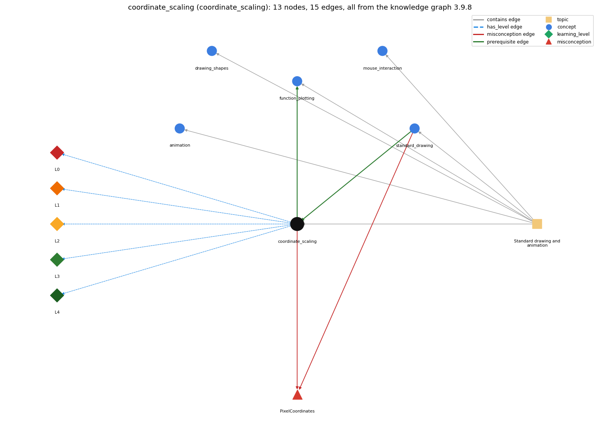

# coordinate_scaling (`coordinate_scaling`)

StdDraw's unit square and setXscale/setYscale

Section 1.5 Input and Output, topic 1.5.e Standard drawing and animation.

## At a glance

- **Needs first:** `standard_drawing`
- **Leads to:** `function_plotting`
- **Learned alongside:** nothing
- **Misconceptions:** `PixelCoordinates`
- **Errors:** none
- **Levels:** L0, L1, L2, L3, L4

Everything below comes from the knowledge graph 3.9.8 (`data/raw/chapter1_kg_updated.json`): 15 edges around this concept, each explained in the graph's own words.

## What it needs first (1)

A prerequisite edge means the other concept has to be understood before `coordinate_scaling`.

### `standard_drawing` comes before `coordinate_scaling`

*StdDraw -- graphical output (book-specific)*

Scaling sets the coordinate system StdDraw uses.

- **Grounding:** book passage
- **How `coordinate_scaling` combines with `standard_drawing`:** The scale fixes how every later StdDraw coordinate is interpreted. The pen radius is unaffected by it.
- **How `standard_drawing` combines with `coordinate_scaling`:** setXscale and setYscale set the coordinate system that every later StdDraw command uses.

## What it leads to (1)

These concepts need `coordinate_scaling` first.

### `coordinate_scaling` comes before `function_plotting`

*sampling a function and joining the points with lines*

Before plotting, the x-scale is set to the interval and the y-scale to the range of function values so the curve fits the canvas.

- **Grounding:** book passage
- **How `coordinate_scaling` combines with `function_plotting`:** Before plotting, set the x-scale to the sampled interval and the y-scale to the function's min and max, so the curve fits the canvas.
- **How `function_plotting` combines with `coordinate_scaling`:** The x-scale must match the sampled interval and the y-scale the function's range; otherwise the curve is clipped or squashed.

## Learned alongside (0)

A parallel edge joins two concepts that sit side by side: neither is needed before the other.

No parallel edge touches this concept.

## Misconceptions (1)

A misconception edge states the wrong rule a student may hold about this concept, and the right rule.

### PixelCoordinates

- **Wrong rule:** StdDraw.point(256, 256) draws in the middle of the default window.
- **Right rule:** The default coordinate scale is the unit square, so the middle is (0.5, 0.5).
- **Role of this concept:** context
- **Shows at level L0 as:** misconception: wrong rule: StdDraw.point(256, 256) draws in the middle of the default window. Right rule: In the default unit square the middle is (0.5, 0.5). Use setXscale(0, 512) and setYscale(0, 512) to work in pixel-like units.
- **Shows at level L0 as:** inconsistent trace: Points to LT (a scale applies to the drawing commands after it). An uneven trace maps some points with the old scale, or applies the x-scale to y. (here mixing in: "StdDraw.point(256, 256) draws in the middle of the default window")
- **Also an edge from `standard_drawing`:** StdDraw.point(256, 256) draws in the middle of the default window.

## Errors (0)

An error edge states the rule that gets broken in a program, and the right rule.

The graph has no error edge from this concept.

## Levels L0 to L4 (5 of 5)

Each level edge lists the ways a student shows that level, each with its exact rule.

### L0: Prestructural / sensorimotor

L0 for coordinate scaling: the answer holds a rule that contradicts Java.

*Deciding question: Does every rule the answer applies to coordinate scaling agree with the language rule? If it reads the code with everyday meanings, applies a wrong rule, or switches rules within one trace, it is L0. A slip in an otherwise rule-correct trace is L2 with an error, not L0.*

coordinate scaling -&gt; L0 (Prestructural): the answer holds a rule that contradicts Java (3 ways).

- **everyday reading** (folk-meaning rule): Graph paper and screens suggest pixel coordinates, or axes that start wherever the data start. StdDraw's default coordinates are the unit square, and setXscale/setYscale map any chosen ranges onto the canvas.
- **misconception** (wrong rule / right rule; shows `PixelCoordinates`): wrong rule: StdDraw.point(256, 256) draws in the middle of the default window. Right rule: In the default unit square the middle is (0.5, 0.5). Use setXscale(0, 512) and setYscale(0, 512) to work in pixel-like units.
- **inconsistent trace** (uneven-application rule; shows `PixelCoordinates`): Points to LT (a scale applies to the drawing commands after it). An uneven trace maps some points with the old scale, or applies the x-scale to y. (here mixing in: "StdDraw.point(256, 256) draws in the middle of the default window")

### L1: Unistructural / atom x text surface

L1 for coordinate scaling: the answer states one correct rule without applying it.

*Deciding question: Does the answer cover every part of the code, in order, with the values (L2)? If it covers one part or only states the rule, it is L1.*

coordinate scaling -&gt; L1 (Unistructural): the answer states one correct rule without applying it (2 ways).

- **names the element** (identity rule): Coordinate scaling is done by StdDraw control commands, setXscale(x0, x1) and setYscale(y0, y1), which choose the user-coordinate ranges mapped onto the canvas.
- **states the rule** (declarative rule): setXscale(x0, x1) followed by setYscale(y0, y1) makes the canvas the box with lower-left corner (x0, y0) and upper-right corner (x1, y1). The no-argument versions reset to the unit square.

### L2: Multistructural / block x execution / preoperational

L2 for coordinate scaling: the answer applies these rules to every part of the code, in order.

*Deciding question: Is the answer many segments mapped onto lines (L2), or one segment stating the purpose of the whole (L3)? A correct output with no value-by-value justification is not levelled.*

coordinate scaling -&gt; L2 (Multistructural): the answer applies the rules of coordinate scaling to every part of the code, in order (3 ways).

- **line by line trace** (operational sequencing rule): The scale calls run first and change the mapping state. Every later drawing command converts its (x, y) through the current mapping. Integer arguments are converted to double.
- **output prediction** (evaluation / result rule): After setXscale(0, N) and setYscale(0, N), line(0, N-i, i, 0) for i = 0..N draws lines spanning the whole canvas, and (N/2, N/2) is the centre. The methods return void.
- **one step execution** (state-transition rule): One scale call changes only the coordinate mapping for one axis. It draws nothing and leaves the existing picture alone.

### L3: Relational / relations x function (concrete operational begins)

L3 for coordinate scaling: the answer relates the parts by these rules.

*Deciding question: Was the purpose deduced from the code, or only guessed from traced input/output pairs (then L2)? Does the answer stay within the given code (L3), or reason about changed code, an error class or a new program (L4)?*

coordinate scaling -&gt; L3 (Relational): the answer relates the parts (3 ways).

- **relation to neighbour** (composition rule (with a neighbour)): The scale fixes how every later StdDraw coordinate is interpreted. The pen radius is unaffected by it.
- **relation to neighbour** (composition rule (with a neighbour)): Before plotting, set the x-scale to the sampled interval and the y-scale to the function's min and max, so the curve fits the canvas.
- **purpose of the whole** (plan / role rule): Scaling matches the drawing to the data, so values can be drawn in their own units.

### L4: Extended abstract (concrete-operational reversibility and conservation)

L4 for coordinate scaling: the answer reasons beyond the given code by these rules.

*Deciding question: Does the answer link the code to a broader context: a changed program, a class of inputs, an unseen problem? Re-tracing changed code value by value is L2; fixing one given failing case is L3.*

coordinate scaling -&gt; L4 (Extended abstract): the answer reasons beyond the given code (4 ways).

- **predict a change** (conservation rule; shows `PixelCoordinates`): Scaling the data and the axis ranges by the same factor leaves the picture the same. The pen radius stays the same whatever the scale.
- **transfer to a new program** (applicability rule): Set the scales whenever the data's natural range is not [0, 1] (plots, maps such as USA.txt, integer grids). Data already normalized to [0, 1] need no scaling.
- **diagnose an error** (error rule): rule broken: Data must fall inside the scaled box to be visible. Kind: silent logic error. Trigger class: The scale is not set, or set to the wrong range (e.g. the y-range misses the function's min and max), so parts of the plot fall off the canvas.
- **diagnose an error** (error rule): rule broken: A scale applies only to drawing done after it. Kind: silent logic error. Trigger class: setXscale is called after the points are drawn, so they were placed in unit-square coordinates.

## Same topic

`coordinate_scaling` belongs to the topic **Standard drawing and animation** (`topic1.5.e`). The topic also contains: `animation`, `drawing_shapes`, `function_plotting`, `mouse_interaction`, `standard_drawing`.

## Rules of the concept (15)

- **folk-meaning rule:** Graph paper and screens suggest pixel coordinates, or axes that start wherever the data start. StdDraw's default coordinates are the unit square, and setXscale/setYscale map any chosen ranges onto the canvas.
- **wrong rule / right rule:** PixelCoordinates: wrong: StdDraw.point(256, 256) draws in the middle of the default window. \| right: In the default unit square the middle is (0.5, 0.5). Use setXscale(0, 512) and setYscale(0, 512) to work in pixel-like units.
- **uneven-application rule:** Points to LT (a scale applies to the drawing commands after it). An uneven trace maps some points with the old scale, or applies the x-scale to y.
- **identity rule:** Coordinate scaling is done by StdDraw control commands, setXscale(x0, x1) and setYscale(y0, y1), which choose the user-coordinate ranges mapped onto the canvas.
- **declarative rule:** setXscale(x0, x1) followed by setYscale(y0, y1) makes the canvas the box with lower-left corner (x0, y0) and upper-right corner (x1, y1). The no-argument versions reset to the unit square.
- **operational sequencing rule:** The scale calls run first and change the mapping state. Every later drawing command converts its (x, y) through the current mapping. Integer arguments are converted to double.
- **evaluation / result rule:** After setXscale(0, N) and setYscale(0, N), line(0, N-i, i, 0) for i = 0..N draws lines spanning the whole canvas, and (N/2, N/2) is the centre. The methods return void.
- **state-transition rule:** One scale call changes only the coordinate mapping for one axis. It draws nothing and leaves the existing picture alone.
- **composition rule (with a neighbour):** with standard\_drawing: The scale fixes how every later StdDraw coordinate is interpreted. The pen radius is unaffected by it.
- **composition rule (with a neighbour):** with function\_plotting: Before plotting, set the x-scale to the sampled interval and the y-scale to the function's min and max, so the curve fits the canvas.
- **plan / role rule:** Scaling matches the drawing to the data, so values can be drawn in their own units.
- **conservation rule:** Scaling the data and the axis ranges by the same factor leaves the picture the same. The pen radius stays the same whatever the scale.
- **error rule:** rule broken: Data must fall inside the scaled box to be visible. (silent logic error)
- **error rule:** rule broken: A scale applies only to drawing done after it. (silent logic error)
- **applicability rule:** Set the scales whenever the data's natural range is not [0, 1] (plots, maps such as USA.txt, integer grids). Data already normalized to [0, 1] need no scaling.

## The whole prerequisite chain

- **Everything it builds on (10):** `api`, `arithmetic_operators`, `data_type`, `expression`, `identifier`, `literal`, `method_call`, `primitive_type`, `standard_drawing`, `variable`
- **Everything that builds on it (2):** `function_plotting`, `standard_audio`
