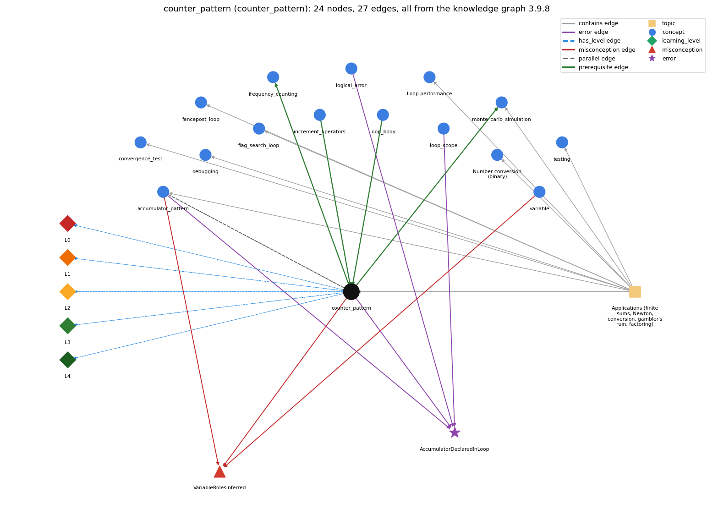

# counter_pattern (`counter_pattern`)

counting occurrences across passes

Section 1.3 Conditionals and Loops, topic 1.3.f Applications (finite sums, Newton, conversion, gambler's ruin, factoring).

## At a glance

- **Needs first:** `increment_operators`, `loop_body`
- **Leads to:** `frequency_counting`, `monte_carlo_simulation`
- **Learned alongside:** `accumulator_pattern`
- **Misconceptions:** `VariableRolesInferred`
- **Errors:** `AccumulatorDeclaredInLoop`
- **Levels:** L0, L1, L2, L3, L4

Everything below comes from the knowledge graph 3.9.8 (`data/raw/chapter1_kg_updated.json`): 27 edges around this concept. The edge logic, the wrong and right rules and the exact rules of the ways are copied word for word from the graph.

## To work on (0)

Nothing is missing for this concept.

## What it needs first (2)

A prerequisite edge means the other concept has to be understood before `counter_pattern`.

### `increment_operators` comes before `counter_pattern`

*++ / -- (and +=)*

- **Edge:** `pre:increment_operators->counter_pattern`
- **Exact edge logic:** A counter is updated with count++, adding one on each pass that matches.
- **Grounding:** book\_passage

### `loop_body` comes before `counter_pattern`

*the block repeated each pass*

- **Edge:** `pre:loop_body->counter_pattern`
- **Exact edge logic:** count++ sits inside the body, usually under an if, so it runs once on every pass that matches.
- **Grounding:** order\_only
- **Composition rule (R) of `counter_pattern` with `loop_body`:** The \`count++\` (with its guard) must be inside the loop body, while the declaration \`int count = 0;\` must be outside and before it. Inside the body it runs once for each matching pass. After the loop it runs only once, so the count is at most 1.
- **Composition rule (R) of `loop_body` with `counter_pattern`:** count++ sits inside the body, often under an if, so it runs once on each pass that matches; the counter is declared before the loop.

## What it leads to (2)

These concepts need `counter_pattern` first.

### `counter_pattern` comes before `frequency_counting`

*tally visits to estimate page rank*

- **Edge:** `pre:counter_pattern->frequency_counting`
- **Exact edge logic:** Frequency counting keeps one counter per value in an array, freq[page]++.
- **Grounding:** book\_passage

### `counter_pattern` comes before `monte_carlo_simulation`

*estimating a probability by repeating random trials*

- **Edge:** `pre:counter_pattern->monte_carlo_simulation`
- **Exact edge logic:** Counting successes is the counter pattern.
- **Grounding:** book\_passage
- **Composition rule (R) of `counter_pattern` with `monte_carlo_simulation`:** A Monte Carlo estimate is the counter divided by the number of trials (\`(double) wins / T\`). So the counter has to be initialised once, before the trial loop, and must not be reset inside it.
- **Composition rule (R) of `monte_carlo_simulation` with `counter_pattern`:** Successes are tallied by a counter declared before the trial loop and incremented once per successful trial. The estimate is that counter divided by T, computed as a double or as \`100\*wins/T\` for a whole-number percentage.

## Learned alongside (1)

A parallel edge joins two concepts that sit side by side: neither is needed before the other.

### `counter_pattern` alongside `accumulator_pattern`

*building up a running total/result*

- **Edge:** `par:accumulator_pattern~counter_pattern`
- **Exact edge logic:** An accumulator adds the current value itself on each pass (sum += x); a counter adds 1 on each pass that matches (count++).
- **Grounding:** order\_only
- **Composition rule (R) of `counter_pattern` with `accumulator_pattern`:** Same skeleton (initialise before, update inside, read after); the accumulator adds the current value (\`sum += x\`), the counter adds the constant 1 on matching passes (\`count++\`). The two are often combined to compute an average \`sum / count\`, which needs a guard against \`count == 0\`.
- **Composition rule (R) of `accumulator_pattern` with `counter_pattern`:** A counter is an accumulator that adds 1 on each pass that matches (count++), whereas an accumulator adds the current value itself (sum += x).

## Misconceptions (1)

A misconception edge states the wrong rule a student may hold about this concept, and the right rule.

### VariableRolesInferred

- **Edge:** `counter_pattern` &rarr; `VariableRolesInferred` (misconception)
- **Exact edge logic (the wrong rule):** The computer recognises that one variable plays two roles, e.g. input value and running total, and keeps the values apart; it knows which variable is the counter and which the sum.
- **Twin logic (the right rule):** A variable holds one value at a time; each role (input, counter, running total) needs its own variable and explicit update.
- **Wrong belief (on the node):** The computer recognises that one variable plays two roles, e.g. input value and running total, and keeps the values apart; it knows which variable is the counter and which the sum.
- **Correct rule (on the node):** A variable holds one value at a time; each role (input, counter, running total) needs its own variable and explicit update.
- **Provenance:** published
- **Role of this concept:** context
- **L0 way linked to it:** yes
- **L0 way [1] misconception, exact rule:** wrong rule: Java recognises which variable is the counter and which is the running total, and keeps their values apart even if one variable is used for both. Right rule: A variable holds one value at a time and Java infers no roles: a counter needs its own variable, initialised before the loop (\`int wins = 0;\`) and updated only by its own statement (\`wins++\`).
- **Edge `accumulator_pattern` &rarr; `VariableRolesInferred`, exact edge logic:** The computer recognises that one variable plays two roles, e.g. input value and running total, and keeps the values apart; it knows which variable is the counter and which the sum. **Twin logic:** A variable holds one value at a time; each role (input, counter, running total) needs its own variable and explicit update. (role: context)
- **Edge `variable` &rarr; `VariableRolesInferred`, exact edge logic:** The computer recognises that one variable plays two roles, e.g. input value and running total, and keeps the values apart; it knows which variable is the counter and which the sum. **Twin logic:** A variable holds one value at a time; each role (input, counter, running total) needs its own variable and explicit update. (role: primary)

## Errors (1)

An error edge states the rule that gets broken in a program, and the right rule.

### AccumulatorDeclaredInLoop

- **Edge:** `counter_pattern` &rarr; `AccumulatorDeclaredInLoop` (error)
- **Exact edge logic (the wrong rule):** Declaring sum inside the loop body keeps a running total across passes.
- **Twin logic (the right rule):** The accumulator must be declared and initialised before the loop.
- **Wrong belief (on the node):** Declaring sum inside the loop body keeps a running total across passes.
- **Correct rule (on the node):** The accumulator must be declared and initialised before the loop.
- **Provenance:** textbook
- **Role of this concept:** context
- **Edge `accumulator_pattern` &rarr; `AccumulatorDeclaredInLoop`, exact edge logic:** Declaring sum inside the loop body keeps a running total across passes. **Twin logic:** The accumulator must be declared and initialised before the loop. (role: context)
- **Edge `logical_error` &rarr; `AccumulatorDeclaredInLoop`, exact edge logic:** Declaring sum inside the loop body keeps a running total across passes. **Twin logic:** The accumulator must be declared and initialised before the loop. (role: context)
- **Edge `loop_scope` &rarr; `AccumulatorDeclaredInLoop`, exact edge logic:** Declaring sum inside the loop body keeps a running total across passes. **Twin logic:** The accumulator must be declared and initialised before the loop. (role: primary)

## Levels L0 to L4 (5 of 5)

Each level edge lists the ways a student shows that level, each with its exact rule.

### L0: Prestructural / sensorimotor

L0 for counter pattern: the answer holds a rule that contradicts Java.

*Deciding question: Does every rule the answer applies to counter pattern agree with the language rule? If it reads the code with everyday meanings, applies a wrong rule, or switches rules within one trace, it is L0. A slip in an otherwise rule-correct trace is L2 with an error, not L0.*

- **Edge:** `counter_pattern` &rarr; `counter_pattern@L0` (has_level)
- **Exact edge logic:** counter pattern -&gt; L0 (Prestructural): the answer holds a rule that contradicts Java (2 ways).

Ways (2), each with its exact rule:

- **[0] everyday\_reading** (rule type E, folk-meaning rule): Folk meaning: 'count' in everyday speech is done by looking at the whole collection at once, so a novice expects \`count\` to 'know' how many items matched. In Java a counter is just an int that changes only when \`count++\` executes, once per matching pass, starting from the value it was given before the loop.
- **[1] misconception** (rule type M, wrong rule / right rule) &rarr; `VariableRolesInferred`: wrong rule: Java recognises which variable is the counter and which is the running total, and keeps their values apart even if one variable is used for both. Right rule: A variable holds one value at a time and Java infers no roles: a counter needs its own variable, initialised before the loop (\`int wins = 0;\`) and updated only by its own statement (\`wins++\`).

### L1: Unistructural / atom x text surface

L1 for counter pattern: the answer states one correct rule without applying it.

*Deciding question: Does the answer cover every part of the code, in order, with the values (L2)? If it covers one part or only states the rule, it is L1.*

- **Edge:** `counter_pattern` &rarr; `counter_pattern@L1` (has_level)
- **Exact edge logic:** counter pattern -&gt; L1 (Unistructural): the answer states one correct rule without applying it (2 ways).

Ways (2), each with its exact rule:

- **[0] names\_the\_element** (rule type N, identity rule): Loop plan (Soloway counter plan): an int variable set to 0 before a loop and increased by 1 on each pass that meets a condition, so it ends holding the number of matches.
- **[1] states\_the\_rule** (rule type S, declarative rule): Declare and initialise the counter before the loop (\`int wins = 0;\`); inside the loop guard \`wins++\` with the condition being counted (\`if (cash == goal) wins++;\`); read it after the loop.

### L2: Multistructural / block x execution / preoperational

L2 for counter pattern: the answer applies these rules to every part of the code, in order.

*Deciding question: Is the answer many segments mapped onto lines (L2), or one segment stating the purpose of the whole (L3)? A correct output with no value-by-value justification is not levelled.*

- **Edge:** `counter_pattern` &rarr; `counter_pattern@L2` (has_level)
- **Exact edge logic:** counter pattern -&gt; L2 (Multistructural): the answer applies the rules of counter pattern to every part of the code, in order (3 ways).

Ways (3), each with its exact rule:

- **[0] line\_by\_line\_trace** (rule type LT, operational sequencing rule): Order: the initialisation \`count = 0\` runs once before the loop; then on each pass the loop test, the guard (\`if (...)\`) and, only when the guard is true, \`count++\`; the counter is read once after the loop ends.
- **[1] output\_prediction** (rule type OP, evaluation / result rule): The result is an int equal to the number of passes on which the guard was true (0 if none); it is between 0 and the number of passes. Turning it into a rate with ints truncates: \`100\*wins/T\` with wins = 503, T = 1000 prints 50.
- **[2] one\_step\_execution** (rule type OS, state-transition rule): One matching pass changes only the counter, by exactly +1 (\`wins++\` turns 7 into 8); a non-matching pass leaves it unchanged. \`count++\` as a statement returns nothing that is used.

### L3: Relational / relations x function (concrete operational begins)

L3 for counter pattern: the answer relates the parts by these rules.

*Deciding question: Was the purpose deduced from the code, or only guessed from traced input/output pairs (then L2)? Does the answer stay within the given code (L3), or reason about changed code, an error class or a new program (L4)?*

- **Edge:** `counter_pattern` &rarr; `counter_pattern@L3` (has_level)
- **Exact edge logic:** counter pattern -&gt; L3 (Relational): the answer relates the parts (4 ways).

Ways (4), each with its exact rule:

- **[0] relation\_to\_neighbour** (rule type R, composition rule (with a neighbour)): The \`count++\` (with its guard) must be inside the loop body, while the declaration \`int count = 0;\` must be outside and before it. Inside the body it runs once for each matching pass. After the loop it runs only once, so the count is at most 1.
- **[1] relation\_to\_neighbour** (rule type R, composition rule (with a neighbour)): Same skeleton (initialise before, update inside, read after); the accumulator adds the current value (\`sum += x\`), the counter adds the constant 1 on matching passes (\`count++\`). The two are often combined to compute an average \`sum / count\`, which needs a guard against \`count == 0\`.
- **[2] relation\_to\_neighbour** (rule type R, composition rule (with a neighbour)): A Monte Carlo estimate is the counter divided by the number of trials (\`(double) wins / T\`). So the counter has to be initialised once, before the trial loop, and must not be reset inside it.
- **[3] purpose\_of\_the\_whole** (rule type P, plan / role rule): Plan: counting plan; the counter variable plays a Sajaniemi 'stepper'-like counting role (Soloway's counter variable). Its job is to answer 'how many passes satisfied P?', e.g. wins or number of bets.

### L4: Extended abstract (concrete-operational reversibility and conservation)

L4 for counter pattern: the answer reasons beyond the given code by these rules.

*Deciding question: Does the answer link the code to a broader context: a changed program, a class of inputs, an unseen problem? Re-tracing changed code value by value is L2; fixing one given failing case is L3.*

- **Edge:** `counter_pattern` &rarr; `counter_pattern@L4` (has_level)
- **Exact edge logic:** counter pattern -&gt; L4 (Extended abstract): the answer reasons beyond the given code (6 ways).

Ways (6), each with its exact rule:

- **[0] predict\_a\_change** (rule type C, conservation rule): Invariant: after k passes, count equals the number of matching passes among those k. Moving the guard or the update changes the count. Moving \`count++\` out of the \`if\` turns it into a pass counter. Starting at 1 instead of 0 makes every result one too high. Reordering statements that do not touch count leaves it unchanged.
- **[1] diagnose\_an\_error** (rule type D, error rule): rule broken: The counter/accumulator must be declared and initialised before the loop. \`int count = 0;\` inside the body re-creates and resets it on every pass. Kind: silent logic error. Trigger class: Any loop with two or more passes: the count never exceeds 1 (or holds only the last pass).
- **[2] transfer\_to\_a\_new\_program** (rule type X, applicability rule): Use a counter when the question is 'how many' (wins, bets, primes, distinct values); use an accumulator when it is 'how much in total', and a boolean flag when you only need 'whether any'. When you need a count for each of many values, use an array of counters (a histogram) instead of many separate variables.
- **[3] diagnose\_an\_error** (rule type D, error rule): rule broken: A variable declared inside the loop body is out of scope after the loop. Kind: compile-time. Trigger class: Printing or using a counter after the loop when it was declared inside the body (cannot find symbol).
- **[4] diagnose\_an\_error** (rule type D, error rule): rule broken: Integer division truncates: a rate computed as \`count / total\` with ints is 0 whenever count &lt; total. Kind: silent logic error. Trigger class: Converting a count to a fraction or percentage with int operands (e.g. \`wins / T\`) instead of \`(double) wins / T\` or \`100\*wins/T\`.
- **[5] diagnose\_an\_error** (rule type D, error rule): rule broken: A local counter must be definitely assigned before it is read. Kind: compile-time. Trigger class: Declaring \`int count;\` without \`= 0\` and then executing \`count++\` (variable might not have been initialized).

## Same topic

`counter_pattern` belongs to the topic **Applications (finite sums, Newton, conversion, gambler's ruin, factoring)** (`topic1.3.f`). The topic also contains: `accumulator_pattern`, `convergence_test`, `debugging`, `fencepost_loop`, `flag_search_loop`, `loop_performance`, `monte_carlo_simulation`, `number_conversion`, `testing`.

## Rules of the concept (18)

- **Book** (SW-1e, p. 67 (pdf 77)): "continuing until the gambler is broke or the goal is reached, and keeping track of the number of wins and the number of bets."
- **Book** (SW-1.3, ): "It uses two variables-one as an index that controls a loop, and the other to accumulate a computational result."
- **E** (folk-meaning rule): Folk meaning: 'count' in everyday speech is done by looking at the whole collection at once, so a novice expects \`count\` to 'know' how many items matched. In Java a counter is just an int that changes only when \`count++\` executes, once per matching pass, starting from the value it was given before the loop.
- **M** (wrong rule / right rule): VariableRolesInferred: wrong: Java recognises which variable is the counter and which is the running total, and keeps their values apart even if one variable is used for both. \| right: A variable holds one value at a time and Java infers no roles: a counter needs its own variable, initialised before the loop (\`int wins = 0;\`) and updated only by its own statement (\`wins++\`).
- **T** (uneven-application rule): Applies the LT rule (test the condition, then \`count++\` only on passes where it holds) unevenly: increments on a pass whose test was false, skips one matching pass, or forgets that the counter keeps its value from the previous pass, so the traced final count is off by one or more.
- **N** (identity rule): Loop plan (Soloway counter plan): an int variable set to 0 before a loop and increased by 1 on each pass that meets a condition, so it ends holding the number of matches.
- **S** (declarative rule): Declare and initialise the counter before the loop (\`int wins = 0;\`); inside the loop guard \`wins++\` with the condition being counted (\`if (cash == goal) wins++;\`); read it after the loop.
- **LT** (operational sequencing rule): Order: the initialisation \`count = 0\` runs once before the loop; then on each pass the loop test, the guard (\`if (...)\`) and, only when the guard is true, \`count++\`; the counter is read once after the loop ends.
- **OP** (evaluation / result rule): The result is an int equal to the number of passes on which the guard was true (0 if none); it is between 0 and the number of passes. Turning it into a rate with ints truncates: \`100\*wins/T\` with wins = 503, T = 1000 prints 50.
- **OS** (state-transition rule): One matching pass changes only the counter, by exactly +1 (\`wins++\` turns 7 into 8); a non-matching pass leaves it unchanged. \`count++\` as a statement returns nothing that is used.
- **R** (composition rule (with a neighbour)): with loop\_body: The \`count++\` (with its guard) must be inside the loop body, while the declaration \`int count = 0;\` must be outside and before it. Inside the body it runs once for each matching pass. After the loop it runs only once, so the count is at most 1.
- **R** (composition rule (with a neighbour)): with accumulator\_pattern: Same skeleton (initialise before, update inside, read after); the accumulator adds the current value (\`sum += x\`), the counter adds the constant 1 on matching passes (\`count++\`). The two are often combined to compute an average \`sum / count\`, which needs a guard against \`count == 0\`.
- **R** (composition rule (with a neighbour)): with monte\_carlo\_simulation: A Monte Carlo estimate is the counter divided by the number of trials (\`(double) wins / T\`). So the counter has to be initialised once, before the trial loop, and must not be reset inside it.
- **P** (plan / role rule): Plan: counting plan; the counter variable plays a Sajaniemi 'stepper'-like counting role (Soloway's counter variable). Its job is to answer 'how many passes satisfied P?', e.g. wins or number of bets.
- **C** (conservation rule): Invariant: after k passes, count equals the number of matching passes among those k. Moving the guard or the update changes the count. Moving \`count++\` out of the \`if\` turns it into a pass counter. Starting at 1 instead of 0 makes every result one too high. Reordering statements that do not touch count leaves it unchanged.
- **D** (error rule): rule broken: The counter/accumulator must be declared and initialised before the loop. \`int count = 0;\` inside the body re-creates and resets it on every pass. (silent logic error)
- **D** (error rule): rule broken: A variable declared inside the loop body is out of scope after the loop. (compile-time)
- **D** (error rule): rule broken: Integer division truncates: a rate computed as \`count / total\` with ints is 0 whenever count &lt; total. (silent logic error)
- **D** (error rule): rule broken: A local counter must be definitely assigned before it is read. (compile-time)
- **X** (applicability rule): Use a counter when the question is 'how many' (wins, bets, primes, distinct values); use an accumulator when it is 'how much in total', and a boolean flag when you only need 'whether any'. When you need a count for each of many values, use an array of counters (a histogram) instead of many separate variables.

## How it is found in code and answers (reader block)

- **Aliases:** counter, counter variable
- **Code patterns:** `\bif\s*\((?:[^()]|\([^()]*\))*\)\s*\{?\s*\w+\s*(?:\+\+|\+=\s*1\s*;)`, `\bcount\w*\s*(?:\+\+|\+=)`, `\]\s*\+\+`, `(?i)\b\w*count\w*\s*=\s*\w*count\w*\s*\+\s*1`
- **Operator symbols:** none
- **Java types:** none

## The whole prerequisite chain

- **Everything it builds on (20):** `arithmetic_operators`, `assignment`, `boolean`, `boolean_expression`, `comparison_operators`, `data_type`, `declaration`, `do_while_loop`, `expression`, `for_loop`, `identifier`, `increment_operators`, `literal`, `logical_operators`, `loop_body`, `loop_control`, `loop_variable`, `primitive_type`, `variable`, `while_loop`
- **Everything that builds on it (3):** `frequency_counting`, `monte_carlo_simulation`, `two_models`

## Every edge in this view and its exact edge logic (27)

All the edges drawn in the picture, in the order: prerequisite, parallel, misconception, error, has_level, contains.

**1. `counter_pattern` &rarr; `frequency_counting`** (prerequisite)

- **Exact edge logic:** Frequency counting keeps one counter per value in an array, freq[page]++.
- **Grounding:** book\_passage

**2. `counter_pattern` &rarr; `monte_carlo_simulation`** (prerequisite)

- **Exact edge logic:** Counting successes is the counter pattern.
- **Grounding:** book\_passage
- **Composition rule (R) of `counter_pattern` with `monte_carlo_simulation`:** A Monte Carlo estimate is the counter divided by the number of trials (\`(double) wins / T\`). So the counter has to be initialised once, before the trial loop, and must not be reset inside it.
- **Composition rule (R) of `monte_carlo_simulation` with `counter_pattern`:** Successes are tallied by a counter declared before the trial loop and incremented once per successful trial. The estimate is that counter divided by T, computed as a double or as \`100\*wins/T\` for a whole-number percentage.

**3. `increment_operators` &rarr; `counter_pattern`** (prerequisite)

- **Exact edge logic:** A counter is updated with count++, adding one on each pass that matches.
- **Grounding:** book\_passage

**4. `loop_body` &rarr; `counter_pattern`** (prerequisite)

- **Exact edge logic:** count++ sits inside the body, usually under an if, so it runs once on every pass that matches.
- **Grounding:** order\_only
- **Composition rule (R) of `loop_body` with `counter_pattern`:** count++ sits inside the body, often under an if, so it runs once on each pass that matches; the counter is declared before the loop.
- **Composition rule (R) of `counter_pattern` with `loop_body`:** The \`count++\` (with its guard) must be inside the loop body, while the declaration \`int count = 0;\` must be outside and before it. Inside the body it runs once for each matching pass. After the loop it runs only once, so the count is at most 1.

**5. `accumulator_pattern` &harr; `counter_pattern`** (parallel)

- **Exact edge logic:** An accumulator adds the current value itself on each pass (sum += x); a counter adds 1 on each pass that matches (count++).
- **Grounding:** order\_only
- **Composition rule (R) of `accumulator_pattern` with `counter_pattern`:** A counter is an accumulator that adds 1 on each pass that matches (count++), whereas an accumulator adds the current value itself (sum += x).
- **Composition rule (R) of `counter_pattern` with `accumulator_pattern`:** Same skeleton (initialise before, update inside, read after); the accumulator adds the current value (\`sum += x\`), the counter adds the constant 1 on matching passes (\`count++\`). The two are often combined to compute an average \`sum / count\`, which needs a guard against \`count == 0\`.

**6. `counter_pattern` &rarr; `VariableRolesInferred`** (misconception)

- **Exact edge logic (the wrong rule):** The computer recognises that one variable plays two roles, e.g. input value and running total, and keeps the values apart; it knows which variable is the counter and which the sum.
- **Twin logic (the right rule):** A variable holds one value at a time; each role (input, counter, running total) needs its own variable and explicit update.
- **Role:** context

**7. `accumulator_pattern` &rarr; `VariableRolesInferred`** (misconception)

- **Exact edge logic (the wrong rule):** The computer recognises that one variable plays two roles, e.g. input value and running total, and keeps the values apart; it knows which variable is the counter and which the sum.
- **Twin logic (the right rule):** A variable holds one value at a time; each role (input, counter, running total) needs its own variable and explicit update.
- **Role:** context

**8. `variable` &rarr; `VariableRolesInferred`** (misconception)

- **Exact edge logic (the wrong rule):** The computer recognises that one variable plays two roles, e.g. input value and running total, and keeps the values apart; it knows which variable is the counter and which the sum.
- **Twin logic (the right rule):** A variable holds one value at a time; each role (input, counter, running total) needs its own variable and explicit update.
- **Role:** primary

**9. `counter_pattern` &rarr; `AccumulatorDeclaredInLoop`** (error)

- **Exact edge logic (the wrong rule):** Declaring sum inside the loop body keeps a running total across passes.
- **Twin logic (the right rule):** The accumulator must be declared and initialised before the loop.
- **Role:** context

**10. `accumulator_pattern` &rarr; `AccumulatorDeclaredInLoop`** (error)

- **Exact edge logic (the wrong rule):** Declaring sum inside the loop body keeps a running total across passes.
- **Twin logic (the right rule):** The accumulator must be declared and initialised before the loop.
- **Role:** context

**11. `logical_error` &rarr; `AccumulatorDeclaredInLoop`** (error)

- **Exact edge logic (the wrong rule):** Declaring sum inside the loop body keeps a running total across passes.
- **Twin logic (the right rule):** The accumulator must be declared and initialised before the loop.
- **Role:** context

**12. `loop_scope` &rarr; `AccumulatorDeclaredInLoop`** (error)

- **Exact edge logic (the wrong rule):** Declaring sum inside the loop body keeps a running total across passes.
- **Twin logic (the right rule):** The accumulator must be declared and initialised before the loop.
- **Role:** primary

**13. `counter_pattern` &rarr; `counter_pattern@L0`** (has_level)

- **Exact edge logic:** counter pattern -&gt; L0 (Prestructural): the answer holds a rule that contradicts Java (2 ways).
  - **[0] everyday\_reading** (rule type E, folk-meaning rule): Folk meaning: 'count' in everyday speech is done by looking at the whole collection at once, so a novice expects \`count\` to 'know' how many items matched. In Java a counter is just an int that changes only when \`count++\` executes, once per matching pass, starting from the value it was given before the loop.
  - **[1] misconception** (rule type M, wrong rule / right rule) &rarr; `VariableRolesInferred`: wrong rule: Java recognises which variable is the counter and which is the running total, and keeps their values apart even if one variable is used for both. Right rule: A variable holds one value at a time and Java infers no roles: a counter needs its own variable, initialised before the loop (\`int wins = 0;\`) and updated only by its own statement (\`wins++\`).

**14. `counter_pattern` &rarr; `counter_pattern@L1`** (has_level)

- **Exact edge logic:** counter pattern -&gt; L1 (Unistructural): the answer states one correct rule without applying it (2 ways).
  - **[0] names\_the\_element** (rule type N, identity rule): Loop plan (Soloway counter plan): an int variable set to 0 before a loop and increased by 1 on each pass that meets a condition, so it ends holding the number of matches.
  - **[1] states\_the\_rule** (rule type S, declarative rule): Declare and initialise the counter before the loop (\`int wins = 0;\`); inside the loop guard \`wins++\` with the condition being counted (\`if (cash == goal) wins++;\`); read it after the loop.

**15. `counter_pattern` &rarr; `counter_pattern@L2`** (has_level)

- **Exact edge logic:** counter pattern -&gt; L2 (Multistructural): the answer applies the rules of counter pattern to every part of the code, in order (3 ways).
  - **[0] line\_by\_line\_trace** (rule type LT, operational sequencing rule): Order: the initialisation \`count = 0\` runs once before the loop; then on each pass the loop test, the guard (\`if (...)\`) and, only when the guard is true, \`count++\`; the counter is read once after the loop ends.
  - **[1] output\_prediction** (rule type OP, evaluation / result rule): The result is an int equal to the number of passes on which the guard was true (0 if none); it is between 0 and the number of passes. Turning it into a rate with ints truncates: \`100\*wins/T\` with wins = 503, T = 1000 prints 50.
  - **[2] one\_step\_execution** (rule type OS, state-transition rule): One matching pass changes only the counter, by exactly +1 (\`wins++\` turns 7 into 8); a non-matching pass leaves it unchanged. \`count++\` as a statement returns nothing that is used.

**16. `counter_pattern` &rarr; `counter_pattern@L3`** (has_level)

- **Exact edge logic:** counter pattern -&gt; L3 (Relational): the answer relates the parts (4 ways).
  - **[0] relation\_to\_neighbour** (rule type R, composition rule (with a neighbour)): The \`count++\` (with its guard) must be inside the loop body, while the declaration \`int count = 0;\` must be outside and before it. Inside the body it runs once for each matching pass. After the loop it runs only once, so the count is at most 1.
  - **[1] relation\_to\_neighbour** (rule type R, composition rule (with a neighbour)): Same skeleton (initialise before, update inside, read after); the accumulator adds the current value (\`sum += x\`), the counter adds the constant 1 on matching passes (\`count++\`). The two are often combined to compute an average \`sum / count\`, which needs a guard against \`count == 0\`.
  - **[2] relation\_to\_neighbour** (rule type R, composition rule (with a neighbour)): A Monte Carlo estimate is the counter divided by the number of trials (\`(double) wins / T\`). So the counter has to be initialised once, before the trial loop, and must not be reset inside it.
  - **[3] purpose\_of\_the\_whole** (rule type P, plan / role rule): Plan: counting plan; the counter variable plays a Sajaniemi 'stepper'-like counting role (Soloway's counter variable). Its job is to answer 'how many passes satisfied P?', e.g. wins or number of bets.

**17. `counter_pattern` &rarr; `counter_pattern@L4`** (has_level)

- **Exact edge logic:** counter pattern -&gt; L4 (Extended abstract): the answer reasons beyond the given code (6 ways).
  - **[0] predict\_a\_change** (rule type C, conservation rule): Invariant: after k passes, count equals the number of matching passes among those k. Moving the guard or the update changes the count. Moving \`count++\` out of the \`if\` turns it into a pass counter. Starting at 1 instead of 0 makes every result one too high. Reordering statements that do not touch count leaves it unchanged.
  - **[1] diagnose\_an\_error** (rule type D, error rule): rule broken: The counter/accumulator must be declared and initialised before the loop. \`int count = 0;\` inside the body re-creates and resets it on every pass. Kind: silent logic error. Trigger class: Any loop with two or more passes: the count never exceeds 1 (or holds only the last pass).
  - **[2] transfer\_to\_a\_new\_program** (rule type X, applicability rule): Use a counter when the question is 'how many' (wins, bets, primes, distinct values); use an accumulator when it is 'how much in total', and a boolean flag when you only need 'whether any'. When you need a count for each of many values, use an array of counters (a histogram) instead of many separate variables.
  - **[3] diagnose\_an\_error** (rule type D, error rule): rule broken: A variable declared inside the loop body is out of scope after the loop. Kind: compile-time. Trigger class: Printing or using a counter after the loop when it was declared inside the body (cannot find symbol).
  - **[4] diagnose\_an\_error** (rule type D, error rule): rule broken: Integer division truncates: a rate computed as \`count / total\` with ints is 0 whenever count &lt; total. Kind: silent logic error. Trigger class: Converting a count to a fraction or percentage with int operands (e.g. \`wins / T\`) instead of \`(double) wins / T\` or \`100\*wins/T\`.
  - **[5] diagnose\_an\_error** (rule type D, error rule): rule broken: A local counter must be definitely assigned before it is read. Kind: compile-time. Trigger class: Declaring \`int count;\` without \`= 0\` and then executing \`count++\` (variable might not have been initialized).

**18. `topic1.3.f` &rarr; `counter_pattern`** (contains)

- topic `topic1.3.f` contains `counter_pattern`

**19. `topic1.3.f` &rarr; `accumulator_pattern`** (contains)

- topic `topic1.3.f` contains `accumulator_pattern`

**20. `topic1.3.f` &rarr; `convergence_test`** (contains)

- topic `topic1.3.f` contains `convergence_test`

**21. `topic1.3.f` &rarr; `debugging`** (contains)

- topic `topic1.3.f` contains `debugging`

**22. `topic1.3.f` &rarr; `fencepost_loop`** (contains)

- topic `topic1.3.f` contains `fencepost_loop`

**23. `topic1.3.f` &rarr; `flag_search_loop`** (contains)

- topic `topic1.3.f` contains `flag_search_loop`

**24. `topic1.3.f` &rarr; `loop_performance`** (contains)

- topic `topic1.3.f` contains `loop_performance`

**25. `topic1.3.f` &rarr; `monte_carlo_simulation`** (contains)

- topic `topic1.3.f` contains `monte_carlo_simulation`

**26. `topic1.3.f` &rarr; `number_conversion`** (contains)

- topic `topic1.3.f` contains `number_conversion`

**27. `topic1.3.f` &rarr; `testing`** (contains)

- topic `topic1.3.f` contains `testing`
