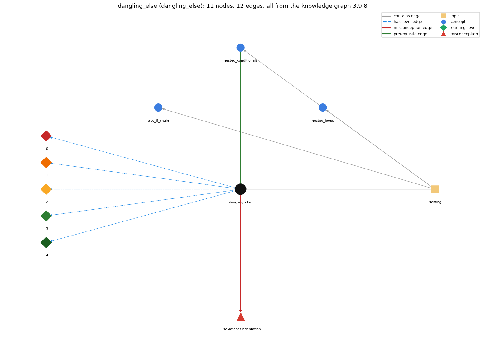

# dangling_else (`dangling_else`)

an else belongs to the nearest unmatched if

Section 1.3 Conditionals and Loops, topic 1.3.e Nesting. From the knowledge graph 3.9.8 (`data/raw/chapter1_kg_updated.json`).

## Concepts associated with dangling\_else (3)

| Concept | Description | How it is associated |
| --- | --- | --- |
| **else\_if\_chain** | if ... else if ... else picks exactly one branch | same topic (topic1.3.e) |
| **nested\_conditionals** | else-if chains and conditionals inside conditionals | prerequisite of it (it needs this) composition rule (R) with it shares misconception ElseMatchesIndentation same topic (topic1.3.e) |
| **nested\_loops** | a loop inside a loop | same topic (topic1.3.e) |

## Every edge in this view and its full label (12)

| From | Edge | To | Full edge label |
| --- | --- | --- | --- |
| **nested\_conditionals** | prerequisite | **dangling\_else** | The dangling else arises when ifs are nested without braces. grounding: book\_passage composition rule (R) of nested\_conditionals with dangling\_else: The dangling-else ambiguity arises when ifs are nested without braces: if &lt;e1&gt; if &lt;e2&gt; A else B attaches else to the inner if. composition rule (R) of dangling\_else with nested\_conditionals: The dangling else arises only when ifs are nested without braces; adding braces around the inner if lets the else belong to the outer if. |
| **dangling\_else** | misconception | **ElseMatchesIndentation** | **wrong rule:** The else belongs to the if it is lined up with. **right rule:** The else belongs to the most recent unmatched if, whatever the indentation. role: primary |
| **nested\_conditionals** | misconception | **ElseMatchesIndentation** | **wrong rule:** The else belongs to the if it is lined up with. **right rule:** The else belongs to the most recent unmatched if, whatever the indentation. role: context |
| **dangling\_else** | has\_level | **dangling\_else@L0** | dangling else -&gt; L0 (Prestructural): the answer holds a rule that contradicts Java (3 ways). **[0] everyday\_reading** (E): Folk meaning: on paper the layout shows which 'if' an 'otherwise' answers, so an else lined up with the outer if is read as belonging to it. Java ignores indentation and attaches each else to the innermost if to which it might possibly belong. **[1] misconception** (M) &rarr; ElseMatchesIndentation: wrong rule: The else belongs to the if it is lined up with. Right rule: The else belongs to the most recent unmatched if, whatever the indentation. **[2] inconsistent\_trace** (T) &rarr; ElseMatchesIndentation: Applies the matching rule (LT) unevenly: attaches the else to the inner if in one fragment but to the outer if in a similarly indented one. (here mixing in: "The else belongs to the if it is lined up with") |
| **dangling\_else** | has\_level | **dangling\_else@L1** | dangling else -&gt; L1 (Unistructural): the answer states one correct rule without applying it (2 ways). **[0] names\_the\_element** (N): The dangling else is the ambiguity of an else after two nested ifs without braces: it could belong to either if. **[1] states\_the\_rule** (S): Java decrees that an else clause belongs to the innermost if to which it might possibly belong: if &lt;e1&gt; if &lt;e2&gt; A else B means if &lt;e1&gt; { if &lt;e2&gt; A else B }. |
| **dangling\_else** | has\_level | **dangling\_else@L2** | dangling else -&gt; L2 (Multistructural): the answer applies the rules of dangling else to every part of the code, in order (3 ways). **[0] line\_by\_line\_trace** (LT): Parse first: match each else with the nearest preceding unmatched if; then execute: test e1; only if true test e2, running A if e2 is true and B if e2 is false; if e1 is false nothing runs. **[1] output\_prediction** (OP): For if (x &gt; 0) if (y &gt; 0) A; else B;: x &gt; 0, y &gt; 0 runs A; x &gt; 0, y &lt;= 0 runs B; x &lt;= 0 runs neither, even if the else was indented under the outer if. **[2] one\_step\_execution** (OS): One execution tests e1 and, only if it is true, e2; it runs at most one of A and B. |
| **dangling\_else** | has\_level | **dangling\_else@L3** | dangling else -&gt; L3 (Relational): the answer relates the parts (2 ways). **[0] relation\_to\_neighbour** (R): The dangling else arises only when ifs are nested without braces; adding braces around the inner if lets the else belong to the outer if. **[1] purpose\_of\_the\_whole** (P): Purpose: not a technique but a pitfall to recognise; braces state the intended pairing explicitly. |
| **dangling\_else** | has\_level | **dangling\_else@L4** | dangling else -&gt; L4 (Extended abstract): the answer reasons beyond the given code (3 ways). **[0] predict\_a\_change** (C) &rarr; ElseMatchesIndentation: Adding braces { if (e2) A } before the else moves the else to the outer if and changes the behaviour for e1 false; re-indenting the code changes nothing. **[1] transfer\_to\_a\_new\_program** (X): Whenever an if without braces contains another if and an else follows, add braces to state which if the else belongs to; coding standards require brackets for this reason. **[2] diagnose\_an\_error** (D): rule broken: An else belongs to the innermost unmatched if. Kind: silent logic error. Trigger class: Nested braceless ifs with the else indented under the outer if: the else case runs for inner-false inputs and never for outer-false inputs. |
| **topic1.3.e** | contains | **dangling\_else** | topic topic1.3.e contains dangling\_else |
| **topic1.3.e** | contains | **else\_if\_chain** | topic topic1.3.e contains else\_if\_chain |
| **topic1.3.e** | contains | **nested\_conditionals** | topic topic1.3.e contains nested\_conditionals |
| **topic1.3.e** | contains | **nested\_loops** | topic topic1.3.e contains nested\_loops |
