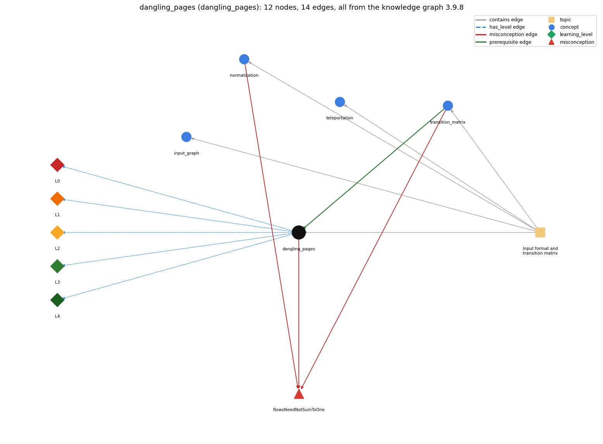

# dangling_pages (`dangling_pages`)

pages with no outgoing links

Section 1.6 Case Study: Random Web Surfer, topic 1.6.a Input format and transition matrix.

## At a glance

- **Needs first:** `transition_matrix`
- **Leads to:** nothing
- **Learned alongside:** nothing
- **Misconceptions:** `RowsNeedNotSumToOne`
- **Errors:** none
- **Levels:** L0, L1, L2, L3, L4

Everything below comes from the knowledge graph 3.9.8 (`data/raw/chapter1_kg_updated.json`): 14 edges around this concept. The edge logic, the wrong and right rules and the exact rules of the ways are copied word for word from the graph.

## To work on (1)

- no aliases: a student's words cannot name this concept

## What it needs first (1)

A prerequisite edge means the other concept has to be understood before `dangling_pages`.

### `transition_matrix` comes before `dangling_pages`

*a 2-D array of move probabilities (rows sum to 1)*

- **Edge:** `pre:transition_matrix->dangling_pages`
- **Exact edge logic:** Transition assumes that every page has an outgoing link; Exercise 1.6.3 handles a page with no outgoing links by filling its row of the transition matrix with 1/N.
- **Grounding:** book\_passage
- **Composition rule (R) of `dangling_pages` with `transition_matrix`:** A dangling page is the case where the matrix formula breaks (division by outDegree 0); the 1/N row replaces it so the matrix stays stochastic.
- **Composition rule (R) of `transition_matrix` with `dangling_pages`:** Transition's formula is valid only if every outDegree[i] &gt; 0; a page with no outlinks must have its row filled with 1/N.

## What it leads to (0)

These concepts need `dangling_pages` first.

No concept has this one as a prerequisite.

## Learned alongside (0)

A parallel edge joins two concepts that sit side by side: neither is needed before the other.

No parallel edge touches this concept.

## Misconceptions (1)

A misconception edge states the wrong rule a student may hold about this concept, and the right rule.

### RowsNeedNotSumToOne

- **Edge:** `dangling_pages` &rarr; `RowsNeedNotSumToOne` (misconception)
- **Exact edge logic (the wrong rule):** A page with no outgoing links can have an all-zero row.
- **Twin logic (the right rule):** Each row is a probability distribution; a page with no links is made equally likely to move to every page.
- **Wrong belief (on the node):** A page with no outgoing links can have an all-zero row.
- **Correct rule (on the node):** Each row is a probability distribution; a page with no links is made equally likely to move to every page.
- **Provenance:** textbook
- **Role of this concept:** primary
- **L0 way linked to it:** yes
- **L0 way [1] misconception, exact rule:** wrong rule: A page with no outgoing links can have an all-zero row. Right rule: Every row must sum to 1; fill the row of a page with no outgoing links with 1/N (equally likely to go to every page).
- **L0 way [2] inconsistent\_trace, exact rule:** Applies LT (test outDegree[i] == 0 before dividing; if so use 1.0/N for the whole row) unevenly: e.g. tests only on the first column, or still adds the .10/N leap term to the 1/N entries so the row sums to more than 1. (here mixing in: "A page with no outgoing links can have an all-zero row")
- **Edge `normalization` &rarr; `RowsNeedNotSumToOne`, exact edge logic:** A page with no outgoing links can have an all-zero row. **Twin logic:** Each row is a probability distribution; a page with no links is made equally likely to move to every page. (role: context)
- **Edge `transition_matrix` &rarr; `RowsNeedNotSumToOne`, exact edge logic:** A page with no outgoing links can have an all-zero row. **Twin logic:** Each row is a probability distribution; a page with no links is made equally likely to move to every page. (role: context)

## Errors (0)

An error edge states the rule that gets broken in a program, and the right rule.

The graph has no error edge from this concept.

## Levels L0 to L4 (5 of 5)

Each level edge lists the ways a student shows that level, each with its exact rule.

### L0: Prestructural / sensorimotor

L0 for dangling pages: the answer holds a rule that contradicts Java.

*Deciding question: Does every rule the answer applies to dangling pages agree with the language rule? If it reads the code with everyday meanings, applies a wrong rule, or switches rules within one trace, it is L0. A slip in an otherwise rule-correct trace is L2 with an error, not L0.*

- **Edge:** `dangling_pages` &rarr; `dangling_pages@L0` (has_level)
- **Exact edge logic:** dangling pages -&gt; L0 (Prestructural): the answer holds a rule that contradicts Java (3 ways).

Ways (3), each with its exact rule:

- **[0] everyday\_reading** (rule type E, folk-meaning rule): Everyday reading of a "dead-end" page is that the surfer just stops or stays there; in the model the surfer always goes somewhere, so a page with no outlinks must still have a full probability row (1/N to every page).
- **[1] misconception** (rule type M, wrong rule / right rule) &rarr; `RowsNeedNotSumToOne`: wrong rule: A page with no outgoing links can have an all-zero row. Right rule: Every row must sum to 1; fill the row of a page with no outgoing links with 1/N (equally likely to go to every page).
- **[2] inconsistent\_trace** (rule type T, uneven-application rule) &rarr; `RowsNeedNotSumToOne`: Applies LT (test outDegree[i] == 0 before dividing; if so use 1.0/N for the whole row) unevenly: e.g. tests only on the first column, or still adds the .10/N leap term to the 1/N entries so the row sums to more than 1. (here mixing in: "A page with no outgoing links can have an all-zero row")

### L1: Unistructural / atom x text surface

L1 for dangling pages: the answer states one correct rule without applying it.

*Deciding question: Does the answer cover every part of the code, in order, with the values (L2)? If it covers one part or only states the rule, it is L1.*

- **Edge:** `dangling_pages` &rarr; `dangling_pages@L1` (has_level)
- **Exact edge logic:** dangling pages -&gt; L1 (Unistructural): the answer states one correct rule without applying it (2 ways).

Ways (2), each with its exact rule:

- **[0] names\_the\_element** (rule type N, identity rule): A page with no outgoing links (outDegree 0), also called a dangling page or sink; spider traps are sets of such pages.
- **[1] states\_the\_rule** (rule type S, declarative rule): Transition assumes there are none; to handle them, fill the row of every page with no outgoing links with 1/N, which keeps the matrix stochastic.

### L2: Multistructural / block x execution / preoperational

L2 for dangling pages: the answer applies these rules to every part of the code, in order.

*Deciding question: Is the answer many segments mapped onto lines (L2), or one segment stating the purpose of the whole (L3)? A correct output with no value-by-value justification is not levelled.*

- **Edge:** `dangling_pages` &rarr; `dangling_pages@L2` (has_level)
- **Exact edge logic:** dangling pages -&gt; L2 (Multistructural): the answer applies the rules of dangling pages to every part of the code, in order (3 ways).

Ways (3), each with its exact rule:

- **[0] line\_by\_line\_trace** (rule type LT, operational sequencing rule): For row i: first test outDegree[i] == 0; if true every p[i][j] = 1.0/N; otherwise use .90\*counts[i][j]/outDegree[i] + .10/N. The test must come before the division.
- **[1] output\_prediction** (rule type OP, evaluation / result rule): A dangling page's row is N equal entries 1/N (for N = 5, 0.20000 each), summing to 1.
- **[2] one\_step\_execution** (rule type OS, state-transition rule): Handling one dangling entry sets p[i][j] to the double 1.0/N; counts and outDegree are unchanged.

### L3: Relational / relations x function (concrete operational begins)

L3 for dangling pages: the answer relates the parts by these rules.

*Deciding question: Was the purpose deduced from the code, or only guessed from traced input/output pairs (then L2)? Does the answer stay within the given code (L3), or reason about changed code, an error class or a new program (L4)?*

- **Edge:** `dangling_pages` &rarr; `dangling_pages@L3` (has_level)
- **Exact edge logic:** dangling pages -&gt; L3 (Relational): the answer relates the parts (2 ways).

Ways (2), each with its exact rule:

- **[0] relation\_to\_neighbour** (rule type R, composition rule (with a neighbour)): A dangling page is the case where the matrix formula breaks (division by outDegree 0); the 1/N row replaces it so the matrix stays stochastic.
- **[1] purpose\_of\_the\_whole** (rule type P, plan / role rule): A guard / special-case plan: detect the zero-total case and substitute a uniform distribution so later code (random move, power method) can assume every row sums to 1.

### L4: Extended abstract (concrete-operational reversibility and conservation)

L4 for dangling pages: the answer reasons beyond the given code by these rules.

*Deciding question: Does the answer link the code to a broader context: a changed program, a class of inputs, an unseen problem? Re-tracing changed code value by value is L2; fixing one given failing case is L3.*

- **Edge:** `dangling_pages` &rarr; `dangling_pages@L4` (has_level)
- **Exact edge logic:** dangling pages -&gt; L4 (Extended abstract): the answer reasons beyond the given code (4 ways).

Ways (4), each with its exact rule:

- **[0] predict\_a\_change** (rule type C, conservation rule) &rarr; `RowsNeedNotSumToOne`: Filling with 1/N keeps the row-sum invariant; writing 1/N with int operands (0) or leaving the row as computed (NaN) breaks it, and RandomSurfer then fails.
- **[1] transfer\_to\_a\_new\_program** (rule type X, applicability rule): Needed whenever the input may contain pages with no outlinks (as the real web does, e.g. spider traps); unnecessary when every page has at least one outlink, as Transition assumes.
- **[2] diagnose\_an\_error** (rule type D, error rule): rule broken: Transition assumes no page lacks outlinks. Kind: silent logic error. Trigger class: Input with a page that never appears as i: its row is NaN (0.0/0), and RandomSurfer's test r &lt; sum is always false on that row, so the surfer never leaves.
- **[3] diagnose\_an\_error** (rule type D, error rule): rule broken: 1/N must be computed in floating point. Kind: silent logic error. Trigger class: Fill value written as 1/N with int N &gt; 1: every entry is 0 and the row sums to 0.

## Same topic

`dangling_pages` belongs to the topic **Input format and transition matrix** (`topic1.6.a`). The topic also contains: `input_graph`, `normalization`, `teleportation`, `transition_matrix`.

## Rules of the concept (14)

- **Book** (SW-1e, p. 178 (pdf 188)): "Modify Transition to handle pages with no outgoing links, by filling rows corresponding to such pages with the value 1/N."
- **Book** (SW-1e, p. 165 (pdf 175)): "It assumes that there are no pages that have no outlinks in the input"
- **Book** (SW-1.6, ): "make that page equally likely to transition to every other page."
- **E** (folk-meaning rule): Everyday reading of a "dead-end" page is that the surfer just stops or stays there; in the model the surfer always goes somewhere, so a page with no outlinks must still have a full probability row (1/N to every page).
- **M** (wrong rule / right rule): RowsNeedNotSumToOne: wrong: A page with no outgoing links can have an all-zero row. \| right: Every row must sum to 1; fill the row of a page with no outgoing links with 1/N (equally likely to go to every page).
- **T** (uneven-application rule): Applies LT (test outDegree[i] == 0 before dividing; if so use 1.0/N for the whole row) unevenly: e.g. tests only on the first column, or still adds the .10/N leap term to the 1/N entries so the row sums to more than 1.
- **N** (identity rule): A page with no outgoing links (outDegree 0), also called a dangling page or sink; spider traps are sets of such pages.
- **S** (declarative rule): Transition assumes there are none; to handle them, fill the row of every page with no outgoing links with 1/N, which keeps the matrix stochastic.
- **LT** (operational sequencing rule): For row i: first test outDegree[i] == 0; if true every p[i][j] = 1.0/N; otherwise use .90\*counts[i][j]/outDegree[i] + .10/N. The test must come before the division.
- **OP** (evaluation / result rule): A dangling page's row is N equal entries 1/N (for N = 5, 0.20000 each), summing to 1.
- **OS** (state-transition rule): Handling one dangling entry sets p[i][j] to the double 1.0/N; counts and outDegree are unchanged.
- **R** (composition rule (with a neighbour)): with transition\_matrix: A dangling page is the case where the matrix formula breaks (division by outDegree 0); the 1/N row replaces it so the matrix stays stochastic.
- **P** (plan / role rule): A guard / special-case plan: detect the zero-total case and substitute a uniform distribution so later code (random move, power method) can assume every row sums to 1.
- **C** (conservation rule): Filling with 1/N keeps the row-sum invariant; writing 1/N with int operands (0) or leaving the row as computed (NaN) breaks it, and RandomSurfer then fails.
- **D** (error rule): rule broken: Transition assumes no page lacks outlinks. (silent logic error)
- **D** (error rule): rule broken: 1/N must be computed in floating point. (silent logic error)
- **X** (applicability rule): Needed whenever the input may contain pages with no outlinks (as the real web does, e.g. spider traps); unnecessary when every page has at least one outlink, as Transition assumes.

## How it is found in code and answers (reader block)

- **Aliases:** none
- **Code patterns:** `\boutDegree\w*(?:\s*\[[^\]]+\])?\s*==\s*0`
- **Operator symbols:** none
- **Java types:** none

## The whole prerequisite chain

- **Everything it builds on (12):** `array_creation`, `array_declaration`, `array_initializer`, `data_structure`, `data_type`, `indexing`, `input_graph`, `standard_input`, `stream_model`, `teleportation`, `transition_matrix`, `two_dimensional_array`
- **Everything that builds on it (0):** nothing

## Every edge in this view and its exact edge logic (14)

All the edges drawn in the picture, in the order: prerequisite, parallel, misconception, error, has_level, contains.

**1. `transition_matrix` &rarr; `dangling_pages`** (prerequisite)

- **Exact edge logic:** Transition assumes that every page has an outgoing link; Exercise 1.6.3 handles a page with no outgoing links by filling its row of the transition matrix with 1/N.
- **Grounding:** book\_passage
- **Composition rule (R) of `transition_matrix` with `dangling_pages`:** Transition's formula is valid only if every outDegree[i] &gt; 0; a page with no outlinks must have its row filled with 1/N.
- **Composition rule (R) of `dangling_pages` with `transition_matrix`:** A dangling page is the case where the matrix formula breaks (division by outDegree 0); the 1/N row replaces it so the matrix stays stochastic.

**2. `dangling_pages` &rarr; `RowsNeedNotSumToOne`** (misconception)

- **Exact edge logic (the wrong rule):** A page with no outgoing links can have an all-zero row.
- **Twin logic (the right rule):** Each row is a probability distribution; a page with no links is made equally likely to move to every page.
- **Role:** primary

**3. `normalization` &rarr; `RowsNeedNotSumToOne`** (misconception)

- **Exact edge logic (the wrong rule):** A page with no outgoing links can have an all-zero row.
- **Twin logic (the right rule):** Each row is a probability distribution; a page with no links is made equally likely to move to every page.
- **Role:** context

**4. `transition_matrix` &rarr; `RowsNeedNotSumToOne`** (misconception)

- **Exact edge logic (the wrong rule):** A page with no outgoing links can have an all-zero row.
- **Twin logic (the right rule):** Each row is a probability distribution; a page with no links is made equally likely to move to every page.
- **Role:** context

**5. `dangling_pages` &rarr; `dangling_pages@L0`** (has_level)

- **Exact edge logic:** dangling pages -&gt; L0 (Prestructural): the answer holds a rule that contradicts Java (3 ways).
  - **[0] everyday\_reading** (rule type E, folk-meaning rule): Everyday reading of a "dead-end" page is that the surfer just stops or stays there; in the model the surfer always goes somewhere, so a page with no outlinks must still have a full probability row (1/N to every page).
  - **[1] misconception** (rule type M, wrong rule / right rule) &rarr; `RowsNeedNotSumToOne`: wrong rule: A page with no outgoing links can have an all-zero row. Right rule: Every row must sum to 1; fill the row of a page with no outgoing links with 1/N (equally likely to go to every page).
  - **[2] inconsistent\_trace** (rule type T, uneven-application rule) &rarr; `RowsNeedNotSumToOne`: Applies LT (test outDegree[i] == 0 before dividing; if so use 1.0/N for the whole row) unevenly: e.g. tests only on the first column, or still adds the .10/N leap term to the 1/N entries so the row sums to more than 1. (here mixing in: "A page with no outgoing links can have an all-zero row")

**6. `dangling_pages` &rarr; `dangling_pages@L1`** (has_level)

- **Exact edge logic:** dangling pages -&gt; L1 (Unistructural): the answer states one correct rule without applying it (2 ways).
  - **[0] names\_the\_element** (rule type N, identity rule): A page with no outgoing links (outDegree 0), also called a dangling page or sink; spider traps are sets of such pages.
  - **[1] states\_the\_rule** (rule type S, declarative rule): Transition assumes there are none; to handle them, fill the row of every page with no outgoing links with 1/N, which keeps the matrix stochastic.

**7. `dangling_pages` &rarr; `dangling_pages@L2`** (has_level)

- **Exact edge logic:** dangling pages -&gt; L2 (Multistructural): the answer applies the rules of dangling pages to every part of the code, in order (3 ways).
  - **[0] line\_by\_line\_trace** (rule type LT, operational sequencing rule): For row i: first test outDegree[i] == 0; if true every p[i][j] = 1.0/N; otherwise use .90\*counts[i][j]/outDegree[i] + .10/N. The test must come before the division.
  - **[1] output\_prediction** (rule type OP, evaluation / result rule): A dangling page's row is N equal entries 1/N (for N = 5, 0.20000 each), summing to 1.
  - **[2] one\_step\_execution** (rule type OS, state-transition rule): Handling one dangling entry sets p[i][j] to the double 1.0/N; counts and outDegree are unchanged.

**8. `dangling_pages` &rarr; `dangling_pages@L3`** (has_level)

- **Exact edge logic:** dangling pages -&gt; L3 (Relational): the answer relates the parts (2 ways).
  - **[0] relation\_to\_neighbour** (rule type R, composition rule (with a neighbour)): A dangling page is the case where the matrix formula breaks (division by outDegree 0); the 1/N row replaces it so the matrix stays stochastic.
  - **[1] purpose\_of\_the\_whole** (rule type P, plan / role rule): A guard / special-case plan: detect the zero-total case and substitute a uniform distribution so later code (random move, power method) can assume every row sums to 1.

**9. `dangling_pages` &rarr; `dangling_pages@L4`** (has_level)

- **Exact edge logic:** dangling pages -&gt; L4 (Extended abstract): the answer reasons beyond the given code (4 ways).
  - **[0] predict\_a\_change** (rule type C, conservation rule) &rarr; `RowsNeedNotSumToOne`: Filling with 1/N keeps the row-sum invariant; writing 1/N with int operands (0) or leaving the row as computed (NaN) breaks it, and RandomSurfer then fails.
  - **[1] transfer\_to\_a\_new\_program** (rule type X, applicability rule): Needed whenever the input may contain pages with no outlinks (as the real web does, e.g. spider traps); unnecessary when every page has at least one outlink, as Transition assumes.
  - **[2] diagnose\_an\_error** (rule type D, error rule): rule broken: Transition assumes no page lacks outlinks. Kind: silent logic error. Trigger class: Input with a page that never appears as i: its row is NaN (0.0/0), and RandomSurfer's test r &lt; sum is always false on that row, so the surfer never leaves.
  - **[3] diagnose\_an\_error** (rule type D, error rule): rule broken: 1/N must be computed in floating point. Kind: silent logic error. Trigger class: Fill value written as 1/N with int N &gt; 1: every entry is 0 and the row sums to 0.

**10. `topic1.6.a` &rarr; `dangling_pages`** (contains)

- topic `topic1.6.a` contains `dangling_pages`

**11. `topic1.6.a` &rarr; `input_graph`** (contains)

- topic `topic1.6.a` contains `input_graph`

**12. `topic1.6.a` &rarr; `normalization`** (contains)

- topic `topic1.6.a` contains `normalization`

**13. `topic1.6.a` &rarr; `teleportation`** (contains)

- topic `topic1.6.a` contains `teleportation`

**14. `topic1.6.a` &rarr; `transition_matrix`** (contains)

- topic `topic1.6.a` contains `transition_matrix`
