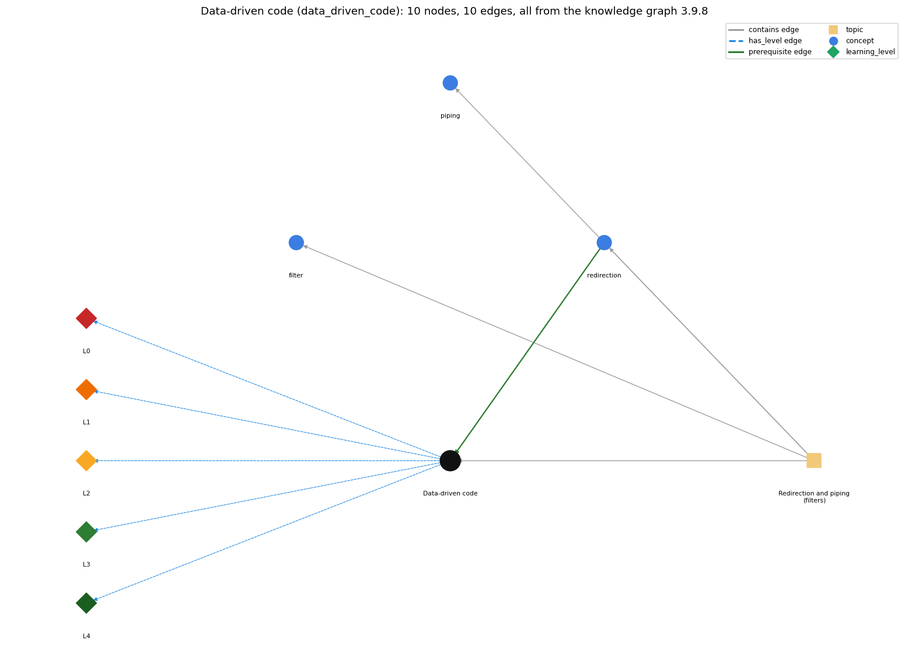

# Data-driven code (`data_driven_code`)

keeping data in files and writing programs that read it from standard input, so the data can change without changing the program

Section 1.5 1.5 Input and Output, topic 1.5.d Redirection and piping (filters). From the knowledge graph 3.9.8 (`data/raw/chapter1_kg_updated.json`).

## Concepts associated with data\_driven\_code (3)

| Concept | Description | How it is associated |
| --- | --- | --- |
| **filter** | a program that reads standard input and writes standard output | same topic (topic1.5.d) |
| **piping** | \| connects one program's output to another's input | same topic (topic1.5.d) |
| **redirection** | &lt; / &gt; send a file in/out as standard input/output | prerequisite of it (it needs this) composition rule (R) with it same topic (topic1.5.d) |

## Every edge in this view and its full label (10)

| From | Edge | To | Full edge label |
| --- | --- | --- | --- |
| **redirection** | prerequisite | **data\_driven\_code** | Redirecting a file to standard input lets the same program process different data files without being changed. grounding: book\_passage composition rule (R) of redirection with data\_driven\_code: Redirecting different files into the same program changes the data it processes without changing the program. composition rule (R) of data\_driven\_code with redirection: Redirecting a different data file to standard input changes what the unchanged program processes. |
| **data\_driven\_code** | has\_level | **data\_driven\_code@L0** | Data-driven code -&gt; L0 (Prestructural): the answer holds a rule that contradicts Java (1 way). **[0] everyday\_reading** (E): In the everyday sense, a 'program' includes its data, so changing the results means editing the code. In data-driven code the data live in files read from standard input, so they change while the program stays the same. |
| **data\_driven\_code** | has\_level | **data\_driven\_code@L1** | Data-driven code -&gt; L1 (Unistructural): the answer states one correct rule without applying it (2 ways). **[0] names\_the\_element** (N): Data-driven code is a design style: data are kept in files and the program reads them from standard input, so the data can change without changing the program. **[1] states\_the\_rule** (S): Keep the data in files and write programs that read from standard input. Then change the data, not the program. |
| **data\_driven\_code** | has\_level | **data\_driven\_code@L2** | Data-driven code -&gt; L2 (Multistructural): the answer applies the rules of Data-driven code to every part of the code, in order (3 ways). **[0] line\_by\_line\_trace** (LT): The program is launched with \`&lt; file\`. It reads values in file order and interprets them by a format convention (e.g. a header first, then records) until isEmpty(). **[1] output\_prediction** (OP): The same program with different files gives different outputs. \`java PlayThatTune &lt; elise.txt\` plays Für Elise, and another file plays another tune. **[2] one\_step\_execution** (OS): Each read takes the next value from the data file, where a literal written in the code would otherwise be. |
| **data\_driven\_code** | has\_level | **data\_driven\_code@L3** | Data-driven code -&gt; L3 (Relational): the answer relates the parts (2 ways). **[0] relation\_to\_neighbour** (R): Redirecting a different data file to standard input changes what the unchanged program processes. **[1] purpose\_of\_the\_whole** (P): Data-driven code lets one program serve many data sets (experiments, transactions, web models). It is the norm in data processing. |
| **data\_driven\_code** | has\_level | **data\_driven\_code@L4** | Data-driven code -&gt; L4 (Extended abstract): the answer reasons beyond the given code (4 ways). **[0] predict\_a\_change** (C): Changing the data file keeps the program and its correctness. Changing the file's format (field order, header) breaks the program's reads. **[1] transfer\_to\_a\_new\_program** (X): Use data-driven code when the same computation must run on many or changing data sets. Values that are intrinsic to the algorithm belong in the code, and a few launch parameters go on the command line. **[2] diagnose\_an\_error** (D): rule broken: The data file must follow the program's input format. Kind: run-time exception. Trigger class: A file with a non-numeric token, or fields in the wrong order: NumberFormatException at the read. **[3] diagnose\_an\_error** (D): rule broken: The data file must contain all the values the program reads. Kind: run-time exception. Trigger class: A truncated file (fewer values than a header promises): the read after the end fails. |
| **topic1.5.d** | contains | **data\_driven\_code** | topic topic1.5.d contains data\_driven\_code |
| **topic1.5.d** | contains | **filter** | topic topic1.5.d contains filter |
| **topic1.5.d** | contains | **piping** | topic topic1.5.d contains piping |
| **topic1.5.d** | contains | **redirection** | topic topic1.5.d contains redirection |
