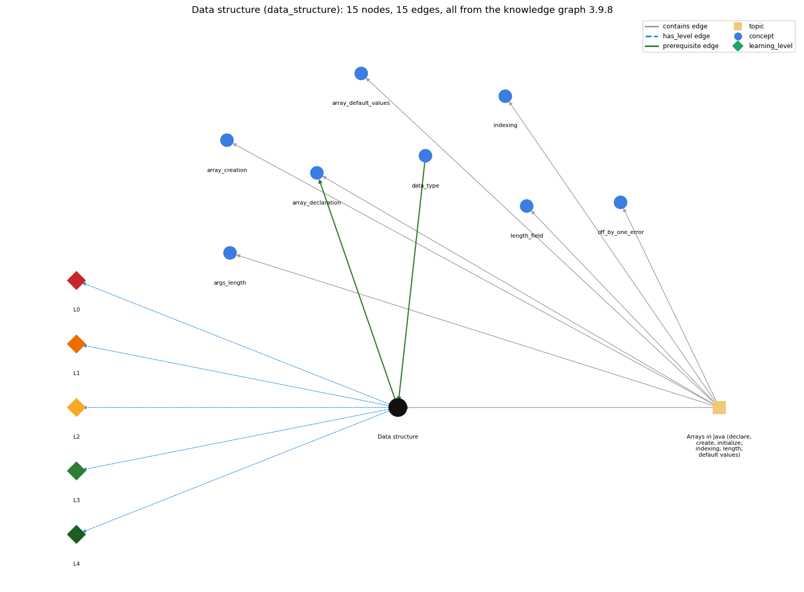

# Data structure (`data_structure`)

a method for organizing data; the one-dimensional array is the first example

Section 1.4 1.4 Arrays, topic 1.4.a Arrays in Java (declare, create, initialize; indexing; length; default values). From the knowledge graph 3.9.8 (`data/raw/chapter1_kg_updated.json`).

## Concepts associated with data\_structure (8)

| Concept | Description | How it is associated |
| --- | --- | --- |
| **args\_length** | args.length gives the number of command-line arguments | same topic (topic1.4.a) |
| **array\_creation** | new int[n] -- allocates n slots | same topic (topic1.4.a) |
| **array\_declaration** | int[] a; -- declares an array variable | builds on it (needs it) same topic (topic1.4.a) |
| **array\_default\_values** | new slots start at 0 / false / null | same topic (topic1.4.a) |
| **data\_type** | a set of values and the operations defined on them | prerequisite of it (it needs this) composition rule (R) with it |
| **indexing** | a[i] -- 0-based access | same topic (topic1.4.a) |
| **length\_field** | a.length is a field, not a method | same topic (topic1.4.a) |
| **off\_by\_one\_error** | a loop or index that runs one time too many or too few (&lt; vs &lt;=, 0..n vs 1..n, length vs length-1) | same topic (topic1.4.a) |

## Every edge in this view and its full label (15)

| From | Edge | To | Full edge label |
| --- | --- | --- | --- |
| **data\_structure** | prerequisite | **array\_declaration** | An array is a data structure: one name for a sequence of values of the same type, organised by index. grounding: book\_passage |
| **data\_type** | prerequisite | **data\_structure** | A data structure organizes many values of a data type; the array holds a sequence of values of one type. grounding: book\_passage composition rule (R) of data\_type with data\_structure: A data structure such as an array holds many values of one data type. The element type limits what can be stored in a[i] and which operations apply to it. composition rule (R) of data\_structure with data\_type: A data structure organizes many values of a data type; the array holds a sequence of values of one type, and its operations (create, index, length) work on that collection. |
| **data\_structure** | has\_level | **data\_structure@L0** | Data structure -&gt; L0 (Prestructural): the answer holds a rule that contradicts Java (1 way). **[0] everyday\_reading** (E): Folk meaning: one variable 'remembers' everything that was put into it, so storing many values needs no special structure. Rule: a variable holds one value at a time; keeping many values for later use needs a data structure such as an array. |
| **data\_structure** | has\_level | **data\_structure@L1** | Data structure -&gt; L1 (Unistructural): the answer states one correct rule without applying it (2 ways). **[0] names\_the\_element** (N): Identity: a data structure is a method for organizing data; the one-dimensional array is the book's first example, and the two-dimensional array the second. **[1] states\_the\_rule** (S): Declarative: an array is a data structure that stores a sequence of values of the same type and gives direct access to each by its index. |
| **data\_structure** | has\_level | **data\_structure@L2** | Data structure -&gt; L2 (Multistructural): the answer applies the rules of Data structure to every part of the code, in order (3 ways). **[0] line\_by\_line\_trace** (LT): Sequencing: a structure is first built (for an array: declare, create, initialize) and then accessed one element per operation. **[1] output\_prediction** (OP): Result: what an array structure provides is fast access to any stored value: element i is found by adding i to the array's address. **[2] one\_step\_execution** (OS): State transition: one array operation changes at most one element (an assignment) or creates a new array; reads change nothing. |
| **data\_structure** | has\_level | **data\_structure@L3** | Data structure -&gt; L3 (Relational): the answer relates the parts (2 ways). **[0] relation\_to\_neighbour** (R): A data structure organizes many values of a data type; the array holds a sequence of values of one type, and its operations (create, index, length) work on that collection. **[1] purpose\_of\_the\_whole** (P): Plan/role: organize large amounts of data so it can be stored and then processed by indexing (vectors, matrices, tables, experimental results). |
| **data\_structure** | has\_level | **data\_structure@L4** | Data structure -&gt; L4 (Extended abstract): the answer reasons beyond the given code (3 ways). **[0] predict\_a\_change** (C): Conservation: choosing a different organization keeps the data but changes which operations are cheap. Using arrays enlarges the program state, so tracing becomes harder and invariants matter more. **[1] transfer\_to\_a\_new\_program** (X): Applicability: use an array when the number of values is known when it is created and access is by integer position. Other structures (Chapter 4) fit growing collections or non-integer keys. **[2] diagnose\_an\_error** (D): rule broken: Values needed again later must be stored in a structure, not a single variable. Kind: silent logic error. Trigger class: a task that needs a second pass over the data (e.g. count how many equal the maximum) is solved with one variable that keeps only the latest value |
| **topic1.4.a** | contains | **args\_length** | topic topic1.4.a contains args\_length |
| **topic1.4.a** | contains | **array\_creation** | topic topic1.4.a contains array\_creation |
| **topic1.4.a** | contains | **array\_declaration** | topic topic1.4.a contains array\_declaration |
| **topic1.4.a** | contains | **array\_default\_values** | topic topic1.4.a contains array\_default\_values |
| **topic1.4.a** | contains | **data\_structure** | topic topic1.4.a contains data\_structure |
| **topic1.4.a** | contains | **indexing** | topic topic1.4.a contains indexing |
| **topic1.4.a** | contains | **length\_field** | topic topic1.4.a contains length\_field |
| **topic1.4.a** | contains | **off\_by\_one\_error** | topic topic1.4.a contains off\_by\_one\_error |
