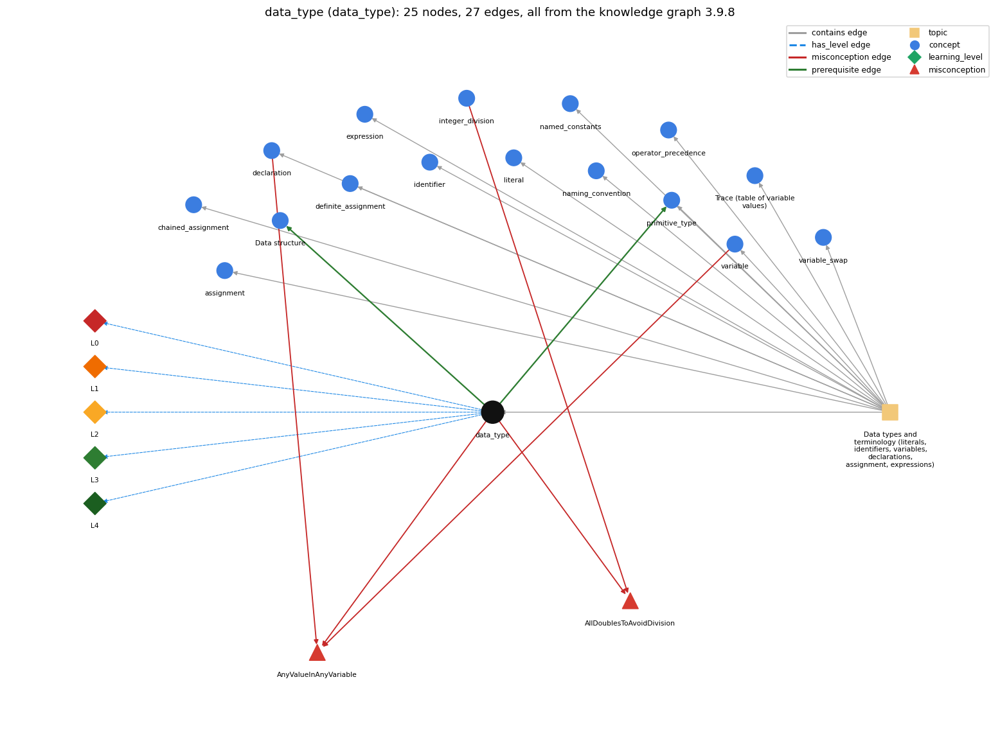

# data_type (`data_type`)

a set of values and the operations defined on them

Section 1.2 Built-in Types of Data, topic 1.2.a Data types and terminology (literals, identifiers, variables, declarations, assignment, expressions).

## At a glance

- **Needs first:** nothing
- **Leads to:** `data_structure`, `primitive_type`
- **Learned alongside:** nothing
- **Misconceptions:** `AllDoublesToAvoidDivision`, `AnyValueInAnyVariable`
- **Errors:** none
- **Levels:** L0, L1, L2, L3, L4

Everything below comes from the knowledge graph 3.9.8 (`data/raw/chapter1_kg_updated.json`): 27 edges around this concept. The edge logic, the wrong and right rules and the exact rules of the ways are copied word for word from the graph.

## To work on (0)

Nothing is missing for this concept.

## What it needs first (0)

A prerequisite edge means the other concept has to be understood before `data_type`.

No prerequisite edge leads into this concept.

## What it leads to (2)

These concepts need `data_type` first.

### `data_type` comes before `data_structure`

*Data structure: a method for organizing data; the one-dimensional array is the first example*

- **Edge:** `pre:data_type->data_structure`
- **Exact edge logic:** A data structure organizes many values of a data type; the array holds a sequence of values of one type.
- **Grounding:** book\_passage
- **Composition rule (R) of `data_type` with `data_structure`:** A data structure such as an array holds many values of one data type. The element type limits what can be stored in a[i] and which operations apply to it.
- **Composition rule (R) of `data_structure` with `data_type`:** A data structure organizes many values of a data type; the array holds a sequence of values of one type, and its operations (create, index, length) work on that collection.

### `data_type` comes before `primitive_type`

*int, double, boolean, char*

- **Edge:** `pre:data_type->primitive_type`
- **Exact edge logic:** Java has eight primitive data types (boolean, char, byte, short, int, long, float, double); each, like any data type, is a set of values and a set of operations on those values.
- **Grounding:** book\_passage
- **Composition rule (R) of `data_type` with `primitive_type`:** The eight primitive types are Java's built-in data types. Each one fixes its own values and operators (boolean has &amp;&amp; \|\| !, int has + - \* / %), so which operators are legal in an expression depends on which primitive type its operands have.
- **Composition rule (R) of `primitive_type` with `data_type`:** Each primitive type is a data type: a fixed set of values plus the operators defined for them.

## Learned alongside (0)

A parallel edge joins two concepts that sit side by side: neither is needed before the other.

No parallel edge touches this concept.

## Misconceptions (2)

A misconception edge states the wrong rule a student may hold about this concept, and the right rule.

### AllDoublesToAvoidDivision

- **Edge:** `data_type` &rarr; `AllDoublesToAvoidDivision` (misconception)
- **Exact edge logic (the wrong rule):** Making every variable a double is the right fix for integer division.
- **Twin logic (the right rule):** Use int for countable things and double for measured ones; where a fraction is needed, make one operand of the division a double (or cast) instead of changing every type.
- **Wrong belief (on the node):** Making every variable a double is the right fix for integer division.
- **Correct rule (on the node):** Use int for countable things and double for measured ones; where a fraction is needed, make one operand of the division a double (or cast) instead of changing every type.
- **Provenance:** textbook
- **Role of this concept:** primary
- **L0 way linked to it:** yes
- **L0 way [1] misconception, exact rule:** wrong rule: Making every variable a double is the right fix for integer division. Right rule: Use int for countable things and double for measured ones; where a fraction is needed, make one operand of the division a double (or cast) instead of changing every type.
- **L0 way [3] inconsistent\_trace, exact rule:** Points to LT (find each operand's type, then apply that type's operator). Applied unevenly, a student uses the int operator for 7 / 2 in one line (3) but real division in the next (3.5), or treats a String "12" as a number in one + and as text in another. (here mixing in: "Making every variable a double is the right fix for integer division")
- **Edge `integer_division` &rarr; `AllDoublesToAvoidDivision`, exact edge logic:** Making every variable a double is the right fix for integer division. **Twin logic:** Use int for countable things and double for measured ones; where a fraction is needed, make one operand of the division a double (or cast) instead of changing every type. (role: context)

### AnyValueInAnyVariable

- **Edge:** `data_type` &rarr; `AnyValueInAnyVariable` (misconception)
- **Exact edge logic (the wrong rule):** A variable declared int can hold 2.5 or "hi"; the type is only a label.
- **Twin logic (the right rule):** A data type is a set of values and a set of operations defined on them, so an int variable holds only int values.
- **Wrong belief (on the node):** A variable declared int can hold 2.5 or "hi"; the type is only a label.
- **Correct rule (on the node):** A data type is a set of values and a set of operations defined on them, so an int variable holds only int values.
- **Provenance:** textbook
- **Role of this concept:** primary
- **L0 way linked to it:** yes
- **L0 way [2] misconception, exact rule:** wrong rule: A variable declared int can hold 2.5 or "hi"; the type is only a label. Right rule: A data type is a set of values and a set of operations defined on them, so an int variable holds only int values.
- **Edge `declaration` &rarr; `AnyValueInAnyVariable`, exact edge logic:** A variable declared int can hold 2.5 or "hi"; the type is only a label. **Twin logic:** A data type is a set of values and a set of operations defined on them, so an int variable holds only int values. (role: context)
- **Edge `variable` &rarr; `AnyValueInAnyVariable`, exact edge logic:** A variable declared int can hold 2.5 or "hi"; the type is only a label. **Twin logic:** A data type is a set of values and a set of operations defined on them, so an int variable holds only int values. (role: context)

## Errors (0)

An error edge states the rule that gets broken in a program, and the right rule.

The graph has no error edge from this concept.

## Levels L0 to L4 (5 of 5)

Each level edge lists the ways a student shows that level, each with its exact rule.

### L0: Prestructural / sensorimotor

L0 for data type: the answer holds a rule that contradicts Java.

*Deciding question: Does every rule the answer applies to data type agree with the language rule? If it reads the code with everyday meanings, applies a wrong rule, or switches rules within one trace, it is L0. A slip in an otherwise rule-correct trace is L2 with an error, not L0.*

- **Edge:** `data_type` &rarr; `data_type@L0` (has_level)
- **Exact edge logic:** data type -&gt; L0 (Prestructural): the answer holds a rule that contradicts Java (4 ways).

Ways (4), each with its exact rule:

- **[0] everyday\_reading** (rule type E, folk-meaning rule): Everyday 'type' means a kind or label (a 'whole number' is still just a number), so novices read int and double as tags on the same arithmetic. In Java the type fixes both the set of values and which operation runs: 7 / 2 on two ints is 3, while 7.0 / 2 is 3.5.
- **[1] misconception** (rule type M, wrong rule / right rule) &rarr; `AllDoublesToAvoidDivision`: wrong rule: Making every variable a double is the right fix for integer division. Right rule: Use int for countable things and double for measured ones; where a fraction is needed, make one operand of the division a double (or cast) instead of changing every type.
- **[2] misconception** (rule type M, wrong rule / right rule) &rarr; `AnyValueInAnyVariable`: wrong rule: A variable declared int can hold 2.5 or "hi"; the type is only a label. Right rule: A data type is a set of values and a set of operations defined on them, so an int variable holds only int values.
- **[3] inconsistent\_trace** (rule type T, uneven-application rule) &rarr; `AllDoublesToAvoidDivision`: Points to LT (find each operand's type, then apply that type's operator). Applied unevenly, a student uses the int operator for 7 / 2 in one line (3) but real division in the next (3.5), or treats a String "12" as a number in one + and as text in another. (here mixing in: "Making every variable a double is the right fix for integer division")

### L1: Unistructural / atom x text surface

L1 for data type: the answer states one correct rule without applying it.

*Deciding question: Does the answer cover every part of the code, in order, with the values (L2)? If it covers one part or only states the rule, it is L1.*

- **Edge:** `data_type` &rarr; `data_type@L1` (has_level)
- **Exact edge logic:** data type -&gt; L1 (Unistructural): the answer states one correct rule without applying it (2 ways).

Ways (2), each with its exact rule:

- **[0] names\_the\_element** (rule type N, identity rule): Data type: a category of data defined as a set of values together with the set of operations on those values (int, double, boolean, char, String...).
- **[1] states\_the\_rule** (rule type S, declarative rule): Java is strongly typed: every variable and expression has a type known at compile time, a variable always holds a value of its type, and the compiler rejects values or operations that do not fit (int x = 1.1; does not compile).

### L2: Multistructural / block x execution / preoperational

L2 for data type: the answer applies these rules to every part of the code, in order.

*Deciding question: Is the answer many segments mapped onto lines (L2), or one segment stating the purpose of the whole (L3)? A correct output with no value-by-value justification is not levelled.*

- **Edge:** `data_type` &rarr; `data_type@L2` (has_level)
- **Exact edge logic:** data type -&gt; L2 (Multistructural): the answer applies the rules of data type to every part of the code, in order (3 ways).

Ways (3), each with its exact rule:

- **[0] line\_by\_line\_trace** (rule type LT, operational sequencing rule): For each operator, the operand types are found first (after any automatic promotion), and then that type's version of the operator is applied. So in b\*b - 4\*c with int b and c, the whole expression is computed as int and only then promoted to double for Math.sqrt().
- **[1] output\_prediction** (rule type OP, evaluation / result rule): The result type follows from the operand types: int op int gives int (7 / 2 is 3), any double operand gives double (7 / 2.0 is 3.5), and + with a String operand gives a String ("7" + 2 is "72").
- **[2] one\_step\_execution** (rule type OS, state-transition rule): A declaration fixes a variable's type for good. Each assignment changes only the value, never the type, and a value outside the type (a double into an int) is rejected at compile time unless it is cast.

### L3: Relational / relations x function (concrete operational begins)

L3 for data type: the answer relates the parts by these rules.

*Deciding question: Was the purpose deduced from the code, or only guessed from traced input/output pairs (then L2)? Does the answer stay within the given code (L3), or reason about changed code, an error class or a new program (L4)?*

- **Edge:** `data_type` &rarr; `data_type@L3` (has_level)
- **Exact edge logic:** data type -&gt; L3 (Relational): the answer relates the parts (3 ways).

Ways (3), each with its exact rule:

- **[0] relation\_to\_neighbour** (rule type R, composition rule (with a neighbour)): The eight primitive types are Java's built-in data types. Each one fixes its own values and operators (boolean has &amp;&amp; \|\| !, int has + - \* / %), so which operators are legal in an expression depends on which primitive type its operands have.
- **[1] relation\_to\_neighbour** (rule type R, composition rule (with a neighbour)): A data structure such as an array holds many values of one data type. The element type limits what can be stored in a[i] and which operations apply to it.
- **[2] purpose\_of\_the\_whole** (rule type P, plan / role rule): Choosing a type records what a value represents (int for counts, double for measurements, boolean for conditions, String for text), so the compiler can check that operations match that intent.

### L4: Extended abstract (concrete-operational reversibility and conservation)

L4 for data type: the answer reasons beyond the given code by these rules.

*Deciding question: Does the answer link the code to a broader context: a changed program, a class of inputs, an unseen problem? Re-tracing changed code value by value is L2; fixing one given failing case is L3.*

- **Edge:** `data_type` &rarr; `data_type@L4` (has_level)
- **Exact edge logic:** data type -&gt; L4 (Extended abstract): the answer reasons beyond the given code (4 ways).

Ways (4), each with its exact rule:

- **[0] predict\_a\_change** (rule type C, conservation rule) &rarr; `AllDoublesToAvoidDivision`: Widening a variable's type (int to double) usually still compiles but changes which operations run: / keeps fractions and output prints 3.0. Narrowing it (double to int) breaks every assignment of a double value with a compile-time error. Values that fit both types are kept.
- **[1] transfer\_to\_a\_new\_program** (rule type X, applicability rule): Think in data types whenever you declare a variable or read an expression. Use the built-in primitive types for single numbers, characters and truth values, String for text, and an array or another class when no single built-in type has the values and operations you need.
- **[2] diagnose\_an\_error** (rule type D, error rule): rule broken: A value can be stored only in a variable whose type can hold it without loss; narrowing needs an explicit cast. Kind: compile-time. Trigger class: Assigning a double (or long) expression to an int variable, e.g. int x = 1.1; or int n = Math.round(x);: 'incompatible types: possible lossy conversion'.
- **[3] diagnose\_an\_error** (rule type D, error rule): rule broken: An operator is defined only for certain types. Kind: compile-time. Trigger class: Applying an operator to a type that lacks it: "Hello" - 1, s &lt; t on Strings, !5: 'bad operand types for binary operator'.

## Same topic

`data_type` belongs to the topic **Data types and terminology (literals, identifiers, variables, declarations, assignment, expressions)** (`topic1.2.a`). The topic also contains: `assignment`, `chained_assignment`, `declaration`, `definite_assignment`, `expression`, `identifier`, `literal`, `named_constants`, `naming_convention`, `operator_precedence`, `primitive_type`, `program_trace`, `variable`, `variable_swap`.

## Rules of the concept (16)

- **Book** (SW-1e, p. 34 (pdf 44)): "A data type is a set of values and a set of operations on those values."
- **Book** (SW-1.2, ): "A data type is a set of values and a set of operations defined on them."
- **E** (folk-meaning rule): Everyday 'type' means a kind or label (a 'whole number' is still just a number), so novices read int and double as tags on the same arithmetic. In Java the type fixes both the set of values and which operation runs: 7 / 2 on two ints is 3, while 7.0 / 2 is 3.5.
- **M** (wrong rule / right rule): AllDoublesToAvoidDivision: wrong: Making every variable a double is the right fix for integer division. \| right: Use int for countable things and double for measured ones; where a fraction is needed, make one operand of the division a double (or cast) instead of changing every type.
- **M** (wrong rule / right rule): AnyValueInAnyVariable: wrong: A variable declared int can hold 2.5 or "hi"; the type is only a label. \| right: A data type is a set of values and a set of operations defined on them, so an int variable holds only int values.
- **T** (uneven-application rule): Points to LT (find each operand's type, then apply that type's operator). Applied unevenly, a student uses the int operator for 7 / 2 in one line (3) but real division in the next (3.5), or treats a String "12" as a number in one + and as text in another.
- **N** (identity rule): Data type: a category of data defined as a set of values together with the set of operations on those values (int, double, boolean, char, String...).
- **S** (declarative rule): Java is strongly typed: every variable and expression has a type known at compile time, a variable always holds a value of its type, and the compiler rejects values or operations that do not fit (int x = 1.1; does not compile).
- **LT** (operational sequencing rule): For each operator, the operand types are found first (after any automatic promotion), and then that type's version of the operator is applied. So in b\*b - 4\*c with int b and c, the whole expression is computed as int and only then promoted to double for Math.sqrt().
- **OP** (evaluation / result rule): The result type follows from the operand types: int op int gives int (7 / 2 is 3), any double operand gives double (7 / 2.0 is 3.5), and + with a String operand gives a String ("7" + 2 is "72").
- **OS** (state-transition rule): A declaration fixes a variable's type for good. Each assignment changes only the value, never the type, and a value outside the type (a double into an int) is rejected at compile time unless it is cast.
- **R** (composition rule (with a neighbour)): with primitive\_type: The eight primitive types are Java's built-in data types. Each one fixes its own values and operators (boolean has &amp;&amp; \|\| !, int has + - \* / %), so which operators are legal in an expression depends on which primitive type its operands have.
- **R** (composition rule (with a neighbour)): with data\_structure: A data structure such as an array holds many values of one data type. The element type limits what can be stored in a[i] and which operations apply to it.
- **P** (plan / role rule): Choosing a type records what a value represents (int for counts, double for measurements, boolean for conditions, String for text), so the compiler can check that operations match that intent.
- **C** (conservation rule): Widening a variable's type (int to double) usually still compiles but changes which operations run: / keeps fractions and output prints 3.0. Narrowing it (double to int) breaks every assignment of a double value with a compile-time error. Values that fit both types are kept.
- **D** (error rule): rule broken: A value can be stored only in a variable whose type can hold it without loss; narrowing needs an explicit cast. (compile-time)
- **D** (error rule): rule broken: An operator is defined only for certain types. (compile-time)
- **X** (applicability rule): Think in data types whenever you declare a variable or read an expression. Use the built-in primitive types for single numbers, characters and truth values, String for text, and an array or another class when no single built-in type has the values and operations you need.

## How it is found in code and answers (reader block)

- **Aliases:** data type, data types
- **Code patterns:** `\b(?:int|double|boolean|char|long|String|float|short|byte)\b`
- **Operator symbols:** none
- **Java types:** none

## The whole prerequisite chain

- **Everything it builds on (0):** nothing
- **Everything that builds on it (124):** `accumulator_pattern`, `animation`, `api`, `args_length`, `array_aliasing`, `array_bounds`, `array_copy`, `array_creation`, `array_declaration`, `array_default_values`, `array_exchange`, `array_initializer`, `array_reference`, `array_reversal`, `array_traversal`, `assignment`, `boolean`, `boolean_expression`, `boolean_flag_array`, `break_statement`, `chained_assignment`, `char`, `char_arithmetic`, `comparison_operators`, `compound_assignment`, `conditional_operator`, `continue_statement`, `convergence_rate`, `convergence_test`, `coordinate_scaling`, `counter_pattern`, `dangling_else`, `dangling_pages`, `data_structure`, `de_morgan`, `debugging`, `division_by_zero`, `do_while_loop`, `double`, `drawing_shapes`, `else_if_chain`, `enhanced_for`, `exclusive_or`, `explicit_cast`, `expression`, `fencepost_loop`, `flag_search_loop`, `floating_point_precision`, `for_loop`, `frequency_counting`, `function_plotting`, `if_else_statement`, `if_statement`, `increment_operators`, `indexing`, `infinite_loop`, `input_graph`, `int`, `int_literal_limit`, `integer_constants`, `labeled_break`, `length_field`, `literal`, `logical_operators`, `long_type`, `lookup_table`, `loop_body`, `loop_control`, `loop_guard`, `loop_invariant_reasoning`, `loop_performance`, `loop_scope`, `loop_variable`, `markov_chain`, `math_library`, `math_random`, `math_round`, `matrix_operations`, `method_call`, `monte_carlo_simulation`, `mouse_interaction`, `multidimensional_array`, `named_constants`, `naming_convention`, `nested_conditionals`, `nested_loops`, `normalization`, `number_conversion`, `off_by_one_error`, `operator_precedence`, `overflow`, `power_method`, `primitive_type`, `primitive_vs_reference`, `printing_array_reference`, `program_state`, `program_trace`, `ragged_array`, `random_move`, `row_major_order`, `run_time_error`, `running_extreme`, `sampling_without_replacement`, `scientific_notation`, `sentinel_loop`, `short_circuit`, `shuffle`, `side_effect_order`, `simulation_loop`, `space_time_tradeoff`, `standard_audio`, `standard_drawing`, `switch_statement`, `syntax_template`, `testing`, `transition_matrix`, `trig_functions`, `two_dimensional_array`, `two_models`, `type_conversion`, `variable`, `variable_swap`, `while_loop`, `widening_conversion`

## Every edge in this view and its exact edge logic (27)

All the edges drawn in the picture, in the order: prerequisite, parallel, misconception, error, has_level, contains.

**1. `data_type` &rarr; `data_structure`** (prerequisite)

- **Exact edge logic:** A data structure organizes many values of a data type; the array holds a sequence of values of one type.
- **Grounding:** book\_passage
- **Composition rule (R) of `data_type` with `data_structure`:** A data structure such as an array holds many values of one data type. The element type limits what can be stored in a[i] and which operations apply to it.
- **Composition rule (R) of `data_structure` with `data_type`:** A data structure organizes many values of a data type; the array holds a sequence of values of one type, and its operations (create, index, length) work on that collection.

**2. `data_type` &rarr; `primitive_type`** (prerequisite)

- **Exact edge logic:** Java has eight primitive data types (boolean, char, byte, short, int, long, float, double); each, like any data type, is a set of values and a set of operations on those values.
- **Grounding:** book\_passage
- **Composition rule (R) of `data_type` with `primitive_type`:** The eight primitive types are Java's built-in data types. Each one fixes its own values and operators (boolean has &amp;&amp; \|\| !, int has + - \* / %), so which operators are legal in an expression depends on which primitive type its operands have.
- **Composition rule (R) of `primitive_type` with `data_type`:** Each primitive type is a data type: a fixed set of values plus the operators defined for them.

**3. `data_type` &rarr; `AllDoublesToAvoidDivision`** (misconception)

- **Exact edge logic (the wrong rule):** Making every variable a double is the right fix for integer division.
- **Twin logic (the right rule):** Use int for countable things and double for measured ones; where a fraction is needed, make one operand of the division a double (or cast) instead of changing every type.
- **Role:** primary

**4. `data_type` &rarr; `AnyValueInAnyVariable`** (misconception)

- **Exact edge logic (the wrong rule):** A variable declared int can hold 2.5 or "hi"; the type is only a label.
- **Twin logic (the right rule):** A data type is a set of values and a set of operations defined on them, so an int variable holds only int values.
- **Role:** primary

**5. `declaration` &rarr; `AnyValueInAnyVariable`** (misconception)

- **Exact edge logic (the wrong rule):** A variable declared int can hold 2.5 or "hi"; the type is only a label.
- **Twin logic (the right rule):** A data type is a set of values and a set of operations defined on them, so an int variable holds only int values.
- **Role:** context

**6. `integer_division` &rarr; `AllDoublesToAvoidDivision`** (misconception)

- **Exact edge logic (the wrong rule):** Making every variable a double is the right fix for integer division.
- **Twin logic (the right rule):** Use int for countable things and double for measured ones; where a fraction is needed, make one operand of the division a double (or cast) instead of changing every type.
- **Role:** context

**7. `variable` &rarr; `AnyValueInAnyVariable`** (misconception)

- **Exact edge logic (the wrong rule):** A variable declared int can hold 2.5 or "hi"; the type is only a label.
- **Twin logic (the right rule):** A data type is a set of values and a set of operations defined on them, so an int variable holds only int values.
- **Role:** context

**8. `data_type` &rarr; `data_type@L0`** (has_level)

- **Exact edge logic:** data type -&gt; L0 (Prestructural): the answer holds a rule that contradicts Java (4 ways).
  - **[0] everyday\_reading** (rule type E, folk-meaning rule): Everyday 'type' means a kind or label (a 'whole number' is still just a number), so novices read int and double as tags on the same arithmetic. In Java the type fixes both the set of values and which operation runs: 7 / 2 on two ints is 3, while 7.0 / 2 is 3.5.
  - **[1] misconception** (rule type M, wrong rule / right rule) &rarr; `AllDoublesToAvoidDivision`: wrong rule: Making every variable a double is the right fix for integer division. Right rule: Use int for countable things and double for measured ones; where a fraction is needed, make one operand of the division a double (or cast) instead of changing every type.
  - **[2] misconception** (rule type M, wrong rule / right rule) &rarr; `AnyValueInAnyVariable`: wrong rule: A variable declared int can hold 2.5 or "hi"; the type is only a label. Right rule: A data type is a set of values and a set of operations defined on them, so an int variable holds only int values.
  - **[3] inconsistent\_trace** (rule type T, uneven-application rule) &rarr; `AllDoublesToAvoidDivision`: Points to LT (find each operand's type, then apply that type's operator). Applied unevenly, a student uses the int operator for 7 / 2 in one line (3) but real division in the next (3.5), or treats a String "12" as a number in one + and as text in another. (here mixing in: "Making every variable a double is the right fix for integer division")

**9. `data_type` &rarr; `data_type@L1`** (has_level)

- **Exact edge logic:** data type -&gt; L1 (Unistructural): the answer states one correct rule without applying it (2 ways).
  - **[0] names\_the\_element** (rule type N, identity rule): Data type: a category of data defined as a set of values together with the set of operations on those values (int, double, boolean, char, String...).
  - **[1] states\_the\_rule** (rule type S, declarative rule): Java is strongly typed: every variable and expression has a type known at compile time, a variable always holds a value of its type, and the compiler rejects values or operations that do not fit (int x = 1.1; does not compile).

**10. `data_type` &rarr; `data_type@L2`** (has_level)

- **Exact edge logic:** data type -&gt; L2 (Multistructural): the answer applies the rules of data type to every part of the code, in order (3 ways).
  - **[0] line\_by\_line\_trace** (rule type LT, operational sequencing rule): For each operator, the operand types are found first (after any automatic promotion), and then that type's version of the operator is applied. So in b\*b - 4\*c with int b and c, the whole expression is computed as int and only then promoted to double for Math.sqrt().
  - **[1] output\_prediction** (rule type OP, evaluation / result rule): The result type follows from the operand types: int op int gives int (7 / 2 is 3), any double operand gives double (7 / 2.0 is 3.5), and + with a String operand gives a String ("7" + 2 is "72").
  - **[2] one\_step\_execution** (rule type OS, state-transition rule): A declaration fixes a variable's type for good. Each assignment changes only the value, never the type, and a value outside the type (a double into an int) is rejected at compile time unless it is cast.

**11. `data_type` &rarr; `data_type@L3`** (has_level)

- **Exact edge logic:** data type -&gt; L3 (Relational): the answer relates the parts (3 ways).
  - **[0] relation\_to\_neighbour** (rule type R, composition rule (with a neighbour)): The eight primitive types are Java's built-in data types. Each one fixes its own values and operators (boolean has &amp;&amp; \|\| !, int has + - \* / %), so which operators are legal in an expression depends on which primitive type its operands have.
  - **[1] relation\_to\_neighbour** (rule type R, composition rule (with a neighbour)): A data structure such as an array holds many values of one data type. The element type limits what can be stored in a[i] and which operations apply to it.
  - **[2] purpose\_of\_the\_whole** (rule type P, plan / role rule): Choosing a type records what a value represents (int for counts, double for measurements, boolean for conditions, String for text), so the compiler can check that operations match that intent.

**12. `data_type` &rarr; `data_type@L4`** (has_level)

- **Exact edge logic:** data type -&gt; L4 (Extended abstract): the answer reasons beyond the given code (4 ways).
  - **[0] predict\_a\_change** (rule type C, conservation rule) &rarr; `AllDoublesToAvoidDivision`: Widening a variable's type (int to double) usually still compiles but changes which operations run: / keeps fractions and output prints 3.0. Narrowing it (double to int) breaks every assignment of a double value with a compile-time error. Values that fit both types are kept.
  - **[1] transfer\_to\_a\_new\_program** (rule type X, applicability rule): Think in data types whenever you declare a variable or read an expression. Use the built-in primitive types for single numbers, characters and truth values, String for text, and an array or another class when no single built-in type has the values and operations you need.
  - **[2] diagnose\_an\_error** (rule type D, error rule): rule broken: A value can be stored only in a variable whose type can hold it without loss; narrowing needs an explicit cast. Kind: compile-time. Trigger class: Assigning a double (or long) expression to an int variable, e.g. int x = 1.1; or int n = Math.round(x);: 'incompatible types: possible lossy conversion'.
  - **[3] diagnose\_an\_error** (rule type D, error rule): rule broken: An operator is defined only for certain types. Kind: compile-time. Trigger class: Applying an operator to a type that lacks it: "Hello" - 1, s &lt; t on Strings, !5: 'bad operand types for binary operator'.

**13. `topic1.2.a` &rarr; `data_type`** (contains)

- topic `topic1.2.a` contains `data_type`

**14. `topic1.2.a` &rarr; `assignment`** (contains)

- topic `topic1.2.a` contains `assignment`

**15. `topic1.2.a` &rarr; `chained_assignment`** (contains)

- topic `topic1.2.a` contains `chained_assignment`

**16. `topic1.2.a` &rarr; `declaration`** (contains)

- topic `topic1.2.a` contains `declaration`

**17. `topic1.2.a` &rarr; `definite_assignment`** (contains)

- topic `topic1.2.a` contains `definite_assignment`

**18. `topic1.2.a` &rarr; `expression`** (contains)

- topic `topic1.2.a` contains `expression`

**19. `topic1.2.a` &rarr; `identifier`** (contains)

- topic `topic1.2.a` contains `identifier`

**20. `topic1.2.a` &rarr; `literal`** (contains)

- topic `topic1.2.a` contains `literal`

**21. `topic1.2.a` &rarr; `named_constants`** (contains)

- topic `topic1.2.a` contains `named_constants`

**22. `topic1.2.a` &rarr; `naming_convention`** (contains)

- topic `topic1.2.a` contains `naming_convention`

**23. `topic1.2.a` &rarr; `operator_precedence`** (contains)

- topic `topic1.2.a` contains `operator_precedence`

**24. `topic1.2.a` &rarr; `primitive_type`** (contains)

- topic `topic1.2.a` contains `primitive_type`

**25. `topic1.2.a` &rarr; `program_trace`** (contains)

- topic `topic1.2.a` contains `program_trace`

**26. `topic1.2.a` &rarr; `variable`** (contains)

- topic `topic1.2.a` contains `variable`

**27. `topic1.2.a` &rarr; `variable_swap`** (contains)

- topic `topic1.2.a` contains `variable_swap`
