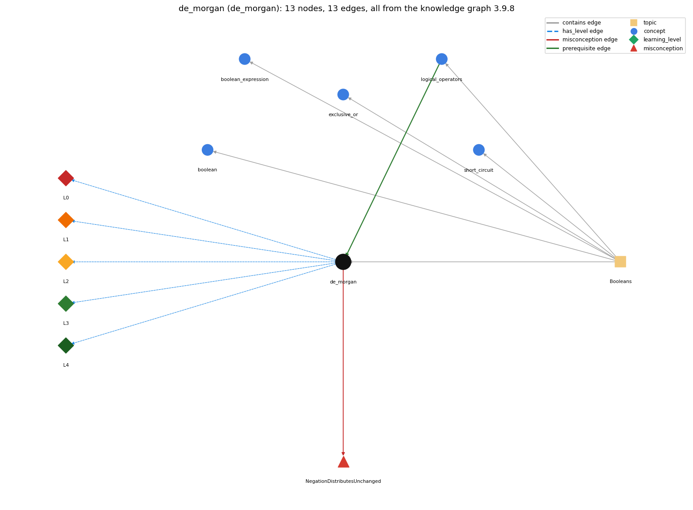

# de_morgan (`de_morgan`)

!(a &amp;&amp; b) == !a \|\| !b and !(a \|\| b) == !a &amp;&amp; !b

Section 1.2 Built-in Types of Data, topic 1.2.e Booleans.

## At a glance

- **Needs first:** `logical_operators`
- **Leads to:** nothing
- **Learned alongside:** nothing
- **Misconceptions:** `NegationDistributesUnchanged`
- **Errors:** none
- **Levels:** L0, L1, L2, L3, L4

Everything below comes from the knowledge graph 3.9.8 (`data/raw/chapter1_kg_updated.json`): 13 edges around this concept. The edge logic, the wrong and right rules and the exact rules of the ways are copied word for word from the graph.

## To work on (1)

- no aliases: a student's words cannot name this concept

## What it needs first (1)

A prerequisite edge means the other concept has to be understood before `de_morgan`.

### `logical_operators` comes before `de_morgan`

*&amp;&amp; \|\| !*

- **Edge:** `pre:logical_operators->de_morgan`
- **Exact edge logic:** De Morgan's laws rewrite expressions built from &amp;&amp; , \|\| and !.
- **Grounding:** book\_passage
- **Composition rule (R) of `de_morgan` with `logical_operators`:** De Morgan's laws relate the three logical operators: a negated &amp;&amp; becomes an \|\| of negations and a negated \|\| becomes an &amp;&amp; of negations.
- **Composition rule (R) of `logical_operators` with `de_morgan`:** De Morgan's laws rewrite negated &amp;&amp; / \|\| expressions: !(A &amp;&amp; B) is !A \|\| !B and !(A \|\| B) is !A &amp;&amp; !B.

## What it leads to (0)

These concepts need `de_morgan` first.

No concept has this one as a prerequisite.

## Learned alongside (0)

A parallel edge joins two concepts that sit side by side: neither is needed before the other.

No parallel edge touches this concept.

## Misconceptions (1)

A misconception edge states the wrong rule a student may hold about this concept, and the right rule.

### NegationDistributesUnchanged

- **Edge:** `de_morgan` &rarr; `NegationDistributesUnchanged` (misconception)
- **Exact edge logic (the wrong rule):** !(a &amp;&amp; b) is the same as !a &amp;&amp; !b.
- **Twin logic (the right rule):** !(a &amp;&amp; b) is !a \|\| !b (De Morgan).
- **Wrong belief (on the node):** !(a &amp;&amp; b) is the same as !a &amp;&amp; !b.
- **Correct rule (on the node):** !(a &amp;&amp; b) is !a \|\| !b (De Morgan).
- **Provenance:** derived
- **Role of this concept:** primary
- **L0 way linked to it:** yes
- **L0 way [1] misconception, exact rule:** wrong rule: !(a &amp;&amp; b) is the same as !a &amp;&amp; !b. Right rule: !(a &amp;&amp; b) is !a \|\| !b, and !(a \|\| b) is !a &amp;&amp; !b (De Morgan); !a &amp;&amp; !b differs whenever exactly one of a, b is true.
- **L0 way [2] inconsistent\_trace, exact rule:** Points to LT (push ! into every term, replace each relation by its opposite, and swap &amp;&amp; and \|\|, all together). Applied unevenly: the student negates the terms but keeps the operator, or turns !(x &lt; 5) into x &gt; 5 instead of x &gt;= 5 in one term while handling the other correctly. (here mixing in: "!(a &amp;&amp; b) is the same as !a &amp;&amp; !b")

## Errors (0)

An error edge states the rule that gets broken in a program, and the right rule.

The graph has no error edge from this concept.

## Levels L0 to L4 (5 of 5)

Each level edge lists the ways a student shows that level, each with its exact rule.

### L0: Prestructural / sensorimotor

L0 for de morgan: the answer holds a rule that contradicts Java.

*Deciding question: Does every rule the answer applies to de morgan agree with the language rule? If it reads the code with everyday meanings, applies a wrong rule, or switches rules within one trace, it is L0. A slip in an otherwise rule-correct trace is L2 with an error, not L0.*

- **Edge:** `de_morgan` &rarr; `de_morgan@L0` (has_level)
- **Exact edge logic:** de morgan -&gt; L0 (Prestructural): the answer holds a rule that contradicts Java (3 ways).

Ways (3), each with its exact rule:

- **[0] everyday\_reading** (rule type E, folk-meaning rule): Folk meaning: 'not (A and B)' is read as 'not A and not B', the way a minus sign is distributed over a sum in algebra without changing the operator. Java (Boolean logic) rule: negating a compound condition negates each term and also flips &amp;&amp; to \|\| (and \|\| to &amp;&amp;).
- **[1] misconception** (rule type M, wrong rule / right rule) &rarr; `NegationDistributesUnchanged`: wrong rule: !(a &amp;&amp; b) is the same as !a &amp;&amp; !b. Right rule: !(a &amp;&amp; b) is !a \|\| !b, and !(a \|\| b) is !a &amp;&amp; !b (De Morgan); !a &amp;&amp; !b differs whenever exactly one of a, b is true.
- **[2] inconsistent\_trace** (rule type T, uneven-application rule) &rarr; `NegationDistributesUnchanged`: Points to LT (push ! into every term, replace each relation by its opposite, and swap &amp;&amp; and \|\|, all together). Applied unevenly: the student negates the terms but keeps the operator, or turns !(x &lt; 5) into x &gt; 5 instead of x &gt;= 5 in one term while handling the other correctly. (here mixing in: "!(a &amp;&amp; b) is the same as !a &amp;&amp; !b")

### L1: Unistructural / atom x text surface

L1 for de morgan: the answer states one correct rule without applying it.

*Deciding question: Does the answer cover every part of the code, in order, with the values (L2)? If it covers one part or only states the rule, it is L1.*

- **Edge:** `de_morgan` &rarr; `de_morgan@L1` (has_level)
- **Exact edge logic:** de morgan -&gt; L1 (Unistructural): the answer states one correct rule without applying it (2 ways).

Ways (2), each with its exact rule:

- **[0] names\_the\_element** (rule type N, identity rule): De Morgan's laws are rules of Boolean logic that show how to negate a logical expression.
- **[1] states\_the\_rule** (rule type S, declarative rule): !(A &amp;&amp; B) is equivalent to !A \|\| !B, and !(A \|\| B) is equivalent to !A &amp;&amp; !B; with comparisons, negating a term uses the opposite relational operator (!(x &lt; 5) is x &gt;= 5).

### L2: Multistructural / block x execution / preoperational

L2 for de morgan: the answer applies these rules to every part of the code, in order.

*Deciding question: Is the answer many segments mapped onto lines (L2), or one segment stating the purpose of the whole (L3)? A correct output with no value-by-value justification is not levelled.*

- **Edge:** `de_morgan` &rarr; `de_morgan@L2` (has_level)
- **Exact edge logic:** de morgan -&gt; L2 (Multistructural): the answer applies the rules of de morgan to every part of the code, in order (3 ways).

Ways (3), each with its exact rule:

- **[0] line\_by\_line\_trace** (rule type LT, operational sequencing rule): As a rewrite: move the ! inside the parentheses, negate each term (flipping each comparison), swap &amp;&amp; and \|\|; as evaluation, both forms give the same value on every row of the truth table and short-circuit after the same left operand.
- **[1] output\_prediction** (rule type OP, evaluation / result rule): The rewritten expression has the same boolean value as the original for all inputs: with x = 1 and y = 0, !(x == 0 \|\| y == 0) and x != 0 &amp;&amp; y != 0 are both false.
- **[2] one\_step\_execution** (rule type OS, state-transition rule): Rewriting changes no program state; both forms evaluate the same terms in the same left-to-right order, so side effects and short-circuit points are unchanged.

### L3: Relational / relations x function (concrete operational begins)

L3 for de morgan: the answer relates the parts by these rules.

*Deciding question: Was the purpose deduced from the code, or only guessed from traced input/output pairs (then L2)? Does the answer stay within the given code (L3), or reason about changed code, an error class or a new program (L4)?*

- **Edge:** `de_morgan` &rarr; `de_morgan@L3` (has_level)
- **Exact edge logic:** de morgan -&gt; L3 (Relational): the answer relates the parts (2 ways).

Ways (2), each with its exact rule:

- **[0] relation\_to\_neighbour** (rule type R, composition rule (with a neighbour)): De Morgan's laws relate the three logical operators: a negated &amp;&amp; becomes an \|\| of negations and a negated \|\| becomes an &amp;&amp; of negations.
- **[1] purpose\_of\_the\_whole** (rule type P, plan / role rule): Used to simplify negated conditions into readable positive ones, e.g. turning a stopping condition ('found or at the end') into a loop-continuation condition while (!found &amp;&amp; i &lt; n), or simplifying (!(a &lt; b) &amp;&amp; !(a &gt; b)) to a == b.

### L4: Extended abstract (concrete-operational reversibility and conservation)

L4 for de morgan: the answer reasons beyond the given code by these rules.

*Deciding question: Does the answer link the code to a broader context: a changed program, a class of inputs, an unseen problem? Re-tracing changed code value by value is L2; fixing one given failing case is L3.*

- **Edge:** `de_morgan` &rarr; `de_morgan@L4` (has_level)
- **Exact edge logic:** de morgan -&gt; L4 (Extended abstract): the answer reasons beyond the given code (3 ways).

Ways (3), each with its exact rule:

- **[0] predict\_a\_change** (rule type C, conservation rule) &rarr; `NegationDistributesUnchanged`: A correct De Morgan rewrite preserves the value for every input (invariant); dropping the operator flip, or using &gt; instead of &gt;= for !(x &lt; 5), breaks it exactly on mixed or boundary inputs.
- **[1] transfer\_to\_a\_new\_program** (rule type X, applicability rule): Apply De Morgan when a condition is written as !(...) of a compound, or when converting a 'stop when' condition into a 'continue while' condition; leave a condition alone when its positive form is already clear.
- **[2] diagnose\_an\_error** (rule type D, error rule): rule broken: Negation flips &amp;&amp; and \|\| (De Morgan). Kind: silent logic error. Trigger class: Inputs where exactly one term is true (and boundary values of negated comparisons) after a condition was negated term by term without flipping the operator.

## Same topic

`de_morgan` belongs to the topic **Booleans** (`topic1.2.e`). The topic also contains: `boolean`, `boolean_expression`, `exclusive_or`, `logical_operators`, `short_circuit`.

## Rules of the concept (13)

- **Book** (SW-1e, p. 39 (pdf 49)): "(!(a &lt; b) &amp;&amp; !(a &gt; b))"
- **Book** (TJ-2e, p. 84 (pdf 106)): "De Morgan's laws: Mathematical rules that show how to negate a logical expression."
- **Book** (SW-1.2, ): "Simplify the following expression: (!(a &lt; b) &amp;&amp; !(a &gt; b)) Solution: (a == b)"
- **E** (folk-meaning rule): Folk meaning: 'not (A and B)' is read as 'not A and not B', the way a minus sign is distributed over a sum in algebra without changing the operator. Java (Boolean logic) rule: negating a compound condition negates each term and also flips &amp;&amp; to \|\| (and \|\| to &amp;&amp;).
- **M** (wrong rule / right rule): NegationDistributesUnchanged: wrong: !(a &amp;&amp; b) is the same as !a &amp;&amp; !b. \| right: !(a &amp;&amp; b) is !a \|\| !b, and !(a \|\| b) is !a &amp;&amp; !b (De Morgan); !a &amp;&amp; !b differs whenever exactly one of a, b is true.
- **T** (uneven-application rule): Points to LT (push ! into every term, replace each relation by its opposite, and swap &amp;&amp; and \|\|, all together). Applied unevenly: the student negates the terms but keeps the operator, or turns !(x &lt; 5) into x &gt; 5 instead of x &gt;= 5 in one term while handling the other correctly.
- **N** (identity rule): De Morgan's laws are rules of Boolean logic that show how to negate a logical expression.
- **S** (declarative rule): !(A &amp;&amp; B) is equivalent to !A \|\| !B, and !(A \|\| B) is equivalent to !A &amp;&amp; !B; with comparisons, negating a term uses the opposite relational operator (!(x &lt; 5) is x &gt;= 5).
- **LT** (operational sequencing rule): As a rewrite: move the ! inside the parentheses, negate each term (flipping each comparison), swap &amp;&amp; and \|\|; as evaluation, both forms give the same value on every row of the truth table and short-circuit after the same left operand.
- **OP** (evaluation / result rule): The rewritten expression has the same boolean value as the original for all inputs: with x = 1 and y = 0, !(x == 0 \|\| y == 0) and x != 0 &amp;&amp; y != 0 are both false.
- **OS** (state-transition rule): Rewriting changes no program state; both forms evaluate the same terms in the same left-to-right order, so side effects and short-circuit points are unchanged.
- **R** (composition rule (with a neighbour)): with logical\_operators: De Morgan's laws relate the three logical operators: a negated &amp;&amp; becomes an \|\| of negations and a negated \|\| becomes an &amp;&amp; of negations.
- **P** (plan / role rule): Used to simplify negated conditions into readable positive ones, e.g. turning a stopping condition ('found or at the end') into a loop-continuation condition while (!found &amp;&amp; i &lt; n), or simplifying (!(a &lt; b) &amp;&amp; !(a &gt; b)) to a == b.
- **C** (conservation rule): A correct De Morgan rewrite preserves the value for every input (invariant); dropping the operator flip, or using &gt; instead of &gt;= for !(x &lt; 5), breaks it exactly on mixed or boundary inputs.
- **D** (error rule): rule broken: Negation flips &amp;&amp; and \|\| (De Morgan). (silent logic error)
- **X** (applicability rule): Apply De Morgan when a condition is written as !(...) of a compound, or when converting a 'stop when' condition into a 'continue while' condition; leave a condition alone when its positive form is already clear.

## How it is found in code and answers (reader block)

- **Aliases:** none
- **Code patterns:** `!\s*\([^()]*(?:&&|\|\|)`, `!\s*\w+\s*(?:&&|\|\|)\s*!\s*\w+`
- **Operator symbols:** none
- **Java types:** none

## The whole prerequisite chain

- **Everything it builds on (4):** `boolean`, `data_type`, `logical_operators`, `primitive_type`
- **Everything that builds on it (0):** nothing

## Every edge in this view and its exact edge logic (13)

All the edges drawn in the picture, in the order: prerequisite, parallel, misconception, error, has_level, contains.

**1. `logical_operators` &rarr; `de_morgan`** (prerequisite)

- **Exact edge logic:** De Morgan's laws rewrite expressions built from &amp;&amp; , \|\| and !.
- **Grounding:** book\_passage
- **Composition rule (R) of `logical_operators` with `de_morgan`:** De Morgan's laws rewrite negated &amp;&amp; / \|\| expressions: !(A &amp;&amp; B) is !A \|\| !B and !(A \|\| B) is !A &amp;&amp; !B.
- **Composition rule (R) of `de_morgan` with `logical_operators`:** De Morgan's laws relate the three logical operators: a negated &amp;&amp; becomes an \|\| of negations and a negated \|\| becomes an &amp;&amp; of negations.

**2. `de_morgan` &rarr; `NegationDistributesUnchanged`** (misconception)

- **Exact edge logic (the wrong rule):** !(a &amp;&amp; b) is the same as !a &amp;&amp; !b.
- **Twin logic (the right rule):** !(a &amp;&amp; b) is !a \|\| !b (De Morgan).
- **Role:** primary

**3. `de_morgan` &rarr; `de_morgan@L0`** (has_level)

- **Exact edge logic:** de morgan -&gt; L0 (Prestructural): the answer holds a rule that contradicts Java (3 ways).
  - **[0] everyday\_reading** (rule type E, folk-meaning rule): Folk meaning: 'not (A and B)' is read as 'not A and not B', the way a minus sign is distributed over a sum in algebra without changing the operator. Java (Boolean logic) rule: negating a compound condition negates each term and also flips &amp;&amp; to \|\| (and \|\| to &amp;&amp;).
  - **[1] misconception** (rule type M, wrong rule / right rule) &rarr; `NegationDistributesUnchanged`: wrong rule: !(a &amp;&amp; b) is the same as !a &amp;&amp; !b. Right rule: !(a &amp;&amp; b) is !a \|\| !b, and !(a \|\| b) is !a &amp;&amp; !b (De Morgan); !a &amp;&amp; !b differs whenever exactly one of a, b is true.
  - **[2] inconsistent\_trace** (rule type T, uneven-application rule) &rarr; `NegationDistributesUnchanged`: Points to LT (push ! into every term, replace each relation by its opposite, and swap &amp;&amp; and \|\|, all together). Applied unevenly: the student negates the terms but keeps the operator, or turns !(x &lt; 5) into x &gt; 5 instead of x &gt;= 5 in one term while handling the other correctly. (here mixing in: "!(a &amp;&amp; b) is the same as !a &amp;&amp; !b")

**4. `de_morgan` &rarr; `de_morgan@L1`** (has_level)

- **Exact edge logic:** de morgan -&gt; L1 (Unistructural): the answer states one correct rule without applying it (2 ways).
  - **[0] names\_the\_element** (rule type N, identity rule): De Morgan's laws are rules of Boolean logic that show how to negate a logical expression.
  - **[1] states\_the\_rule** (rule type S, declarative rule): !(A &amp;&amp; B) is equivalent to !A \|\| !B, and !(A \|\| B) is equivalent to !A &amp;&amp; !B; with comparisons, negating a term uses the opposite relational operator (!(x &lt; 5) is x &gt;= 5).

**5. `de_morgan` &rarr; `de_morgan@L2`** (has_level)

- **Exact edge logic:** de morgan -&gt; L2 (Multistructural): the answer applies the rules of de morgan to every part of the code, in order (3 ways).
  - **[0] line\_by\_line\_trace** (rule type LT, operational sequencing rule): As a rewrite: move the ! inside the parentheses, negate each term (flipping each comparison), swap &amp;&amp; and \|\|; as evaluation, both forms give the same value on every row of the truth table and short-circuit after the same left operand.
  - **[1] output\_prediction** (rule type OP, evaluation / result rule): The rewritten expression has the same boolean value as the original for all inputs: with x = 1 and y = 0, !(x == 0 \|\| y == 0) and x != 0 &amp;&amp; y != 0 are both false.
  - **[2] one\_step\_execution** (rule type OS, state-transition rule): Rewriting changes no program state; both forms evaluate the same terms in the same left-to-right order, so side effects and short-circuit points are unchanged.

**6. `de_morgan` &rarr; `de_morgan@L3`** (has_level)

- **Exact edge logic:** de morgan -&gt; L3 (Relational): the answer relates the parts (2 ways).
  - **[0] relation\_to\_neighbour** (rule type R, composition rule (with a neighbour)): De Morgan's laws relate the three logical operators: a negated &amp;&amp; becomes an \|\| of negations and a negated \|\| becomes an &amp;&amp; of negations.
  - **[1] purpose\_of\_the\_whole** (rule type P, plan / role rule): Used to simplify negated conditions into readable positive ones, e.g. turning a stopping condition ('found or at the end') into a loop-continuation condition while (!found &amp;&amp; i &lt; n), or simplifying (!(a &lt; b) &amp;&amp; !(a &gt; b)) to a == b.

**7. `de_morgan` &rarr; `de_morgan@L4`** (has_level)

- **Exact edge logic:** de morgan -&gt; L4 (Extended abstract): the answer reasons beyond the given code (3 ways).
  - **[0] predict\_a\_change** (rule type C, conservation rule) &rarr; `NegationDistributesUnchanged`: A correct De Morgan rewrite preserves the value for every input (invariant); dropping the operator flip, or using &gt; instead of &gt;= for !(x &lt; 5), breaks it exactly on mixed or boundary inputs.
  - **[1] transfer\_to\_a\_new\_program** (rule type X, applicability rule): Apply De Morgan when a condition is written as !(...) of a compound, or when converting a 'stop when' condition into a 'continue while' condition; leave a condition alone when its positive form is already clear.
  - **[2] diagnose\_an\_error** (rule type D, error rule): rule broken: Negation flips &amp;&amp; and \|\| (De Morgan). Kind: silent logic error. Trigger class: Inputs where exactly one term is true (and boundary values of negated comparisons) after a condition was negated term by term without flipping the operator.

**8. `topic1.2.e` &rarr; `de_morgan`** (contains)

- topic `topic1.2.e` contains `de_morgan`

**9. `topic1.2.e` &rarr; `boolean`** (contains)

- topic `topic1.2.e` contains `boolean`

**10. `topic1.2.e` &rarr; `boolean_expression`** (contains)

- topic `topic1.2.e` contains `boolean_expression`

**11. `topic1.2.e` &rarr; `exclusive_or`** (contains)

- topic `topic1.2.e` contains `exclusive_or`

**12. `topic1.2.e` &rarr; `logical_operators`** (contains)

- topic `topic1.2.e` contains `logical_operators`

**13. `topic1.2.e` &rarr; `short_circuit`** (contains)

- topic `topic1.2.e` contains `short_circuit`
