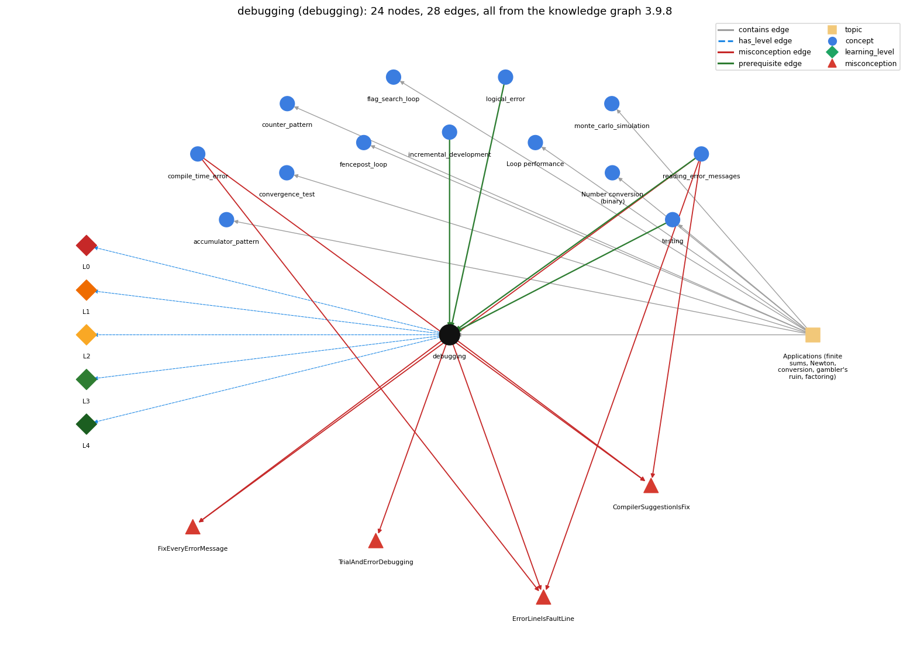

# debugging (`debugging`)

finding and fixing the cause of a wrong result or error by forming a hypothesis, changing the program and checking the prediction

Section 1.3 Conditionals and Loops, topic 1.3.f Applications (finite sums, Newton, conversion, gambler's ruin, factoring). From the knowledge graph 3.9.8 (`data/raw/chapter1_kg_updated.json`).

## Concepts associated with debugging (13)

| Concept | Description | How it is associated |
| --- | --- | --- |
| **accumulator\_pattern** | building up a running total/result | same topic (topic1.3.f) |
| **compile\_time\_error** | an error javac reports before the program can run (syntax, types) | shares misconception ErrorLineIsFaultLine shares misconception CompilerSuggestionIsFix |
| **convergence\_test** | stopping a loop when a floating-point result is close enough | same topic (topic1.3.f) |
| **counter\_pattern** | counting occurrences across passes | same topic (topic1.3.f) |
| **fencepost\_loop** | n items need n - 1 separators: one item handled outside the loop | same topic (topic1.3.f) |
| **flag\_search\_loop** | a boolean flag that a loop sets once and never resets | same topic (topic1.3.f) |
| **incremental\_development** | building a program in small steps from a version that works, compiling and testing after each change | prerequisite of it (it needs this) composition rule (R) with it |
| **logical\_error** | the program runs but computes the wrong result | prerequisite of it (it needs this) composition rule (R) with it |
| **loop\_performance** | the running time of a loop program depends on how many iterations it makes | same topic (topic1.3.f) |
| **monte\_carlo\_simulation** | estimating a probability by repeating random trials | same topic (topic1.3.f) |
| **number\_conversion** | converting an integer to its binary representation by casting out powers of 2 in a loop | same topic (topic1.3.f) |
| **reading\_error\_messages** | how to read compiler error messages: first error first; reported line may follow the real fault | prerequisite of it (it needs this) composition rule (R) with it shares misconception ErrorLineIsFaultLine shares misconception FixEveryErrorMessage shares misconception CompilerSuggestionIsFix |
| **testing** | running a program on chosen inputs, including boundary and unusual ones, and comparing the output with what it should be | prerequisite of it (it needs this) composition rule (R) with it same topic (topic1.3.f) |

## Every edge in this view and its full label (28)

| From | Edge | To | Full edge label |
| --- | --- | --- | --- |
| **incremental\_development** | prerequisite | **debugging** | Developing in small steps keeps debugging local: an error is in the change just made. grounding: book\_passage composition rule (R) of incremental\_development with debugging: Small steps make debugging local: the newest change is the first suspect. composition rule (R) of debugging with incremental\_development: Small steps keep debugging short: the error is in the change just made. |
| **logical\_error** | prerequisite | **debugging** | Debugging is mostly the search for logic errors, which give wrong output without any message. grounding: book\_passage composition rule (R) of debugging with logical\_error: A logic error gives no message, so it is found only by comparing actual values with expected ones. |
| **reading\_error\_messages** | prerequisite | **debugging** | Reading an error message tells you where to start looking; debugging goes on from there to the cause. grounding: book\_passage composition rule (R) of debugging with reading\_error\_messages: An error message gives the place where Java noticed the problem; the cause may be earlier, so it is the start of the search, not the answer. |
| **testing** | prerequisite | **debugging** | A failing test is what starts debugging: testing finds that something is wrong, debugging finds why. grounding: book\_passage composition rule (R) of testing with debugging: A failing test starts debugging; after the fix, the same test is run again to confirm it. composition rule (R) of debugging with testing: Testing tells that a program is wrong; debugging finds why. The failing test is re-run after the fix. |
| **compile\_time\_error** | misconception | **CompilerSuggestionIsFix** | **wrong rule:** Doing exactly what the compiler message suggests will fix the error. **right rule:** An error message is evidence that something is wrong, but its suggested remedy may be wrong; find the actual cause. role: context |
| **compile\_time\_error** | misconception | **ErrorLineIsFaultLine** | **wrong rule:** The line number in a javac error is always the line that has the mistake. **right rule:** The compiler reports where it noticed the problem, which can be after the real fault; for example, omitting the second left brace of HelloWorld produces errors reported on later lines. role: context |
| **debugging** | misconception | **CompilerSuggestionIsFix** | **wrong rule:** Doing exactly what the compiler message suggests will fix the error. **right rule:** An error message is evidence that something is wrong, but its suggested remedy may be wrong; find the actual cause. role: context |
| **debugging** | misconception | **ErrorLineIsFaultLine** | **wrong rule:** The line number in a javac error is always the line that has the mistake. **right rule:** The compiler reports where it noticed the problem, which can be after the real fault; for example, omitting the second left brace of HelloWorld produces errors reported on later lines. role: context |
| **debugging** | misconception | **FixEveryErrorMessage** | **wrong rule:** Each error message is a separate mistake that needs its own fix. **right rule:** One fault can produce several messages; fix the first and recompile. role: context |
| **debugging** | misconception | **TrialAndErrorDebugging** | **wrong rule:** Debugging means changing the code until the error goes away. **right rule:** Debugging is like an experiment: form a hypothesis about what is wrong, change the program, and check that the result matches the prediction. role: primary |
| **reading\_error\_messages** | misconception | **CompilerSuggestionIsFix** | **wrong rule:** Doing exactly what the compiler message suggests will fix the error. **right rule:** An error message is evidence that something is wrong, but its suggested remedy may be wrong; find the actual cause. role: primary |
| **reading\_error\_messages** | misconception | **ErrorLineIsFaultLine** | **wrong rule:** The line number in a javac error is always the line that has the mistake. **right rule:** The compiler reports where it noticed the problem, which can be after the real fault; for example, omitting the second left brace of HelloWorld produces errors reported on later lines. role: primary |
| **reading\_error\_messages** | misconception | **FixEveryErrorMessage** | **wrong rule:** Each error message is a separate mistake that needs its own fix. **right rule:** One fault can produce several messages; fix the first and recompile. role: primary |
| **debugging** | has\_level | **debugging@L0** | debugging -&gt; L0 (Prestructural): the answer holds a rule that contradicts Java (3 ways). **[0] everyday\_reading** (E): Everyday 'fixing' means trying changes until a problem goes away. In programming, debugging finds the cause first: form a hypothesis, change the program, and check that the result is the one predicted. **[1] misconception** (M) &rarr; TrialAndErrorDebugging: wrong rule: Debugging means changing the code until the error goes away. Right rule: Debugging is like an experiment: form a hypothesis about what is wrong, change the program, and check that the result matches the prediction. **[2] inconsistent\_trace** (T) &rarr; TrialAndErrorDebugging: Applies the debugging method unevenly: forms a hypothesis for the first bug, then makes random changes for the next one. (here mixing in: "Debugging means changing the code until the error goes away") |
| **debugging** | has\_level | **debugging@L1** | debugging -&gt; L1 (Unistructural): the answer states one correct rule without applying it (2 ways). **[0] names\_the\_element** (N): Debugging: finding and removing the cause of a wrong result or an error. **[1] states\_the\_rule** (S): Debug like an experimental scientist: once you have an idea of what is going wrong, modify the program and try again; if the hypothesis was right, you can predict the result of the change. |
| **debugging** | has\_level | **debugging@L2** | debugging -&gt; L2 (Multistructural): the answer applies the rules of debugging to every part of the code, in order (3 ways). **[0] line\_by\_line\_trace** (LT): Sequencing: reproduce the failure, locate where the actual values first differ from the expected ones (by tracing or by printing intermediate values), form a hypothesis, change one thing, and run again. **[1] output\_prediction** (OP): Result: a fix is accepted when the failing input now gives the expected output and the earlier tests still pass. **[2] one\_step\_execution** (OS): State transition: each debugging step changes one thing in the program and either confirms or rejects one hypothesis. |
| **debugging** | has\_level | **debugging@L3** | debugging -&gt; L3 (Relational): the answer relates the parts (5 ways). **[0] relation\_to\_neighbour** (R): Testing tells that a program is wrong; debugging finds why. The failing test is re-run after the fix. **[1] relation\_to\_neighbour** (R): An error message gives the place where Java noticed the problem; the cause may be earlier, so it is the start of the search, not the answer. **[2] relation\_to\_neighbour** (R): A logic error gives no message, so it is found only by comparing actual values with expected ones. **[3] relation\_to\_neighbour** (R): Small steps keep debugging short: the error is in the change just made. **[4] purpose\_of\_the\_whole** (P): Plan: turn a failing program into a working one by finding the cause of each failure, not by guessing. |
| **debugging** | has\_level | **debugging@L4** | debugging -&gt; L4 (Extended abstract): the answer reasons beyond the given code (3 ways). **[0] predict\_a\_change** (C) &rarr; TrialAndErrorDebugging: Conservation: a correct fix removes the cause for the whole class of inputs that failed, and changes nothing for inputs that already worked. **[1] transfer\_to\_a\_new\_program** (X): When a program fails: reproduce the failure, print or trace intermediate values to find where they first go wrong, fix that, and re-run all the tests. **[2] diagnose\_an\_error** (D): rule broken: Find the cause before changing code. Kind: logic error. Trigger class: changes are made at random until one test passes, so the bug survives for other inputs or a new bug is added |
| **topic1.3.f** | contains | **accumulator\_pattern** | topic topic1.3.f contains accumulator\_pattern |
| **topic1.3.f** | contains | **convergence\_test** | topic topic1.3.f contains convergence\_test |
| **topic1.3.f** | contains | **counter\_pattern** | topic topic1.3.f contains counter\_pattern |
| **topic1.3.f** | contains | **debugging** | topic topic1.3.f contains debugging |
| **topic1.3.f** | contains | **fencepost\_loop** | topic topic1.3.f contains fencepost\_loop |
| **topic1.3.f** | contains | **flag\_search\_loop** | topic topic1.3.f contains flag\_search\_loop |
| **topic1.3.f** | contains | **loop\_performance** | topic topic1.3.f contains loop\_performance |
| **topic1.3.f** | contains | **monte\_carlo\_simulation** | topic topic1.3.f contains monte\_carlo\_simulation |
| **topic1.3.f** | contains | **number\_conversion** | topic topic1.3.f contains number\_conversion |
| **topic1.3.f** | contains | **testing** | topic topic1.3.f contains testing |
