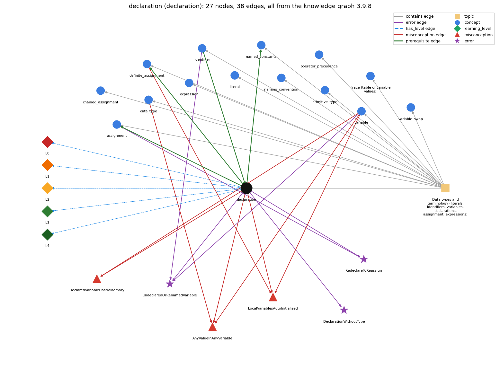

# declaration (`declaration`)

int x; -- introduces a variable name and its type

Section 1.2 Built-in Types of Data, topic 1.2.a Data types and terminology (literals, identifiers, variables, declarations, assignment, expressions). From the knowledge graph 3.9.8 (`data/raw/chapter1_kg_updated.json`).

## Concepts associated with declaration (14)

| Concept | Description | How it is associated |
| --- | --- | --- |
| **assignment** | = stores the computed value of the right side | builds on it (needs it) composition rule (R) with it shares error RedeclareToReassign same topic (topic1.2.a) |
| **chained\_assignment** | a = b = 0 assigns right to left | same topic (topic1.2.a) |
| **data\_type** | a set of values and the operations defined on them | shares misconception AnyValueInAnyVariable same topic (topic1.2.a) |
| **definite\_assignment** | a local variable must be assigned before it is read | builds on it (needs it) composition rule (R) with it shares misconception LocalVariablesAutoInitialized same topic (topic1.2.a) |
| **expression** | anything that evaluates to a value | same topic (topic1.2.a) |
| **identifier** | a name for a variable, method or class; case-sensitive, no spaces, not a keyword | prerequisite of it (it needs this) composition rule (R) with it shares error UndeclaredOrRenamedVariable same topic (topic1.2.a) |
| **literal** | a constant value written in code (42, 3.14, true, 'a', "hi") | same topic (topic1.2.a) |
| **named\_constants** | final constants in UPPER\_CASE instead of magic numbers | builds on it (needs it) composition rule (R) with it same topic (topic1.2.a) |
| **naming\_convention** | choosing meaningful names: full words, lowerCamelCase, single letters only for throwaway loop counters | same topic (topic1.2.a) |
| **operator\_precedence** | the order operators bind in an expression | same topic (topic1.2.a) |
| **primitive\_type** | int, double, boolean, char | same topic (topic1.2.a) |
| **program\_trace** | a table of the values of the variables after each statement, used to check what code does | same topic (topic1.2.a) |
| **variable** | a named, typed box that holds a value | shares error UndeclaredOrRenamedVariable shares misconception AnyValueInAnyVariable shares misconception LocalVariablesAutoInitialized shares misconception DeclaredVariableHasNoMemory same topic (topic1.2.a) |
| **variable\_swap** | exchanging two variables needs a temporary | same topic (topic1.2.a) |

## Every edge in this view and its full label (38)

| From | Edge | To | Full edge label |
| --- | --- | --- | --- |
| **declaration** | prerequisite | **assignment** | A variable must be declared before an assignment can store a value into it. grounding: book\_passage composition rule (R) of declaration with assignment: An assignment can store into a variable only after the variable's declaration, and only a value of a compatible type. composition rule (R) of assignment with declaration: A declaration can include the first assignment (int x = 5;). Assigning to a variable that was never declared does not compile. |
| **declaration** | prerequisite | **definite\_assignment** | A declared local variable has no defined value until it is assigned, and the compiler rejects any read before that assignment. grounding: book\_passage composition rule (R) of declaration with definite\_assignment: A declaration without an initializer leaves a local unassigned, and any read before an assignment on every path is a compile error. composition rule (R) of definite\_assignment with declaration: A declaration without an initializer leaves the local unassigned. Writing = value in the declaration satisfies the rule at once. |
| **declaration** | prerequisite | **named\_constants** | A constant is a declaration marked final. grounding: book\_passage composition rule (R) of declaration with named\_constants: Adding final to a declaration makes the variable a constant that can be assigned only once. composition rule (R) of named\_constants with declaration: A constant is an ordinary declaration with the final modifier, with the same type and scope rules. |
| **identifier** | prerequisite | **declaration** | A declaration pairs a type with an identifier, e.g. int count;. grounding: book\_passage composition rule (R) of identifier with declaration: A declaration binds the identifier to a type. Every later use must repeat exactly that spelling, or the compiler cannot resolve it. composition rule (R) of declaration with identifier: A declaration binds a legal identifier to a type, and that identifier must not already be declared in the same scope. |
| **data\_type** | misconception | **AnyValueInAnyVariable** | **wrong rule:** A variable declared int can hold 2.5 or "hi"; the type is only a label. **right rule:** A data type is a set of values and a set of operations defined on them, so an int variable holds only int values. role: primary |
| **declaration** | misconception | **AnyValueInAnyVariable** | **wrong rule:** A variable declared int can hold 2.5 or "hi"; the type is only a label. **right rule:** A data type is a set of values and a set of operations defined on them, so an int variable holds only int values. role: context |
| **declaration** | misconception | **DeclaredVariableHasNoMemory** | **wrong rule:** int x; without a value sets aside no memory; the variable only exists once something is assigned. **right rule:** A declaration creates the variable (its storage) with its type; assignment later puts a value in it. role: primary |
| **declaration** | misconception | **LocalVariablesAutoInitialized** | **wrong rule:** local variables get a default value on their own **right rule:** A local variable has no value until it is assigned, and using it before then does not compile. role: context |
| **definite\_assignment** | misconception | **LocalVariablesAutoInitialized** | **wrong rule:** local variables get a default value on their own **right rule:** A local variable has no value until it is assigned, and using it before then does not compile. role: primary |
| **variable** | misconception | **AnyValueInAnyVariable** | **wrong rule:** A variable declared int can hold 2.5 or "hi"; the type is only a label. **right rule:** A data type is a set of values and a set of operations defined on them, so an int variable holds only int values. role: context |
| **variable** | misconception | **DeclaredVariableHasNoMemory** | **wrong rule:** int x; without a value sets aside no memory; the variable only exists once something is assigned. **right rule:** A declaration creates the variable (its storage) with its type; assignment later puts a value in it. role: context |
| **variable** | misconception | **LocalVariablesAutoInitialized** | **wrong rule:** int x; inside main starts at 0, so x can be used before anything is assigned to it. **right rule:** A local variable has no value until it is assigned, and using it before then does not compile. role: context |
| **assignment** | error | **RedeclareToReassign** | **wrong rule:** Writes int x = 5; ... int x = 10; to change x. **right rule:** A declaration gives a variable its name and type; a later change of value is an assignment statement such as x = 10;, not a second declaration. role: context |
| **declaration** | error | **DeclarationWithoutType** | **wrong rule:** Writes name = value; to declare a new variable. **right rule:** A declaration needs a type: type name = value; role: primary |
| **declaration** | error | **RedeclareToReassign** | **wrong rule:** Writes int x = 5; ... int x = 10; to change x. **right rule:** A declaration gives a variable its name and type; a later change of value is an assignment statement such as x = 10;, not a second declaration. role: primary |
| **declaration** | error | **UndeclaredOrRenamedVariable** | **wrong rule:** Uses a variable that was never declared, or under a different name (studentTotal vs total). **right rule:** Every variable must be declared, and used with exactly the declared name. role: context |
| **identifier** | error | **UndeclaredOrRenamedVariable** | **wrong rule:** Uses a variable that was never declared, or under a different name (studentTotal vs total). **right rule:** Every variable must be declared, and used with exactly the declared name. role: context |
| **variable** | error | **UndeclaredOrRenamedVariable** | **wrong rule:** Uses a variable that was never declared, or under a different name (studentTotal vs total). **right rule:** Every variable must be declared, and used with exactly the declared name. role: primary |
| **declaration** | has\_level | **declaration@L0** | declaration -&gt; L0 (Prestructural): the answer holds a rule that contradicts Java (5 ways). **[0] everyday\_reading** (E): In English, to 'declare' something announces a fact or gives it a value, so novices think int x; already sets x to 0, or that x = 5; alone creates x. In Java a declaration creates the variable with a type, and a local variable has no usable value until it is assigned. **[1] misconception** (M) &rarr; DeclaredVariableHasNoMemory: wrong rule: int x; without a value sets aside no memory; the variable only exists once something is assigned. Right rule: A declaration creates the variable (its storage) with its type; assignment later puts a value in it. **[2] inconsistent\_trace** (T) &rarr; DeclaredVariableHasNoMemory: Points to LT (a declaration runs once when reached and creates the variable, and later assignments only update it). Applied unevenly, a student re-creates or zeroes the variable on some passes but not others, or treats a declaration further down as already in effect. (here mixing in: "int x; without a value sets aside no memory; the variable only exists once something is assigned") **[3] misconception** (M) &rarr; AnyValueInAnyVariable: wrong rule: A variable declared int can hold 2.5 or "hi"; the type is only a label. Right rule: A data type is a set of values and a set of operations defined on them, so an int variable holds only int values. **[4] misconception** (M) &rarr; LocalVariablesAutoInitialized: wrong rule: local variables get a default value on their own. Right rule: A local variable has no value until it is assigned, and using it before then does not compile. |
| **declaration** | has\_level | **declaration@L1** | declaration -&gt; L1 (Unistructural): the answer states one correct rule without applying it (2 ways). **[0] names\_the\_element** (N): Declaration statement: a statement that introduces a variable by giving its type and name, such as int count; or double x = 0.5;. **[1] states\_the\_rule** (S): Syntax: type name; or type name = expression; or type a, b, c;. Each variable must be declared before it is used, only once per scope, and its type never changes. |
| **declaration** | has\_level | **declaration@L2** | declaration -&gt; L2 (Multistructural): the answer applies the rules of declaration to every part of the code, in order (3 ways). **[0] line\_by\_line\_trace** (LT): When execution reaches the declaration, the variable comes into being. If there is an initializer, it is evaluated and stored. The variable's scope runs from there to the end of the enclosing block, and statements in the block run first to last. **[1] output\_prediction** (OP): A declaration produces no value and no output. Its effect is to fix the variable's name and type for every later compile-time check. **[2] one\_step\_execution** (OS): int x; adds x to the program state with an undefined (unassigned) value. int x = 5; adds x holding 5. |
| **declaration** | has\_level | **declaration@L3** | declaration -&gt; L3 (Relational): the answer relates the parts (5 ways). **[0] relation\_to\_neighbour** (R): A declaration binds a legal identifier to a type, and that identifier must not already be declared in the same scope. **[1] relation\_to\_neighbour** (R): An assignment can store into a variable only after the variable's declaration, and only a value of a compatible type. **[2] relation\_to\_neighbour** (R): A declaration without an initializer leaves a local unassigned, and any read before an assignment on every path is a compile error. **[3] relation\_to\_neighbour** (R): Adding final to a declaration makes the variable a constant that can be assigned only once. **[4] purpose\_of\_the\_whole** (P): Declarations make the programmer's intent explicit (names and types) so the compiler can check consistency. The usual plan is to declare each variable at its point of first use. |
| **declaration** | has\_level | **declaration@L4** | declaration -&gt; L4 (Extended abstract): the answer reasons beyond the given code (6 ways). **[0] predict\_a\_change** (C) &rarr; DeclaredVariableHasNoMemory: Moving a declaration into an inner block (such as a loop body) shrinks its scope and re-creates the variable on each pass, so an accumulated value is lost. Moving it out widens its scope. Changing its type changes which values and operations are legal. **[1] diagnose\_an\_error** (D): rule broken: A local variable may be declared only once in its scope; later changes use an assignment without the type. Kind: compile-time. Trigger class: A second 'int x = ...' for a name already declared in the same or an enclosing block: 'variable x is already defined'. **[2] diagnose\_an\_error** (D): rule broken: A declaration must begin with a type (type name = value;); name = value; is only an assignment to an existing variable. Kind: compile-time. Trigger class: First use of a new variable written without its type (total = 0;): 'cannot find symbol' because no variable total exists. **[3] transfer\_to\_a\_new\_program** (X): Declare every variable exactly once, in the narrowest block that covers all its uses, with an initializer when the first value is known. Declare it before (outside) a loop when its value must last across iterations or be used after the loop. **[4] diagnose\_an\_error** (D): rule broken: Every variable must be declared (with a type) before use and referred to by exactly the declared name, inside its scope. Kind: compile-time. Trigger class: Use of a name that was never declared, was declared under another name, or is used outside the block where it was declared: 'cannot find symbol' (one missing declaration can produce several errors). **[5] diagnose\_an\_error** (D): rule broken: The initializer's type must be assignable to the declared type. Kind: compile-time. Trigger class: Declaring int x = 1.1; or String s = 123;: 'incompatible types'. |
| **topic1.2.a** | contains | **assignment** | topic topic1.2.a contains assignment |
| **topic1.2.a** | contains | **chained\_assignment** | topic topic1.2.a contains chained\_assignment |
| **topic1.2.a** | contains | **data\_type** | topic topic1.2.a contains data\_type |
| **topic1.2.a** | contains | **declaration** | topic topic1.2.a contains declaration |
| **topic1.2.a** | contains | **definite\_assignment** | topic topic1.2.a contains definite\_assignment |
| **topic1.2.a** | contains | **expression** | topic topic1.2.a contains expression |
| **topic1.2.a** | contains | **identifier** | topic topic1.2.a contains identifier |
| **topic1.2.a** | contains | **literal** | topic topic1.2.a contains literal |
| **topic1.2.a** | contains | **named\_constants** | topic topic1.2.a contains named\_constants |
| **topic1.2.a** | contains | **naming\_convention** | topic topic1.2.a contains naming\_convention |
| **topic1.2.a** | contains | **operator\_precedence** | topic topic1.2.a contains operator\_precedence |
| **topic1.2.a** | contains | **primitive\_type** | topic topic1.2.a contains primitive\_type |
| **topic1.2.a** | contains | **program\_trace** | topic topic1.2.a contains program\_trace |
| **topic1.2.a** | contains | **variable** | topic topic1.2.a contains variable |
| **topic1.2.a** | contains | **variable\_swap** | topic topic1.2.a contains variable\_swap |
