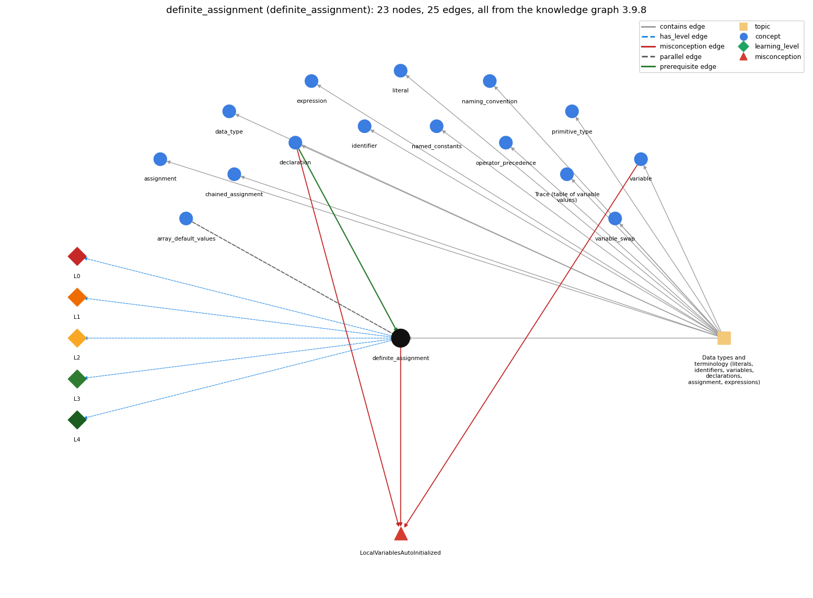

# definite_assignment (`definite_assignment`)

a local variable must be assigned before it is read

Section 1.2 Built-in Types of Data, topic 1.2.a Data types and terminology (literals, identifiers, variables, declarations, assignment, expressions).

## At a glance

- **Needs first:** `declaration`
- **Leads to:** nothing
- **Learned alongside:** `array_default_values`
- **Misconceptions:** `LocalVariablesAutoInitialized`
- **Errors:** none
- **Levels:** L0, L1, L2, L3, L4

Everything below comes from the knowledge graph 3.9.8 (`data/raw/chapter1_kg_updated.json`): 25 edges around this concept, each explained in the graph's own words.

## What it needs first (1)

A prerequisite edge means the other concept has to be understood before `definite_assignment`.

### `declaration` comes before `definite_assignment`

*int x; -- introduces a variable name and its type*

A declared local variable has no defined value until it is assigned, and the compiler rejects any read before that assignment.

- **Grounding:** book passage
- **How `definite_assignment` combines with `declaration`:** A declaration without an initializer leaves the local unassigned. Writing = value in the declaration satisfies the rule at once.
- **How `declaration` combines with `definite_assignment`:** A declaration without an initializer leaves a local unassigned, and any read before an assignment on every path is a compile error.

## What it leads to (0)

These concepts need `definite_assignment` first.

No concept has this one as a prerequisite.

## Learned alongside (1)

A parallel edge joins two concepts that sit side by side: neither is needed before the other.

### `definite_assignment` alongside `array_default_values`

*new slots start at 0 / false / null*

A local variable has no value until it is assigned: using it first is a compile-time error. An array element is given a default value (0, 0.0, false) when the array is created with new, so it can be read before any assignment.

- **Grounding:** book passage

## Misconceptions (1)

A misconception edge states the wrong rule a student may hold about this concept, and the right rule.

### LocalVariablesAutoInitialized

- **Wrong rule:** local variables get a default value on their own
- **Right rule:** A local variable has no value until it is assigned, and using it before then does not compile.
- **Role of this concept:** primary
- **Shows at level L0 as:** misconception: wrong rule: local variables get a default value on their own. Right rule: A local variable has no value until it is assigned, and using it before then does not compile.
- **Shows at level L0 as:** inconsistent trace: Points to LT (along every control-flow path, an assignment must come before each read). Applied unevenly, a student checks straight-line code but assumes a variable assigned in only one branch of an if, or inside a loop, is assigned afterwards. (here mixing in: "local variables get a default value on their own")
- **Also an edge from `declaration`:** local variables get a default value on their own
- **Also an edge from `variable`:** int x; inside main starts at 0, so x can be used before anything is assigned to it.

## Errors (0)

An error edge states the rule that gets broken in a program, and the right rule.

The graph has no error edge from this concept.

## Levels L0 to L4 (5 of 5)

Each level edge lists the ways a student shows that level, each with its exact rule.

### L0: Prestructural / sensorimotor

L0 for definite assignment: the answer holds a rule that contradicts Java.

*Deciding question: Does every rule the answer applies to definite assignment agree with the language rule? If it reads the code with everyday meanings, applies a wrong rule, or switches rules within one trace, it is L0. A slip in an otherwise rule-correct trace is L2 with an error, not L0.*

definite assignment -&gt; L0 (Prestructural): the answer holds a rule that contradicts Java (3 ways).

- **everyday reading** (folk-meaning rule): Everyday intuition, and some older languages, treat a new or empty quantity as zero ("nothing yet means 0"). A Java local variable has no value at all until it is assigned, and the compiler rejects any read before that.
- **misconception** (wrong rule / right rule; shows `LocalVariablesAutoInitialized`): wrong rule: local variables get a default value on their own. Right rule: A local variable has no value until it is assigned, and using it before then does not compile.
- **inconsistent trace** (uneven-application rule; shows `LocalVariablesAutoInitialized`): Points to LT (along every control-flow path, an assignment must come before each read). Applied unevenly, a student checks straight-line code but assumes a variable assigned in only one branch of an if, or inside a loop, is assigned afterwards. (here mixing in: "local variables get a default value on their own")

### L1: Unistructural / atom x text surface

L1 for definite assignment: the answer states one correct rule without applying it.

*Deciding question: Does the answer cover every part of the code, in order, with the values (L2)? If it covers one part or only states the rule, it is L1.*

definite assignment -&gt; L1 (Unistructural): the answer states one correct rule without applying it (2 ways).

- **names the element** (identity rule): Definite assignment: the compile-time rule that a local variable must certainly have been assigned before any read of it.
- **states the rule** (declarative rule): Every access of a local variable must be preceded by an assignment on every possible path, or the program does not compile. The analysis ignores run-time values, except for constant booleans and the operators &amp;&amp; \|\| ?:.

### L2: Multistructural / block x execution / preoperational

L2 for definite assignment: the answer applies these rules to every part of the code, in order.

*Deciding question: Is the answer many segments mapped onto lines (L2), or one segment stating the purpose of the whole (L3)? A correct output with no value-by-value justification is not levelled.*

definite assignment -&gt; L2 (Multistructural): the answer applies the rules of definite assignment to every part of the code, in order (3 ways).

- **line by line trace** (operational sequencing rule): The compiler walks the control flow. After a declaration with no initializer the variable is unassigned, and an assignment makes it assigned on that path. Where paths merge (after if/else) it counts as assigned only if every incoming path assigned it, and an assignment inside a while body does not count after the loop.
- **output prediction** (evaluation / result rule): The result appears at compile time: the code either compiles or reports 'variable x might not have been initialized'. No default value is ever produced for a local variable.
- **one step execution** (state-transition rule): The first assignment (initialization) moves a variable from unassigned to holding a value, and only then may it be read.

### L3: Relational / relations x function (concrete operational begins)

L3 for definite assignment: the answer relates the parts by these rules.

*Deciding question: Was the purpose deduced from the code, or only guessed from traced input/output pairs (then L2)? Does the answer stay within the given code (L3), or reason about changed code, an error class or a new program (L4)?*

definite assignment -&gt; L3 (Relational): the answer relates the parts (3 ways).

- **relation to neighbour** (composition rule (with a neighbour)): A declaration without an initializer leaves the local unassigned. Writing = value in the declaration satisfies the rule at once.
- **relation to neighbour** (composition rule (with a neighbour)): A local variable has no value until it is assigned: using it first is a compile-time error. An array element is given a default value (0, 0.0, false) when the array is created with new, so it can be read before any assignment.
- **purpose of the whole** (plan / role rule): The rule guarantees that no program reads a meaningless value. The matching plan is to initialize counters and accumulators before the loop that updates them (int sum = 0; then sum += i inside the loop).

### L4: Extended abstract (concrete-operational reversibility and conservation)

L4 for definite assignment: the answer reasons beyond the given code by these rules.

*Deciding question: Does the answer link the code to a broader context: a changed program, a class of inputs, an unseen problem? Re-tracing changed code value by value is L2; fixing one given failing case is L3.*

definite assignment -&gt; L4 (Extended abstract): the answer reasons beyond the given code (4 ways).

- **predict a change** (conservation rule; shows `LocalVariablesAutoInitialized`): Moving an initialization into one branch of an if, or into a loop body, breaks compilation of the reads that follow. Adding an else branch that also assigns, or initializing at the declaration, restores it.
- **transfer to a new program** (applicability rule): Initialize at the declaration whenever a sensible first value exists (0 for counters and sums). Leave the declaration bare only when every branch that follows assigns it. The rule covers local variables only: array elements and fields get default values.
- **diagnose an error** (error rule): rule broken: A local variable must be definitely assigned before it is read. Kind: compile-time. Trigger class: A read reachable on a path with no assignment: declared without initializer, or assigned only inside an if without else, a loop body, or a switch case: 'variable might not have been initialized'.
- **diagnose an error** (error rule): rule broken: A blank final variable must be assigned at most once. Kind: compile-time. Trigger class: Assigning a final local on two paths that can both run, or again inside a loop: 'variable might already have been assigned'.

## Same topic

`definite_assignment` belongs to the topic **Data types and terminology (literals, identifiers, variables, declarations, assignment, expressions)** (`topic1.2.a`). The topic also contains: `assignment`, `chained_assignment`, `data_type`, `declaration`, `expression`, `identifier`, `literal`, `named_constants`, `naming_convention`, `operator_precedence`, `primitive_type`, `program_trace`, `variable`, `variable_swap`.

## Rules of the concept (14)

- **folk-meaning rule:** Everyday intuition, and some older languages, treat a new or empty quantity as zero ("nothing yet means 0"). A Java local variable has no value at all until it is assigned, and the compiler rejects any read before that.
- **wrong rule / right rule:** LocalVariablesAutoInitialized: wrong: local variables get a default value on their own \| right: A local variable has no value until it is assigned, and using it before then does not compile.
- **uneven-application rule:** Points to LT (along every control-flow path, an assignment must come before each read). Applied unevenly, a student checks straight-line code but assumes a variable assigned in only one branch of an if, or inside a loop, is assigned afterwards.
- **identity rule:** Definite assignment: the compile-time rule that a local variable must certainly have been assigned before any read of it.
- **declarative rule:** Every access of a local variable must be preceded by an assignment on every possible path, or the program does not compile. The analysis ignores run-time values, except for constant booleans and the operators &amp;&amp; \|\| ?:.
- **operational sequencing rule:** The compiler walks the control flow. After a declaration with no initializer the variable is unassigned, and an assignment makes it assigned on that path. Where paths merge (after if/else) it counts as assigned only if every incoming path assigned it, and an assignment inside a while body does not count after the loop.
- **evaluation / result rule:** The result appears at compile time: the code either compiles or reports 'variable x might not have been initialized'. No default value is ever produced for a local variable.
- **state-transition rule:** The first assignment (initialization) moves a variable from unassigned to holding a value, and only then may it be read.
- **composition rule (with a neighbour):** with declaration: A declaration without an initializer leaves the local unassigned. Writing = value in the declaration satisfies the rule at once.
- **plan / role rule:** The rule guarantees that no program reads a meaningless value. The matching plan is to initialize counters and accumulators before the loop that updates them (int sum = 0; then sum += i inside the loop).
- **conservation rule:** Moving an initialization into one branch of an if, or into a loop body, breaks compilation of the reads that follow. Adding an else branch that also assigns, or initializing at the declaration, restores it.
- **error rule:** rule broken: A local variable must be definitely assigned before it is read. (compile-time)
- **error rule:** rule broken: A blank final variable must be assigned at most once. (compile-time)
- **applicability rule:** Initialize at the declaration whenever a sensible first value exists (0 for counters and sums). Leave the declaration bare only when every branch that follows assigns it. The rule covers local variables only: array elements and fields get default values.

## The whole prerequisite chain

- **Everything it builds on (2):** `declaration`, `identifier`
- **Everything that builds on it (0):** nothing
