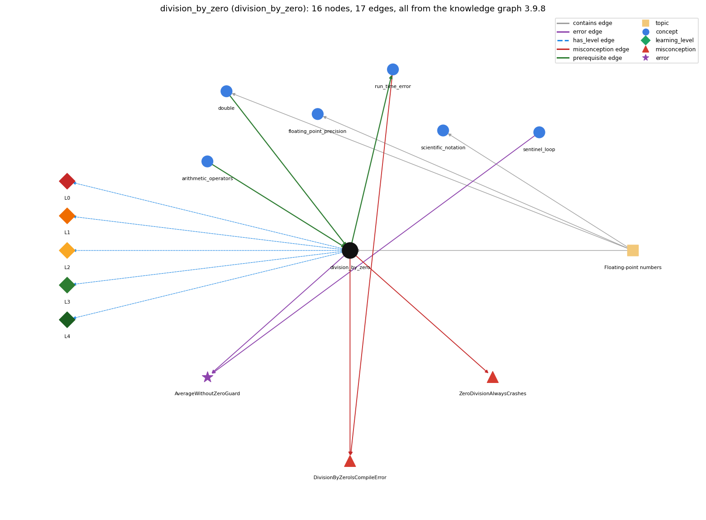

# division_by_zero (`division_by_zero`)

int division by zero throws; double division gives Infinity or NaN

Section 1.2 Built-in Types of Data, topic 1.2.d Floating-point numbers.

## At a glance

- **Needs first:** `arithmetic_operators`, `double`
- **Leads to:** `run_time_error`
- **Learned alongside:** nothing
- **Misconceptions:** `DivisionByZeroIsCompileError`, `ZeroDivisionAlwaysCrashes`
- **Errors:** `AverageWithoutZeroGuard`
- **Levels:** L0, L1, L2, L3, L4

Everything below comes from the knowledge graph 3.9.8 (`data/raw/chapter1_kg_updated.json`): 17 edges around this concept, each explained in the graph's own words.

## What it needs first (2)

A prerequisite edge means the other concept has to be understood before `division_by_zero`.

### `arithmetic_operators` comes before `division_by_zero`

*+ - \* / %*

Integer division by zero (1/0) generates a run-time exception, while floating-point 1.0/0.0 is legal and has the value Infinity.

- **Grounding:** book passage
- **How `division_by_zero` combines with `arithmetic_operators`:** The zero check belongs to the int / and % operators: they always produce an int except when the divisor is zero, in which case they throw; + - \* never throw.
- **How `arithmetic_operators` combines with `division_by_zero`:** int / or % by zero throws a run-time exception, while floating-point division by zero gives Infinity or NaN.

### `double` comes before `division_by_zero`

*64-bit floating-point primitive*

For doubles, 1.0/0.0 is legal and has the value Infinity; a double result can also be the special value NaN when the calculation is undefined.

- **Grounding:** book passage
- **How `division_by_zero` combines with `double`:** Once either operand is a double the division follows IEEE 754 rules instead, so the same zero divisor gives Infinity or NaN rather than an exception.
- **How `double` combines with `division_by_zero`:** For double operands a zero divisor is not an error: 1.0/0.0 is Infinity, -1.0/0.0 is -Infinity and 0.0/0.0 is NaN, whereas int division by zero throws an exception.

## What it leads to (1)

These concepts need `division_by_zero` first.

### `division_by_zero` comes before `run_time_error`

*an error raised while the program executes (e.g. ArrayIndexOutOfBounds, NumberFormatException)*

Dividing an int by zero compiles but throws ArithmeticException when the program runs: a run-time error.

- **Grounding:** spec passage

## Learned alongside (0)

A parallel edge joins two concepts that sit side by side: neither is needed before the other.

No parallel edge touches this concept.

## Misconceptions (2)

A misconception edge states the wrong rule a student may hold about this concept, and the right rule.

### DivisionByZeroIsCompileError

- **Wrong rule:** System.out.println(5 / 0); is rejected by the compiler.
- **Right rule:** It compiles; the ArithmeticException happens when the program runs.
- **Role of this concept:** primary
- **Shows at level L0 as:** misconception: wrong rule: System.out.println(5 / 0); is rejected by the compiler. Right rule: It compiles; the ArithmeticException (/ by zero) is thrown when the program runs and reaches the division.
- **Also an edge from `run_time_error`:** System.out.println(5 / 0); is rejected by the compiler.

### ZeroDivisionAlwaysCrashes

- **Wrong rule:** Dividing by zero always stops the program with an error.
- **Right rule:** Only integer division by zero generates a run-time exception; 1.0/0.0 is legal and has the value Infinity.
- **Role of this concept:** primary
- **Shows at level L0 as:** misconception: wrong rule: Dividing by zero always stops the program with an error. Right rule: Only integer division (and remainder) by zero throws; 1.0/0.0 is Infinity and 0.0/0.0 is NaN, and the program keeps running.
- **Shows at level L0 as:** inconsistent trace: Points to LT (both operands are evaluated, promotion decides whether the division is int or double, and only then is the divisor checked). Applied unevenly: the student lets 1/0.0 crash because the 1 is an int, or lets 1/0 give Infinity on one line and an exception on another. (here mixing in: "Dividing by zero always stops the program with an error")

## Errors (1)

An error edge states the rule that gets broken in a program, and the right rule.

### AverageWithoutZeroGuard

- **Wrong rule:** Computes sum / count without checking that count is above 0.
- **Right rule:** If no value was read (count is 0), do not compute the average: with int operands sum / count is a division by zero, a run-time exception that stops the program; with a double sum the division does not stop the program and gives a meaningless value instead of an average.
- **Role of this concept:** context
- **Also an edge from `sentinel_loop`:** Computes sum / count without checking that count is above 0.

## Levels L0 to L4 (5 of 5)

Each level edge lists the ways a student shows that level, each with its exact rule.

### L0: Prestructural / sensorimotor

L0 for division by zero: the answer holds a rule that contradicts Java.

*Deciding question: Does every rule the answer applies to division by zero agree with the language rule? If it reads the code with everyday meanings, applies a wrong rule, or switches rules within one trace, it is L0. A slip in an otherwise rule-correct trace is L2 with an error, not L0.*

division by zero -&gt; L0 (Prestructural): the answer holds a rule that contradicts Java (4 ways).

- **everyday reading** (folk-meaning rule): Folk meaning: in maths division by zero is 'impossible', so every x / 0 must be rejected, ideally by the compiler. Java rule: the compiler accepts it; int or long / and % by zero throw ArithmeticException at run time, while double division by zero is legal and gives Infinity or NaN.
- **misconception** (wrong rule / right rule; shows `ZeroDivisionAlwaysCrashes`): wrong rule: Dividing by zero always stops the program with an error. Right rule: Only integer division (and remainder) by zero throws; 1.0/0.0 is Infinity and 0.0/0.0 is NaN, and the program keeps running.
- **misconception** (wrong rule / right rule; shows `DivisionByZeroIsCompileError`): wrong rule: System.out.println(5 / 0); is rejected by the compiler. Right rule: It compiles; the ArithmeticException (/ by zero) is thrown when the program runs and reaches the division.
- **inconsistent trace** (uneven-application rule; shows `ZeroDivisionAlwaysCrashes`): Points to LT (both operands are evaluated, promotion decides whether the division is int or double, and only then is the divisor checked). Applied unevenly: the student lets 1/0.0 crash because the 1 is an int, or lets 1/0 give Infinity on one line and an exception on another. (here mixing in: "Dividing by zero always stops the program with an error")

### L1: Unistructural / atom x text surface

L1 for division by zero: the answer states one correct rule without applying it.

*Deciding question: Does the answer cover every part of the code, in order, with the values (L2)? If it covers one part or only states the rule, it is L1.*

division by zero -&gt; L1 (Unistructural): the answer states one correct rule without applying it (2 ways).

- **names the element** (identity rule): Division by zero is the evaluation of x / 0 or x % 0: a run-time error for integer types and a special value (Infinity or NaN) for floating-point types.
- **states the rule** (declarative rule): An integer / or % throws ArithmeticException if the right operand is zero; floating-point arithmetic follows IEEE 754, so a nonzero double divided by zero is Infinity or -Infinity and 0.0/0.0 is NaN. With doubles, 1.0 / 0.0 is Infinity and 0.0 / 0.0 (or Math.sqrt(-1.0)) is NaN; NaN is not equal to anything, not even itself.

### L2: Multistructural / block x execution / preoperational

L2 for division by zero: the answer applies these rules to every part of the code, in order.

*Deciding question: Is the answer many segments mapped onto lines (L2), or one segment stating the purpose of the whole (L3)? A correct output with no value-by-value justification is not levelled.*

division by zero -&gt; L2 (Multistructural): the answer applies the rules of division by zero to every part of the code, in order (3 ways).

- **line by line trace** (operational sequencing rule): Left operand, then right operand are fully evaluated; then the division itself runs: for int it checks the divisor and throws at that moment, so the rest of the statement (the assignment or the println) never happens; for double it produces the special value and evaluation continues.
- **output prediction** (evaluation / result rule): 1/0 and 1%0 produce no value: the program stops with Exception in thread "main" java.lang.ArithmeticException: / by zero; 1.0/0.0 is Infinity, -1.0/0.0 is -Infinity, 0.0/0.0 is NaN, and 1/0.0 is Infinity (the 1 is promoted).
- **one step execution** (state-transition rule): For int, no variable changes: the exception aborts the statement and (uncaught) ends the program. For double, the target gets Infinity or NaN; NaN then propagates through later arithmetic and every comparison with it (even ==) is false.

### L3: Relational / relations x function (concrete operational begins)

L3 for division by zero: the answer relates the parts by these rules.

*Deciding question: Was the purpose deduced from the code, or only guessed from traced input/output pairs (then L2)? Does the answer stay within the given code (L3), or reason about changed code, an error class or a new program (L4)?*

division by zero -&gt; L3 (Relational): the answer relates the parts (3 ways).

- **relation to neighbour** (composition rule (with a neighbour)): The zero check belongs to the int / and % operators: they always produce an int except when the divisor is zero, in which case they throw; + - \* never throw.
- **relation to neighbour** (composition rule (with a neighbour)): Once either operand is a double the division follows IEEE 754 rules instead, so the same zero divisor gives Infinity or NaN rather than an exception.
- **purpose of the whole** (plan / role rule): Plan: guard the division (if (count &gt; 0) average = sum / count;), a guard test placed before the risky operation; Infinity is used on purpose as an initial value for a minimum search (Double.POSITIVE\_INFINITY).

### L4: Extended abstract (concrete-operational reversibility and conservation)

L4 for division by zero: the answer reasons beyond the given code by these rules.

*Deciding question: Does the answer link the code to a broader context: a changed program, a class of inputs, an unseen problem? Re-tracing changed code value by value is L2; fixing one given failing case is L3.*

division by zero -&gt; L4 (Extended abstract): the answer reasons beyond the given code (5 ways).

- **predict a change** (conservation rule; shows `ZeroDivisionAlwaysCrashes`): Changing an operand from int to double turns a crash into a silent Infinity or NaN (and changing it back turns the silent value into a crash); adding a zero guard leaves results for nonzero divisors unchanged.
- **diagnose an error** (error rule): rule broken: A divisor must be checked to be nonzero before dividing; an average of zero values is undefined. Kind: run-time exception. Trigger class: count == 0 (empty input, no values read): with int sum / count an ArithmeticException stops the program; with a double sum the division gives NaN (0.0/0.0) and prints a meaningless average as a silent logic error.
- **transfer to a new program** (applicability rule): Guard every integer division whose divisor could be zero; rely on Infinity only when it is the intended value (e.g. as a sentinel for min); when the result is undefined (empty input) handle the case explicitly instead of printing NaN.
- **diagnose an error** (error rule): rule broken: Integer / and % require a nonzero right operand. Kind: run-time exception. Trigger class: Any int or long division or remainder whose right operand evaluates to 0, e.g. n % k with k = 0, or a loop dividing by a variable that reaches 0.
- **diagnose an error** (error rule): rule broken: A floating-point division by zero yields Infinity or NaN instead of a number. Kind: silent logic error. Trigger class: A double divisor that becomes 0.0 (or 0.0/0.0), whose Infinity/NaN result then flows into later computations and comparisons.

## Same topic

`division_by_zero` belongs to the topic **Floating-point numbers** (`topic1.2.d`). The topic also contains: `double`, `floating_point_precision`, `scientific_notation`.

## Rules of the concept (17)

- **folk-meaning rule:** Folk meaning: in maths division by zero is 'impossible', so every x / 0 must be rejected, ideally by the compiler. Java rule: the compiler accepts it; int or long / and % by zero throw ArithmeticException at run time, while double division by zero is legal and gives Infinity or NaN.
- **wrong rule / right rule:** DivisionByZeroIsCompileError: wrong: System.out.println(5 / 0); is rejected by the compiler. \| right: It compiles; the ArithmeticException (/ by zero) is thrown when the program runs and reaches the division.
- **wrong rule / right rule:** ZeroDivisionAlwaysCrashes: wrong: Dividing by zero always stops the program with an error. \| right: Only integer division (and remainder) by zero throws; 1.0/0.0 is Infinity and 0.0/0.0 is NaN, and the program keeps running.
- **uneven-application rule:** Points to LT (both operands are evaluated, promotion decides whether the division is int or double, and only then is the divisor checked). Applied unevenly: the student lets 1/0.0 crash because the 1 is an int, or lets 1/0 give Infinity on one line and an exception on another.
- **identity rule:** Division by zero is the evaluation of x / 0 or x % 0: a run-time error for integer types and a special value (Infinity or NaN) for floating-point types.
- **declarative rule:** An integer / or % throws ArithmeticException if the right operand is zero; floating-point arithmetic follows IEEE 754, so a nonzero double divided by zero is Infinity or -Infinity and 0.0/0.0 is NaN. With doubles, 1.0 / 0.0 is Infinity and 0.0 / 0.0 (or Math.sqrt(-1.0)) is NaN; NaN is not equal to anything, not even itself.
- **operational sequencing rule:** Left operand, then right operand are fully evaluated; then the division itself runs: for int it checks the divisor and throws at that moment, so the rest of the statement (the assignment or the println) never happens; for double it produces the special value and evaluation continues.
- **evaluation / result rule:** 1/0 and 1%0 produce no value: the program stops with Exception in thread "main" java.lang.ArithmeticException: / by zero; 1.0/0.0 is Infinity, -1.0/0.0 is -Infinity, 0.0/0.0 is NaN, and 1/0.0 is Infinity (the 1 is promoted).
- **state-transition rule:** For int, no variable changes: the exception aborts the statement and (uncaught) ends the program. For double, the target gets Infinity or NaN; NaN then propagates through later arithmetic and every comparison with it (even ==) is false.
- **composition rule (with a neighbour):** with arithmetic\_operators: The zero check belongs to the int / and % operators: they always produce an int except when the divisor is zero, in which case they throw; + - \* never throw.
- **composition rule (with a neighbour):** with double: Once either operand is a double the division follows IEEE 754 rules instead, so the same zero divisor gives Infinity or NaN rather than an exception.
- **plan / role rule:** Plan: guard the division (if (count &gt; 0) average = sum / count;), a guard test placed before the risky operation; Infinity is used on purpose as an initial value for a minimum search (Double.POSITIVE\_INFINITY).
- **conservation rule:** Changing an operand from int to double turns a crash into a silent Infinity or NaN (and changing it back turns the silent value into a crash); adding a zero guard leaves results for nonzero divisors unchanged.
- **error rule:** rule broken: A divisor must be checked to be nonzero before dividing; an average of zero values is undefined. (run-time exception)
- **error rule:** rule broken: Integer / and % require a nonzero right operand. (run-time exception)
- **error rule:** rule broken: A floating-point division by zero yields Infinity or NaN instead of a number. (silent logic error)
- **applicability rule:** Guard every integer division whose divisor could be zero; rely on Infinity only when it is the intended value (e.g. as a sentinel for min); when the result is undefined (empty input) handle the case explicitly instead of printing NaN.

## The whole prerequisite chain

- **Everything it builds on (4):** `arithmetic_operators`, `data_type`, `double`, `primitive_type`
- **Everything that builds on it (1):** `run_time_error`
