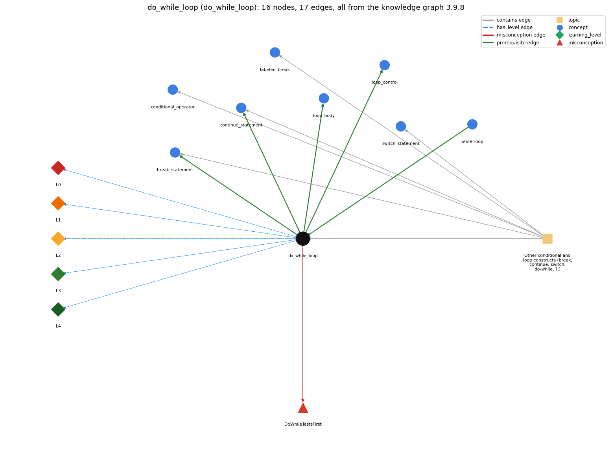

# do_while_loop (`do_while_loop`)

do { body } while (c); -- body first, test after

Section 1.3 Conditionals and Loops, topic 1.3.g Other conditional and loop constructs (break, continue, switch, do-while, ?:).

## At a glance

- **Needs first:** `while_loop`
- **Leads to:** `break_statement`, `continue_statement`, `loop_body`, `loop_control`
- **Learned alongside:** nothing
- **Misconceptions:** `DoWhileTestsFirst`
- **Errors:** none
- **Levels:** L0, L1, L2, L3, L4

Everything below comes from the knowledge graph 3.9.8 (`data/raw/chapter1_kg_updated.json`): 17 edges around this concept, each explained in the graph's own words.

## What it needs first (1)

A prerequisite edge means the other concept has to be understood before `do_while_loop`.

### `while_loop` comes before `do_while_loop`

*repeat a block while a condition holds*

do { body } while (c); is a while loop whose test is moved to the bottom.

- **Grounding:** book passage
- **How `do_while_loop` combines with `while_loop`:** do { S } while (c); equals \`S; while (c) { S }\`. If c is initially true it behaves exactly like \`while (c) { S }\`; if c is initially false it still runs S once where the while runs it zero times.
- **How `while_loop` combines with `do_while_loop`:** do { body } while (c); means the same as while (c) { body } except that the first test is omitted, so the body runs at least once.

## What it leads to (4)

These concepts need `do_while_loop` first.

### `do_while_loop` comes before `break_statement`

*break -- immediately exits the innermost loop or switch*

break leaves the do-while loop at once, exactly as it leaves a while or for loop.

- **Grounding:** spec passage

### `do_while_loop` comes before `continue_statement`

*continue -- skips to the next iteration of the innermost loop*

continue ends the current pass of the do-while loop and goes on to the loop test.

- **Grounding:** spec passage

### `do_while_loop` comes before `loop_body`

*the block repeated each pass*

The block between do and while is the loop body; it runs first and is repeated while the condition holds.

- **Grounding:** book passage

### `do_while_loop` comes before `loop_control`

*the three slots: init ; condition ; update*

A do-while loop has the same control parts as a while loop (the variable set before, the condition, the update in the body); only the test is moved after the body.

- **Grounding:** book passage

## Learned alongside (0)

A parallel edge joins two concepts that sit side by side: neither is needed before the other.

No parallel edge touches this concept.

## Misconceptions (1)

A misconception edge states the wrong rule a student may hold about this concept, and the right rule.

### DoWhileTestsFirst

- **Wrong rule:** A do-while whose condition starts false runs its body zero times.
- **Right rule:** The statements within the do block are always executed at least once.
- **Role of this concept:** primary
- **Shows at level L0 as:** misconception: wrong rule: A do-while whose condition starts false runs its body zero times. Right rule: The first test is omitted: the body always runs at least once, and the condition is checked only after each pass.
- **Shows at level L0 as:** inconsistent trace: Applies the LT rule unevenly: on a trace, the condition is tested before the first pass on some runs (as for while) and after it on others, or one more pass is run after the condition becomes false. The traced number of passes is off by one. (here mixing in: "A do-while whose condition starts false runs its body zero times")

## Errors (0)

An error edge states the rule that gets broken in a program, and the right rule.

The graph has no error edge from this concept.

## Levels L0 to L4 (5 of 5)

Each level edge lists the ways a student shows that level, each with its exact rule.

### L0: Prestructural / sensorimotor

L0 for do while loop: the answer holds a rule that contradicts Java.

*Deciding question: Does every rule the answer applies to do while loop agree with the language rule? If it reads the code with everyday meanings, applies a wrong rule, or switches rules within one trace, it is L0. A slip in an otherwise rule-correct trace is L2 with an error, not L0.*

do while loop -&gt; L0 (Prestructural): the answer holds a rule that contradicts Java (3 ways).

- **everyday reading** (folk-meaning rule): Folk meaning: in English 'do X while Y' means do X during the time that Y holds, with Y watched continuously, as in the 'while demon'. In Java the condition is tested only at the bottom, after each complete pass of the body, and the first pass always runs.
- **misconception** (wrong rule / right rule; shows `DoWhileTestsFirst`): wrong rule: A do-while whose condition starts false runs its body zero times. Right rule: The first test is omitted: the body always runs at least once, and the condition is checked only after each pass.
- **inconsistent trace** (uneven-application rule; shows `DoWhileTestsFirst`): Applies the LT rule unevenly: on a trace, the condition is tested before the first pass on some runs (as for while) and after it on others, or one more pass is run after the condition becomes false. The traced number of passes is off by one. (here mixing in: "A do-while whose condition starts false runs its body zero times")

### L1: Unistructural / atom x text surface

L1 for do while loop: the answer states one correct rule without applying it.

*Deciding question: Does the answer cover every part of the code, in order, with the values (L2)? If it covers one part or only states the rule, it is L1.*

do while loop -&gt; L1 (Unistructural): the answer states one correct rule without applying it (2 ways).

- **names the element** (identity rule): Loop statement: \`do { body } while (cond);\` is a loop whose test comes after the body, so the body runs one or more times.
- **states the rule** (declarative rule): \`do { &lt;statements&gt; } while (&lt;boolean expression&gt;);\` (note the final semicolon) means the same as the corresponding while loop except that the first test of the condition is omitted. (Spec: JLS §14.13.)

### L2: Multistructural / block x execution / preoperational

L2 for do while loop: the answer applies these rules to every part of the code, in order.

*Deciding question: Is the answer many segments mapped onto lines (L2), or one segment stating the purpose of the whole (L3)? A correct output with no value-by-value justification is not levelled.*

do while loop -&gt; L2 (Multistructural): the answer applies the rules of do while loop to every part of the code, in order (3 ways).

- **line by line trace** (operational sequencing rule): Order: execute the body; evaluate the condition; if true, execute the body again and re-test; stop the first time the condition is false at the bottom test.
- **output prediction** (evaluation / result rule): do-while produces no value. Its result is the state after the last pass. In the unit-disk example, x and y end inside the disk after about 4/π ≈ 1.27 passes on average.
- **one step execution** (state-transition rule): One pass runs every statement of the body once (e.g. new random x and y) and then evaluates the condition, a boolean that decides whether another pass follows. The test changes nothing unless it has side effects.

### L3: Relational / relations x function (concrete operational begins)

L3 for do while loop: the answer relates the parts by these rules.

*Deciding question: Was the purpose deduced from the code, or only guessed from traced input/output pairs (then L2)? Does the answer stay within the given code (L3), or reason about changed code, an error class or a new program (L4)?*

do while loop -&gt; L3 (Relational): the answer relates the parts (2 ways).

- **relation to neighbour** (composition rule (with a neighbour)): do { S } while (c); equals \`S; while (c) { S }\`. If c is initially true it behaves exactly like \`while (c) { S }\`; if c is initially false it still runs S once where the while runs it zero times.
- **purpose of the whole** (plan / role rule): Plan: generate-and-test (rejection sampling) or read-then-validate. Produce a candidate, test it, and repeat until it is acceptable, e.g. a random point in the unit disk.

### L4: Extended abstract (concrete-operational reversibility and conservation)

L4 for do while loop: the answer reasons beyond the given code by these rules.

*Deciding question: Does the answer link the code to a broader context: a changed program, a class of inputs, an unseen problem? Re-tracing changed code value by value is L2; fixing one given failing case is L3.*

do while loop -&gt; L4 (Extended abstract): the answer reasons beyond the given code (5 ways).

- **predict a change** (conservation rule; shows `DoWhileTestsFirst`): Converting do-while to while keeps behaviour whenever the condition is true before the first pass, and breaks it (0 passes vs 1) when it is false. Moving the body's variables out of the block doesn't change the passes, but it is needed for the condition to see them.
- **transfer to a new program** (applicability rule): Use do-while when the body must run at least once before the test makes sense: generate-and-reject, prompt-and-validate, or a menu loop. Use while when zero passes must be possible, and for when there is an index with initialise/test/increment.
- **diagnose an error** (error rule): rule broken: A variable declared inside the do block is out of scope in the while condition. Kind: compile-time. Trigger class: \`do { double x = ...; } while (x &gt; 1.0);\` (cannot find symbol x): declare x before the do.
- **diagnose an error** (error rule): rule broken: The do-while statement ends with a semicolon after the condition. Kind: compile-time. Trigger class: Omitting the \`;\` after \`while (cond)\` (';' expected).
- **diagnose an error** (error rule): rule broken: The body runs at least once even if the condition is false. Kind: silent logic error. Trigger class: Using do-while for a task that must allow zero passes (e.g. processing an empty input or N = 0): one spurious pass runs.

## Same topic

`do_while_loop` belongs to the topic **Other conditional and loop constructs (break, continue, switch, do-while, ?:)** (`topic1.3.g`). The topic also contains: `break_statement`, `conditional_operator`, `continue_statement`, `labeled_break`, `switch_statement`.

## Rules of the concept (15)

- **folk-meaning rule:** Folk meaning: in English 'do X while Y' means do X during the time that Y holds, with Y watched continuously, as in the 'while demon'. In Java the condition is tested only at the bottom, after each complete pass of the body, and the first pass always runs.
- **wrong rule / right rule:** DoWhileTestsFirst: wrong: A do-while whose condition starts false runs its body zero times. \| right: The first test is omitted: the body always runs at least once, and the condition is checked only after each pass.
- **uneven-application rule:** Applies the LT rule unevenly: on a trace, the condition is tested before the first pass on some runs (as for while) and after it on others, or one more pass is run after the condition becomes false. The traced number of passes is off by one.
- **identity rule:** Loop statement: \`do { body } while (cond);\` is a loop whose test comes after the body, so the body runs one or more times.
- **declarative rule:** \`do { &lt;statements&gt; } while (&lt;boolean expression&gt;);\` (note the final semicolon) means the same as the corresponding while loop except that the first test of the condition is omitted. (Spec: JLS §14.13.)
- **operational sequencing rule:** Order: execute the body; evaluate the condition; if true, execute the body again and re-test; stop the first time the condition is false at the bottom test.
- **evaluation / result rule:** do-while produces no value. Its result is the state after the last pass. In the unit-disk example, x and y end inside the disk after about 4/π ≈ 1.27 passes on average.
- **state-transition rule:** One pass runs every statement of the body once (e.g. new random x and y) and then evaluates the condition, a boolean that decides whether another pass follows. The test changes nothing unless it has side effects.
- **composition rule (with a neighbour):** with while\_loop: do { S } while (c); equals \`S; while (c) { S }\`. If c is initially true it behaves exactly like \`while (c) { S }\`; if c is initially false it still runs S once where the while runs it zero times.
- **plan / role rule:** Plan: generate-and-test (rejection sampling) or read-then-validate. Produce a candidate, test it, and repeat until it is acceptable, e.g. a random point in the unit disk.
- **conservation rule:** Converting do-while to while keeps behaviour whenever the condition is true before the first pass, and breaks it (0 passes vs 1) when it is false. Moving the body's variables out of the block doesn't change the passes, but it is needed for the condition to see them.
- **error rule:** rule broken: A variable declared inside the do block is out of scope in the while condition. (compile-time)
- **error rule:** rule broken: The do-while statement ends with a semicolon after the condition. (compile-time)
- **error rule:** rule broken: The body runs at least once even if the condition is false. (silent logic error)
- **applicability rule:** Use do-while when the body must run at least once before the test makes sense: generate-and-reject, prompt-and-validate, or a menu loop. Use while when zero passes must be possible, and for when there is an index with initialise/test/increment.

## The whole prerequisite chain

- **Everything it builds on (12):** `arithmetic_operators`, `boolean`, `boolean_expression`, `comparison_operators`, `data_type`, `expression`, `identifier`, `literal`, `logical_operators`, `primitive_type`, `variable`, `while_loop`
- **Everything that builds on it (35):** `accumulator_pattern`, `array_copy`, `array_reversal`, `array_traversal`, `boolean_flag_array`, `break_statement`, `continue_statement`, `convergence_rate`, `counter_pattern`, `enhanced_for`, `fencepost_loop`, `flag_search_loop`, `for_loop`, `frequency_counting`, `function_plotting`, `increment_operators`, `infinite_loop`, `labeled_break`, `loop_body`, `loop_control`, `loop_performance`, `loop_scope`, `matrix_operations`, `monte_carlo_simulation`, `nested_loops`, `off_by_one_error`, `power_method`, `row_major_order`, `running_extreme`, `sentinel_loop`, `side_effect_order`, `simulation_loop`, `standard_audio`, `switch_statement`, `two_models`
