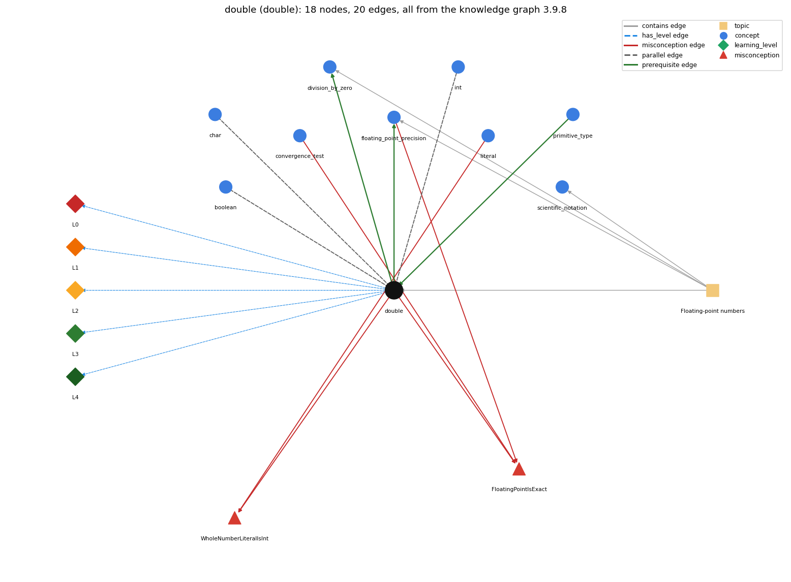

# double (`double`)

64-bit floating-point primitive

Section 1.2 Built-in Types of Data, topic 1.2.d Floating-point numbers. From the knowledge graph 3.9.8 (`data/raw/chapter1_kg_updated.json`).

## Concepts associated with double (9)

| Concept | Description | How it is associated |
| --- | --- | --- |
| **boolean** | true/false primitive | parallel concept composition rule (R) with it |
| **char** | 16-bit character primitive | parallel concept composition rule (R) with it |
| **convergence\_test** | stopping a loop when a floating-point result is close enough | shares misconception FloatingPointIsExact |
| **division\_by\_zero** | int division by zero throws; double division gives Infinity or NaN | builds on it (needs it) composition rule (R) with it same topic (topic1.2.d) |
| **floating\_point\_precision** | double values are approximations; == on doubles is unreliable | builds on it (needs it) composition rule (R) with it shares misconception FloatingPointIsExact same topic (topic1.2.d) |
| **int** | 32-bit integer primitive | parallel concept composition rule (R) with it |
| **literal** | a constant value written in code (42, 3.14, true, 'a', "hi") | shares misconception WholeNumberLiteralIsInt |
| **primitive\_type** | int, double, boolean, char | prerequisite of it (it needs this) composition rule (R) with it |
| **scientific\_notation** | double literals like 6.022E23 | same topic (topic1.2.d) |

## Every edge in this view and its full label (20)

| From | Edge | To | Full edge label |
| --- | --- | --- | --- |
| **double** | prerequisite | **division\_by\_zero** | For doubles, 1.0/0.0 is legal and has the value Infinity; a double result can also be the special value NaN when the calculation is undefined. grounding: book\_passage composition rule (R) of double with division\_by\_zero: For double operands a zero divisor is not an error: 1.0/0.0 is Infinity, -1.0/0.0 is -Infinity and 0.0/0.0 is NaN, whereas int division by zero throws an exception. composition rule (R) of division\_by\_zero with double: Once either operand is a double the division follows IEEE 754 rules instead, so the same zero divisor gives Infinity or NaN rather than an exception. |
| **double** | prerequisite | **floating\_point\_precision** | A double approximates real numbers, so its arithmetic is not exact. grounding: book\_passage composition rule (R) of double with floating\_point\_precision: Every double operation rounds its result to the nearest representable value, so double results carry rounding error that can accumulate; this is why == on computed doubles is unreliable. composition rule (R) of floating\_point\_precision with double: Imprecision is inherent in the double type, not in a particular program: any arithmetic on doubles may carry rounding error, so code that uses double must be written to tolerate it. |
| **primitive\_type** | prerequisite | **double** | double is one of the eight primitive types, the one used for real (floating-point) numbers. grounding: book\_passage composition rule (R) of primitive\_type with double: double is the 64-bit IEEE 754 primitive. Once a double meets an integral operand in a binary operator, the whole operation becomes floating point. composition rule (R) of double with primitive\_type: double is one of the eight primitive types and the default type of decimal literals (float would need an f suffix and is not used in the book). |
| **double** | parallel | **boolean** | A double holds a number with a fractional part; a boolean holds only true or false. grounding: book\_passage composition rule (R) of double with boolean: double and boolean never convert into each other (no cast is allowed either way); they meet only through comparisons, which take doubles and produce a boolean, e.g. (x &lt; 3.1). composition rule (R) of boolean with double: A double reaches the boolean world only through a comparison such as (x &lt; 3.1), which yields a boolean; there is no cast between double and boolean. |
| **double** | parallel | **char** | A double holds a number with a fractional part; a char holds one character code, which is a whole number. grounding: book\_passage composition rule (R) of double with char: char is an integral numeric type, so a char widens automatically to double in arithmetic ('a' + 0.5 is 97.5), but a double needs an explicit cast to become a char. composition rule (R) of char with double: A char widens automatically to double (its code), but a double needs a cast to become a char. A char never holds a fractional part. |
| **int** | parallel | **double** | With two ints, a / b drops the fractional part; if either a or b is a double, a / b keeps the fractional part. grounding: book\_passage composition rule (R) of int with double: int op double promotes the int and gives a double. A double becomes an int only through a cast, which truncates toward zero. composition rule (R) of double with int: Type flow decides the division: with two int operands a / b discards the fraction (10/3 is 3, and double d = 10/3; stores 3.0); if either operand is double the other is promoted and the fraction is kept (10/3.0 is 3.3333333333333335). |
| **convergence\_test** | misconception | **FloatingPointIsExact** | **wrong rule:** Math.sqrt(2) \* Math.sqrt(2) == 2 is true. **right rule:** A double is an approximation, so the product is close to 2 but not equal to 2. role: context |
| **double** | misconception | **FloatingPointIsExact** | **wrong rule:** Math.sqrt(2) \* Math.sqrt(2) == 2 is true. **right rule:** A double is an approximation, so the product is close to 2 but not equal to 2. role: context |
| **double** | misconception | **WholeNumberLiteralIsInt** | **wrong rule:** 207. and 2.3e4 are int values because they are whole numbers. **right rule:** A decimal point or scientific notation makes the literal a double. role: context |
| **floating\_point\_precision** | misconception | **FloatingPointIsExact** | **wrong rule:** Math.sqrt(2) \* Math.sqrt(2) == 2 is true. **right rule:** A double is an approximation, so the product is close to 2 but not equal to 2. role: primary |
| **literal** | misconception | **WholeNumberLiteralIsInt** | **wrong rule:** 207. and 2.3e4 are int values because they are whole numbers. **right rule:** A decimal point or scientific notation makes the literal a double. role: primary |
| **double** | has\_level | **double@L0** | double -&gt; L0 (Prestructural): the answer holds a rule that contradicts Java (4 ways). **[0] everyday\_reading** (E): Folk meaning: a number with a decimal point is the exact real number of school maths, and a whole-looking number such as 207. or 2.3e4 is an integer. Java rule: a double is a 64-bit binary approximation from a finite set of values, and any literal with a decimal point or exponent is a double (207. is 207.0, 2.3e4 is 23000.0). **[1] misconception** (M) &rarr; FloatingPointIsExact: wrong rule: Math.sqrt(2) \* Math.sqrt(2) == 2 is true. Right rule: A double is an approximation: Math.sqrt(2) \* Math.sqrt(2) is 2.0000000000000004, so the == test is false; compare doubles with a tolerance. **[2] misconception** (M) &rarr; WholeNumberLiteralIsInt: wrong rule: 207. and 2.3e4 are int values because they are whole numbers. Right rule: A decimal point or scientific notation makes the literal a double, whatever its value: 207. is 207.0 and 2.3e4 is 23000.0, so int n = 2.3e4; does not compile. **[3] inconsistent\_trace** (T) &rarr; FloatingPointIsExact: Points to LT (at each operator the narrower operand is promoted, then the operation is done in double and rounded). Applied unevenly: the student promotes to double on one line but keeps integer division on another, e.g. treats 1/2 \* x as 0.5 \* x on one pass and as 0 on the next. (here mixing in: "Math.sqrt(2) \* Math.sqrt(2) == 2 is true") |
| **double** | has\_level | **double@L1** | double -&gt; L1 (Unistructural): the answer states one correct rule without applying it (2 ways). **[0] names\_the\_element** (N): double is a primitive data type: Java's 64-bit IEEE 754 floating-point type for representing real numbers. **[1] states\_the\_rule** (S): Values are 64-bit IEEE 754 numbers (about 15 significant digits) plus the special values Infinity and NaN; +, -, \*, / (and %) are defined; if at least one operand of a binary arithmetic operator is double, the operation is a floating-point operation. |
| **double** | has\_level | **double@L2** | double -&gt; L2 (Multistructural): the answer applies the rules of double to every part of the code, in order (3 ways). **[0] line\_by\_line\_trace** (LT): Operators are applied in precedence order, left operand first; at each operator, if one operand is double the other is widened to double before the operation, and the result is rounded to the nearest double before the next operator uses it. **[1] output\_prediction** (OP): The result has type double: 5.0/3.0 is 1.6666666666666667, 10/3.0 is 3.3333333333333335, 1.0/0.0 is Infinity, Math.sqrt(-1.0) is NaN; println always shows a decimal part (3.0, not 3). **[2] one\_step\_execution** (OS): An assignment to a double variable stores the nearest representable value (x = x + 0.1 replaces x with the rounded sum); no double operation throws an exception, so the variable may end up holding Infinity or NaN. |
| **double** | has\_level | **double@L3** | double -&gt; L3 (Relational): the answer relates the parts (7 ways). **[0] relation\_to\_neighbour** (R): Type flow decides the division: with two int operands a / b discards the fraction (10/3 is 3, and double d = 10/3; stores 3.0); if either operand is double the other is promoted and the fraction is kept (10/3.0 is 3.3333333333333335). **[1] relation\_to\_neighbour** (R): double and boolean never convert into each other (no cast is allowed either way); they meet only through comparisons, which take doubles and produce a boolean, e.g. (x &lt; 3.1). **[2] relation\_to\_neighbour** (R): char is an integral numeric type, so a char widens automatically to double in arithmetic ('a' + 0.5 is 97.5), but a double needs an explicit cast to become a char. **[3] relation\_to\_neighbour** (R): Every double operation rounds its result to the nearest representable value, so double results carry rounding error that can accumulate; this is why == on computed doubles is unreliable. **[4] relation\_to\_neighbour** (R): For double operands a zero divisor is not an error: 1.0/0.0 is Infinity, -1.0/0.0 is -Infinity and 0.0/0.0 is NaN, whereas int division by zero throws an exception. **[5] relation\_to\_neighbour** (R): double is one of the eight primitive types and the default type of decimal literals (float would need an f suffix and is not used in the book). **[6] purpose\_of\_the\_whole** (P): Used for measured or computed real quantities (physics formulas, roots, averages, probabilities); a double variable often plays the gatherer role, as in Harmonic's sum += 1.0/i. |
| **double** | has\_level | **double@L4** | double -&gt; L4 (Extended abstract): the answer reasons beyond the given code (5 ways). **[0] predict\_a\_change** (C) &rarr; FloatingPointIsExact: Changing a variable from int to double changes / from truncating to real division and changes the printed form (3 becomes 3.0); changing back needs a cast and loses the fraction. Invariant: values are approximations, so reordering a sum ((a+b)+c vs a+(b+c)) may change the last digits. **[1] transfer\_to\_a\_new\_program** (X): Use double for real-valued quantities where approximate results are acceptable (science, geometry, probabilities, averages); do not use it for counts, array indices, loop counters or money that must be exact (use int or long, e.g. cents). **[2] diagnose\_an\_error** (D): rule broken: A double cannot be assigned to an int (narrowing) without a cast. Kind: compile-time. Trigger class: A double expression assigned or passed where an int is required, e.g. int n = Math.sqrt(x); or int n = 2.0 \* k; (possible lossy conversion). **[3] diagnose\_an\_error** (D): rule broken: Floating-point division needs at least one double operand. Kind: silent logic error. Trigger class: A formula assigned to a double whose division has only int operands, e.g. double y = 1 / 3; (gives 0.0) or (9/5)\*c + 32. **[4] diagnose\_an\_error** (D): rule broken: Computed doubles are approximations and must not be compared with ==. Kind: silent logic error. Trigger class: == or != between doubles produced by arithmetic on non-dyadic fractions (0.1, 1/3, square roots). |
| **topic1.2.d** | contains | **division\_by\_zero** | topic topic1.2.d contains division\_by\_zero |
| **topic1.2.d** | contains | **double** | topic topic1.2.d contains double |
| **topic1.2.d** | contains | **floating\_point\_precision** | topic topic1.2.d contains floating\_point\_precision |
| **topic1.2.d** | contains | **scientific\_notation** | topic topic1.2.d contains scientific\_notation |
