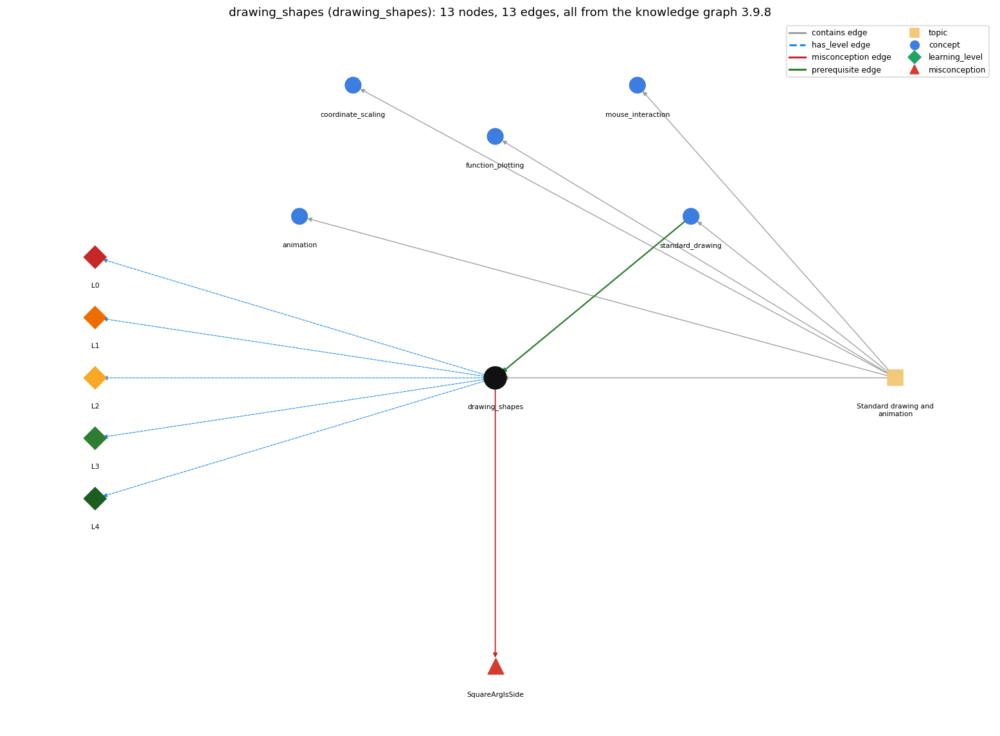

# drawing_shapes (`drawing_shapes`)

outline vs filled shapes, square half-length, colour and text

Section 1.5 Input and Output, topic 1.5.e Standard drawing and animation.

## At a glance

- **Needs first:** `standard_drawing`
- **Leads to:** nothing
- **Learned alongside:** nothing
- **Misconceptions:** `SquareArgIsSide`
- **Errors:** none
- **Levels:** L0, L1, L2, L3, L4

Everything below comes from the knowledge graph 3.9.8 (`data/raw/chapter1_kg_updated.json`): 13 edges around this concept. The edge logic, the wrong and right rules and the exact rules of the ways are copied word for word from the graph.

## To work on (1)

- no aliases: a student's words cannot name this concept

## What it needs first (1)

A prerequisite edge means the other concept has to be understood before `drawing_shapes`.

### `standard_drawing` comes before `drawing_shapes`

*StdDraw -- graphical output (book-specific)*

- **Edge:** `pre:standard_drawing->drawing_shapes`
- **Exact edge logic:** Shape commands are StdDraw drawing commands.
- **Grounding:** book\_passage
- **Composition rule (R) of `drawing_shapes` with `standard_drawing`:** Shapes use StdDraw's current coordinate scale, pen radius and color, and paint over earlier marks.
- **Composition rule (R) of `standard_drawing` with `drawing_shapes`:** Shape commands are StdDraw drawing commands. They use the same coordinates, pen color and pen radius as line and point.

## What it leads to (0)

These concepts need `drawing_shapes` first.

No concept has this one as a prerequisite.

## Learned alongside (0)

A parallel edge joins two concepts that sit side by side: neither is needed before the other.

No parallel edge touches this concept.

## Misconceptions (1)

A misconception edge states the wrong rule a student may hold about this concept, and the right rule.

### SquareArgIsSide

- **Edge:** `drawing_shapes` &rarr; `SquareArgIsSide` (misconception)
- **Exact edge logic (the wrong rule):** StdDraw.square(x, y, r) draws a square with side length r.
- **Twin logic (the right rule):** The square has side length 2r, centred on (x, y).
- **Wrong belief (on the node):** StdDraw.square(x, y, r) draws a square with side length r.
- **Correct rule (on the node):** The square has side length 2r, centred on (x, y).
- **Provenance:** derived
- **Role of this concept:** primary
- **L0 way linked to it:** yes
- **L0 way [1] misconception, exact rule:** wrong rule: StdDraw.square(x, y, r) draws a square with side length r. Right rule: The square has side length 2r, centred on (x, y).
- **L0 way [2] inconsistent\_trace, exact rule:** Points to LT (each shape is centred on (x, y); a polygon joins its points in order and closes back to the first). An uneven trace uses (x, y) as a corner for some shapes, or leaves a polygon open. (here mixing in: "StdDraw.square(x, y, r) draws a square with side length r")

## Errors (0)

An error edge states the rule that gets broken in a program, and the right rule.

The graph has no error edge from this concept.

## Levels L0 to L4 (5 of 5)

Each level edge lists the ways a student shows that level, each with its exact rule.

### L0: Prestructural / sensorimotor

L0 for drawing shapes: the answer holds a rule that contradicts Java.

*Deciding question: Does every rule the answer applies to drawing shapes agree with the language rule? If it reads the code with everyday meanings, applies a wrong rule, or switches rules within one trace, it is L0. A slip in an otherwise rule-correct trace is L2 with an error, not L0.*

- **Edge:** `drawing_shapes` &rarr; `drawing_shapes@L0` (has_level)
- **Exact edge logic:** drawing shapes -&gt; L0 (Prestructural): the answer holds a rule that contradicts Java (3 ways).

Ways (3), each with its exact rule:

- **[0] everyday\_reading** (rule type E, folk-meaning rule): In everyday geometry, square(x, y, r) reads as a square with side r, with (x, y) as a corner. In StdDraw, r is the half-side: the square has side 2r and is centred on (x, y). For circles, r is the radius.
- **[1] misconception** (rule type M, wrong rule / right rule) &rarr; `SquareArgIsSide`: wrong rule: StdDraw.square(x, y, r) draws a square with side length r. Right rule: The square has side length 2r, centred on (x, y).
- **[2] inconsistent\_trace** (rule type T, uneven-application rule) &rarr; `SquareArgIsSide`: Points to LT (each shape is centred on (x, y); a polygon joins its points in order and closes back to the first). An uneven trace uses (x, y) as a corner for some shapes, or leaves a polygon open. (here mixing in: "StdDraw.square(x, y, r) draws a square with side length r")

### L1: Unistructural / atom x text surface

L1 for drawing shapes: the answer states one correct rule without applying it.

*Deciding question: Does the answer cover every part of the code, in order, with the values (L2)? If it covers one part or only states the rule, it is L1.*

- **Edge:** `drawing_shapes` &rarr; `drawing_shapes@L1` (has_level)
- **Exact edge logic:** drawing shapes -&gt; L1 (Unistructural): the answer states one correct rule without applying it (2 ways).

Ways (2), each with its exact rule:

- **[0] names\_the\_element** (rule type N, identity rule): Shape commands are StdDraw drawing methods: circle, square and polygon, each with a filled version, plus text and pen color.
- **[1] states\_the\_rule** (rule type S, declarative rule): A method named after the shape traces its outline, and one whose name begins with filled fills it solid. circle(x, y, r) has radius r and square(x, y, r) has side 2r, both centred on (x, y).

### L2: Multistructural / block x execution / preoperational

L2 for drawing shapes: the answer applies these rules to every part of the code, in order.

*Deciding question: Is the answer many segments mapped onto lines (L2), or one segment stating the purpose of the whole (L3)? A correct output with no value-by-value justification is not levelled.*

- **Edge:** `drawing_shapes` &rarr; `drawing_shapes@L2` (has_level)
- **Exact edge logic:** drawing shapes -&gt; L2 (Multistructural): the answer applies the rules of drawing shapes to every part of the code, in order (3 ways).

Ways (3), each with its exact rule:

- **[0] line\_by\_line\_trace** (rule type LT, operational sequencing rule): polygon(x[], y[]) draws a line from point 0 to point 1, then 1 to 2, and so on, and finally from the last point back to point 0. Each shape is drawn in the pen color current at the call.
- **[1] output\_prediction** (rule type OP, evaluation / result rule): square(.2, .8, .1) draws an outline square 0.2 wide with corners (.1, .7) and (.3, .9). filledSquare(.8, .8, .2) draws a solid 0.4-wide square. The methods return void.
- **[2] one\_step\_execution** (rule type OS, state-transition rule): A shape call adds one outlined or filled shape in the current pen color. setPenColor only changes the ink used by later calls (the default is BLACK).

### L3: Relational / relations x function (concrete operational begins)

L3 for drawing shapes: the answer relates the parts by these rules.

*Deciding question: Was the purpose deduced from the code, or only guessed from traced input/output pairs (then L2)? Does the answer stay within the given code (L3), or reason about changed code, an error class or a new program (L4)?*

- **Edge:** `drawing_shapes` &rarr; `drawing_shapes@L3` (has_level)
- **Exact edge logic:** drawing shapes -&gt; L3 (Relational): the answer relates the parts (2 ways).

Ways (2), each with its exact rule:

- **[0] relation\_to\_neighbour** (rule type R, composition rule (with a neighbour)): Shapes use StdDraw's current coordinate scale, pen radius and color, and paint over earlier marks.
- **[1] purpose\_of\_the\_whole** (rule type P, plan / role rule): Shapes, color and text annotate and highlight drawings, and color can represent data values.

### L4: Extended abstract (concrete-operational reversibility and conservation)

L4 for drawing shapes: the answer reasons beyond the given code by these rules.

*Deciding question: Does the answer link the code to a broader context: a changed program, a class of inputs, an unseen problem? Re-tracing changed code value by value is L2; fixing one given failing case is L3.*

- **Edge:** `drawing_shapes` &rarr; `drawing_shapes@L4` (has_level)
- **Exact edge logic:** drawing shapes -&gt; L4 (Extended abstract): the answer reasons beyond the given code (4 ways).

Ways (4), each with its exact rule:

- **[0] predict\_a\_change** (rule type C, conservation rule) &rarr; `SquareArgIsSide`: Switching shape(...) to filledShape(...) keeps the geometry and only fills it. A diamond is the polygon of a 2r-by-2r square rotated 45 degrees about the same centre.
- **[1] transfer\_to\_a\_new\_program** (rule type X, applicability rule): Use circle and square (and their filled versions) for those shapes. For any other shape, use polygon or filledPolygon.
- **[2] diagnose\_an\_error** (rule type D, error rule): rule broken: square's r is the half-length. Kind: silent logic error. Trigger class: Passing the side length as r, so squares come out twice as large and overlap.
- **[3] diagnose\_an\_error** (rule type D, error rule): rule broken: setPenColor takes a Color constant, not a String. Kind: compile-time. Trigger class: StdDraw.setPenColor("red"): no method accepts a String (use StdDraw.RED).

## Same topic

`drawing_shapes` belongs to the topic **Standard drawing and animation** (`topic1.5.e`). The topic also contains: `animation`, `coordinate_scaling`, `function_plotting`, `mouse_interaction`, `standard_drawing`.

## Rules of the concept (14)

- **Book** (SW-1e, p. 141 (pdf 151)): "StdDraw also includes methods to draw circles, rectangles, and arbitrary polygons."
- **Book** (SW-1.5, ): "the arguments for square() define a square of side length 2r centered on the given point"
- **E** (folk-meaning rule): In everyday geometry, square(x, y, r) reads as a square with side r, with (x, y) as a corner. In StdDraw, r is the half-side: the square has side 2r and is centred on (x, y). For circles, r is the radius.
- **M** (wrong rule / right rule): SquareArgIsSide: wrong: StdDraw.square(x, y, r) draws a square with side length r. \| right: The square has side length 2r, centred on (x, y).
- **T** (uneven-application rule): Points to LT (each shape is centred on (x, y); a polygon joins its points in order and closes back to the first). An uneven trace uses (x, y) as a corner for some shapes, or leaves a polygon open.
- **N** (identity rule): Shape commands are StdDraw drawing methods: circle, square and polygon, each with a filled version, plus text and pen color.
- **S** (declarative rule): A method named after the shape traces its outline, and one whose name begins with filled fills it solid. circle(x, y, r) has radius r and square(x, y, r) has side 2r, both centred on (x, y).
- **LT** (operational sequencing rule): polygon(x[], y[]) draws a line from point 0 to point 1, then 1 to 2, and so on, and finally from the last point back to point 0. Each shape is drawn in the pen color current at the call.
- **OP** (evaluation / result rule): square(.2, .8, .1) draws an outline square 0.2 wide with corners (.1, .7) and (.3, .9). filledSquare(.8, .8, .2) draws a solid 0.4-wide square. The methods return void.
- **OS** (state-transition rule): A shape call adds one outlined or filled shape in the current pen color. setPenColor only changes the ink used by later calls (the default is BLACK).
- **R** (composition rule (with a neighbour)): with standard\_drawing: Shapes use StdDraw's current coordinate scale, pen radius and color, and paint over earlier marks.
- **P** (plan / role rule): Shapes, color and text annotate and highlight drawings, and color can represent data values.
- **C** (conservation rule): Switching shape(...) to filledShape(...) keeps the geometry and only fills it. A diamond is the polygon of a 2r-by-2r square rotated 45 degrees about the same centre.
- **D** (error rule): rule broken: square's r is the half-length. (silent logic error)
- **D** (error rule): rule broken: setPenColor takes a Color constant, not a String. (compile-time)
- **X** (applicability rule): Use circle and square (and their filled versions) for those shapes. For any other shape, use polygon or filledPolygon.

## How it is found in code and answers (reader block)

- **Aliases:** none
- **Code patterns:** `StdDraw\.(?:circle|filledCircle|square|filledSquare|rectangle|filledRectangle|polygon|filledPolygon|text|setPenColor|setPenRadius)\s*\(`
- **Operator symbols:** none
- **Java types:** none

## The whole prerequisite chain

- **Everything it builds on (10):** `api`, `arithmetic_operators`, `data_type`, `expression`, `identifier`, `literal`, `method_call`, `primitive_type`, `standard_drawing`, `variable`
- **Everything that builds on it (0):** nothing

## Every edge in this view and its exact edge logic (13)

All the edges drawn in the picture, in the order: prerequisite, parallel, misconception, error, has_level, contains.

**1. `standard_drawing` &rarr; `drawing_shapes`** (prerequisite)

- **Exact edge logic:** Shape commands are StdDraw drawing commands.
- **Grounding:** book\_passage
- **Composition rule (R) of `standard_drawing` with `drawing_shapes`:** Shape commands are StdDraw drawing commands. They use the same coordinates, pen color and pen radius as line and point.
- **Composition rule (R) of `drawing_shapes` with `standard_drawing`:** Shapes use StdDraw's current coordinate scale, pen radius and color, and paint over earlier marks.

**2. `drawing_shapes` &rarr; `SquareArgIsSide`** (misconception)

- **Exact edge logic (the wrong rule):** StdDraw.square(x, y, r) draws a square with side length r.
- **Twin logic (the right rule):** The square has side length 2r, centred on (x, y).
- **Role:** primary

**3. `drawing_shapes` &rarr; `drawing_shapes@L0`** (has_level)

- **Exact edge logic:** drawing shapes -&gt; L0 (Prestructural): the answer holds a rule that contradicts Java (3 ways).
  - **[0] everyday\_reading** (rule type E, folk-meaning rule): In everyday geometry, square(x, y, r) reads as a square with side r, with (x, y) as a corner. In StdDraw, r is the half-side: the square has side 2r and is centred on (x, y). For circles, r is the radius.
  - **[1] misconception** (rule type M, wrong rule / right rule) &rarr; `SquareArgIsSide`: wrong rule: StdDraw.square(x, y, r) draws a square with side length r. Right rule: The square has side length 2r, centred on (x, y).
  - **[2] inconsistent\_trace** (rule type T, uneven-application rule) &rarr; `SquareArgIsSide`: Points to LT (each shape is centred on (x, y); a polygon joins its points in order and closes back to the first). An uneven trace uses (x, y) as a corner for some shapes, or leaves a polygon open. (here mixing in: "StdDraw.square(x, y, r) draws a square with side length r")

**4. `drawing_shapes` &rarr; `drawing_shapes@L1`** (has_level)

- **Exact edge logic:** drawing shapes -&gt; L1 (Unistructural): the answer states one correct rule without applying it (2 ways).
  - **[0] names\_the\_element** (rule type N, identity rule): Shape commands are StdDraw drawing methods: circle, square and polygon, each with a filled version, plus text and pen color.
  - **[1] states\_the\_rule** (rule type S, declarative rule): A method named after the shape traces its outline, and one whose name begins with filled fills it solid. circle(x, y, r) has radius r and square(x, y, r) has side 2r, both centred on (x, y).

**5. `drawing_shapes` &rarr; `drawing_shapes@L2`** (has_level)

- **Exact edge logic:** drawing shapes -&gt; L2 (Multistructural): the answer applies the rules of drawing shapes to every part of the code, in order (3 ways).
  - **[0] line\_by\_line\_trace** (rule type LT, operational sequencing rule): polygon(x[], y[]) draws a line from point 0 to point 1, then 1 to 2, and so on, and finally from the last point back to point 0. Each shape is drawn in the pen color current at the call.
  - **[1] output\_prediction** (rule type OP, evaluation / result rule): square(.2, .8, .1) draws an outline square 0.2 wide with corners (.1, .7) and (.3, .9). filledSquare(.8, .8, .2) draws a solid 0.4-wide square. The methods return void.
  - **[2] one\_step\_execution** (rule type OS, state-transition rule): A shape call adds one outlined or filled shape in the current pen color. setPenColor only changes the ink used by later calls (the default is BLACK).

**6. `drawing_shapes` &rarr; `drawing_shapes@L3`** (has_level)

- **Exact edge logic:** drawing shapes -&gt; L3 (Relational): the answer relates the parts (2 ways).
  - **[0] relation\_to\_neighbour** (rule type R, composition rule (with a neighbour)): Shapes use StdDraw's current coordinate scale, pen radius and color, and paint over earlier marks.
  - **[1] purpose\_of\_the\_whole** (rule type P, plan / role rule): Shapes, color and text annotate and highlight drawings, and color can represent data values.

**7. `drawing_shapes` &rarr; `drawing_shapes@L4`** (has_level)

- **Exact edge logic:** drawing shapes -&gt; L4 (Extended abstract): the answer reasons beyond the given code (4 ways).
  - **[0] predict\_a\_change** (rule type C, conservation rule) &rarr; `SquareArgIsSide`: Switching shape(...) to filledShape(...) keeps the geometry and only fills it. A diamond is the polygon of a 2r-by-2r square rotated 45 degrees about the same centre.
  - **[1] transfer\_to\_a\_new\_program** (rule type X, applicability rule): Use circle and square (and their filled versions) for those shapes. For any other shape, use polygon or filledPolygon.
  - **[2] diagnose\_an\_error** (rule type D, error rule): rule broken: square's r is the half-length. Kind: silent logic error. Trigger class: Passing the side length as r, so squares come out twice as large and overlap.
  - **[3] diagnose\_an\_error** (rule type D, error rule): rule broken: setPenColor takes a Color constant, not a String. Kind: compile-time. Trigger class: StdDraw.setPenColor("red"): no method accepts a String (use StdDraw.RED).

**8. `topic1.5.e` &rarr; `drawing_shapes`** (contains)

- topic `topic1.5.e` contains `drawing_shapes`

**9. `topic1.5.e` &rarr; `animation`** (contains)

- topic `topic1.5.e` contains `animation`

**10. `topic1.5.e` &rarr; `coordinate_scaling`** (contains)

- topic `topic1.5.e` contains `coordinate_scaling`

**11. `topic1.5.e` &rarr; `function_plotting`** (contains)

- topic `topic1.5.e` contains `function_plotting`

**12. `topic1.5.e` &rarr; `mouse_interaction`** (contains)

- topic `topic1.5.e` contains `mouse_interaction`

**13. `topic1.5.e` &rarr; `standard_drawing`** (contains)

- topic `topic1.5.e` contains `standard_drawing`
