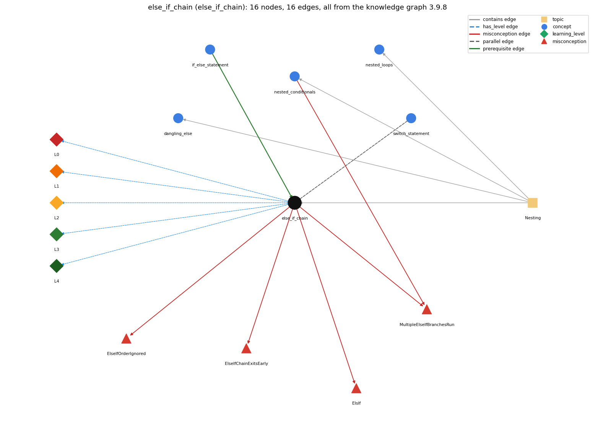

# else_if_chain (`else_if_chain`)

if ... else if ... else picks exactly one branch

Section 1.3 Conditionals and Loops, topic 1.3.e Nesting.

## At a glance

- **Needs first:** `if_else_statement`
- **Leads to:** nothing
- **Learned alongside:** `switch_statement`
- **Misconceptions:** `ElsIf`, `ElseIfChainExitsEarly`, `ElseIfOrderIgnored`, `MultipleElseIfBranchesRun`
- **Errors:** none
- **Levels:** L0, L1, L2, L3, L4

Everything below comes from the knowledge graph 3.9.8 (`data/raw/chapter1_kg_updated.json`): 16 edges around this concept. The edge logic, the wrong and right rules and the exact rules of the ways are copied word for word from the graph.

## To work on (0)

Nothing is missing for this concept.

## What it needs first (1)

A prerequisite edge means the other concept has to be understood before `else_if_chain`.

### `if_else_statement` comes before `else_if_chain`

*choose one of two blocks*

- **Edge:** `pre:if_else_statement->else_if_chain`
- **Exact edge logic:** An else-if chain is an if-else whose else part is another if.
- **Grounding:** book\_passage
- **Composition rule (R) of `else_if_chain` with `if_else_statement`:** An else-if chain is an if-else whose else part is another if-else, so every rule of if-else (one test, one branch) applies at each link.
- **Composition rule (R) of `if_else_statement` with `else_if_chain`:** An else-if chain is an if-else whose else part is another if-else, repeated; the final else catches all remaining cases.

## What it leads to (0)

These concepts need `else_if_chain` first.

No concept has this one as a prerequisite.

## Learned alongside (1)

A parallel edge joins two concepts that sit side by side: neither is needed before the other.

### `else_if_chain` alongside `switch_statement`

*switch (x) { case v: ...; break; default: ... }*

- **Edge:** `par:switch_statement~else_if_chain`
- **Exact edge logic:** Both pick one of several alternatives. A switch compares one value with constant case labels and falls through without break; an else-if chain tests each condition in turn and runs only the first true branch.
- **Grounding:** book\_passage

## Misconceptions (4)

A misconception edge states the wrong rule a student may hold about this concept, and the right rule.

### ElsIf

- **Edge:** `else_if_chain` &rarr; `ElsIf` (misconception)
- **Exact edge logic (the wrong rule):** Java has an elsif keyword for multi-way branches.
- **Twin logic (the right rule):** Multi-way branches are written else if.
- **Wrong belief (on the node):** Java has an elsif keyword for multi-way branches.
- **Correct rule (on the node):** Multi-way branches are written else if.
- **Provenance:** published
- **Role of this concept:** primary
- **L0 way linked to it:** yes
- **L0 way [1] misconception, exact rule:** wrong rule: Java has an elsif keyword for multi-way branches. Right rule: Multi-way branches are written else if.
- **L0 way [5] inconsistent\_trace, exact rule:** Applies the chain rule (LT) unevenly: stops at the first true condition on some inputs but continues testing (and running branches) on others. (here mixing in: "Java has an elsif keyword for multi-way branches")

### ElseIfChainExitsEarly

- **Edge:** `else_if_chain` &rarr; `ElseIfChainExitsEarly` (misconception)
- **Exact edge logic (the wrong rule):** An else-if chain can finish before it has tested all its conditions, even when no branch has run.
- **Twin logic (the right rule):** The conditions of an else-if chain are tested in order until one is true; only then, or after the last test (and the final else), does the chain end.
- **Wrong belief (on the node):** An else-if chain can finish before it has tested all its conditions, even when no branch has run.
- **Correct rule (on the node):** The conditions of an else-if chain are tested in order until one is true; only then, or after the last test (and the final else), does the chain end.
- **Provenance:** published
- **Role of this concept:** primary
- **L0 way linked to it:** yes
- **L0 way [3] misconception, exact rule:** wrong rule: An else-if chain can finish before it has tested all its conditions, even when no branch has run. Right rule: The conditions of an else-if chain are tested in order until one is true; only then, or after the last test (and the final else), does the chain end.

### ElseIfOrderIgnored

- **Edge:** `else_if_chain` &rarr; `ElseIfOrderIgnored` (misconception)
- **Exact edge logic (the wrong rule):** The conditions of an else-if chain can be tested in any order (e.g. the matching or most specific one first).
- **Twin logic (the right rule):** The conditions are tested top to bottom and the first true one wins, so their order changes the result when conditions overlap.
- **Wrong belief (on the node):** The conditions of an else-if chain can be tested in any order (e.g. the matching or most specific one first).
- **Correct rule (on the node):** The conditions are tested top to bottom and the first true one wins, so their order changes the result when conditions overlap.
- **Provenance:** published
- **Role of this concept:** primary
- **L0 way linked to it:** yes
- **L0 way [4] misconception, exact rule:** wrong rule: The conditions of an else-if chain can be tested in any order (e.g. the matching or most specific one first). Right rule: The conditions are tested top to bottom and the first true one wins, so their order changes the result when conditions overlap.

### MultipleElseIfBranchesRun

- **Edge:** `else_if_chain` &rarr; `MultipleElseIfBranchesRun` (misconception)
- **Exact edge logic (the wrong rule):** Every true branch of an else-if chain runs.
- **Twin logic (the right rule):** Only the first branch whose condition is true runs.
- **Wrong belief (on the node):** Every true branch of an else-if chain runs.
- **Correct rule (on the node):** Only the first branch whose condition is true runs.
- **Provenance:** published
- **Role of this concept:** primary
- **L0 way linked to it:** yes
- **L0 way [2] misconception, exact rule:** wrong rule: Every true branch of an else-if chain runs. Right rule: Only the first branch whose condition is true runs.
- **Edge `nested_conditionals` &rarr; `MultipleElseIfBranchesRun`, exact edge logic:** Every true branch of an else-if chain runs. **Twin logic:** Only the first branch whose condition is true runs. (role: context)

## Errors (0)

An error edge states the rule that gets broken in a program, and the right rule.

The graph has no error edge from this concept.

## Levels L0 to L4 (5 of 5)

Each level edge lists the ways a student shows that level, each with its exact rule.

### L0: Prestructural / sensorimotor

L0 for else if chain: the answer holds a rule that contradicts Java.

*Deciding question: Does every rule the answer applies to else if chain agree with the language rule? If it reads the code with everyday meanings, applies a wrong rule, or switches rules within one trace, it is L0. A slip in an otherwise rule-correct trace is L2 with an error, not L0.*

- **Edge:** `else_if_chain` &rarr; `else_if_chain@L0` (has_level)
- **Exact edge logic:** else if chain -&gt; L0 (Prestructural): the answer holds a rule that contradicts Java (6 ways).

Ways (6), each with its exact rule:

- **[0] everyday\_reading** (rule type E, folk-meaning rule): Folk meaning: a list of rules 'if A ...; else if B ...' reads like a set of independent rules where every one that applies is followed, in any order. In Java the conditions are tested top to bottom and only the first true branch runs.
- **[1] misconception** (rule type M, wrong rule / right rule) &rarr; `ElsIf`: wrong rule: Java has an elsif keyword for multi-way branches. Right rule: Multi-way branches are written else if.
- **[2] misconception** (rule type M, wrong rule / right rule) &rarr; `MultipleElseIfBranchesRun`: wrong rule: Every true branch of an else-if chain runs. Right rule: Only the first branch whose condition is true runs.
- **[3] misconception** (rule type M, wrong rule / right rule) &rarr; `ElseIfChainExitsEarly`: wrong rule: An else-if chain can finish before it has tested all its conditions, even when no branch has run. Right rule: The conditions of an else-if chain are tested in order until one is true; only then, or after the last test (and the final else), does the chain end.
- **[4] misconception** (rule type M, wrong rule / right rule) &rarr; `ElseIfOrderIgnored`: wrong rule: The conditions of an else-if chain can be tested in any order (e.g. the matching or most specific one first). Right rule: The conditions are tested top to bottom and the first true one wins, so their order changes the result when conditions overlap.
- **[5] inconsistent\_trace** (rule type T, uneven-application rule) &rarr; `ElsIf`: Applies the chain rule (LT) unevenly: stops at the first true condition on some inputs but continues testing (and running branches) on others. (here mixing in: "Java has an elsif keyword for multi-way branches")

### L1: Unistructural / atom x text surface

L1 for else if chain: the answer states one correct rule without applying it.

*Deciding question: Does the answer cover every part of the code, in order, with the values (L2)? If it covers one part or only states the rule, it is L1.*

- **Edge:** `else_if_chain` &rarr; `else_if_chain@L1` (has_level)
- **Exact edge logic:** else if chain -&gt; L1 (Unistructural): the answer states one correct rule without applying it (2 ways).

Ways (2), each with its exact rule:

- **[0] names\_the\_element** (rule type N, identity rule): An else-if chain (multiway if-else) is a sequence of if-else statements in which each else is another if, choosing among mutually exclusive possibilities.
- **[1] states\_the\_rule** (rule type S, declarative rule): Written if (c1) S1 else if (c2) S2 ... else Sn; the ifs are nested to test from among a number of mutually exclusive possibilities, and the final else needs no condition.

### L2: Multistructural / block x execution / preoperational

L2 for else if chain: the answer applies these rules to every part of the code, in order.

*Deciding question: Is the answer many segments mapped onto lines (L2), or one segment stating the purpose of the whole (L3)? A correct output with no value-by-value justification is not levelled.*

- **Edge:** `else_if_chain` &rarr; `else_if_chain@L2` (has_level)
- **Exact edge logic:** else if chain -&gt; L2 (Multistructural): the answer applies the rules of else if chain to every part of the code, in order (3 ways).

Ways (3), each with its exact rule:

- **[0] line\_by\_line\_trace** (rule type LT, operational sequencing rule): Test c1; if true run S1 and leave the chain; otherwise test c2, and so on; if no condition is true, run the final else (if any); then continue after the chain.
- **[1] output\_prediction** (rule type OP, evaluation / result rule): Exactly one branch (or none, without a final else) runs: in the tax example an income of 100000 gives rate .25, because income &lt; 47450 is false and income &lt; 114650 is the first true test.
- **[2] one\_step\_execution** (rule type OS, state-transition rule): One execution evaluates conditions in order until the first true one, applies that branch's changes, and skips all later tests.

### L3: Relational / relations x function (concrete operational begins)

L3 for else if chain: the answer relates the parts by these rules.

*Deciding question: Was the purpose deduced from the code, or only guessed from traced input/output pairs (then L2)? Does the answer stay within the given code (L3), or reason about changed code, an error class or a new program (L4)?*

- **Edge:** `else_if_chain` &rarr; `else_if_chain@L3` (has_level)
- **Exact edge logic:** else if chain -&gt; L3 (Relational): the answer relates the parts (2 ways).

Ways (2), each with its exact rule:

- **[0] relation\_to\_neighbour** (rule type R, composition rule (with a neighbour)): An else-if chain is an if-else whose else part is another if-else, so every rule of if-else (one test, one branch) applies at each link.
- **[1] purpose\_of\_the\_whole** (rule type P, plan / role rule): Plan: multiway selection / classification into ranges - pick one category for a value (tax bracket, sign of x, grade).

### L4: Extended abstract (concrete-operational reversibility and conservation)

L4 for else if chain: the answer reasons beyond the given code by these rules.

*Deciding question: Does the answer link the code to a broader context: a changed program, a class of inputs, an unseen problem? Re-tracing changed code value by value is L2; fixing one given failing case is L3.*

- **Edge:** `else_if_chain` &rarr; `else_if_chain@L4` (has_level)
- **Exact edge logic:** else if chain -&gt; L4 (Extended abstract): the answer reasons beyond the given code (4 ways).

Ways (4), each with its exact rule:

- **[0] predict\_a\_change** (rule type C, conservation rule) &rarr; `ElsIf`: Reordering the tests preserves behaviour only if the conditions are mutually exclusive; with overlapping, ordered thresholds (income &lt; 47450, &lt; 114650 ...) swapping two tests changes the result. Replacing else if by separate ifs makes several branches run.
- **[1] transfer\_to\_a\_new\_program** (rule type X, applicability rule): Use an else-if chain when exactly one of several mutually exclusive, ordered conditions applies; use separate ifs when several actions may apply, and a switch when testing one expression against many fixed values.
- **[2] diagnose\_an\_error** (rule type D, error rule): rule broken: Java has no elsif/elif keyword; the chain is written else if. Kind: compile-time. Trigger class: Writing elsif (c) or elif (c): the compiler reports a missing semicolon or unknown symbol.
- **[3] diagnose\_an\_error** (rule type D, error rule): rule broken: The first true condition wins, so a broader test placed earlier hides later ones. Kind: silent logic error. Trigger class: if (x &lt; 100) ... else if (x &lt; 10) ...: the second branch is unreachable for every input; no compiler error.

## Same topic

`else_if_chain` belongs to the topic **Nesting** (`topic1.3.e`). The topic also contains: `dangling_else`, `nested_conditionals`, `nested_loops`.

## Rules of the concept (17)

- **Book** (SW-1e, p. 60 (pdf 70)): "In this case, a number of if statements are nested to test from among a number of mutually exclusive possibilities."
- **Book** (SW-1.3, ): "uses several nested if-else statements to test from among a number of mutually exclusive possibilities."
- **E** (folk-meaning rule): Folk meaning: a list of rules 'if A ...; else if B ...' reads like a set of independent rules where every one that applies is followed, in any order. In Java the conditions are tested top to bottom and only the first true branch runs.
- **M** (wrong rule / right rule): ElsIf: wrong: Java has an elsif keyword for multi-way branches. \| right: Multi-way branches are written else if.
- **M** (wrong rule / right rule): MultipleElseIfBranchesRun: wrong: Every true branch of an else-if chain runs. \| right: Only the first branch whose condition is true runs.
- **M** (wrong rule / right rule): ElseIfChainExitsEarly: wrong: An else-if chain can finish before it has tested all its conditions, even when no branch has run. \| right: The conditions of an else-if chain are tested in order until one is true; only then, or after the last test (and the final else), does the chain end.
- **M** (wrong rule / right rule): ElseIfOrderIgnored: wrong: The conditions of an else-if chain can be tested in any order (e.g. the matching or most specific one first). \| right: The conditions are tested top to bottom and the first true one wins, so their order changes the result when conditions overlap.
- **T** (uneven-application rule): Applies the chain rule (LT) unevenly: stops at the first true condition on some inputs but continues testing (and running branches) on others.
- **N** (identity rule): An else-if chain (multiway if-else) is a sequence of if-else statements in which each else is another if, choosing among mutually exclusive possibilities.
- **S** (declarative rule): Written if (c1) S1 else if (c2) S2 ... else Sn; the ifs are nested to test from among a number of mutually exclusive possibilities, and the final else needs no condition.
- **LT** (operational sequencing rule): Test c1; if true run S1 and leave the chain; otherwise test c2, and so on; if no condition is true, run the final else (if any); then continue after the chain.
- **OP** (evaluation / result rule): Exactly one branch (or none, without a final else) runs: in the tax example an income of 100000 gives rate .25, because income &lt; 47450 is false and income &lt; 114650 is the first true test.
- **OS** (state-transition rule): One execution evaluates conditions in order until the first true one, applies that branch's changes, and skips all later tests.
- **R** (composition rule (with a neighbour)): with if\_else\_statement: An else-if chain is an if-else whose else part is another if-else, so every rule of if-else (one test, one branch) applies at each link.
- **P** (plan / role rule): Plan: multiway selection / classification into ranges - pick one category for a value (tax bracket, sign of x, grade).
- **C** (conservation rule): Reordering the tests preserves behaviour only if the conditions are mutually exclusive; with overlapping, ordered thresholds (income &lt; 47450, &lt; 114650 ...) swapping two tests changes the result. Replacing else if by separate ifs makes several branches run.
- **D** (error rule): rule broken: Java has no elsif/elif keyword; the chain is written else if. (compile-time)
- **D** (error rule): rule broken: The first true condition wins, so a broader test placed earlier hides later ones. (silent logic error)
- **X** (applicability rule): Use an else-if chain when exactly one of several mutually exclusive, ordered conditions applies; use separate ifs when several actions may apply, and a switch when testing one expression against many fixed values.

## How it is found in code and answers (reader block)

- **Aliases:** else if
- **Code patterns:** `\belse\s+if\b`
- **Operator symbols:** none
- **Java types:** none

## The whole prerequisite chain

- **Everything it builds on (18):** `arithmetic_operators`, `boolean`, `boolean_expression`, `class_declaration`, `comparison_operators`, `control_flow`, `data_type`, `expression`, `identifier`, `if_else_statement`, `if_statement`, `literal`, `logical_operators`, `main_method`, `primitive_type`, `program_text`, `statement`, `variable`
- **Everything that builds on it (0):** nothing

## Every edge in this view and its exact edge logic (16)

All the edges drawn in the picture, in the order: prerequisite, parallel, misconception, error, has_level, contains.

**1. `if_else_statement` &rarr; `else_if_chain`** (prerequisite)

- **Exact edge logic:** An else-if chain is an if-else whose else part is another if.
- **Grounding:** book\_passage
- **Composition rule (R) of `if_else_statement` with `else_if_chain`:** An else-if chain is an if-else whose else part is another if-else, repeated; the final else catches all remaining cases.
- **Composition rule (R) of `else_if_chain` with `if_else_statement`:** An else-if chain is an if-else whose else part is another if-else, so every rule of if-else (one test, one branch) applies at each link.

**2. `switch_statement` &harr; `else_if_chain`** (parallel)

- **Exact edge logic:** Both pick one of several alternatives. A switch compares one value with constant case labels and falls through without break; an else-if chain tests each condition in turn and runs only the first true branch.
- **Grounding:** book\_passage

**3. `else_if_chain` &rarr; `ElsIf`** (misconception)

- **Exact edge logic (the wrong rule):** Java has an elsif keyword for multi-way branches.
- **Twin logic (the right rule):** Multi-way branches are written else if.
- **Role:** primary

**4. `else_if_chain` &rarr; `ElseIfChainExitsEarly`** (misconception)

- **Exact edge logic (the wrong rule):** An else-if chain can finish before it has tested all its conditions, even when no branch has run.
- **Twin logic (the right rule):** The conditions of an else-if chain are tested in order until one is true; only then, or after the last test (and the final else), does the chain end.
- **Role:** primary

**5. `else_if_chain` &rarr; `ElseIfOrderIgnored`** (misconception)

- **Exact edge logic (the wrong rule):** The conditions of an else-if chain can be tested in any order (e.g. the matching or most specific one first).
- **Twin logic (the right rule):** The conditions are tested top to bottom and the first true one wins, so their order changes the result when conditions overlap.
- **Role:** primary

**6. `else_if_chain` &rarr; `MultipleElseIfBranchesRun`** (misconception)

- **Exact edge logic (the wrong rule):** Every true branch of an else-if chain runs.
- **Twin logic (the right rule):** Only the first branch whose condition is true runs.
- **Role:** primary

**7. `nested_conditionals` &rarr; `MultipleElseIfBranchesRun`** (misconception)

- **Exact edge logic (the wrong rule):** Every true branch of an else-if chain runs.
- **Twin logic (the right rule):** Only the first branch whose condition is true runs.
- **Role:** context

**8. `else_if_chain` &rarr; `else_if_chain@L0`** (has_level)

- **Exact edge logic:** else if chain -&gt; L0 (Prestructural): the answer holds a rule that contradicts Java (6 ways).
  - **[0] everyday\_reading** (rule type E, folk-meaning rule): Folk meaning: a list of rules 'if A ...; else if B ...' reads like a set of independent rules where every one that applies is followed, in any order. In Java the conditions are tested top to bottom and only the first true branch runs.
  - **[1] misconception** (rule type M, wrong rule / right rule) &rarr; `ElsIf`: wrong rule: Java has an elsif keyword for multi-way branches. Right rule: Multi-way branches are written else if.
  - **[2] misconception** (rule type M, wrong rule / right rule) &rarr; `MultipleElseIfBranchesRun`: wrong rule: Every true branch of an else-if chain runs. Right rule: Only the first branch whose condition is true runs.
  - **[3] misconception** (rule type M, wrong rule / right rule) &rarr; `ElseIfChainExitsEarly`: wrong rule: An else-if chain can finish before it has tested all its conditions, even when no branch has run. Right rule: The conditions of an else-if chain are tested in order until one is true; only then, or after the last test (and the final else), does the chain end.
  - **[4] misconception** (rule type M, wrong rule / right rule) &rarr; `ElseIfOrderIgnored`: wrong rule: The conditions of an else-if chain can be tested in any order (e.g. the matching or most specific one first). Right rule: The conditions are tested top to bottom and the first true one wins, so their order changes the result when conditions overlap.
  - **[5] inconsistent\_trace** (rule type T, uneven-application rule) &rarr; `ElsIf`: Applies the chain rule (LT) unevenly: stops at the first true condition on some inputs but continues testing (and running branches) on others. (here mixing in: "Java has an elsif keyword for multi-way branches")

**9. `else_if_chain` &rarr; `else_if_chain@L1`** (has_level)

- **Exact edge logic:** else if chain -&gt; L1 (Unistructural): the answer states one correct rule without applying it (2 ways).
  - **[0] names\_the\_element** (rule type N, identity rule): An else-if chain (multiway if-else) is a sequence of if-else statements in which each else is another if, choosing among mutually exclusive possibilities.
  - **[1] states\_the\_rule** (rule type S, declarative rule): Written if (c1) S1 else if (c2) S2 ... else Sn; the ifs are nested to test from among a number of mutually exclusive possibilities, and the final else needs no condition.

**10. `else_if_chain` &rarr; `else_if_chain@L2`** (has_level)

- **Exact edge logic:** else if chain -&gt; L2 (Multistructural): the answer applies the rules of else if chain to every part of the code, in order (3 ways).
  - **[0] line\_by\_line\_trace** (rule type LT, operational sequencing rule): Test c1; if true run S1 and leave the chain; otherwise test c2, and so on; if no condition is true, run the final else (if any); then continue after the chain.
  - **[1] output\_prediction** (rule type OP, evaluation / result rule): Exactly one branch (or none, without a final else) runs: in the tax example an income of 100000 gives rate .25, because income &lt; 47450 is false and income &lt; 114650 is the first true test.
  - **[2] one\_step\_execution** (rule type OS, state-transition rule): One execution evaluates conditions in order until the first true one, applies that branch's changes, and skips all later tests.

**11. `else_if_chain` &rarr; `else_if_chain@L3`** (has_level)

- **Exact edge logic:** else if chain -&gt; L3 (Relational): the answer relates the parts (2 ways).
  - **[0] relation\_to\_neighbour** (rule type R, composition rule (with a neighbour)): An else-if chain is an if-else whose else part is another if-else, so every rule of if-else (one test, one branch) applies at each link.
  - **[1] purpose\_of\_the\_whole** (rule type P, plan / role rule): Plan: multiway selection / classification into ranges - pick one category for a value (tax bracket, sign of x, grade).

**12. `else_if_chain` &rarr; `else_if_chain@L4`** (has_level)

- **Exact edge logic:** else if chain -&gt; L4 (Extended abstract): the answer reasons beyond the given code (4 ways).
  - **[0] predict\_a\_change** (rule type C, conservation rule) &rarr; `ElsIf`: Reordering the tests preserves behaviour only if the conditions are mutually exclusive; with overlapping, ordered thresholds (income &lt; 47450, &lt; 114650 ...) swapping two tests changes the result. Replacing else if by separate ifs makes several branches run.
  - **[1] transfer\_to\_a\_new\_program** (rule type X, applicability rule): Use an else-if chain when exactly one of several mutually exclusive, ordered conditions applies; use separate ifs when several actions may apply, and a switch when testing one expression against many fixed values.
  - **[2] diagnose\_an\_error** (rule type D, error rule): rule broken: Java has no elsif/elif keyword; the chain is written else if. Kind: compile-time. Trigger class: Writing elsif (c) or elif (c): the compiler reports a missing semicolon or unknown symbol.
  - **[3] diagnose\_an\_error** (rule type D, error rule): rule broken: The first true condition wins, so a broader test placed earlier hides later ones. Kind: silent logic error. Trigger class: if (x &lt; 100) ... else if (x &lt; 10) ...: the second branch is unreachable for every input; no compiler error.

**13. `topic1.3.e` &rarr; `else_if_chain`** (contains)

- topic `topic1.3.e` contains `else_if_chain`

**14. `topic1.3.e` &rarr; `dangling_else`** (contains)

- topic `topic1.3.e` contains `dangling_else`

**15. `topic1.3.e` &rarr; `nested_conditionals`** (contains)

- topic `topic1.3.e` contains `nested_conditionals`

**16. `topic1.3.e` &rarr; `nested_loops`** (contains)

- topic `topic1.3.e` contains `nested_loops`
