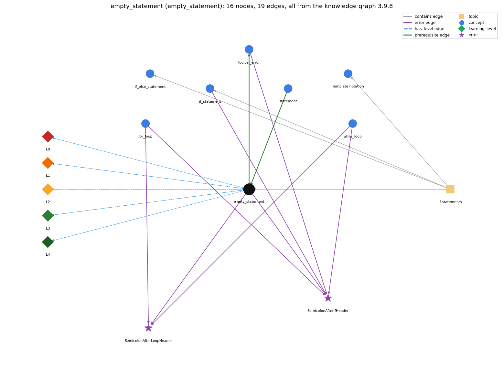

# empty_statement (`empty_statement`)

a lone ; is an empty statement; a block can stand alone

Section 1.3 Conditionals and Loops, topic 1.3.b If statements. From the knowledge graph 3.9.8 (`data/raw/chapter1_kg_updated.json`).

## Concepts associated with empty\_statement (7)

| Concept | Description | How it is associated |
| --- | --- | --- |
| **for\_loop** | a while with init/condition/update packaged together | shares error SemicolonAfterIfHeader shares error SemicolonAfterLoopHeader |
| **if\_else\_statement** | choose one of two blocks | same topic (topic1.3.b) |
| **if\_statement** | run a block only when the condition holds | shares error SemicolonAfterIfHeader same topic (topic1.3.b) |
| **logical\_error** | the program runs but computes the wrong result | builds on it (needs it) shares error SemicolonAfterIfHeader |
| **statement** | one step, terminated by ;, executed in sequence | prerequisite of it (it needs this) composition rule (R) with it |
| **syntax\_template** | the book's notation for a construct: a name in angle brackets, such as &lt;boolean expression&gt;, stands for any instance of that construct | same topic (topic1.3.b) |
| **while\_loop** | repeat a block while a condition holds | shares error SemicolonAfterIfHeader shares error SemicolonAfterLoopHeader |

## Every edge in this view and its full label (19)

| From | Edge | To | Full edge label |
| --- | --- | --- | --- |
| **empty\_statement** | prerequisite | **logical\_error** | A ; right after an if or loop header is an empty statement, so the header controls nothing and the next line always runs: the program compiles but computes the wrong result. grounding: spec\_passage |
| **statement** | prerequisite | **empty\_statement** | Any part of a for loop, including its body, can be left empty (a null statement, a lone ;); the book prefers a while loop to null statements. grounding: book\_passage composition rule (R) of statement with empty\_statement: A lone ; is the empty statement, which does nothing; it can fill a for-loop part or, by accident, end an if or loop header. composition rule (R) of empty\_statement with statement: The empty statement can stand wherever a statement is required (if body, loop body, for slots), and a block { } can stand alone; a ; after a header therefore silently becomes the body. |
| **empty\_statement** | error | **SemicolonAfterIfHeader** | **wrong rule:** if (x &gt; 0); System.out.println("positive"); prints only for positive x. **right rule:** The ; ends the if with an empty statement, so the next line always runs. role: context |
| **empty\_statement** | error | **SemicolonAfterLoopHeader** | **wrong rule:** Puts a ; right after for (...) or while (...). **right rule:** A ; right after the loop header is a null (empty) loop body, so the statements written after it are not repeated by the loop. role: context |
| **for\_loop** | error | **SemicolonAfterIfHeader** | **wrong rule:** if (x &gt; 0); System.out.println("positive"); prints only for positive x. **right rule:** The ; ends the if with an empty statement, so the next line always runs. role: context |
| **for\_loop** | error | **SemicolonAfterLoopHeader** | **wrong rule:** Puts a ; right after for (...) or while (...). **right rule:** A ; right after the loop header is a null (empty) loop body, so the statements written after it are not repeated by the loop. role: primary |
| **if\_statement** | error | **SemicolonAfterIfHeader** | **wrong rule:** if (x &gt; 0); System.out.println("positive"); prints only for positive x. **right rule:** The ; ends the if with an empty statement, so the next line always runs. role: primary |
| **logical\_error** | error | **SemicolonAfterIfHeader** | **wrong rule:** if (x &gt; 0); System.out.println("positive"); prints only for positive x. **right rule:** The ; ends the if with an empty statement, so the next line always runs. role: context |
| **while\_loop** | error | **SemicolonAfterIfHeader** | **wrong rule:** if (x &gt; 0); System.out.println("positive"); prints only for positive x. **right rule:** The ; ends the if with an empty statement, so the next line always runs. role: context |
| **while\_loop** | error | **SemicolonAfterLoopHeader** | **wrong rule:** Puts a ; right after for (...) or while (...). **right rule:** A ; right after the loop header is a null (empty) loop body, so the statements written after it are not repeated by the loop. role: context |
| **empty\_statement** | has\_level | **empty\_statement@L0** | empty statement -&gt; L0 (Prestructural): the answer holds a rule that contradicts Java (1 way). **[0] everyday\_reading** (E): Folk meaning: in English a semicolon just separates or ends a clause, so 'if (x &gt; 0);' still reads as 'if x is positive, do the next thing'. In Java a lone ; is a complete statement that does nothing, and it becomes the whole body of the if or loop. |
| **empty\_statement** | has\_level | **empty\_statement@L1** | empty statement -&gt; L1 (Unistructural): the answer states one correct rule without applying it (2 ways). **[0] names\_the\_element** (N): The empty (null) statement is a lone semicolon: a statement that does nothing. **[1] states\_the\_rule** (S): An empty statement does nothing, and its execution always completes normally; any part of a for loop, including its body, may be left empty, but a while loop is better style than null statements. |
| **empty\_statement** | has\_level | **empty\_statement@L2** | empty statement -&gt; L2 (Multistructural): the answer applies the rules of empty statement to every part of the code, in order (3 ways). **[0] line\_by\_line\_trace** (LT): Executing ; does nothing and passes control to the next statement; as a loop body it means each pass is just test (then update, for a for loop). **[1] output\_prediction** (OP): An empty statement produces no value and no output; e.g. for (int v = 1; v &lt;= N/2; v \*= 2) ; computes the same final v as the while version, but v is out of scope afterwards. **[2] one\_step\_execution** (OS): One execution changes no variable and returns nothing; only the header parts around it (test, update) change state. |
| **empty\_statement** | has\_level | **empty\_statement@L3** | empty statement -&gt; L3 (Relational): the answer relates the parts (2 ways). **[0] relation\_to\_neighbour** (R): The empty statement can stand wherever a statement is required (if body, loop body, for slots), and a block { } can stand alone; a ; after a header therefore silently becomes the body. **[1] purpose\_of\_the\_whole** (P): Plan: placeholder - an intentionally empty body when the loop header does all the work; the book avoids it and prefers a while loop. |
| **empty\_statement** | has\_level | **empty\_statement@L4** | empty statement -&gt; L4 (Extended abstract): the answer reasons beyond the given code (4 ways). **[0] predict\_a\_change** (C): Deleting a ; that stands right after an if or loop header changes the program: the next statement becomes the body. Adding or removing an extra ; between ordinary statements changes nothing. **[1] diagnose\_an\_error** (D): rule broken: A ; right after if (...) is an empty statement that forms the whole then branch; the following statement or block is no longer part of the if. Kind: silent logic error. Trigger class: Any if (cond); followed by a statement or block: that statement runs for every input, whatever cond is (it compiles without error). **[2] diagnose\_an\_error** (D): rule broken: A ; right after while (...) or for (...) is an empty statement that is the whole loop body; the block written next is not repeated. Kind: silent logic error. Trigger class: for (...); { body } runs the body once after the loop ends; while (cond); with a cond that the empty body cannot change hangs forever (infinite loop) when cond starts true. **[3] transfer\_to\_a\_new\_program** (X): Use an empty statement only for a loop whose header does all the work, and comment it; otherwise write { } or restructure as a while loop. Never put ; directly after if (...), while (...) or for (...) by habit. |
| **topic1.3.b** | contains | **empty\_statement** | topic topic1.3.b contains empty\_statement |
| **topic1.3.b** | contains | **if\_else\_statement** | topic topic1.3.b contains if\_else\_statement |
| **topic1.3.b** | contains | **if\_statement** | topic topic1.3.b contains if\_statement |
| **topic1.3.b** | contains | **syntax\_template** | topic topic1.3.b contains syntax\_template |
