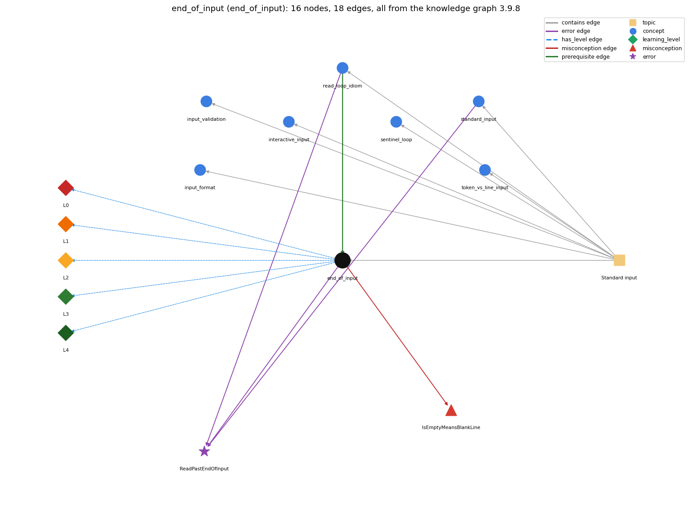

# end_of_input (`end_of_input`)

StdIn.isEmpty() and the end-of-file keystroke

Section 1.5 Input and Output, topic 1.5.c Standard input.

## At a glance

- **Needs first:** `read_loop_idiom`
- **Leads to:** nothing
- **Learned alongside:** nothing
- **Misconceptions:** `IsEmptyMeansBlankLine`
- **Errors:** `ReadPastEndOfInput`
- **Levels:** L0, L1, L2, L3, L4

Everything below comes from the knowledge graph 3.9.8 (`data/raw/chapter1_kg_updated.json`): 18 edges around this concept, each explained in the graph's own words.

## What it needs first (1)

A prerequisite edge means the other concept has to be understood before `end_of_input`.

### `read_loop_idiom` comes before `end_of_input`

*reading until end-of-input*

The read loop runs until StdIn.isEmpty() returns true, which happens when the user types the end-of-file sequence (&lt;ctrl-d&gt;).

- **Grounding:** book passage
- **How `end_of_input` combines with `read_loop_idiom`:** isEmpty() is the condition of the read loop, so the loop ends exactly when end-of-file is reached (&lt;ctrl-d&gt; at the keyboard, end of file with &lt;).
- **How `read_loop_idiom` combines with `end_of_input`:** The loop ends only when isEmpty() becomes true: at the end of a redirected file, or after the end-of-file keystroke (&lt;ctrl-d&gt;, or &lt;ctrl-z&gt; on some systems).

## What it leads to (0)

These concepts need `end_of_input` first.

No concept has this one as a prerequisite.

## Learned alongside (0)

A parallel edge joins two concepts that sit side by side: neither is needed before the other.

No parallel edge touches this concept.

## Misconceptions (1)

A misconception edge states the wrong rule a student may hold about this concept, and the right rule.

### IsEmptyMeansBlankLine

- **Wrong rule:** StdIn.isEmpty() becomes true when the user presses Enter on an empty line.
- **Right rule:** isEmpty() is true only when no more values remain: at the end of a redirected file, or after the end-of-file sequence (&lt;ctrl-d&gt;, or &lt;ctrl-z&gt; on some systems, on a line by itself) is typed; an empty line is just whitespace.
- **Role of this concept:** primary
- **Shows at level L0 as:** misconception: wrong rule: StdIn.isEmpty() becomes true when the user presses Enter on an empty line. Right rule: isEmpty() is true only when no tokens remain: at the end of a redirected file, or after the end-of-file sequence (&lt;ctrl-d&gt;, or &lt;ctrl-z&gt; on some systems, on a line by itself). An empty line is just whitespace.
- **Shows at level L0 as:** inconsistent trace: Points to LT (isEmpty() waits until it can decide; it returns true only after end-of-file). An uneven trace ends the loop at a blank line on some passes, or counts the end-of-file keystroke as a value. (here mixing in: "StdIn.isEmpty() becomes true when the user presses Enter on an empty line")

## Errors (1)

An error edge states the rule that gets broken in a program, and the right rule.

### ReadPastEndOfInput

- **Wrong rule:** Calls StdIn.readInt() again after the input has run out.
- **Right rule:** Reading after standard input is exhausted is a run-time error; test StdIn.isEmpty() before each read.
- **Role of this concept:** primary
- **Also an edge from `read_loop_idiom`:** Calls StdIn.readInt() again after the input has run out.
- **Also an edge from `standard_input`:** Calls StdIn.readInt() again after the input has run out.

## Levels L0 to L4 (5 of 5)

Each level edge lists the ways a student shows that level, each with its exact rule.

### L0: Prestructural / sensorimotor

L0 for end of input: the answer holds a rule that contradicts Java.

*Deciding question: Does every rule the answer applies to end of input agree with the language rule? If it reads the code with everyday meanings, applies a wrong rule, or switches rules within one trace, it is L0. A slip in an otherwise rule-correct trace is L2 with an error, not L0.*

end of input -&gt; L0 (Prestructural): the answer holds a rule that contradicts Java (3 ways).

- **everyday reading** (folk-meaning rule): Everyday 'empty' and 'done' suggest that a blank line, or pressing Enter, ends the input. For StdIn, a blank line is only whitespace: input ends only when the end-of-file signal arrives.
- **misconception** (wrong rule / right rule; shows `IsEmptyMeansBlankLine`): wrong rule: StdIn.isEmpty() becomes true when the user presses Enter on an empty line. Right rule: isEmpty() is true only when no tokens remain: at the end of a redirected file, or after the end-of-file sequence (&lt;ctrl-d&gt;, or &lt;ctrl-z&gt; on some systems, on a line by itself). An empty line is just whitespace.
- **inconsistent trace** (uneven-application rule; shows `IsEmptyMeansBlankLine`): Points to LT (isEmpty() waits until it can decide; it returns true only after end-of-file). An uneven trace ends the loop at a blank line on some passes, or counts the end-of-file keystroke as a value. (here mixing in: "StdIn.isEmpty() becomes true when the user presses Enter on an empty line")

### L1: Unistructural / atom x text surface

L1 for end of input: the answer states one correct rule without applying it.

*Deciding question: Does the answer cover every part of the code, in order, with the values (L2)? If it covers one part or only states the rule, it is L1.*

end of input -&gt; L1 (Unistructural): the answer states one correct rule without applying it (2 ways).

- **names the element** (identity rule): End of input is the end-of-file condition of the input stream. Typing the end-of-file sequence or reaching the end of a redirected file signals it, and StdIn.isEmpty() tests it.
- **states the rule** (declarative rule): isEmpty() returns true if standard input has no more values (only whitespace may be left). At a terminal the book signals the end with &lt;ctrl-d&gt;; the other widely used convention is &lt;ctrl-z&gt;.

### L2: Multistructural / block x execution / preoperational

L2 for end of input: the answer applies these rules to every part of the code, in order.

*Deciding question: Is the answer many segments mapped onto lines (L2), or one segment stating the purpose of the whole (L3)? A correct output with no value-by-value justification is not levelled.*

end of input -&gt; L2 (Multistructural): the answer applies the rules of end of input to every part of the code, in order (3 ways).

- **line by line trace** (operational sequencing rule): When isEmpty() is called at a terminal, it blocks until a token arrives (it returns false) or the end-of-file sequence is typed (it returns true). With a redirected file, it returns true right after the last token.
- **output prediction** (evaluation / result rule): isEmpty() returns a boolean: true if there are no more values, false otherwise.
- **one step execution** (state-transition rule): isEmpty() consumes no value (at most it skips whitespace) and returns a boolean. Only the read that follows advances past a token.

### L3: Relational / relations x function (concrete operational begins)

L3 for end of input: the answer relates the parts by these rules.

*Deciding question: Was the purpose deduced from the code, or only guessed from traced input/output pairs (then L2)? Does the answer stay within the given code (L3), or reason about changed code, an error class or a new program (L4)?*

end of input -&gt; L3 (Relational): the answer relates the parts (2 ways).

- **relation to neighbour** (composition rule (with a neighbour)): isEmpty() is the condition of the read loop, so the loop ends exactly when end-of-file is reached (&lt;ctrl-d&gt; at the keyboard, end of file with &lt;).
- **purpose of the whole** (plan / role rule): Role: the termination signal of a process-until-done loop, used when the amount of data is unknown.

### L4: Extended abstract (concrete-operational reversibility and conservation)

L4 for end of input: the answer reasons beyond the given code by these rules.

*Deciding question: Does the answer link the code to a broader context: a changed program, a class of inputs, an unseen problem? Re-tracing changed code value by value is L2; fixing one given failing case is L3.*

end of input -&gt; L4 (Extended abstract): the answer reasons beyond the given code (4 ways).

- **predict a change** (conservation rule; shows `IsEmptyMeansBlankLine`): Adding blank lines or trailing spaces at the end of the input keeps isEmpty()'s answer (still true at the end). Adding any token changes it.
- **diagnose an error** (error rule): rule broken: Reading after the stream is exhausted is an error. Test isEmpty() first. Kind: run-time exception. Trigger class: Any read after the end-of-file signal or after the last token of the file.
- **transfer to a new program** (applicability rule): Ending on end-of-file is right when data come from a file or a pipe, or the count is unknown. For human typists a count or a sentinel can be clearer, because the end-of-file key differs between systems.
- **diagnose an error** (error rule): rule broken: The end must be signalled with the system's end-of-file key. Kind: silent logic error. Trigger class: At a terminal the user presses Enter, or uses the other system's key, so isEmpty() keeps waiting and the program seems to hang.

## Same topic

`end_of_input` belongs to the topic **Standard input** (`topic1.5.c`). The topic also contains: `input_format`, `input_validation`, `interactive_input`, `read_loop_idiom`, `sentinel_loop`, `standard_input`, `token_vs_line_input`.

## Rules of the concept (14)

- **folk-meaning rule:** Everyday 'empty' and 'done' suggest that a blank line, or pressing Enter, ends the input. For StdIn, a blank line is only whitespace: input ends only when the end-of-file signal arrives.
- **wrong rule / right rule:** IsEmptyMeansBlankLine: wrong: StdIn.isEmpty() becomes true when the user presses Enter on an empty line. \| right: isEmpty() is true only when no tokens remain: at the end of a redirected file, or after the end-of-file sequence (&lt;ctrl-d&gt;, or &lt;ctrl-z&gt; on some systems, on a line by itself). An empty line is just whitespace.
- **uneven-application rule:** Points to LT (isEmpty() waits until it can decide; it returns true only after end-of-file). An uneven trace ends the loop at a blank line on some passes, or counts the end-of-file keystroke as a value.
- **identity rule:** End of input is the end-of-file condition of the input stream. Typing the end-of-file sequence or reaching the end of a redirected file signals it, and StdIn.isEmpty() tests it.
- **declarative rule:** isEmpty() returns true if standard input has no more values (only whitespace may be left). At a terminal the book signals the end with &lt;ctrl-d&gt;; the other widely used convention is &lt;ctrl-z&gt;.
- **operational sequencing rule:** When isEmpty() is called at a terminal, it blocks until a token arrives (it returns false) or the end-of-file sequence is typed (it returns true). With a redirected file, it returns true right after the last token.
- **evaluation / result rule:** isEmpty() returns a boolean: true if there are no more values, false otherwise.
- **state-transition rule:** isEmpty() consumes no value (at most it skips whitespace) and returns a boolean. Only the read that follows advances past a token.
- **composition rule (with a neighbour):** with read\_loop\_idiom: isEmpty() is the condition of the read loop, so the loop ends exactly when end-of-file is reached (&lt;ctrl-d&gt; at the keyboard, end of file with &lt;).
- **plan / role rule:** Role: the termination signal of a process-until-done loop, used when the amount of data is unknown.
- **conservation rule:** Adding blank lines or trailing spaces at the end of the input keeps isEmpty()'s answer (still true at the end). Adding any token changes it.
- **error rule:** rule broken: Reading after the stream is exhausted is an error. Test isEmpty() first. (run-time exception)
- **error rule:** rule broken: The end must be signalled with the system's end-of-file key. (silent logic error)
- **applicability rule:** Ending on end-of-file is right when data come from a file or a pipe, or the count is unknown. For human typists a count or a sentinel can be clearer, because the end-of-file key differs between systems.

## The whole prerequisite chain

- **Everything it builds on (3):** `read_loop_idiom`, `standard_input`, `stream_model`
- **Everything that builds on it (0):** nothing
