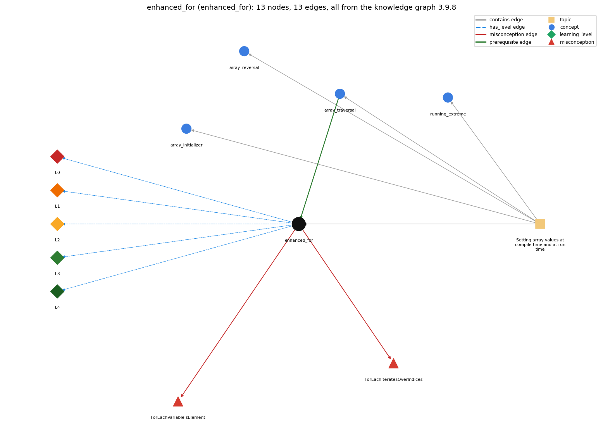

# enhanced_for (`enhanced_for`)

for (int x : a) -- the for-each form

Section 1.4 Arrays, topic 1.4.c Setting array values at compile time and at run time. From the knowledge graph 3.9.8 (`data/raw/chapter1_kg_updated.json`).

## Concepts associated with enhanced\_for (4)

| Concept | Description | How it is associated |
| --- | --- | --- |
| **array\_initializer** | {1, 2, 3} literal initialization | same topic (topic1.4.c) |
| **array\_reversal** | reversing an array in place | same topic (topic1.4.c) |
| **array\_traversal** | walking the array with an index loop | prerequisite of it (it needs this) composition rule (R) with it same topic (topic1.4.c) |
| **running\_extreme** | tracking the max or min of a stream | same topic (topic1.4.c) |

## Every edge in this view and its full label (13)

| From | Edge | To | Full edge label |
| --- | --- | --- | --- |
| **array\_traversal** | prerequisite | **enhanced\_for** | for (int x : a) is a traversal that hands the body each value a[i] instead of the index i. grounding: book\_passage composition rule (R) of array\_traversal with enhanced\_for: for (int x : a) is a traversal that hands the body each value a[i] and hides the index i. composition rule (R) of enhanced\_for with array\_traversal: It is a full forward traversal with the index hidden, so it cannot skip, go backward, stop at a computed index or write a[i]. |
| **enhanced\_for** | misconception | **ForEachIteratesOverIndices** | **wrong rule:** In for (int x : a), x takes the index values 0, 1, ..., a.length - 1. **right rule:** In for (int x : a), x takes the element values a[0], a[1] and so on. role: primary |
| **enhanced\_for** | misconception | **ForEachVariableIsElement** | **wrong rule:** Assigning x = v inside for (int x : a) changes the array element. **right rule:** x is a copy of the element, so assigning to x does not change the array. role: primary |
| **enhanced\_for** | has\_level | **enhanced\_for@L0** | enhanced for -&gt; L0 (Prestructural): the answer holds a rule that contradicts Java (4 ways). **[0] everyday\_reading** (E): Folk meaning: the English reading 'for each value in values' suggests the variable is the item itself, so changing it changes the array, or that it ranges over positions. Java rule: on each pass the variable receives a copy of the next element value; the index is hidden and the array is not changed by assigning the variable. **[1] misconception** (M) &rarr; ForEachIteratesOverIndices: wrong rule: A for-each loops over indices, not values. Right rule: In for (int x : a), x takes the element values a[0], a[1], ... in order; no index is available. **[2] misconception** (M) &rarr; ForEachVariableIsElement: wrong rule: Assigning the for-each variable writes back into the array. Right rule: x is a local copy of the element (as if int x = a[i];), so assigning to x does not change the array. **[3] inconsistent\_trace** (T) &rarr; ForEachIteratesOverIndices: Points to LT: before each pass the next element is copied into x. Inconsistent application: the trace stores an assignment to x back into a on some passes but not on others. (here mixing in: "a for-each loops over indices, not values") |
| **enhanced\_for** | has\_level | **enhanced\_for@L1** | enhanced for -&gt; L1 (Unistructural): the answer states one correct rule without applying it (2 ways). **[0] names\_the\_element** (N): Identity: the enhanced for loop ('for each' loop), a statement that runs its body once per element of an array, giving the body each element value. **[1] states\_the\_rule** (S): Declarative: 'for (T x : a) statement', where T is the element type (or a type it converts to); x's scope is the contained statement. |
| **enhanced\_for** | has\_level | **enhanced\_for@L2** | enhanced for -&gt; L2 (Multistructural): the answer applies the rules of enhanced for to every part of the code, in order (3 ways). **[0] line\_by\_line\_trace** (LT): Sequencing: equivalent to for (int i = 0; i &lt; a.length; i++) { T x = a[i]; body }. The element is copied into x, the body runs, and then the next element follows, until all a.length elements are done. **[1] output\_prediction** (OP): Result: the body runs a.length times with x = a[0], a[1], ...; for int[] a = {1, 2, 3}, summing x gives 6. The loop itself produces no value. **[2] one\_step\_execution** (OS): State transition: each pass sets x to the next element value; assigning to x changes only x, never a[i]. |
| **enhanced\_for** | has\_level | **enhanced\_for@L3** | enhanced for -&gt; L3 (Relational): the answer relates the parts (2 ways). **[0] relation\_to\_neighbour** (R): It is a full forward traversal with the index hidden, so it cannot skip, go backward, stop at a computed index or write a[i]. **[1] purpose\_of\_the\_whole** (P): Plan/role: accumulate or count over all values (gatherer or counter role) when the position is irrelevant, as in histogram counting counts[score]++. |
| **enhanced\_for** | has\_level | **enhanced\_for@L4** | enhanced for -&gt; L4 (Extended abstract): the answer reasons beyond the given code (5 ways). **[0] predict\_a\_change** (C) &rarr; ForEachIteratesOverIndices: Conservation: rewriting an index loop as a for-each keeps every read of a[i] but breaks writes to the array (assigning x has no effect) and loses i, so searches can no longer report positions. **[1] transfer\_to\_a\_new\_program** (X): Applicability: use for-each to read every element in order when the index is not needed (sums, counts, printing). Use an index loop when you need the position, write elements, visit part of the array, go backward, or compare neighbours. **[2] diagnose\_an\_error** (D): rule broken: The loop variable must have a type that the element type converts to. Kind: compile-time. Trigger class: for (int x : d) with d a double[] (incompatible types: possible lossy conversion) **[3] diagnose\_an\_error** (D): rule broken: The for-each variable is a copy; it cannot update the array. Kind: silent logic error. Trigger class: x = 0 or x \*= 2 inside the loop is meant to change the elements **[4] diagnose\_an\_error** (D): rule broken: The enhanced for gives no index. Kind: silent logic error. Trigger class: a search written with for-each cannot report where the target is found |
| **topic1.4.c** | contains | **array\_initializer** | topic topic1.4.c contains array\_initializer |
| **topic1.4.c** | contains | **array\_reversal** | topic topic1.4.c contains array\_reversal |
| **topic1.4.c** | contains | **array\_traversal** | topic topic1.4.c contains array\_traversal |
| **topic1.4.c** | contains | **enhanced\_for** | topic topic1.4.c contains enhanced\_for |
| **topic1.4.c** | contains | **running\_extreme** | topic topic1.4.c contains running\_extreme |
