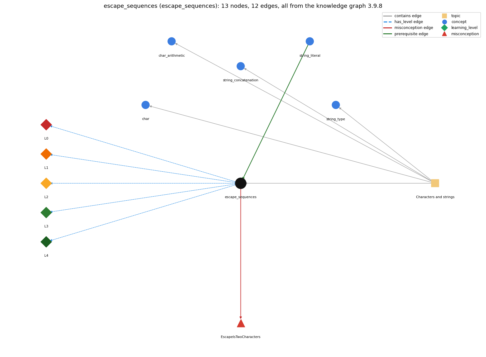

# escape_sequences (`escape_sequences`)

backslash codes inside literals: '\t' tab, '\n' newline

Section 1.2 Built-in Types of Data, topic 1.2.b Characters and strings.

## At a glance

- **Needs first:** `string_literal`
- **Leads to:** nothing
- **Learned alongside:** nothing
- **Misconceptions:** `EscapeIsTwoCharacters`
- **Errors:** none
- **Levels:** L0, L1, L2, L3, L4

Everything below comes from the knowledge graph 3.9.8 (`data/raw/chapter1_kg_updated.json`): 12 edges around this concept, each explained in the graph's own words.

## What it needs first (1)

A prerequisite edge means the other concept has to be understood before `escape_sequences`.

### `string_literal` comes before `escape_sequences`

*"Hello, World" -- the text being printed*

Escape sequences are written inside string or char literals.

- **Grounding:** book passage
- **How `escape_sequences` combines with `string_literal`:** Escapes are written inside "..." or '...'. \" puts a double quote inside a String literal without ending it.
- **How `string_literal` combines with `escape_sequences`:** Escape sequences (\n, \t, \", \\) are written inside string or char literals to stand for one character that cannot be typed directly.

## What it leads to (0)

These concepts need `escape_sequences` first.

No concept has this one as a prerequisite.

## Learned alongside (0)

A parallel edge joins two concepts that sit side by side: neither is needed before the other.

No parallel edge touches this concept.

## Misconceptions (1)

A misconception edge states the wrong rule a student may hold about this concept, and the right rule.

### EscapeIsTwoCharacters

- **Wrong rule:** \t in a string prints a backslash and the letter t.
- **Right rule:** A backslash starts an escape sequence, so \t is a single tab character.
- **Role of this concept:** primary
- **Shows at level L0 as:** misconception: wrong rule: \t in a string prints a backslash and the letter t. Right rule: A backslash starts an escape sequence, so \t is a single tab character.
- **Shows at level L0 as:** inconsistent trace: Points to LT (the compiler turns each escape into a single character). Applied unevenly, a student prints "\n" as a line break but counts it as two characters in length() or charAt. (here mixing in: "\t in a string prints a backslash and the letter t")

## Errors (0)

An error edge states the rule that gets broken in a program, and the right rule.

The graph has no error edge from this concept.

## Levels L0 to L4 (5 of 5)

Each level edge lists the ways a student shows that level, each with its exact rule.

### L0: Prestructural / sensorimotor

L0 for escape sequences: the answer holds a rule that contradicts Java.

*Deciding question: Does every rule the answer applies to escape sequences agree with the language rule? If it reads the code with everyday meanings, applies a wrong rule, or switches rules within one trace, it is L0. A slip in an otherwise rule-correct trace is L2 with an error, not L0.*

escape sequences -&gt; L0 (Prestructural): the answer holds a rule that contradicts Java (3 ways).

- **everyday reading** (folk-meaning rule): In everyday text a backslash is just a character, and a new line is made by pressing Enter. Inside a Java literal a backslash starts an escape: \n is one newline character and \\ is one backslash, and a literal cannot contain a raw line break.
- **misconception** (wrong rule / right rule; shows `EscapeIsTwoCharacters`): wrong rule: \t in a string prints a backslash and the letter t. Right rule: A backslash starts an escape sequence, so \t is a single tab character.
- **inconsistent trace** (uneven-application rule; shows `EscapeIsTwoCharacters`): Points to LT (the compiler turns each escape into a single character). Applied unevenly, a student prints "\n" as a line break but counts it as two characters in length() or charAt. (here mixing in: "\t in a string prints a backslash and the letter t")

### L1: Unistructural / atom x text surface

L1 for escape sequences: the answer states one correct rule without applying it.

*Deciding question: Does the answer cover every part of the code, in order, with the values (L2)? If it covers one part or only states the rule, it is L1.*

escape sequences -&gt; L1 (Unistructural): the answer states one correct rule without applying it (2 ways).

- **names the element** (identity rule): Escape sequence: a backslash code inside a char or String literal that stands for one special character (\t, \n, \\, \', \").
- **states the rule** (declarative rule): Java has eight escape sequences. The common ones are \t (tab), \n (newline), \\ (backslash), \' (single quote) and \" (double quote), and each represents a single character.

### L2: Multistructural / block x execution / preoperational

L2 for escape sequences: the answer applies these rules to every part of the code, in order.

*Deciding question: Is the answer many segments mapped onto lines (L2), or one segment stating the purpose of the whole (L3)? A correct output with no value-by-value justification is not levelled.*

escape sequences -&gt; L2 (Multistructural): the answer applies the rules of escape sequences to every part of the code, in order (3 ways).

- **line by line trace** (operational sequencing rule): The compiler replaces each escape with its single character while reading the literal, so at run time the String already contains that one character.
- **output prediction** (evaluation / result rule): System.out.print("Hello!\nHow are you doing?\n") prints two lines. "a\tb" prints a, a tab, then b. "Hi\n".length() is 3.
- **one step execution** (state-transition rule): An escape changes no variable. Printing \n moves the output position to the start of a new line.

### L3: Relational / relations x function (concrete operational begins)

L3 for escape sequences: the answer relates the parts by these rules.

*Deciding question: Was the purpose deduced from the code, or only guessed from traced input/output pairs (then L2)? Does the answer stay within the given code (L3), or reason about changed code, an error class or a new program (L4)?*

escape sequences -&gt; L3 (Relational): the answer relates the parts (2 ways).

- **relation to neighbour** (composition rule (with a neighbour)): Escapes are written inside "..." or '...'. \" puts a double quote inside a String literal without ending it.
- **purpose of the whole** (plan / role rule): Escapes format output (line breaks, tab-aligned columns) and put quote or backslash characters into text.

### L4: Extended abstract (concrete-operational reversibility and conservation)

L4 for escape sequences: the answer reasons beyond the given code by these rules.

*Deciding question: Does the answer link the code to a broader context: a changed program, a class of inputs, an unseen problem? Re-tracing changed code value by value is L2; fixing one given failing case is L3.*

escape sequences -&gt; L4 (Extended abstract): the answer reasons beyond the given code (5 ways).

- **predict a change** (conservation rule; shows `EscapeIsTwoCharacters`): Removing the backslash turns \n into the letter n. Doubling it (\\n) prints a backslash followed by n. Adding a space after \n puts a space at the start of the next line.
- **transfer to a new program** (applicability rule): Use escapes for special characters inside literals. For line ends in formatted output, use println or printf's %n, which gives the platform line separator.
- **diagnose an error** (error rule): rule broken: A double quote inside a String literal must be escaped. Kind: compile-time. Trigger class: An unescaped " inside a String, such as "She said "Hi"": the literal ends early, and the compiler reports an unclosed literal or ')' expected.
- **diagnose an error** (error rule): rule broken: A backslash must be followed by a valid escape character. Kind: compile-time. Trigger class: Backslash plus an undefined letter, e.g. a Windows path "C:\data": 'illegal escape character'.
- **diagnose an error** (error rule): rule broken: A backslash followed by a valid escape letter is replaced by that character. Kind: silent logic error. Trigger class: Paths or text containing \t or \n by accident ("C:\temp" contains a tab).

## Same topic

`escape_sequences` belongs to the topic **Characters and strings** (`topic1.2.b`). The topic also contains: `char`, `char_arithmetic`, `string_concatenation`, `string_type`.

## Rules of the concept (15)

- **folk-meaning rule:** In everyday text a backslash is just a character, and a new line is made by pressing Enter. Inside a Java literal a backslash starts an escape: \n is one newline character and \\ is one backslash, and a literal cannot contain a raw line break.
- **wrong rule / right rule:** EscapeIsTwoCharacters: wrong: \t in a string prints a backslash and the letter t. \| right: A backslash starts an escape sequence, so \t is a single tab character.
- **uneven-application rule:** Points to LT (the compiler turns each escape into a single character). Applied unevenly, a student prints "\n" as a line break but counts it as two characters in length() or charAt.
- **identity rule:** Escape sequence: a backslash code inside a char or String literal that stands for one special character (\t, \n, \\, \', \").
- **declarative rule:** Java has eight escape sequences. The common ones are \t (tab), \n (newline), \\ (backslash), \' (single quote) and \" (double quote), and each represents a single character.
- **operational sequencing rule:** The compiler replaces each escape with its single character while reading the literal, so at run time the String already contains that one character.
- **evaluation / result rule:** System.out.print("Hello!\nHow are you doing?\n") prints two lines. "a\tb" prints a, a tab, then b. "Hi\n".length() is 3.
- **state-transition rule:** An escape changes no variable. Printing \n moves the output position to the start of a new line.
- **composition rule (with a neighbour):** with string\_literal: Escapes are written inside "..." or '...'. \" puts a double quote inside a String literal without ending it.
- **plan / role rule:** Escapes format output (line breaks, tab-aligned columns) and put quote or backslash characters into text.
- **conservation rule:** Removing the backslash turns \n into the letter n. Doubling it (\\n) prints a backslash followed by n. Adding a space after \n puts a space at the start of the next line.
- **error rule:** rule broken: A double quote inside a String literal must be escaped. (compile-time)
- **error rule:** rule broken: A backslash must be followed by a valid escape character. (compile-time)
- **error rule:** rule broken: A backslash followed by a valid escape letter is replaced by that character. (silent logic error)
- **applicability rule:** Use escapes for special characters inside literals. For line ends in formatted output, use println or printf's %n, which gives the platform line separator.

## The whole prerequisite chain

- **Everything it builds on (1):** `string_literal`
- **Everything that builds on it (0):** nothing
