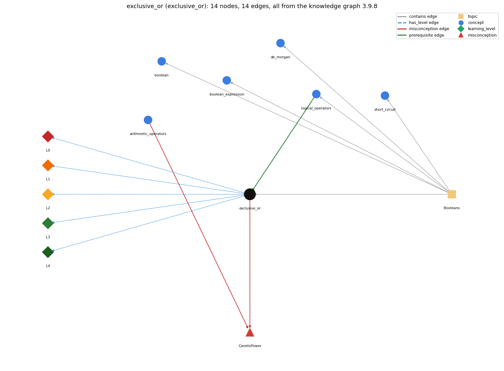

# exclusive_or (`exclusive_or`)

^ on booleans is true when the operands differ

Section 1.2 Built-in Types of Data, topic 1.2.e Booleans.

## At a glance

- **Needs first:** `logical_operators`
- **Leads to:** nothing
- **Learned alongside:** nothing
- **Misconceptions:** `CaretIsPower`
- **Errors:** none
- **Levels:** L0, L1, L2, L3, L4

Everything below comes from the knowledge graph 3.9.8 (`data/raw/chapter1_kg_updated.json`): 14 edges around this concept, each explained in the graph's own words.

## What it needs first (1)

A prerequisite edge means the other concept has to be understood before `exclusive_or`.

### `logical_operators` comes before `exclusive_or`

*&amp;&amp; \|\| !*

^ on booleans is another logical operator, defined by a truth table like &amp;&amp;, \|\| and !: true exactly when its operands differ.

- **Grounding:** order only
- **How `exclusive_or` combines with `logical_operators`:** ^ belongs with &amp;&amp;, \|\| and ! as a boolean operator defined by a truth table, but it is not short-circuit and it binds tighter than &amp;&amp; and \|\|; a ^ b equals (a \|\| b) &amp;&amp; !(a &amp;&amp; b).
- **How `logical_operators` combines with `exclusive_or`:** ^ on booleans is a further logical operator, true exactly when the operands differ (it equals (a \|\| b) &amp;&amp; !(a &amp;&amp; b)), but unlike &amp;&amp; and \|\| it always evaluates both operands.

## What it leads to (0)

These concepts need `exclusive_or` first.

No concept has this one as a prerequisite.

## Learned alongside (0)

A parallel edge joins two concepts that sit side by side: neither is needed before the other.

No parallel edge touches this concept.

## Misconceptions (1)

A misconception edge states the wrong rule a student may hold about this concept, and the right rule.

### CaretIsPower

- **Wrong rule:** a^2 computes a squared.
- **Right rule:** Java has no exponent operator; ^ is exclusive or, and a \* a or Math.pow(a, 2) computes a squared.
- **Role of this concept:** context
- **Shows at level L0 as:** misconception: wrong rule: a^2 computes a squared. Right rule: Java has no exponent operator; ^ is exclusive or, and a \* a or Math.pow(a, 2) computes a squared.
- **Shows at level L0 as:** inconsistent trace: Points to LT (both operands are evaluated, then compared: true if they differ). Applied unevenly: in the true/true row of a truth table the student gives true (treating ^ like \|\|) while the other rows are right. (here mixing in: "a^2 computes a squared")
- **Also an edge from `arithmetic_operators`:** a^2 computes a squared.

## Errors (0)

An error edge states the rule that gets broken in a program, and the right rule.

The graph has no error edge from this concept.

## Levels L0 to L4 (5 of 5)

Each level edge lists the ways a student shows that level, each with its exact rule.

### L0: Prestructural / sensorimotor

L0 for exclusive or: the answer holds a rule that contradicts Java.

*Deciding question: Does every rule the answer applies to exclusive or agree with the language rule? If it reads the code with everyday meanings, applies a wrong rule, or switches rules within one trace, it is L0. A slip in an otherwise rule-correct trace is L2 with an error, not L0.*

exclusive or -&gt; L0 (Prestructural): the answer holds a rule that contradicts Java (3 ways).

- **everyday reading** (folk-meaning rule): Folk meaning: on calculators, in spreadsheets and in typed maths ^ means 'to the power of', so a^2 is a squared. Java rule: ^ is exclusive or (bitwise on ints), there is no exponent operator, and 10^6 is 12.
- **misconception** (wrong rule / right rule; shows `CaretIsPower`): wrong rule: a^2 computes a squared. Right rule: Java has no exponent operator; ^ is exclusive or, and a \* a or Math.pow(a, 2) computes a squared.
- **inconsistent trace** (uneven-application rule; shows `CaretIsPower`): Points to LT (both operands are evaluated, then compared: true if they differ). Applied unevenly: in the true/true row of a truth table the student gives true (treating ^ like \|\|) while the other rows are right. (here mixing in: "a^2 computes a squared")

### L1: Unistructural / atom x text surface

L1 for exclusive or: the answer states one correct rule without applying it.

*Deciding question: Does the answer cover every part of the code, in order, with the values (L2)? If it covers one part or only states the rule, it is L1.*

exclusive or -&gt; L1 (Unistructural): the answer states one correct rule without applying it (2 ways).

- **names the element** (identity rule): ^ applied to boolean operands is the exclusive-or logical operator.
- **states the rule** (declarative rule): For booleans, a ^ b is true if a and b are different and false if they are the same (equivalent to a != b); both operands are always evaluated.

### L2: Multistructural / block x execution / preoperational

L2 for exclusive or: the answer applies these rules to every part of the code, in order.

*Deciding question: Is the answer many segments mapped onto lines (L2), or one segment stating the purpose of the whole (L3)? A correct output with no value-by-value justification is not levelled.*

exclusive or -&gt; L2 (Multistructural): the answer applies the rules of exclusive or to every part of the code, in order (3 ways).

- **line by line trace** (operational sequencing rule): Evaluate the left operand, then the right operand (always, no short-circuit), then compare them.
- **output prediction** (evaluation / result rule): Boolean result: true ^ true is false, true ^ false is true, false ^ false is false; with int operands ^ gives an int bitwise result, so 10 ^ 6 is 12.
- **one step execution** (state-transition rule): ^ changes no variable; flag = flag ^ true stores the opposite value, toggling the flag.

### L3: Relational / relations x function (concrete operational begins)

L3 for exclusive or: the answer relates the parts by these rules.

*Deciding question: Was the purpose deduced from the code, or only guessed from traced input/output pairs (then L2)? Does the answer stay within the given code (L3), or reason about changed code, an error class or a new program (L4)?*

exclusive or -&gt; L3 (Relational): the answer relates the parts (2 ways).

- **relation to neighbour** (composition rule (with a neighbour)): ^ belongs with &amp;&amp;, \|\| and ! as a boolean operator defined by a truth table, but it is not short-circuit and it binds tighter than &amp;&amp; and \|\|; a ^ b equals (a \|\| b) &amp;&amp; !(a &amp;&amp; b).
- **purpose of the whole** (plan / role rule): Expresses 'exactly one of two conditions' (e.g. exactly one of two coordinates is negative) or toggles a parity flag.

### L4: Extended abstract (concrete-operational reversibility and conservation)

L4 for exclusive or: the answer reasons beyond the given code by these rules.

*Deciding question: Does the answer link the code to a broader context: a changed program, a class of inputs, an unseen problem? Re-tracing changed code value by value is L2; fixing one given failing case is L3.*

exclusive or -&gt; L4 (Extended abstract): the answer reasons beyond the given code (3 ways).

- **predict a change** (conservation rule; shows `CaretIsPower`): Swapping the operands keeps the value (^ is commutative), and applying ^ b twice restores the original value ((a ^ b) ^ b == a), so xor with a fixed operand is reversible.
- **transfer to a new program** (applicability rule): Use ^ (or the clearer a != b) when the test is 'the two conditions differ'; never use ^ for powers (use multiplication, Math.pow, or e-notation literals such as 1e6).
- **diagnose an error** (error rule): rule broken: ^ is exclusive or, not exponentiation. Kind: silent logic error. Trigger class: Writing x^2 or 10^n with int operands: it compiles and computes a bitwise xor (10^6 is 12); with double operands such as 2.0^2 it is a compile-time error instead.

## Same topic

`exclusive_or` belongs to the topic **Booleans** (`topic1.2.e`). The topic also contains: `boolean`, `boolean_expression`, `de_morgan`, `logical_operators`, `short_circuit`.

## Rules of the concept (13)

- **folk-meaning rule:** Folk meaning: on calculators, in spreadsheets and in typed maths ^ means 'to the power of', so a^2 is a squared. Java rule: ^ is exclusive or (bitwise on ints), there is no exponent operator, and 10^6 is 12.
- **wrong rule / right rule:** CaretIsPower: wrong: a^2 computes a squared. \| right: Java has no exponent operator; ^ is exclusive or, and a \* a or Math.pow(a, 2) computes a squared.
- **uneven-application rule:** Points to LT (both operands are evaluated, then compared: true if they differ). Applied unevenly: in the true/true row of a truth table the student gives true (treating ^ like \|\|) while the other rows are right.
- **identity rule:** ^ applied to boolean operands is the exclusive-or logical operator.
- **declarative rule:** For booleans, a ^ b is true if a and b are different and false if they are the same (equivalent to a != b); both operands are always evaluated.
- **operational sequencing rule:** Evaluate the left operand, then the right operand (always, no short-circuit), then compare them.
- **evaluation / result rule:** Boolean result: true ^ true is false, true ^ false is true, false ^ false is false; with int operands ^ gives an int bitwise result, so 10 ^ 6 is 12.
- **state-transition rule:** ^ changes no variable; flag = flag ^ true stores the opposite value, toggling the flag.
- **composition rule (with a neighbour):** with logical\_operators: ^ belongs with &amp;&amp;, \|\| and ! as a boolean operator defined by a truth table, but it is not short-circuit and it binds tighter than &amp;&amp; and \|\|; a ^ b equals (a \|\| b) &amp;&amp; !(a &amp;&amp; b).
- **plan / role rule:** Expresses 'exactly one of two conditions' (e.g. exactly one of two coordinates is negative) or toggles a parity flag.
- **conservation rule:** Swapping the operands keeps the value (^ is commutative), and applying ^ b twice restores the original value ((a ^ b) ^ b == a), so xor with a fixed operand is reversible.
- **error rule:** rule broken: ^ is exclusive or, not exponentiation. (silent logic error)
- **applicability rule:** Use ^ (or the clearer a != b) when the test is 'the two conditions differ'; never use ^ for powers (use multiplication, Math.pow, or e-notation literals such as 1e6).

## The whole prerequisite chain

- **Everything it builds on (4):** `boolean`, `data_type`, `logical_operators`, `primitive_type`
- **Everything that builds on it (0):** nothing
