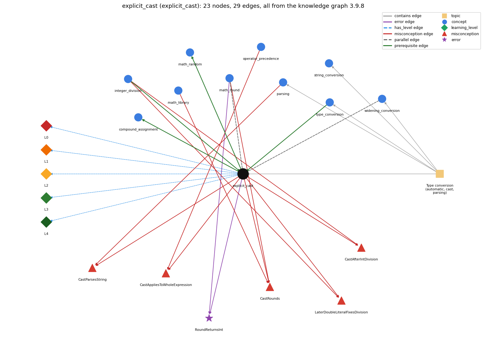

# explicit_cast (`explicit_cast`)

(int) x -- converts between numeric types, truncating toward zero

Section 1.2 Built-in Types of Data, topic 1.2.h Type conversion (automatic, cast, parsing). From the knowledge graph 3.9.8 (`data/raw/chapter1_kg_updated.json`).

## Concepts associated with explicit\_cast (10)

| Concept | Description | How it is associated |
| --- | --- | --- |
| **compound\_assignment** | x += e, x -= e, ... include a hidden cast | builds on it (needs it) composition rule (R) with it |
| **integer\_division** | / on two ints truncates; % is the remainder | prerequisite of it (it needs this) shares misconception CastAfterIntDivision shares misconception LaterDoubleLiteralFixesDivision |
| **math\_library** | Math.abs, Math.sqrt, Math.max, Math.random, Math.round ... | shares misconception CastRounds |
| **math\_random** | Math.random() and scaling to an int range | builds on it (needs it) composition rule (R) with it |
| **math\_round** | Math.round rounds to the nearest integer and returns a long | parallel concept shares misconception CastRounds shares error RoundReturnsInt |
| **operator\_precedence** | the order operators bind in an expression | shares misconception CastAppliesToWholeExpression |
| **parsing** | Integer.parseInt / Double.parseDouble turn text into numbers | shares misconception CastParsesString same topic (topic1.2.h) |
| **string\_conversion** | + with a String converts the other operand to text | same topic (topic1.2.h) |
| **type\_conversion** | implicit widening and explicit (cast) | prerequisite of it (it needs this) composition rule (R) with it same topic (topic1.2.h) |
| **widening\_conversion** | automatic conversion to a type with a larger range | parallel concept same topic (topic1.2.h) |

## Every edge in this view and its full label (29)

| From | Edge | To | Full edge label |
| --- | --- | --- | --- |
| **explicit\_cast** | prerequisite | **compound\_assignment** | x op= e means x = (T)(x op e), where T is the type of x, so the result is cast back to the type of x. grounding: questionable composition rule (R) of explicit\_cast with compound\_assignment: x op= e contains an implicit cast back to the type of x, so with int x, x += 0.5 compiles (x = (int) (x + 0.5)) while x = x + 0.5 is a compile-time error. composition rule (R) of compound\_assignment with explicit\_cast: x op= e includes a hidden narrowing cast to the type of x: with int x = 1, x += 1.7 compiles (as x = (int)(x + 1.7), giving 2) while x = x + 1.7 does not. |
| **explicit\_cast** | prerequisite | **math\_random** | To turn Math.random()'s double in [0, 1) into a random int from 0 to N-1, multiply it by N and cast the result to int. grounding: book\_passage composition rule (R) of explicit\_cast with math\_random: To turn Math.random()'s double into a random int from 0 to N-1, the cast must enclose the product: (int) (Math.random() \* N); casting first gives 0. composition rule (R) of math\_random with explicit\_cast: Converting to a random int requires the cast to apply to the whole product: (int) (Math.random() \* N); (int) Math.random() \* N casts first and is always 0. |
| **integer\_division** | prerequisite | **explicit\_cast** | To divide two ints and keep the fraction, one operand is cast to double before the division, as in (double) freq[i] / T; casting the finished quotient comes too late. grounding: book\_passage |
| **type\_conversion** | prerequisite | **explicit\_cast** | A cast is the explicit form of type conversion between primitive types, required when the conversion may lose information (e.g. (int) 2.71828 is 2). grounding: book\_passage composition rule (R) of type\_conversion with explicit\_cast: A cast is the explicit conversion between primitive types, required when information may be lost: (int) 2.71828 is 2. composition rule (R) of explicit\_cast with type\_conversion: A cast is the explicit conversion between primitive types, needed exactly where automatic conversion is refused because information may be lost. |
| **math\_round** | parallel | **explicit\_cast** | (int) 2.71828 truncates toward zero and gives 2; Math.round(2.71828) rounds to the nearest integer and gives 3, as a long that needs (int) to become an int. grounding: book\_passage |
| **widening\_conversion** | parallel | **explicit\_cast** | Widening (promotion) happens automatically when a value goes to a type with a larger range (int to double) and loses nothing; a narrowing conversion (double to int) is never automatic and needs an explicit cast, which truncates toward zero. grounding: book\_passage |
| **explicit\_cast** | misconception | **CastAfterIntDivision** | **wrong rule:** (double) (3 / 5) is 0.6. **right rule:** The integer division 3 / 5 = 0 happens before the cast, so the result is 0.0. role: primary |
| **explicit\_cast** | misconception | **CastAppliesToWholeExpression** | **wrong rule:** (int) 2.5 / 0.15 casts the whole quotient to int. **right rule:** The cast applies only to what comes right after it, here 2.5. role: primary |
| **explicit\_cast** | misconception | **CastParsesString** | **wrong rule:** (int) args[0] converts the text "34" into the number 34. **right rule:** A String argument that represents a number must be converted with a method such as Integer.parseInt. role: context |
| **explicit\_cast** | misconception | **CastRounds** | **wrong rule:** (int) 2.7 evaluates to 3. **right rule:** A cast to int discards the fractional part (rounds toward zero, so (int) -2.7 is -2); Math.round rounds to the nearest integer. role: primary |
| **explicit\_cast** | misconception | **LaterDoubleLiteralFixesDivision** | **wrong rule:** Changing a later literal to 100.0 fixes an earlier int division. **right rule:** The int division happens first; the double must be in the division itself. role: context |
| **integer\_division** | misconception | **CastAfterIntDivision** | **wrong rule:** (double) (3 / 5) is 0.6. **right rule:** The integer division 3 / 5 = 0 happens before the cast, so the result is 0.0. role: context |
| **integer\_division** | misconception | **LaterDoubleLiteralFixesDivision** | **wrong rule:** Changing a later literal to 100.0 fixes an earlier int division. **right rule:** The int division happens first; the double must be in the division itself. role: primary |
| **math\_library** | misconception | **CastRounds** | **wrong rule:** (int) 2.7 evaluates to 3. **right rule:** A cast to int discards the fractional part (rounds toward zero, so (int) -2.7 is -2); Math.round rounds to the nearest integer. role: context |
| **math\_round** | misconception | **CastRounds** | **wrong rule:** (int) 2.7 evaluates to 3. **right rule:** A cast to int discards the fractional part (rounds toward zero, so (int) -2.7 is -2); Math.round rounds to the nearest integer. role: context |
| **operator\_precedence** | misconception | **CastAppliesToWholeExpression** | **wrong rule:** (int) 2.5 / 0.15 casts the whole quotient to int. **right rule:** The cast applies only to what comes right after it, here 2.5. role: context |
| **parsing** | misconception | **CastParsesString** | **wrong rule:** (int) args[0] converts the text "34" into the number 34. **right rule:** A String argument that represents a number must be converted with a method such as Integer.parseInt. role: primary |
| **explicit\_cast** | error | **RoundReturnsInt** | **wrong rule:** Writes int n = Math.round(x); because Math.round gives an int. **right rule:** Math.round(double) returns a long, so storing it in an int needs a cast: int n = (int) Math.round(x); role: context |
| **math\_round** | error | **RoundReturnsInt** | **wrong rule:** Writes int n = Math.round(x); because Math.round gives an int. **right rule:** Math.round(double) returns a long, so storing it in an int needs a cast: int n = (int) Math.round(x); role: primary |
| **explicit\_cast** | has\_level | **explicit\_cast@L0** | explicit cast -&gt; L0 (Prestructural): the answer holds a rule that contradicts Java (7 ways). **[0] everyday\_reading** (E): Folk meaning: 'convert 2.7 to a whole number' means round it to 3, and (int) looks like a function label that applies to everything written after it. Java rule: a cast to int truncates toward zero ((int) 2.7 is 2) and, having higher precedence than arithmetic, applies only to the value immediately following it. **[1] misconception** (M) &rarr; CastRounds: wrong rule: (int) 2.7 evaluates to 3. Right rule: A cast to int discards the fractional part (rounds toward zero, so (int) -2.7 is -2); Math.round rounds to the nearest integer. **[2] misconception** (M) &rarr; CastAfterIntDivision: wrong rule: (double) (3 / 5) is 0.6. Right rule: The integer division 3 / 5 = 0 happens inside the parentheses before the cast, so the result is 0.0; write (double) 3 / 5 to get 0.6. **[3] misconception** (M) &rarr; CastAppliesToWholeExpression: wrong rule: (int) 2.5 / 0.15 casts the whole quotient to int. Right rule: The cast applies only to what comes right after it, here 2.5, so the expression is 2 / 0.15 (a double); write (int) (2.5 / 0.15) to cast the quotient. **[4] inconsistent\_trace** (T) &rarr; CastRounds: Points to LT (the cast is a unary operator applied to the operand right after it, before \* and /). Applied unevenly: in one line the student casts only the first operand, and in another applies the same cast to the whole expression. (here mixing in: "(int) 2.7 evaluates to 3") **[5] misconception** (M) &rarr; CastParsesString: wrong rule: (int) args[0] converts the text "34" into the number 34. Right rule: A cast cannot convert a String; a String argument that represents a number must be converted with a method such as Integer.parseInt. **[6] misconception** (M) &rarr; LaterDoubleLiteralFixesDivision: wrong rule: Changing a later literal to 100.0 fixes an earlier int division. Right rule: The int division happens first, when its own operands are both ints; a double must appear in that division itself (or one operand must be cast before it). |
| **explicit\_cast** | has\_level | **explicit\_cast@L1** | explicit cast -&gt; L1 (Unistructural): the answer states one correct rule without applying it (2 ways). **[0] names\_the\_element** (N): A cast is a unary operator, written (type) expression, that converts a value of one primitive type to another, used when the conversion may lose information. **[1] states\_the\_rule** (S): (T) e converts the value of e to type T; a double-to-int cast discards the fraction by rounding toward zero; a cast is required for narrowing conversions; it has higher precedence than arithmetic; casts between boolean and numbers, or from String to int, are not allowed. |
| **explicit\_cast** | has\_level | **explicit\_cast@L2** | explicit cast -&gt; L2 (Multistructural): the answer applies the rules of explicit cast to every part of the code, in order (3 ways). **[0] line\_by\_line\_trace** (LT): Evaluate the operand immediately to the right of the cast (a parenthesized expression is evaluated completely first), convert that value, then continue with the remaining operators of the expression. **[1] output\_prediction** (OP): (int) 2.71828 is int 2; (int) -2.7 is -2; (int) 11 \* 0.3 is double 3.3; (int) (11 \* 0.3) is int 3; (double) 3 / 5 is 0.6 but (double) (3 / 5) is 0.0; (char) ('a' + 4) is 'e'. **[2] one\_step\_execution** (OS): A cast yields a new value and changes nothing else: neither the type nor the value of the variable being cast changes (after int x = (int) pi; pi is still 3.14159). |
| **explicit\_cast** | has\_level | **explicit\_cast@L3** | explicit cast -&gt; L3 (Relational): the answer relates the parts (6 ways). **[0] relation\_to\_neighbour** (R): A cast is the explicit conversion between primitive types, needed exactly where automatic conversion is refused because information may be lost. **[1] relation\_to\_neighbour** (R): To turn Math.random()'s double into a random int from 0 to N-1, the cast must enclose the product: (int) (Math.random() \* N); casting first gives 0. **[2] relation\_to\_neighbour** (R): x op= e contains an implicit cast back to the type of x, so with int x, x += 0.5 compiles (x = (int) (x + 0.5)) while x = x + 0.5 is a compile-time error. **[3] relation\_to\_neighbour** (R): Widening (promotion) happens automatically when a value goes to a type with a larger range (int to double) and loses nothing; a narrowing conversion (double to int) is never automatic and needs an explicit cast, which truncates toward zero. **[4] relation\_to\_neighbour** (R): (int) 2.71828 truncates toward zero and gives 2; Math.round(2.71828) rounds to the nearest integer and gives 3, as a long that needs (int) to become an int. **[5] purpose\_of\_the\_whole** (P): Used to discard information on purpose: truncating a scaled random number to an index, taking the integer part, converting between char and int codes ((char) ('a' + k)), or forcing real division with (double) sum / n. |
| **explicit\_cast** | has\_level | **explicit\_cast@L4** | explicit cast -&gt; L4 (Extended abstract): the answer reasons beyond the given code (6 ways). **[0] predict\_a\_change** (C) &rarr; CastRounds: Moving the parentheses changes when truncation happens ((int) (a \* b) vs (int) a \* b); removing a cast from a narrowing assignment turns it into a compile-time error; int to double to int restores the value, but double to int to double loses the fraction. **[1] transfer\_to\_a\_new\_program** (X): Use a cast when you intend to truncate or narrow (random indices, integer parts, char codes); use Math.round to round, Integer.parseInt for Strings, and put a double into the division itself rather than casting its int result. **[2] diagnose\_an\_error** (D): rule broken: Math.round(double) returns a long, so storing it in an int needs a cast: int n = (int) Math.round(x);. Kind: compile-time. Trigger class: int n = Math.round(x); with double x. **[3] diagnose\_an\_error** (D): rule broken: A cast applies only to the value right after it. Kind: compile-time. Trigger class: int n = (int) 11 \* 0.3; the product is still a double (possible loss of precision); in a double context the same mistake is a silent logic error ((int) pi \* 20.0 gives 60.0). **[4] diagnose\_an\_error** (D): rule broken: Casts require compatible types. Kind: compile-time. Trigger class: (int) "3" or (int) args[0] on a String, or a cast between boolean and a number. **[5] diagnose\_an\_error** (D): rule broken: A narrowing cast may lose magnitude, not just the fraction. Kind: silent logic error. Trigger class: Casting a value outside the target range, e.g. (int) of a long above 2147483647 or of a huge double. |
| **topic1.2.h** | contains | **explicit\_cast** | topic topic1.2.h contains explicit\_cast |
| **topic1.2.h** | contains | **parsing** | topic topic1.2.h contains parsing |
| **topic1.2.h** | contains | **string\_conversion** | topic topic1.2.h contains string\_conversion |
| **topic1.2.h** | contains | **type\_conversion** | topic topic1.2.h contains type\_conversion |
| **topic1.2.h** | contains | **widening\_conversion** | topic topic1.2.h contains widening\_conversion |
