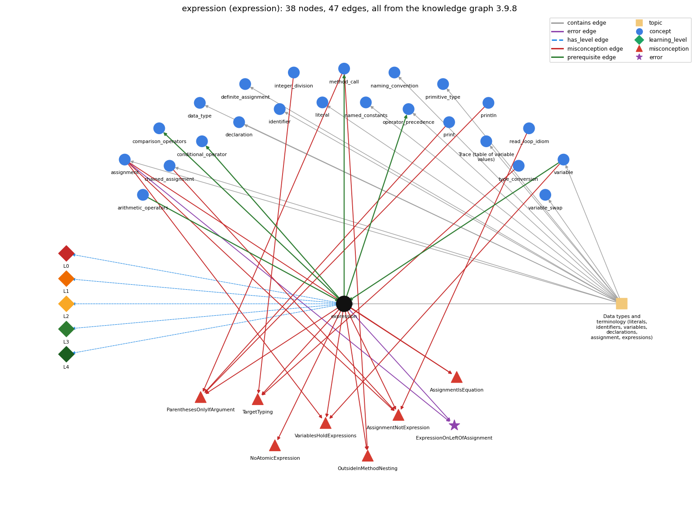

# expression (`expression`)

anything that evaluates to a value

Section 1.2 Built-in Types of Data, topic 1.2.a Data types and terminology (literals, identifiers, variables, declarations, assignment, expressions).

## At a glance

- **Needs first:** `arithmetic_operators`, `variable`
- **Leads to:** `comparison_operators`, `conditional_operator`, `method_call`, `operator_precedence`
- **Learned alongside:** nothing
- **Misconceptions:** `AssignmentIsEquation`, `AssignmentNotExpression`, `NoAtomicExpression`, `OutsideInMethodNesting`, `ParenthesesOnlyIfArgument`, `TargetTyping`, `VariablesHoldExpressions`
- **Errors:** `ExpressionOnLeftOfAssignment`
- **Levels:** L0, L1, L2, L3, L4

Everything below comes from the knowledge graph 3.9.8 (`data/raw/chapter1_kg_updated.json`): 47 edges around this concept. The edge logic, the wrong and right rules and the exact rules of the ways are copied word for word from the graph.

## To work on (0)

Nothing is missing for this concept.

## What it needs first (2)

A prerequisite edge means the other concept has to be understood before `expression`.

### `arithmetic_operators` comes before `expression`

*+ - \* / %*

- **Edge:** `pre:arithmetic_operators->expression`
- **Exact edge logic:** An operator combines operand values a and b into a new value, so operators build larger expressions from smaller ones.
- **Grounding:** book\_passage
- **Composition rule (R) of `expression` with `arithmetic_operators`:** Operators combine operand values into a new value, and the operand types choose the operation (int / truncates, double / does not).
- **Composition rule (R) of `arithmetic_operators` with `expression`:** Operators build larger expressions from smaller ones, and each operand can itself be any expression.

### `variable` comes before `expression`

*a named, typed box that holds a value*

- **Edge:** `pre:variable->expression`
- **Exact edge logic:** An expression can be a literal, a variable, or operations on them; we compute with a variable by using its name in an expression.
- **Grounding:** book\_passage
- **Composition rule (R) of `expression` with `variable`:** A variable name inside an expression contributes the variable's value at the moment of evaluation.
- **Composition rule (R) of `variable` with `expression`:** A variable name is itself an expression whose value is the variable's current value, and it combines with operators into larger expressions.

## What it leads to (4)

These concepts need `expression` first.

### `expression` comes before `comparison_operators`

*== != &lt; &gt; &lt;= &gt;=*

- **Edge:** `pre:expression->comparison_operators`
- **Exact edge logic:** Comparison operators build expressions whose value is a boolean, so one must already know what an expression is to understand a &lt; b.
- **Grounding:** order\_only
- **Composition rule (R) of `expression` with `comparison_operators`:** A comparison takes numeric expressions and yields a boolean expression, and it has lower precedence than arithmetic, so a + b &lt; c compares the sum.
- **Composition rule (R) of `comparison_operators` with `expression`:** A comparison is itself an expression whose value is a boolean, so it can appear anywhere a boolean is needed, including on the right of an assignment (boolean ok = x &gt; y;).

### `expression` comes before `conditional_operator`

*c ? a : b -- an expression that picks one of two values*

- **Edge:** `pre:expression->conditional_operator`
- **Exact edge logic:** c ? a : b is an expression: the boolean c decides which of the two other expressions gives the value.
- **Grounding:** spec\_passage

### `expression` comes before `method_call`

*name(arguments) -- invokes a library method and uses its return value*

- **Edge:** `pre:expression->method_call`
- **Exact edge logic:** Method arguments may be expressions, and a method call can be used in expressions in the same way as variables and literals.
- **Grounding:** book\_passage
- **Composition rule (R) of `expression` with `method_call`:** A method call is an expression usable wherever a value of its return type is, and its arguments are expressions evaluated before the call.
- **Composition rule (R) of `method_call` with `expression`:** Arguments may be arbitrary expressions of the right type, and the call itself is an expression usable inside larger ones (Math.sin(x) \* Math.cos(y)).

### `expression` comes before `operator_precedence`

*the order operators bind in an expression*

- **Edge:** `pre:expression->operator_precedence`
- **Exact edge logic:** When an expression has several operators, precedence decides which operands are combined first, and equal-precedence operators go left to right.
- **Grounding:** book\_passage
- **Composition rule (R) of `expression` with `operator_precedence`:** With several operators, precedence and left associativity decide the grouping, and parentheses override both.
- **Composition rule (R) of `operator_precedence` with `expression`:** Precedence decides the grouping of a multi-operator expression, and a parenthesized subexpression is evaluated as one unit with its own value.

## Learned alongside (0)

A parallel edge joins two concepts that sit side by side: neither is needed before the other.

No parallel edge touches this concept.

## Misconceptions (7)

A misconception edge states the wrong rule a student may hold about this concept, and the right rule.

### AssignmentIsEquation

- **Edge:** `expression` &rarr; `AssignmentIsEquation` (misconception)
- **Exact edge logic (the wrong rule):** An assignment states a lasting equality between its two sides, so y = x - y can be solved like the equation x = 2y and x = x + 5 relates two equal quantities.
- **Twin logic (the right rule):** An assignment is a one-time action: evaluate the right side with current values, then store the result in the left variable.
- **Wrong belief (on the node):** An assignment states a lasting equality between its two sides, so y = x - y can be solved like the equation x = 2y and x = x + 5 relates two equal quantities.
- **Correct rule (on the node):** An assignment is a one-time action: evaluate the right side with current values, then store the result in the left variable.
- **Provenance:** published
- **Role of this concept:** context
- **L0 way linked to it:** yes
- **L0 way [8] misconception, exact rule:** wrong rule: An assignment states a lasting equality between its two sides, so y = x - y can be solved like the equation x = 2y and x = x + 5 relates two equal quantities. Right rule: An assignment is a one-time action: evaluate the right side with current values, then store the result in the left variable.
- **Edge `assignment` &rarr; `AssignmentIsEquation`, exact edge logic:** An assignment states a lasting equality between its two sides, so y = x - y can be solved like the equation x = 2y and x = x + 5 relates two equal quantities. **Twin logic:** An assignment is a one-time action: evaluate the right side with current values, then store the result in the left variable. (role: primary)

### AssignmentNotExpression

- **Edge:** `expression` &rarr; `AssignmentNotExpression` (misconception)
- **Exact edge logic (the wrong rule):** An assignment cannot be used inside a larger expression, so a condition like (x = read()) != v is not allowed.
- **Twin logic (the right rule):** An assignment is an expression whose value is the value assigned, so (x = v) both stores v in x and gives v.
- **Wrong belief (on the node):** an assignment cannot be used inside a larger expression
- **Correct rule (on the node):** An assignment is an expression whose value is the value assigned, so (x = v) both stores v in x and gives v.
- **Provenance:** published
- **Role of this concept:** context
- **L0 way linked to it:** yes
- **L0 way [3] misconception, exact rule:** wrong rule: an assignment cannot be used inside a larger expression. Right rule: An assignment is an expression whose value is the value assigned, so (x = v) both stores v in x and gives v.
- **Edge `assignment` &rarr; `AssignmentNotExpression`, exact edge logic:** An assignment cannot be used inside a larger expression, so a condition like (x = read()) != v is not allowed. **Twin logic:** An assignment is an expression whose value is the value assigned, so (x = v) both stores v in x and gives v. (role: primary)
- **Edge `chained_assignment` &rarr; `AssignmentNotExpression`, exact edge logic:** an assignment cannot be used inside a larger expression **Twin logic:** An assignment is an expression whose value is the value assigned, so (x = v) both stores v in x and gives v. (role: context)
- **Edge `read_loop_idiom` &rarr; `AssignmentNotExpression`, exact edge logic:** A read and a test cannot be combined, so while ((x = read()) != end) is not allowed. **Twin logic:** while ((x = read()) != end) reads a value into x and tests that same value in one expression. (role: context)

### NoAtomicExpression

- **Edge:** `expression` &rarr; `NoAtomicExpression` (misconception)
- **Exact edge logic (the wrong rule):** A single variable x or a literal on its own is not an expression.
- **Twin logic (the right rule):** A single variable or literal is an expression whose value is just that value.
- **Wrong belief (on the node):** a single literal or variable "isn't an expression"
- **Correct rule (on the node):** A single variable or literal is an expression whose value is just that value.
- **Provenance:** published
- **Role of this concept:** primary
- **L0 way linked to it:** yes
- **L0 way [1] misconception, exact rule:** wrong rule: a single literal or variable "isn't an expression". Right rule: A single variable or literal is an expression whose value is just that value.
- **L0 way [2] inconsistent\_trace, exact rule:** Points to LT (replace each variable with its current value, then apply operators in precedence order). Applied unevenly, a student substitutes current values for some variables and old or future values for others, or respects precedence in one subexpression only. (here mixing in: "a single literal or variable "isn't an expression"")

### OutsideInMethodNesting

- **Edge:** `expression` &rarr; `OutsideInMethodNesting` (misconception)
- **Exact edge logic (the wrong rule):** In f(g(x)), f runs first and then g runs.
- **Twin logic (the right rule):** In f(g(x)), g(x) is evaluated first and its result is passed to f.
- **Wrong belief (on the node):** nested calls run outside-in, not arguments-first
- **Correct rule (on the node):** In f(g(x)), g(x) is evaluated first and its result is passed to f.
- **Provenance:** published
- **Role of this concept:** context
- **L0 way linked to it:** yes
- **L0 way [7] misconception, exact rule:** wrong rule: nested calls run outside-in, not arguments-first. Right rule: In f(g(x)), g(x) is evaluated first and its result is passed to f.
- **Edge `method_call` &rarr; `OutsideInMethodNesting`, exact edge logic:** nested calls run outside-in, not arguments-first **Twin logic:** In f(g(x)), g(x) is evaluated first and its result is passed to f. (role: primary)

### ParenthesesOnlyIfArgument

- **Edge:** `expression` &rarr; `ParenthesesOnlyIfArgument` (misconception)
- **Exact edge logic (the wrong rule):** () are optional on a no-argument call like println
- **Twin logic (the right rule):** A method call always needs parentheses, so an empty line is printed with System.out.println();.
- **Wrong belief (on the node):** () are optional on a no-argument call like println
- **Correct rule (on the node):** A method call always needs parentheses, so an empty line is printed with System.out.println();.
- **Provenance:** published
- **Role of this concept:** context
- **L0 way linked to it:** yes
- **L0 way [4] misconception, exact rule:** wrong rule: () are optional on a no-argument call like println. Right rule: A method call always needs parentheses, so an empty line is printed with System.out.println();.
- **Edge `method_call` &rarr; `ParenthesesOnlyIfArgument`, exact edge logic:** () are optional on a no-argument call like println **Twin logic:** A method call always needs parentheses, so an empty line is printed with System.out.println();. (role: primary)
- **Edge `print` &rarr; `ParenthesesOnlyIfArgument`, exact edge logic:** println with nothing to print can be written System.out.println; without the parentheses. **Twin logic:** A method call always needs parentheses, so an empty line is printed with System.out.println();. (role: context)
- **Edge `println` &rarr; `ParenthesesOnlyIfArgument`, exact edge logic:** println with nothing to print can be written System.out.println; without the parentheses. **Twin logic:** A method call always needs parentheses, so an empty line is printed with System.out.println();. (role: context)

### TargetTyping

- **Edge:** `expression` &rarr; `TargetTyping` (misconception)
- **Exact edge logic (the wrong rule):** The type of a numerical expression depends on the type expected by the surrounding context, so double d = a / b; keeps the fraction.
- **Twin logic (the right rule):** The type of a numerical expression is determined by the expression, so double d = a / b; with int a and b still divides as ints.
- **Wrong belief (on the node):** The type of a numerical expression depends on the type expected by the surrounding context, so double d = a / b; keeps the fraction.
- **Correct rule (on the node):** The type of a numerical expression is determined by the expression, so double d = a / b; with int a and b still divides as ints.
- **Provenance:** published
- **Role of this concept:** context
- **L0 way linked to it:** yes
- **L0 way [5] misconception, exact rule:** wrong rule: The type of a numerical expression depends on the type expected by the surrounding context, so double d = a / b; keeps the fraction. Right rule: The type of a numerical expression is determined by the expression, so double d = a / b; with int a and b still divides as ints.
- **Edge `integer_division` &rarr; `TargetTyping`, exact edge logic:** The type of a numerical expression depends on the type expected by the surrounding context, so double d = a / b; keeps the fraction. **Twin logic:** The type of a numerical expression is determined by the expression, so double d = a / b; with int a and b still divides as ints. (role: primary)
- **Edge `type_conversion` &rarr; `TargetTyping`, exact edge logic:** The type of a numerical expression depends on the type expected by the surrounding context, so double d = a / b; keeps the fraction. **Twin logic:** The type of a numerical expression is determined by the expression, so double d = a / b; with int a and b still divides as ints. (role: context)

### VariablesHoldExpressions

- **Edge:** `expression` &rarr; `VariablesHoldExpressions` (misconception)
- **Exact edge logic (the wrong rule):** = stores the expression itself, not its computed value
- **Twin logic (the right rule):** y = x + k; stores the value that x + k has at that moment, so later changes to x do not change y.
- **Wrong belief (on the node):** = stores the expression itself, not its computed value
- **Correct rule (on the node):** y = x + k; stores the value that x + k has at that moment, so later changes to x do not change y.
- **Provenance:** published
- **Role of this concept:** context
- **L0 way linked to it:** yes
- **L0 way [6] misconception, exact rule:** wrong rule: = stores the expression itself, not its computed value. Right rule: y = x + k; stores the value that x + k has at that moment, so later changes to x do not change y.
- **Edge `assignment` &rarr; `VariablesHoldExpressions`, exact edge logic:** y = x + k; makes y always equal to x + k, so when x changes later, y changes too. **Twin logic:** y = x + k; stores the value that x + k has at that moment, so later changes to x do not change y. (role: primary)
- **Edge `variable` &rarr; `VariablesHoldExpressions`, exact edge logic:** = stores the expression itself, not its computed value **Twin logic:** y = x + k; stores the value that x + k has at that moment, so later changes to x do not change y. (role: context)

## Errors (1)

An error edge states the rule that gets broken in a program, and the right rule.

### ExpressionOnLeftOfAssignment

- **Edge:** `expression` &rarr; `ExpressionOnLeftOfAssignment` (error)
- **Exact edge logic (the wrong rule):** Writes a + b = c; or 7 = a; as if = were a math equation.
- **Twin logic (the right rule):** The left side of an assignment must be a single variable; only the right side can be an expression.
- **Wrong belief (on the node):** Writes a + b = c; or 7 = a; as if = were a math equation.
- **Correct rule (on the node):** The left side of an assignment must be a single variable; only the right side can be an expression.
- **Provenance:** textbook
- **Role of this concept:** context
- **Edge `assignment` &rarr; `ExpressionOnLeftOfAssignment`, exact edge logic:** Writes a + b = c; or 7 = a; as if = were a math equation. **Twin logic:** The left side of an assignment must be a single variable; only the right side can be an expression. (role: primary)

## Levels L0 to L4 (5 of 5)

Each level edge lists the ways a student shows that level, each with its exact rule.

### L0: Prestructural / sensorimotor

L0 for expression: the answer holds a rule that contradicts Java.

*Deciding question: Does every rule the answer applies to expression agree with the language rule? If it reads the code with everyday meanings, applies a wrong rule, or switches rules within one trace, it is L0. A slip in an otherwise rule-correct trace is L2 with an error, not L0.*

- **Edge:** `expression` &rarr; `expression@L0` (has_level)
- **Exact edge logic:** expression -&gt; L0 (Prestructural): the answer holds a rule that contradicts Java (9 ways).

Ways (9), each with its exact rule:

- **[0] everyday\_reading** (rule type E, folk-meaning rule): In maths an expression such as 7/2 or x + y names an exact number, and 'expression' means a formula with operators. In Java, any code that evaluates to a typed value is an expression, including a lone literal or variable, and with ints 7/2 evaluates to 3.
- **[1] misconception** (rule type M, wrong rule / right rule) &rarr; `NoAtomicExpression`: wrong rule: a single literal or variable "isn't an expression". Right rule: A single variable or literal is an expression whose value is just that value.
- **[2] inconsistent\_trace** (rule type T, uneven-application rule) &rarr; `NoAtomicExpression`: Points to LT (replace each variable with its current value, then apply operators in precedence order). Applied unevenly, a student substitutes current values for some variables and old or future values for others, or respects precedence in one subexpression only. (here mixing in: "a single literal or variable "isn't an expression"")
- **[3] misconception** (rule type M, wrong rule / right rule) &rarr; `AssignmentNotExpression`: wrong rule: an assignment cannot be used inside a larger expression. Right rule: An assignment is an expression whose value is the value assigned, so (x = v) both stores v in x and gives v.
- **[4] misconception** (rule type M, wrong rule / right rule) &rarr; `ParenthesesOnlyIfArgument`: wrong rule: () are optional on a no-argument call like println. Right rule: A method call always needs parentheses, so an empty line is printed with System.out.println();.
- **[5] misconception** (rule type M, wrong rule / right rule) &rarr; `TargetTyping`: wrong rule: The type of a numerical expression depends on the type expected by the surrounding context, so double d = a / b; keeps the fraction. Right rule: The type of a numerical expression is determined by the expression, so double d = a / b; with int a and b still divides as ints.
- **[6] misconception** (rule type M, wrong rule / right rule) &rarr; `VariablesHoldExpressions`: wrong rule: = stores the expression itself, not its computed value. Right rule: y = x + k; stores the value that x + k has at that moment, so later changes to x do not change y.
- **[7] misconception** (rule type M, wrong rule / right rule) &rarr; `OutsideInMethodNesting`: wrong rule: nested calls run outside-in, not arguments-first. Right rule: In f(g(x)), g(x) is evaluated first and its result is passed to f.
- **[8] misconception** (rule type M, wrong rule / right rule) &rarr; `AssignmentIsEquation`: wrong rule: An assignment states a lasting equality between its two sides, so y = x - y can be solved like the equation x = 2y and x = x + 5 relates two equal quantities. Right rule: An assignment is a one-time action: evaluate the right side with current values, then store the result in the left variable.

### L1: Unistructural / atom x text surface

L1 for expression: the answer states one correct rule without applying it.

*Deciding question: Does the answer cover every part of the code, in order, with the values (L2)? If it covers one part or only states the rule, it is L1.*

- **Edge:** `expression` &rarr; `expression@L1` (has_level)
- **Exact edge logic:** expression -&gt; L1 (Unistructural): the answer states one correct rule without applying it (2 ways).

Ways (2), each with its exact rule:

- **[0] names\_the\_element** (rule type N, identity rule): Expression: a literal, a variable, or a sequence of operations (operators, method calls) on them that produces one value.
- **[1] states\_the\_rule** (rule type S, declarative rule): Each operand of an operator can itself be any expression, and a parenthesized expression has the same value as the expression inside. Every expression has a type, determined by its operators and operands.

### L2: Multistructural / block x execution / preoperational

L2 for expression: the answer applies these rules to every part of the code, in order.

*Deciding question: Is the answer many segments mapped onto lines (L2), or one segment stating the purpose of the whole (L3)? A correct output with no value-by-value justification is not levelled.*

- **Edge:** `expression` &rarr; `expression@L2` (has_level)
- **Exact edge logic:** expression -&gt; L2 (Multistructural): the answer applies the rules of expression to every part of the code, in order (3 ways).

Ways (3), each with its exact rule:

- **[0] line\_by\_line\_trace** (rule type LT, operational sequencing rule): Operands are evaluated left to right, each fully before its operator is applied. Precedence and parentheses decide the grouping, and a method's arguments are all evaluated before the method is called.
- **[1] output\_prediction** (rule type OP, evaluation / result rule): An expression produces one value of a type fixed by its operands: hour \* 60 + minute with hour = 11 and minute = 59 is the int 719.
- **[2] one\_step\_execution** (rule type OS, state-transition rule): Evaluating an expression changes no variable unless it contains an assignment, ++/-- or a method with side effects. The value goes to the enclosing statement, and an expression statement discards it.

### L3: Relational / relations x function (concrete operational begins)

L3 for expression: the answer relates the parts by these rules.

*Deciding question: Was the purpose deduced from the code, or only guessed from traced input/output pairs (then L2)? Does the answer stay within the given code (L3), or reason about changed code, an error class or a new program (L4)?*

- **Edge:** `expression` &rarr; `expression@L3` (has_level)
- **Exact edge logic:** expression -&gt; L3 (Relational): the answer relates the parts (6 ways).

Ways (6), each with its exact rule:

- **[0] relation\_to\_neighbour** (rule type R, composition rule (with a neighbour)): A variable name inside an expression contributes the variable's value at the moment of evaluation.
- **[1] relation\_to\_neighbour** (rule type R, composition rule (with a neighbour)): Operators combine operand values into a new value, and the operand types choose the operation (int / truncates, double / does not).
- **[2] relation\_to\_neighbour** (rule type R, composition rule (with a neighbour)): With several operators, precedence and left associativity decide the grouping, and parentheses override both.
- **[3] relation\_to\_neighbour** (rule type R, composition rule (with a neighbour)): A comparison takes numeric expressions and yields a boolean expression, and it has lower precedence than arithmetic, so a + b &lt; c compares the sum.
- **[4] relation\_to\_neighbour** (rule type R, composition rule (with a neighbour)): A method call is an expression usable wherever a value of its return type is, and its arguments are expressions evaluated before the call.
- **[5] purpose\_of\_the\_whole** (rule type P, plan / role rule): Expressions compute new values from existing ones. They form the right side of every assignment, every condition, every method argument and every printed value.

### L4: Extended abstract (concrete-operational reversibility and conservation)

L4 for expression: the answer reasons beyond the given code by these rules.

*Deciding question: Does the answer link the code to a broader context: a changed program, a class of inputs, an unseen problem? Re-tracing changed code value by value is L2; fixing one given failing case is L3.*

- **Edge:** `expression` &rarr; `expression@L4` (has_level)
- **Exact edge logic:** expression -&gt; L4 (Extended abstract): the answer reasons beyond the given code (6 ways).

Ways (6), each with its exact rule:

- **[0] predict\_a\_change** (rule type C, conservation rule) &rarr; `NoAtomicExpression`: Adding parentheses that match the default grouping keeps the value, and rewriting with an equivalent formula (4 \* (x - 3) as 4\*x - 12) keeps it for ints. Changing one operand's type (3 to 3.0) can change both the result's type and its value.
- **[1] transfer\_to\_a\_new\_program** (rule type X, applicability rule): Use an expression wherever a value is needed. Split a long or unclear expression into named intermediate variables, and add parentheses wherever the grouping is not obvious.
- **[2] diagnose\_an\_error** (rule type D, error rule): rule broken: The left-hand side of = must be a single variable; only the right-hand side may be an arbitrary expression. Kind: compile-time. Trigger class: Any assignment whose left side is a literal or compound expression (7 = a; a + b = c;): 'unexpected type, required: variable'.
- **[3] diagnose\_an\_error** (rule type D, error rule): rule broken: Only assignments, increments, method calls and object creation can stand alone as statements. Kind: compile-time. Trigger class: A bare expression line such as x + 1; or a == b;: 'not a statement'.
- **[4] diagnose\_an\_error** (rule type D, error rule): rule broken: Operators accept only operands of suitable types. Kind: compile-time. Trigger class: Applying arithmetic to Strings ("Hello" - 1) or comparing booleans with &lt;: 'bad operand types'.
- **[5] diagnose\_an\_error** (rule type D, error rule): rule broken: An int division or remainder by zero cannot be evaluated. Kind: run-time exception. Trigger class: Any int / or % whose right operand evaluates to 0: ArithmeticException.

## Same topic

`expression` belongs to the topic **Data types and terminology (literals, identifiers, variables, declarations, assignment, expressions)** (`topic1.2.a`). The topic also contains: `assignment`, `chained_assignment`, `data_type`, `declaration`, `definite_assignment`, `identifier`, `literal`, `named_constants`, `naming_convention`, `operator_precedence`, `primitive_type`, `program_trace`, `variable`, `variable_swap`.

## Rules of the concept (26)

- **Book** (SW-1e, p. 17 (pdf 27)): "An expression that is enclosed in parentheses is another expression with the same value."
- **Book** (OT-Expressions, ): "An expression is a construct made up of variables, operators, and method invocations, which are constructed according to the syntax of the language, that evaluates to a single value."
- **E** (folk-meaning rule): In maths an expression such as 7/2 or x + y names an exact number, and 'expression' means a formula with operators. In Java, any code that evaluates to a typed value is an expression, including a lone literal or variable, and with ints 7/2 evaluates to 3.
- **M** (wrong rule / right rule): AssignmentNotExpression: wrong: an assignment cannot be used inside a larger expression \| right: An assignment is an expression whose value is the value assigned, so (x = v) both stores v in x and gives v.
- **M** (wrong rule / right rule): NoAtomicExpression: wrong: a single literal or variable "isn't an expression" \| right: A single variable or literal is an expression whose value is just that value.
- **M** (wrong rule / right rule): ParenthesesOnlyIfArgument: wrong: () are optional on a no-argument call like println \| right: A method call always needs parentheses, so an empty line is printed with System.out.println();.
- **M** (wrong rule / right rule): TargetTyping: wrong: The type of a numerical expression depends on the type expected by the surrounding context, so double d = a / b; keeps the fraction. \| right: The type of a numerical expression is determined by the expression, so double d = a / b; with int a and b still divides as ints.
- **M** (wrong rule / right rule): VariablesHoldExpressions: wrong: = stores the expression itself, not its computed value \| right: y = x + k; stores the value that x + k has at that moment, so later changes to x do not change y.
- **M** (wrong rule / right rule): OutsideInMethodNesting: wrong: nested calls run outside-in, not arguments-first \| right: In f(g(x)), g(x) is evaluated first and its result is passed to f.
- **M** (wrong rule / right rule): AssignmentIsEquation: wrong: An assignment states a lasting equality between its two sides, so y = x - y can be solved like the equation x = 2y and x = x + 5 relates two equal quantities. \| right: An assignment is a one-time action: evaluate the right side with current values, then store the result in the left variable.
- **T** (uneven-application rule): Points to LT (replace each variable with its current value, then apply operators in precedence order). Applied unevenly, a student substitutes current values for some variables and old or future values for others, or respects precedence in one subexpression only.
- **N** (identity rule): Expression: a literal, a variable, or a sequence of operations (operators, method calls) on them that produces one value.
- **S** (declarative rule): Each operand of an operator can itself be any expression, and a parenthesized expression has the same value as the expression inside. Every expression has a type, determined by its operators and operands.
- **LT** (operational sequencing rule): Operands are evaluated left to right, each fully before its operator is applied. Precedence and parentheses decide the grouping, and a method's arguments are all evaluated before the method is called.
- **OP** (evaluation / result rule): An expression produces one value of a type fixed by its operands: hour \* 60 + minute with hour = 11 and minute = 59 is the int 719.
- **OS** (state-transition rule): Evaluating an expression changes no variable unless it contains an assignment, ++/-- or a method with side effects. The value goes to the enclosing statement, and an expression statement discards it.
- **R** (composition rule (with a neighbour)): with variable: A variable name inside an expression contributes the variable's value at the moment of evaluation.
- **R** (composition rule (with a neighbour)): with arithmetic\_operators: Operators combine operand values into a new value, and the operand types choose the operation (int / truncates, double / does not).
- **R** (composition rule (with a neighbour)): with operator\_precedence: With several operators, precedence and left associativity decide the grouping, and parentheses override both.
- **R** (composition rule (with a neighbour)): with comparison\_operators: A comparison takes numeric expressions and yields a boolean expression, and it has lower precedence than arithmetic, so a + b &lt; c compares the sum.
- **R** (composition rule (with a neighbour)): with method\_call: A method call is an expression usable wherever a value of its return type is, and its arguments are expressions evaluated before the call.
- **P** (plan / role rule): Expressions compute new values from existing ones. They form the right side of every assignment, every condition, every method argument and every printed value.
- **C** (conservation rule): Adding parentheses that match the default grouping keeps the value, and rewriting with an equivalent formula (4 \* (x - 3) as 4\*x - 12) keeps it for ints. Changing one operand's type (3 to 3.0) can change both the result's type and its value.
- **D** (error rule): rule broken: The left-hand side of = must be a single variable; only the right-hand side may be an arbitrary expression. (compile-time)
- **D** (error rule): rule broken: Only assignments, increments, method calls and object creation can stand alone as statements. (compile-time)
- **D** (error rule): rule broken: Operators accept only operands of suitable types. (compile-time)
- **D** (error rule): rule broken: An int division or remainder by zero cannot be evaluated. (run-time exception)
- **X** (applicability rule): Use an expression wherever a value is needed. Split a long or unclear expression into named intermediate variables, and add parentheses wherever the grouping is not obvious.

## How it is found in code and answers (reader block)

- **Aliases:** expression, expressions
- **Code patterns:** `[A-Za-z_0-9)\]]\s*(?:[+\-*/%]|[<>]=?|==|!=|&&|\|\|)(?=\s*[A-Za-z_0-9(!'\"])`, `=\s*[^=;]+;`
- **Operator symbols:** none
- **Java types:** none

## The whole prerequisite chain

- **Everything it builds on (6):** `arithmetic_operators`, `data_type`, `identifier`, `literal`, `primitive_type`, `variable`
- **Everything that builds on it (65):** `accumulator_pattern`, `animation`, `api`, `array_copy`, `array_reversal`, `array_traversal`, `boolean_expression`, `boolean_flag_array`, `break_statement`, `comparison_operators`, `conditional_operator`, `continue_statement`, `convergence_rate`, `convergence_test`, `coordinate_scaling`, `counter_pattern`, `dangling_else`, `do_while_loop`, `drawing_shapes`, `else_if_chain`, `enhanced_for`, `fencepost_loop`, `flag_search_loop`, `for_loop`, `frequency_counting`, `function_plotting`, `if_else_statement`, `if_statement`, `increment_operators`, `infinite_loop`, `labeled_break`, `loop_body`, `loop_control`, `loop_invariant_reasoning`, `loop_performance`, `loop_scope`, `loop_variable`, `math_library`, `math_random`, `math_round`, `matrix_operations`, `method_call`, `monte_carlo_simulation`, `mouse_interaction`, `nested_conditionals`, `nested_loops`, `number_conversion`, `off_by_one_error`, `operator_precedence`, `power_method`, `random_move`, `row_major_order`, `running_extreme`, `sampling_without_replacement`, `sentinel_loop`, `shuffle`, `side_effect_order`, `simulation_loop`, `standard_audio`, `standard_drawing`, `switch_statement`, `syntax_template`, `trig_functions`, `two_models`, `while_loop`

## Every edge in this view and its exact edge logic (47)

All the edges drawn in the picture, in the order: prerequisite, parallel, misconception, error, has_level, contains.

**1. `arithmetic_operators` &rarr; `expression`** (prerequisite)

- **Exact edge logic:** An operator combines operand values a and b into a new value, so operators build larger expressions from smaller ones.
- **Grounding:** book\_passage
- **Composition rule (R) of `arithmetic_operators` with `expression`:** Operators build larger expressions from smaller ones, and each operand can itself be any expression.
- **Composition rule (R) of `expression` with `arithmetic_operators`:** Operators combine operand values into a new value, and the operand types choose the operation (int / truncates, double / does not).

**2. `expression` &rarr; `comparison_operators`** (prerequisite)

- **Exact edge logic:** Comparison operators build expressions whose value is a boolean, so one must already know what an expression is to understand a &lt; b.
- **Grounding:** order\_only
- **Composition rule (R) of `expression` with `comparison_operators`:** A comparison takes numeric expressions and yields a boolean expression, and it has lower precedence than arithmetic, so a + b &lt; c compares the sum.
- **Composition rule (R) of `comparison_operators` with `expression`:** A comparison is itself an expression whose value is a boolean, so it can appear anywhere a boolean is needed, including on the right of an assignment (boolean ok = x &gt; y;).

**3. `expression` &rarr; `conditional_operator`** (prerequisite)

- **Exact edge logic:** c ? a : b is an expression: the boolean c decides which of the two other expressions gives the value.
- **Grounding:** spec\_passage

**4. `expression` &rarr; `method_call`** (prerequisite)

- **Exact edge logic:** Method arguments may be expressions, and a method call can be used in expressions in the same way as variables and literals.
- **Grounding:** book\_passage
- **Composition rule (R) of `expression` with `method_call`:** A method call is an expression usable wherever a value of its return type is, and its arguments are expressions evaluated before the call.
- **Composition rule (R) of `method_call` with `expression`:** Arguments may be arbitrary expressions of the right type, and the call itself is an expression usable inside larger ones (Math.sin(x) \* Math.cos(y)).

**5. `expression` &rarr; `operator_precedence`** (prerequisite)

- **Exact edge logic:** When an expression has several operators, precedence decides which operands are combined first, and equal-precedence operators go left to right.
- **Grounding:** book\_passage
- **Composition rule (R) of `expression` with `operator_precedence`:** With several operators, precedence and left associativity decide the grouping, and parentheses override both.
- **Composition rule (R) of `operator_precedence` with `expression`:** Precedence decides the grouping of a multi-operator expression, and a parenthesized subexpression is evaluated as one unit with its own value.

**6. `variable` &rarr; `expression`** (prerequisite)

- **Exact edge logic:** An expression can be a literal, a variable, or operations on them; we compute with a variable by using its name in an expression.
- **Grounding:** book\_passage
- **Composition rule (R) of `variable` with `expression`:** A variable name is itself an expression whose value is the variable's current value, and it combines with operators into larger expressions.
- **Composition rule (R) of `expression` with `variable`:** A variable name inside an expression contributes the variable's value at the moment of evaluation.

**7. `expression` &rarr; `AssignmentIsEquation`** (misconception)

- **Exact edge logic (the wrong rule):** An assignment states a lasting equality between its two sides, so y = x - y can be solved like the equation x = 2y and x = x + 5 relates two equal quantities.
- **Twin logic (the right rule):** An assignment is a one-time action: evaluate the right side with current values, then store the result in the left variable.
- **Role:** context

**8. `expression` &rarr; `AssignmentNotExpression`** (misconception)

- **Exact edge logic (the wrong rule):** An assignment cannot be used inside a larger expression, so a condition like (x = read()) != v is not allowed.
- **Twin logic (the right rule):** An assignment is an expression whose value is the value assigned, so (x = v) both stores v in x and gives v.
- **Role:** context

**9. `expression` &rarr; `NoAtomicExpression`** (misconception)

- **Exact edge logic (the wrong rule):** A single variable x or a literal on its own is not an expression.
- **Twin logic (the right rule):** A single variable or literal is an expression whose value is just that value.
- **Role:** primary

**10. `expression` &rarr; `OutsideInMethodNesting`** (misconception)

- **Exact edge logic (the wrong rule):** In f(g(x)), f runs first and then g runs.
- **Twin logic (the right rule):** In f(g(x)), g(x) is evaluated first and its result is passed to f.
- **Role:** context

**11. `expression` &rarr; `ParenthesesOnlyIfArgument`** (misconception)

- **Exact edge logic (the wrong rule):** () are optional on a no-argument call like println
- **Twin logic (the right rule):** A method call always needs parentheses, so an empty line is printed with System.out.println();.
- **Role:** context

**12. `expression` &rarr; `TargetTyping`** (misconception)

- **Exact edge logic (the wrong rule):** The type of a numerical expression depends on the type expected by the surrounding context, so double d = a / b; keeps the fraction.
- **Twin logic (the right rule):** The type of a numerical expression is determined by the expression, so double d = a / b; with int a and b still divides as ints.
- **Role:** context

**13. `expression` &rarr; `VariablesHoldExpressions`** (misconception)

- **Exact edge logic (the wrong rule):** = stores the expression itself, not its computed value
- **Twin logic (the right rule):** y = x + k; stores the value that x + k has at that moment, so later changes to x do not change y.
- **Role:** context

**14. `assignment` &rarr; `AssignmentIsEquation`** (misconception)

- **Exact edge logic (the wrong rule):** An assignment states a lasting equality between its two sides, so y = x - y can be solved like the equation x = 2y and x = x + 5 relates two equal quantities.
- **Twin logic (the right rule):** An assignment is a one-time action: evaluate the right side with current values, then store the result in the left variable.
- **Role:** primary

**15. `assignment` &rarr; `AssignmentNotExpression`** (misconception)

- **Exact edge logic (the wrong rule):** An assignment cannot be used inside a larger expression, so a condition like (x = read()) != v is not allowed.
- **Twin logic (the right rule):** An assignment is an expression whose value is the value assigned, so (x = v) both stores v in x and gives v.
- **Role:** primary

**16. `assignment` &rarr; `VariablesHoldExpressions`** (misconception)

- **Exact edge logic (the wrong rule):** y = x + k; makes y always equal to x + k, so when x changes later, y changes too.
- **Twin logic (the right rule):** y = x + k; stores the value that x + k has at that moment, so later changes to x do not change y.
- **Role:** primary

**17. `chained_assignment` &rarr; `AssignmentNotExpression`** (misconception)

- **Exact edge logic (the wrong rule):** an assignment cannot be used inside a larger expression
- **Twin logic (the right rule):** An assignment is an expression whose value is the value assigned, so (x = v) both stores v in x and gives v.
- **Role:** context

**18. `integer_division` &rarr; `TargetTyping`** (misconception)

- **Exact edge logic (the wrong rule):** The type of a numerical expression depends on the type expected by the surrounding context, so double d = a / b; keeps the fraction.
- **Twin logic (the right rule):** The type of a numerical expression is determined by the expression, so double d = a / b; with int a and b still divides as ints.
- **Role:** primary

**19. `method_call` &rarr; `OutsideInMethodNesting`** (misconception)

- **Exact edge logic (the wrong rule):** nested calls run outside-in, not arguments-first
- **Twin logic (the right rule):** In f(g(x)), g(x) is evaluated first and its result is passed to f.
- **Role:** primary

**20. `method_call` &rarr; `ParenthesesOnlyIfArgument`** (misconception)

- **Exact edge logic (the wrong rule):** () are optional on a no-argument call like println
- **Twin logic (the right rule):** A method call always needs parentheses, so an empty line is printed with System.out.println();.
- **Role:** primary

**21. `print` &rarr; `ParenthesesOnlyIfArgument`** (misconception)

- **Exact edge logic (the wrong rule):** println with nothing to print can be written System.out.println; without the parentheses.
- **Twin logic (the right rule):** A method call always needs parentheses, so an empty line is printed with System.out.println();.
- **Role:** context

**22. `println` &rarr; `ParenthesesOnlyIfArgument`** (misconception)

- **Exact edge logic (the wrong rule):** println with nothing to print can be written System.out.println; without the parentheses.
- **Twin logic (the right rule):** A method call always needs parentheses, so an empty line is printed with System.out.println();.
- **Role:** context

**23. `read_loop_idiom` &rarr; `AssignmentNotExpression`** (misconception)

- **Exact edge logic (the wrong rule):** A read and a test cannot be combined, so while ((x = read()) != end) is not allowed.
- **Twin logic (the right rule):** while ((x = read()) != end) reads a value into x and tests that same value in one expression.
- **Role:** context

**24. `type_conversion` &rarr; `TargetTyping`** (misconception)

- **Exact edge logic (the wrong rule):** The type of a numerical expression depends on the type expected by the surrounding context, so double d = a / b; keeps the fraction.
- **Twin logic (the right rule):** The type of a numerical expression is determined by the expression, so double d = a / b; with int a and b still divides as ints.
- **Role:** context

**25. `variable` &rarr; `VariablesHoldExpressions`** (misconception)

- **Exact edge logic (the wrong rule):** = stores the expression itself, not its computed value
- **Twin logic (the right rule):** y = x + k; stores the value that x + k has at that moment, so later changes to x do not change y.
- **Role:** context

**26. `expression` &rarr; `ExpressionOnLeftOfAssignment`** (error)

- **Exact edge logic (the wrong rule):** Writes a + b = c; or 7 = a; as if = were a math equation.
- **Twin logic (the right rule):** The left side of an assignment must be a single variable; only the right side can be an expression.
- **Role:** context

**27. `assignment` &rarr; `ExpressionOnLeftOfAssignment`** (error)

- **Exact edge logic (the wrong rule):** Writes a + b = c; or 7 = a; as if = were a math equation.
- **Twin logic (the right rule):** The left side of an assignment must be a single variable; only the right side can be an expression.
- **Role:** primary

**28. `expression` &rarr; `expression@L0`** (has_level)

- **Exact edge logic:** expression -&gt; L0 (Prestructural): the answer holds a rule that contradicts Java (9 ways).
  - **[0] everyday\_reading** (rule type E, folk-meaning rule): In maths an expression such as 7/2 or x + y names an exact number, and 'expression' means a formula with operators. In Java, any code that evaluates to a typed value is an expression, including a lone literal or variable, and with ints 7/2 evaluates to 3.
  - **[1] misconception** (rule type M, wrong rule / right rule) &rarr; `NoAtomicExpression`: wrong rule: a single literal or variable "isn't an expression". Right rule: A single variable or literal is an expression whose value is just that value.
  - **[2] inconsistent\_trace** (rule type T, uneven-application rule) &rarr; `NoAtomicExpression`: Points to LT (replace each variable with its current value, then apply operators in precedence order). Applied unevenly, a student substitutes current values for some variables and old or future values for others, or respects precedence in one subexpression only. (here mixing in: "a single literal or variable "isn't an expression"")
  - **[3] misconception** (rule type M, wrong rule / right rule) &rarr; `AssignmentNotExpression`: wrong rule: an assignment cannot be used inside a larger expression. Right rule: An assignment is an expression whose value is the value assigned, so (x = v) both stores v in x and gives v.
  - **[4] misconception** (rule type M, wrong rule / right rule) &rarr; `ParenthesesOnlyIfArgument`: wrong rule: () are optional on a no-argument call like println. Right rule: A method call always needs parentheses, so an empty line is printed with System.out.println();.
  - **[5] misconception** (rule type M, wrong rule / right rule) &rarr; `TargetTyping`: wrong rule: The type of a numerical expression depends on the type expected by the surrounding context, so double d = a / b; keeps the fraction. Right rule: The type of a numerical expression is determined by the expression, so double d = a / b; with int a and b still divides as ints.
  - **[6] misconception** (rule type M, wrong rule / right rule) &rarr; `VariablesHoldExpressions`: wrong rule: = stores the expression itself, not its computed value. Right rule: y = x + k; stores the value that x + k has at that moment, so later changes to x do not change y.
  - **[7] misconception** (rule type M, wrong rule / right rule) &rarr; `OutsideInMethodNesting`: wrong rule: nested calls run outside-in, not arguments-first. Right rule: In f(g(x)), g(x) is evaluated first and its result is passed to f.
  - **[8] misconception** (rule type M, wrong rule / right rule) &rarr; `AssignmentIsEquation`: wrong rule: An assignment states a lasting equality between its two sides, so y = x - y can be solved like the equation x = 2y and x = x + 5 relates two equal quantities. Right rule: An assignment is a one-time action: evaluate the right side with current values, then store the result in the left variable.

**29. `expression` &rarr; `expression@L1`** (has_level)

- **Exact edge logic:** expression -&gt; L1 (Unistructural): the answer states one correct rule without applying it (2 ways).
  - **[0] names\_the\_element** (rule type N, identity rule): Expression: a literal, a variable, or a sequence of operations (operators, method calls) on them that produces one value.
  - **[1] states\_the\_rule** (rule type S, declarative rule): Each operand of an operator can itself be any expression, and a parenthesized expression has the same value as the expression inside. Every expression has a type, determined by its operators and operands.

**30. `expression` &rarr; `expression@L2`** (has_level)

- **Exact edge logic:** expression -&gt; L2 (Multistructural): the answer applies the rules of expression to every part of the code, in order (3 ways).
  - **[0] line\_by\_line\_trace** (rule type LT, operational sequencing rule): Operands are evaluated left to right, each fully before its operator is applied. Precedence and parentheses decide the grouping, and a method's arguments are all evaluated before the method is called.
  - **[1] output\_prediction** (rule type OP, evaluation / result rule): An expression produces one value of a type fixed by its operands: hour \* 60 + minute with hour = 11 and minute = 59 is the int 719.
  - **[2] one\_step\_execution** (rule type OS, state-transition rule): Evaluating an expression changes no variable unless it contains an assignment, ++/-- or a method with side effects. The value goes to the enclosing statement, and an expression statement discards it.

**31. `expression` &rarr; `expression@L3`** (has_level)

- **Exact edge logic:** expression -&gt; L3 (Relational): the answer relates the parts (6 ways).
  - **[0] relation\_to\_neighbour** (rule type R, composition rule (with a neighbour)): A variable name inside an expression contributes the variable's value at the moment of evaluation.
  - **[1] relation\_to\_neighbour** (rule type R, composition rule (with a neighbour)): Operators combine operand values into a new value, and the operand types choose the operation (int / truncates, double / does not).
  - **[2] relation\_to\_neighbour** (rule type R, composition rule (with a neighbour)): With several operators, precedence and left associativity decide the grouping, and parentheses override both.
  - **[3] relation\_to\_neighbour** (rule type R, composition rule (with a neighbour)): A comparison takes numeric expressions and yields a boolean expression, and it has lower precedence than arithmetic, so a + b &lt; c compares the sum.
  - **[4] relation\_to\_neighbour** (rule type R, composition rule (with a neighbour)): A method call is an expression usable wherever a value of its return type is, and its arguments are expressions evaluated before the call.
  - **[5] purpose\_of\_the\_whole** (rule type P, plan / role rule): Expressions compute new values from existing ones. They form the right side of every assignment, every condition, every method argument and every printed value.

**32. `expression` &rarr; `expression@L4`** (has_level)

- **Exact edge logic:** expression -&gt; L4 (Extended abstract): the answer reasons beyond the given code (6 ways).
  - **[0] predict\_a\_change** (rule type C, conservation rule) &rarr; `NoAtomicExpression`: Adding parentheses that match the default grouping keeps the value, and rewriting with an equivalent formula (4 \* (x - 3) as 4\*x - 12) keeps it for ints. Changing one operand's type (3 to 3.0) can change both the result's type and its value.
  - **[1] transfer\_to\_a\_new\_program** (rule type X, applicability rule): Use an expression wherever a value is needed. Split a long or unclear expression into named intermediate variables, and add parentheses wherever the grouping is not obvious.
  - **[2] diagnose\_an\_error** (rule type D, error rule): rule broken: The left-hand side of = must be a single variable; only the right-hand side may be an arbitrary expression. Kind: compile-time. Trigger class: Any assignment whose left side is a literal or compound expression (7 = a; a + b = c;): 'unexpected type, required: variable'.
  - **[3] diagnose\_an\_error** (rule type D, error rule): rule broken: Only assignments, increments, method calls and object creation can stand alone as statements. Kind: compile-time. Trigger class: A bare expression line such as x + 1; or a == b;: 'not a statement'.
  - **[4] diagnose\_an\_error** (rule type D, error rule): rule broken: Operators accept only operands of suitable types. Kind: compile-time. Trigger class: Applying arithmetic to Strings ("Hello" - 1) or comparing booleans with &lt;: 'bad operand types'.
  - **[5] diagnose\_an\_error** (rule type D, error rule): rule broken: An int division or remainder by zero cannot be evaluated. Kind: run-time exception. Trigger class: Any int / or % whose right operand evaluates to 0: ArithmeticException.

**33. `topic1.2.a` &rarr; `expression`** (contains)

- topic `topic1.2.a` contains `expression`

**34. `topic1.2.a` &rarr; `assignment`** (contains)

- topic `topic1.2.a` contains `assignment`

**35. `topic1.2.a` &rarr; `chained_assignment`** (contains)

- topic `topic1.2.a` contains `chained_assignment`

**36. `topic1.2.a` &rarr; `data_type`** (contains)

- topic `topic1.2.a` contains `data_type`

**37. `topic1.2.a` &rarr; `declaration`** (contains)

- topic `topic1.2.a` contains `declaration`

**38. `topic1.2.a` &rarr; `definite_assignment`** (contains)

- topic `topic1.2.a` contains `definite_assignment`

**39. `topic1.2.a` &rarr; `identifier`** (contains)

- topic `topic1.2.a` contains `identifier`

**40. `topic1.2.a` &rarr; `literal`** (contains)

- topic `topic1.2.a` contains `literal`

**41. `topic1.2.a` &rarr; `named_constants`** (contains)

- topic `topic1.2.a` contains `named_constants`

**42. `topic1.2.a` &rarr; `naming_convention`** (contains)

- topic `topic1.2.a` contains `naming_convention`

**43. `topic1.2.a` &rarr; `operator_precedence`** (contains)

- topic `topic1.2.a` contains `operator_precedence`

**44. `topic1.2.a` &rarr; `primitive_type`** (contains)

- topic `topic1.2.a` contains `primitive_type`

**45. `topic1.2.a` &rarr; `program_trace`** (contains)

- topic `topic1.2.a` contains `program_trace`

**46. `topic1.2.a` &rarr; `variable`** (contains)

- topic `topic1.2.a` contains `variable`

**47. `topic1.2.a` &rarr; `variable_swap`** (contains)

- topic `topic1.2.a` contains `variable_swap`
