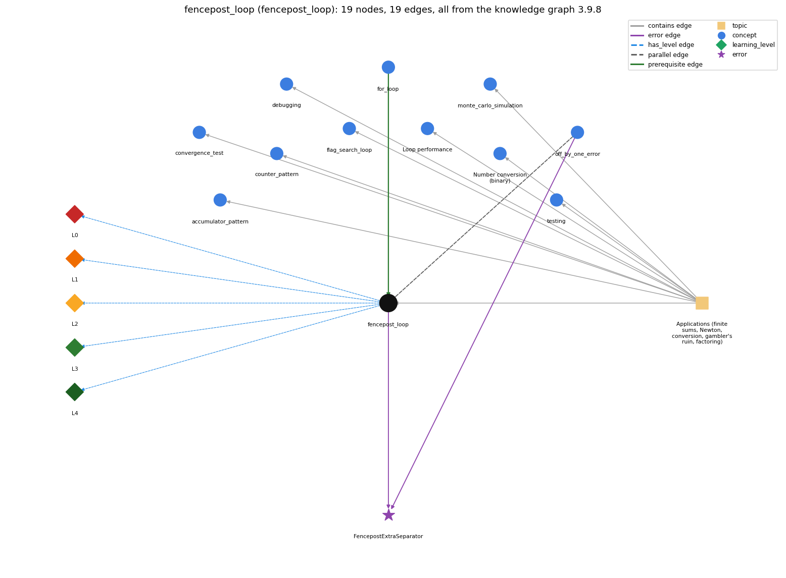

# fencepost_loop (`fencepost_loop`)

n items need n - 1 separators: one item handled outside the loop

Section 1.3 Conditionals and Loops, topic 1.3.f Applications (finite sums, Newton, conversion, gambler's ruin, factoring). From the knowledge graph 3.9.8 (`data/raw/chapter1_kg_updated.json`).

## Concepts associated with fencepost\_loop (11)

| Concept | Description | How it is associated |
| --- | --- | --- |
| **accumulator\_pattern** | building up a running total/result | same topic (topic1.3.f) |
| **convergence\_test** | stopping a loop when a floating-point result is close enough | same topic (topic1.3.f) |
| **counter\_pattern** | counting occurrences across passes | same topic (topic1.3.f) |
| **debugging** | finding and fixing the cause of a wrong result or error by forming a hypothesis, changing the program and checking the prediction | same topic (topic1.3.f) |
| **flag\_search\_loop** | a boolean flag that a loop sets once and never resets | same topic (topic1.3.f) |
| **for\_loop** | a while with init/condition/update packaged together | prerequisite of it (it needs this) composition rule (R) with it |
| **loop\_performance** | the running time of a loop program depends on how many iterations it makes | same topic (topic1.3.f) |
| **monte\_carlo\_simulation** | estimating a probability by repeating random trials | same topic (topic1.3.f) |
| **number\_conversion** | converting an integer to its binary representation by casting out powers of 2 in a loop | same topic (topic1.3.f) |
| **off\_by\_one\_error** | a loop or index that runs one time too many or too few (&lt; vs &lt;=, 0..n vs 1..n, length vs length-1) | parallel concept composition rule (R) with it shares error FencepostExtraSeparator |
| **testing** | running a program on chosen inputs, including boundary and unusual ones, and comparing the output with what it should be | same topic (topic1.3.f) |

## Every edge in this view and its full label (19)

| From | Edge | To | Full edge label |
| --- | --- | --- | --- |
| **for\_loop** | prerequisite | **fencepost\_loop** | A fencepost loop is a for loop with one item handled outside it. grounding: questionable composition rule (R) of for\_loop with fencepost\_loop: A fencepost loop is a for loop that handles one item (the first or last) outside the loop so that separators come out n-1 times for n items. composition rule (R) of fencepost\_loop with for\_loop: The for loop's bounds must match the handled-outside item: if a[0] is printed before the loop, the loop must start at \`i = 1\`. Starting at 0 duplicates the first item, and \`i &lt;= n\` runs past the end. |
| **off\_by\_one\_error** | parallel | **fencepost\_loop** | An off-by-one error is a loop that runs once too many or too few; a fencepost loop is the correct plan for the case that needs one action more than the other. grounding: book\_passage composition rule (R) of off\_by\_one\_error with fencepost\_loop: When one action must happen once more (or less) than the other, the fencepost plan handles the extra case explicitly instead of risking an off-by-one. |
| **fencepost\_loop** | error | **FencepostExtraSeparator** | **wrong rule:** Prints item and separator together in the loop, leaving an extra separator at the end. **right rule:** Handle one item outside the loop so n items get n - 1 separators. role: primary |
| **off\_by\_one\_error** | error | **FencepostExtraSeparator** | **wrong rule:** Prints item and separator together in the loop, leaving an extra separator at the end. **right rule:** Handle one item outside the loop so n items get n - 1 separators. role: context |
| **fencepost\_loop** | has\_level | **fencepost\_loop@L0** | fencepost loop -&gt; L0 (Prestructural): the answer holds a rule that contradicts Java (1 way). **[0] everyday\_reading** (E): Folk meaning: in everyday counting each item 'comes with' its separator (each fence section with a post), so a novice prints item and separator together n times. For n items you need n − 1 separators (or n + 1 posts for n sections), so one item has to be handled outside the loop. |
| **fencepost\_loop** | has\_level | **fencepost\_loop@L1** | fencepost loop -&gt; L1 (Unistructural): the answer states one correct rule without applying it (2 ways). **[0] names\_the\_element** (N): Loop idiom: a loop that processes n items with n − 1 separators by handling one item outside the loop ('loop and a half'). **[1] states\_the\_rule** (S): Print the first item before the loop, then loop over the rest printing separator then item: \`System.out.print(a[0]); for (int i = 1; i &lt; n; i++) System.out.print(", " + a[i]);\` (or print item then separator for all but the last). |
| **fencepost\_loop** | has\_level | **fencepost\_loop@L2** | fencepost loop -&gt; L2 (Multistructural): the answer applies the rules of fencepost loop to every part of the code, in order (3 ways). **[0] line\_by\_line\_trace** (LT): Order: the first item is printed once before the loop test. Each pass then tests \`i &lt; n\`, prints the separator, prints a[i] and increments i, so a separator always comes before an item, never after the last one. **[1] output\_prediction** (OP): For a = {1, 2, 3} the output is \`1, 2, 3\`: 3 items and exactly 2 separators, with no leading or trailing separator. **[2] one\_step\_execution** (OS): One loop pass prints exactly one separator and one item and increments i by 1. The pre-loop statement prints one item and no separator. |
| **fencepost\_loop** | has\_level | **fencepost\_loop@L3** | fencepost loop -&gt; L3 (Relational): the answer relates the parts (3 ways). **[0] relation\_to\_neighbour** (R): The for loop's bounds must match the handled-outside item: if a[0] is printed before the loop, the loop must start at \`i = 1\`. Starting at 0 duplicates the first item, and \`i &lt;= n\` runs past the end. **[1] relation\_to\_neighbour** (R): An off-by-one error is a loop that runs once too many or too few; a fencepost loop is the correct plan for the case that needs one action more than the other. **[2] purpose\_of\_the\_whole** (P): Plan: fencepost / loop-and-a-half plan. It produces separated lists (\`1, 2, 3\`), joined strings, and drawings of n posts with n − 1 rails. |
| **fencepost\_loop** | has\_level | **fencepost\_loop@L4** | fencepost loop -&gt; L4 (Extended abstract): the answer reasons beyond the given code (4 ways). **[0] predict\_a\_change** (C): Invariant: after k passes, the output holds k + 1 items and k separators. Moving the separator after the item inside the loop breaks this and leaves a trailing separator. Swapping the outside item from first to last needs the loop to cover 0 .. n−2 instead. **[1] diagnose\_an\_error** (D): rule broken: n items need n − 1 separators; one item must be handled outside the loop. Kind: silent logic error. Trigger class: Printing \`a[i] + ", "\` for every i: the output ends with an extra separator (\`1, 2, 3, \`). Any n ≥ 1 triggers it. **[2] transfer\_to\_a\_new\_program** (X): Use a fencepost loop whenever items are joined by separators or bounded by posts (CSV lines, comma lists, drawings). It is not needed when every item gets the same surrounding text; there, a plain loop is right. **[3] diagnose\_an\_error** (D): rule broken: Array indices run from 0 to length − 1; the item handled outside the loop must exist. Kind: run-time exception. Trigger class: An empty array (n = 0): \`print(a[0])\` before the loop throws ArrayIndexOutOfBoundsException. |
| **topic1.3.f** | contains | **accumulator\_pattern** | topic topic1.3.f contains accumulator\_pattern |
| **topic1.3.f** | contains | **convergence\_test** | topic topic1.3.f contains convergence\_test |
| **topic1.3.f** | contains | **counter\_pattern** | topic topic1.3.f contains counter\_pattern |
| **topic1.3.f** | contains | **debugging** | topic topic1.3.f contains debugging |
| **topic1.3.f** | contains | **fencepost\_loop** | topic topic1.3.f contains fencepost\_loop |
| **topic1.3.f** | contains | **flag\_search\_loop** | topic topic1.3.f contains flag\_search\_loop |
| **topic1.3.f** | contains | **loop\_performance** | topic topic1.3.f contains loop\_performance |
| **topic1.3.f** | contains | **monte\_carlo\_simulation** | topic topic1.3.f contains monte\_carlo\_simulation |
| **topic1.3.f** | contains | **number\_conversion** | topic topic1.3.f contains number\_conversion |
| **topic1.3.f** | contains | **testing** | topic topic1.3.f contains testing |
