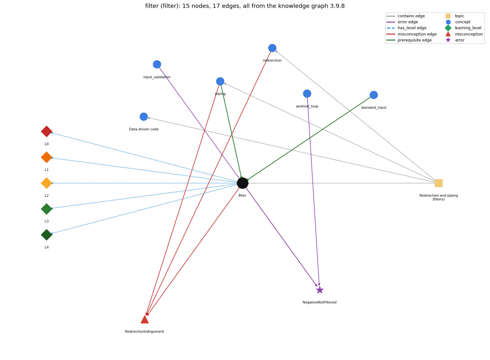

# filter (`filter`)

a program that reads standard input and writes standard output

Section 1.5 Input and Output, topic 1.5.d Redirection and piping (filters).

## At a glance

- **Needs first:** `piping`, `standard_input`
- **Leads to:** nothing
- **Learned alongside:** nothing
- **Misconceptions:** `RedirectionIsArgument`
- **Errors:** `NegativeNotFiltered`
- **Levels:** L0, L1, L2, L3, L4

Everything below comes from the knowledge graph 3.9.8 (`data/raw/chapter1_kg_updated.json`): 17 edges around this concept. The edge logic, the wrong and right rules and the exact rules of the ways are copied word for word from the graph.

## To work on (1)

- no aliases: a student's words cannot name this concept

## What it needs first (2)

A prerequisite edge means the other concept has to be understood before `filter`.

### `piping` comes before `filter`

*\| connects one program's output to another's input*

- **Edge:** `pre:piping->filter`
- **Exact edge logic:** A filter converts a standard input stream to a standard output stream, and piping is the mechanism that connects filters together.
- **Grounding:** book\_passage
- **Composition rule (R) of `filter` with `piping`:** Piping connects filters: the output of one becomes the input of the next, so filters compose into pipelines (\`java RandomSeq 1000 \| more\`).
- **Composition rule (R) of `piping` with `filter`:** Filters are the components and the pipe is the connector: \`A \| F1 \| F2\` passes the stream through each filter in turn.

### `standard_input` comes before `filter`

*StdIn -- reading a stream of values*

- **Edge:** `pre:standard_input->filter`
- **Exact edge logic:** A filter reads its data from standard input and writes what it keeps to standard output.
- **Grounding:** book\_passage

## What it leads to (0)

These concepts need `filter` first.

No concept has this one as a prerequisite.

## Learned alongside (0)

A parallel edge joins two concepts that sit side by side: neither is needed before the other.

No parallel edge touches this concept.

## Misconceptions (1)

A misconception edge states the wrong rule a student may hold about this concept, and the right rule.

### RedirectionIsArgument

- **Edge:** `filter` &rarr; `RedirectionIsArgument` (misconception)
- **Exact edge logic (the wrong rule):** a redirected file shows up in args[]
- **Twin logic (the right rule):** With &lt; data.txt the operating system implements the standard input stream by reading from the file; the program just reads standard input and has no dependence on the source of the input stream.
- **Wrong belief (on the node):** a redirected file shows up in args[]
- **Correct rule (on the node):** With &lt; data.txt the operating system implements the standard input stream by reading from the file; the program just reads standard input and has no dependence on the source of the input stream.
- **Provenance:** derived
- **Role of this concept:** context
- **L0 way linked to it:** yes
- **L0 way [1] misconception, exact rule:** wrong rule: The file a filter processes shows up in args[]. Right rule: A filter reads only standard input. The file or upstream program is attached by &lt; or \|, and args[] carries only parameters such as lo and hi.
- **L0 way [2] inconsistent\_trace, exact rule:** Points to LT (read one value, test it, maybe print it, repeat). An uneven trace prints out-of-range values on some passes, or holds all the output until the end. (here mixing in: "a redirected file shows up in args[]")
- **Edge `piping` &rarr; `RedirectionIsArgument`, exact edge logic:** a redirected file shows up in args[] **Twin logic:** With &lt; data.txt the operating system implements the standard input stream by reading from the file; the program just reads standard input and has no dependence on the source of the input stream. (role: context)
- **Edge `redirection` &rarr; `RedirectionIsArgument`, exact edge logic:** java Prog &lt; in.txt puts the name in.txt into args[0]. **Twin logic:** With &lt; data.txt the operating system implements the standard input stream by reading from the file; the program just reads standard input and has no dependence on the source of the input stream. (role: primary)

## Errors (1)

An error edge states the rule that gets broken in a program, and the right rule.

### NegativeNotFiltered

- **Edge:** `filter` &rarr; `NegativeNotFiltered` (error)
- **Exact edge logic (the wrong rule):** Adds negative rainfall values to the total.
- **Twin logic (the right rule):** Values outside the range of interest must be filtered out (for example with if (t &gt;= lo &amp;&amp; t &lt;= hi)) before they are processed.
- **Wrong belief (on the node):** Adds negative rainfall values to the total.
- **Correct rule (on the node):** Values outside the range of interest must be filtered out (for example with if (t &gt;= lo &amp;&amp; t &lt;= hi)) before they are processed.
- **Provenance:** published
- **Role of this concept:** context
- **Edge `input_validation` &rarr; `NegativeNotFiltered`, exact edge logic:** Adds negative rainfall values to the total. **Twin logic:** Values outside the range of interest must be filtered out (for example with if (t &gt;= lo &amp;&amp; t &lt;= hi)) before they are processed. (role: context)
- **Edge `sentinel_loop` &rarr; `NegativeNotFiltered`, exact edge logic:** Adds negative rainfall values to the total. **Twin logic:** Values outside the range of interest must be filtered out (for example with if (t &gt;= lo &amp;&amp; t &lt;= hi)) before they are processed. (role: primary)

## Levels L0 to L4 (5 of 5)

Each level edge lists the ways a student shows that level, each with its exact rule.

### L0: Prestructural / sensorimotor

L0 for filter: the answer holds a rule that contradicts Java.

*Deciding question: Does every rule the answer applies to filter agree with the language rule? If it reads the code with everyday meanings, applies a wrong rule, or switches rules within one trace, it is L0. A slip in an otherwise rule-correct trace is L2 with an error, not L0.*

- **Edge:** `filter` &rarr; `filter@L0` (has_level)
- **Exact edge logic:** filter -&gt; L0 (Prestructural): the answer holds a rule that contradicts Java (3 ways).

Ways (3), each with its exact rule:

- **[0] everyday\_reading** (rule type E, folk-meaning rule): An everyday filter (a coffee filter) removes things. In the UNIX sense a filter is any program that reads standard input and writes standard output, even one that removes nothing.
- **[1] misconception** (rule type M, wrong rule / right rule) &rarr; `RedirectionIsArgument`: wrong rule: The file a filter processes shows up in args[]. Right rule: A filter reads only standard input. The file or upstream program is attached by &lt; or \|, and args[] carries only parameters such as lo and hi.
- **[2] inconsistent\_trace** (rule type T, uneven-application rule) &rarr; `RedirectionIsArgument`: Points to LT (read one value, test it, maybe print it, repeat). An uneven trace prints out-of-range values on some passes, or holds all the output until the end. (here mixing in: "a redirected file shows up in args[]")

### L1: Unistructural / atom x text surface

L1 for filter: the answer states one correct rule without applying it.

*Deciding question: Does the answer cover every part of the code, in order, with the values (L2)? If it covers one part or only states the rule, it is L1.*

- **Edge:** `filter` &rarr; `filter@L1` (has_level)
- **Exact edge logic:** filter -&gt; L1 (Unistructural): the answer states one correct rule without applying it (2 ways).

Ways (2), each with its exact rule:

- **[0] names\_the\_element** (rule type N, identity rule): A filter is a program that converts a standard input stream into a standard output stream.
- **[1] states\_the\_rule** (rule type S, declarative rule): A filter reads from standard input and writes to standard output, classically writing a subsequence of its input (e.g. RangeFilter keeps the values between lo and hi).

### L2: Multistructural / block x execution / preoperational

L2 for filter: the answer applies these rules to every part of the code, in order.

*Deciding question: Is the answer many segments mapped onto lines (L2), or one segment stating the purpose of the whole (L3)? A correct output with no value-by-value justification is not levelled.*

- **Edge:** `filter` &rarr; `filter@L2` (has_level)
- **Exact edge logic:** filter -&gt; L2 (Multistructural): the answer applies the rules of filter to every part of the code, in order (3 ways).

Ways (3), each with its exact rule:

- **[0] line\_by\_line\_trace** (rule type LT, operational sequencing rule): Each pass of while (!StdIn.isEmpty()) reads one value t, tests lo &lt;= t &lt;= hi, and prints t right away if the test passes. Output is produced while input is still being read.
- **[1] output\_prediction** (rule type OP, evaluation / result rule): \`java RangeFilter 100 400\` with input 358 1330 55 165 689 1014 3066 387 575 843 203 48 292 877 65 998 prints 358 165 387 203 292: the in-range values, in their original order.
- **[2] one\_step\_execution** (rule type OS, state-transition rule): One pass reads one value and appends it to the output only if it passes the test. lo and hi do not change.

### L3: Relational / relations x function (concrete operational begins)

L3 for filter: the answer relates the parts by these rules.

*Deciding question: Was the purpose deduced from the code, or only guessed from traced input/output pairs (then L2)? Does the answer stay within the given code (L3), or reason about changed code, an error class or a new program (L4)?*

- **Edge:** `filter` &rarr; `filter@L3` (has_level)
- **Exact edge logic:** filter -&gt; L3 (Relational): the answer relates the parts (2 ways).

Ways (2), each with its exact rule:

- **[0] relation\_to\_neighbour** (rule type R, composition rule (with a neighbour)): Piping connects filters: the output of one becomes the input of the next, so filters compose into pipelines (\`java RandomSeq 1000 \| more\`).
- **[1] purpose\_of\_the\_whole** (rule type P, plan / role rule): Plan: the stream filter, a one-pass read-test-print loop that uses only a fixed number of variables. The value read is a most-recent holder and lo and hi are fixed values.

### L4: Extended abstract (concrete-operational reversibility and conservation)

L4 for filter: the answer reasons beyond the given code by these rules.

*Deciding question: Does the answer link the code to a broader context: a changed program, a class of inputs, an unseen problem? Re-tracing changed code value by value is L2; fixing one given failing case is L3.*

- **Edge:** `filter` &rarr; `filter@L4` (has_level)
- **Exact edge logic:** filter -&gt; L4 (Extended abstract): the answer reasons beyond the given code (3 ways).

Ways (3), each with its exact rule:

- **[0] predict\_a\_change** (rule type C, conservation rule) &rarr; `RedirectionIsArgument`: A filter keeps the relative order of the values it passes (it outputs a subsequence). Filters can be chained in any number without changing each other.
- **[1] transfer\_to\_a\_new\_program** (rule type X, applicability rule): A filter is the right tool when each output depends only on the current value, or on a fixed amount of state. Tasks that need all the values (sorting, k-th smallest, percentage above the mean) must store them in an array first.
- **[2] diagnose\_an\_error** (rule type D, error rule): rule broken: Every value must pass the range test before it is output or processed. Kind: silent logic error. Trigger class: Values outside lo..hi (e.g. negatives) are output because the test is missing or uses the wrong bounds or operators.

## Same topic

`filter` belongs to the topic **Redirection and piping (filters)** (`topic1.5.d`). The topic also contains: `data_driven_code`, `piping`, `redirection`.

## Rules of the concept (13)

- **Book** (SW-1e, p. 134 (pdf 144)): "For many common tasks, it is convenient to think of each program as a filter that converts a standard input stream to a standard output stream in some way"
- **Book** (SW-1.5, p. 134 (pdf 144)): "to think of each program as a filter that converts a standard input stream"
- **E** (folk-meaning rule): An everyday filter (a coffee filter) removes things. In the UNIX sense a filter is any program that reads standard input and writes standard output, even one that removes nothing.
- **M** (wrong rule / right rule): RedirectionIsArgument: wrong: The file a filter processes shows up in args[]. \| right: A filter reads only standard input. The file or upstream program is attached by &lt; or \|, and args[] carries only parameters such as lo and hi.
- **T** (uneven-application rule): Points to LT (read one value, test it, maybe print it, repeat). An uneven trace prints out-of-range values on some passes, or holds all the output until the end.
- **N** (identity rule): A filter is a program that converts a standard input stream into a standard output stream.
- **S** (declarative rule): A filter reads from standard input and writes to standard output, classically writing a subsequence of its input (e.g. RangeFilter keeps the values between lo and hi).
- **LT** (operational sequencing rule): Each pass of while (!StdIn.isEmpty()) reads one value t, tests lo &lt;= t &lt;= hi, and prints t right away if the test passes. Output is produced while input is still being read.
- **OP** (evaluation / result rule): \`java RangeFilter 100 400\` with input 358 1330 55 165 689 1014 3066 387 575 843 203 48 292 877 65 998 prints 358 165 387 203 292: the in-range values, in their original order.
- **OS** (state-transition rule): One pass reads one value and appends it to the output only if it passes the test. lo and hi do not change.
- **R** (composition rule (with a neighbour)): with piping: Piping connects filters: the output of one becomes the input of the next, so filters compose into pipelines (\`java RandomSeq 1000 \| more\`).
- **P** (plan / role rule): Plan: the stream filter, a one-pass read-test-print loop that uses only a fixed number of variables. The value read is a most-recent holder and lo and hi are fixed values.
- **C** (conservation rule): A filter keeps the relative order of the values it passes (it outputs a subsequence). Filters can be chained in any number without changing each other.
- **D** (error rule): rule broken: Every value must pass the range test before it is output or processed. (silent logic error)
- **X** (applicability rule): A filter is the right tool when each output depends only on the current value, or on a fixed amount of state. Tasks that need all the values (sorting, k-th smallest, percentage above the mean) must store them in an array first.

## How it is found in code and answers (reader block)

- **Aliases:** none
- **Code patterns:** none
- **Operator symbols:** none
- **Java types:** none
- **Signal stdin\_to\_stdout** (scope program): `StdIn\.read[\s\S]*?(?:StdOut|System\.out)\.print`
- **Signal stdout\_then\_stdin** (scope program): `(?:StdOut|System\.out)\.print[\s\S]*?StdIn\.read`

## The whole prerequisite chain

- **Everything it builds on (8):** `compile`, `piping`, `program_text`, `redirection`, `run`, `standard_input`, `standard_output`, `stream_model`
- **Everything that builds on it (0):** nothing

## Every edge in this view and its exact edge logic (17)

All the edges drawn in the picture, in the order: prerequisite, parallel, misconception, error, has_level, contains.

**1. `piping` &rarr; `filter`** (prerequisite)

- **Exact edge logic:** A filter converts a standard input stream to a standard output stream, and piping is the mechanism that connects filters together.
- **Grounding:** book\_passage
- **Composition rule (R) of `piping` with `filter`:** Filters are the components and the pipe is the connector: \`A \| F1 \| F2\` passes the stream through each filter in turn.
- **Composition rule (R) of `filter` with `piping`:** Piping connects filters: the output of one becomes the input of the next, so filters compose into pipelines (\`java RandomSeq 1000 \| more\`).

**2. `standard_input` &rarr; `filter`** (prerequisite)

- **Exact edge logic:** A filter reads its data from standard input and writes what it keeps to standard output.
- **Grounding:** book\_passage

**3. `filter` &rarr; `RedirectionIsArgument`** (misconception)

- **Exact edge logic (the wrong rule):** a redirected file shows up in args[]
- **Twin logic (the right rule):** With &lt; data.txt the operating system implements the standard input stream by reading from the file; the program just reads standard input and has no dependence on the source of the input stream.
- **Role:** context

**4. `piping` &rarr; `RedirectionIsArgument`** (misconception)

- **Exact edge logic (the wrong rule):** a redirected file shows up in args[]
- **Twin logic (the right rule):** With &lt; data.txt the operating system implements the standard input stream by reading from the file; the program just reads standard input and has no dependence on the source of the input stream.
- **Role:** context

**5. `redirection` &rarr; `RedirectionIsArgument`** (misconception)

- **Exact edge logic (the wrong rule):** java Prog &lt; in.txt puts the name in.txt into args[0].
- **Twin logic (the right rule):** With &lt; data.txt the operating system implements the standard input stream by reading from the file; the program just reads standard input and has no dependence on the source of the input stream.
- **Role:** primary

**6. `filter` &rarr; `NegativeNotFiltered`** (error)

- **Exact edge logic (the wrong rule):** Adds negative rainfall values to the total.
- **Twin logic (the right rule):** Values outside the range of interest must be filtered out (for example with if (t &gt;= lo &amp;&amp; t &lt;= hi)) before they are processed.
- **Role:** context

**7. `input_validation` &rarr; `NegativeNotFiltered`** (error)

- **Exact edge logic (the wrong rule):** Adds negative rainfall values to the total.
- **Twin logic (the right rule):** Values outside the range of interest must be filtered out (for example with if (t &gt;= lo &amp;&amp; t &lt;= hi)) before they are processed.
- **Role:** context

**8. `sentinel_loop` &rarr; `NegativeNotFiltered`** (error)

- **Exact edge logic (the wrong rule):** Adds negative rainfall values to the total.
- **Twin logic (the right rule):** Values outside the range of interest must be filtered out (for example with if (t &gt;= lo &amp;&amp; t &lt;= hi)) before they are processed.
- **Role:** primary

**9. `filter` &rarr; `filter@L0`** (has_level)

- **Exact edge logic:** filter -&gt; L0 (Prestructural): the answer holds a rule that contradicts Java (3 ways).
  - **[0] everyday\_reading** (rule type E, folk-meaning rule): An everyday filter (a coffee filter) removes things. In the UNIX sense a filter is any program that reads standard input and writes standard output, even one that removes nothing.
  - **[1] misconception** (rule type M, wrong rule / right rule) &rarr; `RedirectionIsArgument`: wrong rule: The file a filter processes shows up in args[]. Right rule: A filter reads only standard input. The file or upstream program is attached by &lt; or \|, and args[] carries only parameters such as lo and hi.
  - **[2] inconsistent\_trace** (rule type T, uneven-application rule) &rarr; `RedirectionIsArgument`: Points to LT (read one value, test it, maybe print it, repeat). An uneven trace prints out-of-range values on some passes, or holds all the output until the end. (here mixing in: "a redirected file shows up in args[]")

**10. `filter` &rarr; `filter@L1`** (has_level)

- **Exact edge logic:** filter -&gt; L1 (Unistructural): the answer states one correct rule without applying it (2 ways).
  - **[0] names\_the\_element** (rule type N, identity rule): A filter is a program that converts a standard input stream into a standard output stream.
  - **[1] states\_the\_rule** (rule type S, declarative rule): A filter reads from standard input and writes to standard output, classically writing a subsequence of its input (e.g. RangeFilter keeps the values between lo and hi).

**11. `filter` &rarr; `filter@L2`** (has_level)

- **Exact edge logic:** filter -&gt; L2 (Multistructural): the answer applies the rules of filter to every part of the code, in order (3 ways).
  - **[0] line\_by\_line\_trace** (rule type LT, operational sequencing rule): Each pass of while (!StdIn.isEmpty()) reads one value t, tests lo &lt;= t &lt;= hi, and prints t right away if the test passes. Output is produced while input is still being read.
  - **[1] output\_prediction** (rule type OP, evaluation / result rule): \`java RangeFilter 100 400\` with input 358 1330 55 165 689 1014 3066 387 575 843 203 48 292 877 65 998 prints 358 165 387 203 292: the in-range values, in their original order.
  - **[2] one\_step\_execution** (rule type OS, state-transition rule): One pass reads one value and appends it to the output only if it passes the test. lo and hi do not change.

**12. `filter` &rarr; `filter@L3`** (has_level)

- **Exact edge logic:** filter -&gt; L3 (Relational): the answer relates the parts (2 ways).
  - **[0] relation\_to\_neighbour** (rule type R, composition rule (with a neighbour)): Piping connects filters: the output of one becomes the input of the next, so filters compose into pipelines (\`java RandomSeq 1000 \| more\`).
  - **[1] purpose\_of\_the\_whole** (rule type P, plan / role rule): Plan: the stream filter, a one-pass read-test-print loop that uses only a fixed number of variables. The value read is a most-recent holder and lo and hi are fixed values.

**13. `filter` &rarr; `filter@L4`** (has_level)

- **Exact edge logic:** filter -&gt; L4 (Extended abstract): the answer reasons beyond the given code (3 ways).
  - **[0] predict\_a\_change** (rule type C, conservation rule) &rarr; `RedirectionIsArgument`: A filter keeps the relative order of the values it passes (it outputs a subsequence). Filters can be chained in any number without changing each other.
  - **[1] transfer\_to\_a\_new\_program** (rule type X, applicability rule): A filter is the right tool when each output depends only on the current value, or on a fixed amount of state. Tasks that need all the values (sorting, k-th smallest, percentage above the mean) must store them in an array first.
  - **[2] diagnose\_an\_error** (rule type D, error rule): rule broken: Every value must pass the range test before it is output or processed. Kind: silent logic error. Trigger class: Values outside lo..hi (e.g. negatives) are output because the test is missing or uses the wrong bounds or operators.

**14. `topic1.5.d` &rarr; `filter`** (contains)

- topic `topic1.5.d` contains `filter`

**15. `topic1.5.d` &rarr; `data_driven_code`** (contains)

- topic `topic1.5.d` contains `data_driven_code`

**16. `topic1.5.d` &rarr; `piping`** (contains)

- topic `topic1.5.d` contains `piping`

**17. `topic1.5.d` &rarr; `redirection`** (contains)

- topic `topic1.5.d` contains `redirection`
