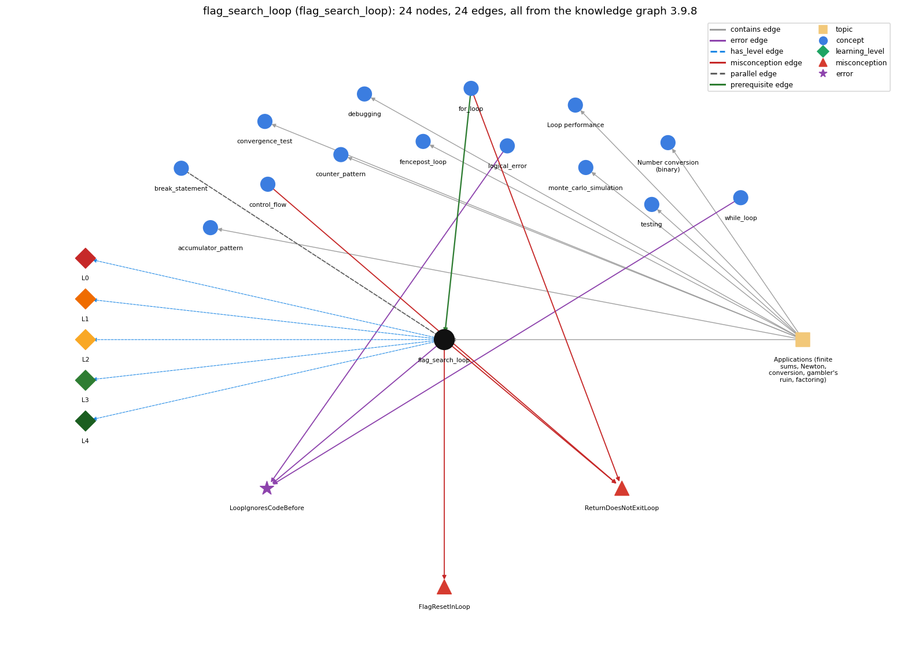

# flag_search_loop (`flag_search_loop`)

a boolean flag that a loop sets once and never resets

Section 1.3 Conditionals and Loops, topic 1.3.f Applications (finite sums, Newton, conversion, gambler's ruin, factoring). From the knowledge graph 3.9.8 (`data/raw/chapter1_kg_updated.json`).

## Concepts associated with flag\_search\_loop (14)

| Concept | Description | How it is associated |
| --- | --- | --- |
| **accumulator\_pattern** | building up a running total/result | same topic (topic1.3.f) |
| **break\_statement** | break -- immediately exits the innermost loop or switch | parallel concept |
| **control\_flow** | the order in which statements are executed | shares misconception ReturnDoesNotExitLoop |
| **convergence\_test** | stopping a loop when a floating-point result is close enough | same topic (topic1.3.f) |
| **counter\_pattern** | counting occurrences across passes | same topic (topic1.3.f) |
| **debugging** | finding and fixing the cause of a wrong result or error by forming a hypothesis, changing the program and checking the prediction | same topic (topic1.3.f) |
| **fencepost\_loop** | n items need n - 1 separators: one item handled outside the loop | same topic (topic1.3.f) |
| **for\_loop** | a while with init/condition/update packaged together | prerequisite of it (it needs this) composition rule (R) with it shares misconception ReturnDoesNotExitLoop |
| **logical\_error** | the program runs but computes the wrong result | shares error LoopIgnoresCodeBefore |
| **loop\_performance** | the running time of a loop program depends on how many iterations it makes | same topic (topic1.3.f) |
| **monte\_carlo\_simulation** | estimating a probability by repeating random trials | same topic (topic1.3.f) |
| **number\_conversion** | converting an integer to its binary representation by casting out powers of 2 in a loop | same topic (topic1.3.f) |
| **testing** | running a program on chosen inputs, including boundary and unusual ones, and comparing the output with what it should be | same topic (topic1.3.f) |
| **while\_loop** | repeat a block while a condition holds | shares error LoopIgnoresCodeBefore |

## Every edge in this view and its full label (24)

| From | Edge | To | Full edge label |
| --- | --- | --- | --- |
| **for\_loop** | prerequisite | **flag\_search\_loop** | A flag search loop sets a boolean flag inside a loop when a pass finds the condition, and leaves it set afterwards. grounding: questionable composition rule (R) of for\_loop with flag\_search\_loop: A flag search loop is a for loop that sets a boolean flag when some pass finds the target and leaves it set afterwards; the flag must be declared before the loop. composition rule (R) of flag\_search\_loop with for\_loop: The flag must be declared before the for loop to be visible after it. The for loop's test can include \`!found\` to stop at the first find; without that, the loop runs all passes, and the flag still works because it is one-way. |
| **flag\_search\_loop** | parallel | **break\_statement** | Two ways to stop a search when the item is found: break leaves the loop at once, while a boolean flag is set and tested in the loop condition so the loop ends at its next test. After either, the code must tell the found case from the loop finishing normally. grounding: book\_passage |
| **control\_flow** | misconception | **ReturnDoesNotExitLoop** | **wrong rule:** A return inside a loop does not end the loop; it sets a value each pass (the last one is returned) or returns several values. **right rule:** When return executes, the method ends at once, so the loop stops on that pass. role: primary |
| **flag\_search\_loop** | misconception | **FlagResetInLoop** | **wrong rule:** A search flag should be set back to true whenever a test fails. **right rule:** Once the flag records a find, the loop must not reset it. role: primary |
| **flag\_search\_loop** | misconception | **ReturnDoesNotExitLoop** | **wrong rule:** A return inside a loop does not end the loop; it sets a value each pass (the last one is returned) or returns several values. **right rule:** When return executes, the method ends at once, so the loop stops on that pass. role: context |
| **for\_loop** | misconception | **ReturnDoesNotExitLoop** | **wrong rule:** A return inside a loop does not end the loop; it sets a value each pass (the last one is returned) or returns several values. **right rule:** When return executes, the method ends at once, so the loop stops on that pass. role: context |
| **flag\_search\_loop** | error | **LoopIgnoresCodeBefore** | **wrong rule:** Initializes the flag before the loop so that the loop condition is already false, and the loop body never runs. **right rule:** A while loop tests its condition before the first pass: if the values set before the loop make the condition false, the body never runs. role: context |
| **logical\_error** | error | **LoopIgnoresCodeBefore** | **wrong rule:** Initializes the flag before the loop so that the loop condition is already false, and the loop body never runs. **right rule:** A while loop tests its condition before the first pass: if the values set before the loop make the condition false, the body never runs. role: context |
| **while\_loop** | error | **LoopIgnoresCodeBefore** | **wrong rule:** Initializes the flag before the loop so that the loop condition is already false, and the loop body never runs. **right rule:** A while loop tests its condition before the first pass: if the values set before the loop make the condition false, the body never runs. role: primary |
| **flag\_search\_loop** | has\_level | **flag\_search\_loop@L0** | flag search loop -&gt; L0 (Prestructural): the answer holds a rule that contradicts Java (3 ways). **[0] everyday\_reading** (E): Folk meaning: in English, 'found' or 'is OK' describes the current item, so a novice writes \`found = (a[i] == target);\` on every pass. In a search, the flag must record whether any pass so far matched: it is set once (\`if (a[i] == target) found = true;\`) and never reset. **[1] misconception** (M) &rarr; FlagResetInLoop: wrong rule: A search flag should be set back (to false/true) whenever a test fails. Right rule: A search flag is a one-way flag: once a pass records a find, no later pass may reset it, so the loop body contains only \`if (match) found = true;\` with no else. **[2] inconsistent\_trace** (T) &rarr; FlagResetInLoop: Applies the LT rule unevenly: on a trace, the flag is updated on non-matching passes as if there were an else, or the trace forgets that the flag carries over from the previous pass. The traced final flag then reflects only the last element. (here mixing in: "A search flag should be set back to true whenever a test fails") |
| **flag\_search\_loop** | has\_level | **flag\_search\_loop@L1** | flag search loop -&gt; L1 (Unistructural): the answer states one correct rule without applying it (2 ways). **[0] names\_the\_element** (N): Loop plan: a boolean flag variable initialised before a loop and set by the loop when a condition is found, recording whether the condition held on any pass. **[1] states\_the\_rule** (S): \`boolean found = false; for (int i = 0; i &lt; n; i++) if (a[i] == target) found = true;\` To stop early, add the flag to the test: \`while (i &lt; n &amp;&amp; !found)\`. |
| **flag\_search\_loop** | has\_level | **flag\_search\_loop@L2** | flag search loop -&gt; L2 (Multistructural): the answer applies the rules of flag search loop to every part of the code, in order (3 ways). **[0] line\_by\_line\_trace** (LT): Order: initialise the flag once before the loop. On each pass, test the loop condition (which may include \`!found\`), then evaluate the guard, and only if it is true assign \`found = true\`. Read the flag after the loop. **[1] output\_prediction** (OP): The result is a boolean: true if at least one pass satisfied the guard, false if none did (including zero passes). For {3, 5, 7} and target 5, found is true. **[2] one\_step\_execution** (OS): A matching pass changes only the flag, from false to true (and it stays true). A non-matching pass changes nothing. \`found = true\` as a statement has the value true, which is discarded. |
| **flag\_search\_loop** | has\_level | **flag\_search\_loop@L3** | flag search loop -&gt; L3 (Relational): the answer relates the parts (3 ways). **[0] relation\_to\_neighbour** (R): The flag must be declared before the for loop to be visible after it. The for loop's test can include \`!found\` to stop at the first find; without that, the loop runs all passes, and the flag still works because it is one-way. **[1] relation\_to\_neighbour** (R): Two ways to stop a search when the item is found: break leaves the loop at once, while a boolean flag is set and tested in the loop condition so the loop ends at its next test. After either, the code must tell the found case from the loop finishing normally. **[2] purpose\_of\_the\_whole** (P): Plan: search / existence-check plan. The flag plays the Sajaniemi one-way flag role. It answers 'is there any element with property P?' or 'is the array sorted?'. |
| **flag\_search\_loop** | has\_level | **flag\_search\_loop@L4** | flag search loop -&gt; L4 (Extended abstract): the answer reasons beyond the given code (5 ways). **[0] predict\_a\_change** (C) &rarr; FlagResetInLoop: Invariant: after k passes, found == (some element among the first k matched). Adding an else that resets the flag breaks the invariant, as does replacing the guard with \`found = (a[i] == target)\`. Adding \`!found\` to the loop test keeps the result and only saves passes. Initialising the flag to true breaks the result for inputs with no match. **[1] transfer\_to\_a\_new\_program** (X): Use a flag when you need a yes/no answer after a loop, or a stopping condition that is set in the middle of a pass. In a method, \`return\` from inside the loop (or \`break\`) is often simpler. Use a counter when you need how many, not whether. **[2] diagnose\_an\_error** (D): rule broken: A while loop tests its condition before the first pass: if the values set before the loop make the condition false, the body never runs. Kind: silent logic error. Trigger class: Initialising the flag so that the loop test is already false (e.g. \`boolean found = true; while (!found) {...}\`): the search never runs. **[3] diagnose\_an\_error** (D): rule broken: A search flag is one-way: it must not be reassigned on every pass. Kind: silent logic error. Trigger class: \`found = (a[i] == target);\` or an else branch that sets \`found = false\`: the result reflects only the last element and fails when the match is not last. **[4] diagnose\_an\_error** (D): rule broken: Using = instead of == on a boolean flag assigns instead of testing. Kind: silent logic error. Trigger class: \`if (found = false)\` compiles (boolean assignment) and is always false; write \`if (!found)\`. |
| **topic1.3.f** | contains | **accumulator\_pattern** | topic topic1.3.f contains accumulator\_pattern |
| **topic1.3.f** | contains | **convergence\_test** | topic topic1.3.f contains convergence\_test |
| **topic1.3.f** | contains | **counter\_pattern** | topic topic1.3.f contains counter\_pattern |
| **topic1.3.f** | contains | **debugging** | topic topic1.3.f contains debugging |
| **topic1.3.f** | contains | **fencepost\_loop** | topic topic1.3.f contains fencepost\_loop |
| **topic1.3.f** | contains | **flag\_search\_loop** | topic topic1.3.f contains flag\_search\_loop |
| **topic1.3.f** | contains | **loop\_performance** | topic topic1.3.f contains loop\_performance |
| **topic1.3.f** | contains | **monte\_carlo\_simulation** | topic topic1.3.f contains monte\_carlo\_simulation |
| **topic1.3.f** | contains | **number\_conversion** | topic topic1.3.f contains number\_conversion |
| **topic1.3.f** | contains | **testing** | topic topic1.3.f contains testing |
