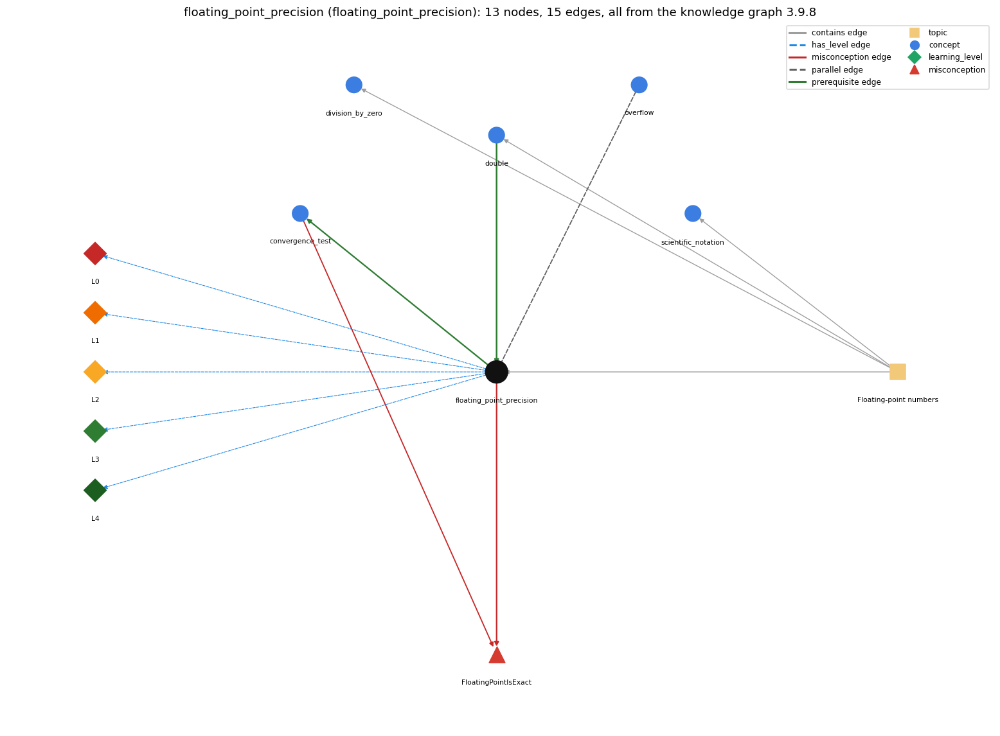

# floating_point_precision (`floating_point_precision`)

double values are approximations; == on doubles is unreliable

Section 1.2 Built-in Types of Data, topic 1.2.d Floating-point numbers.

## At a glance

- **Needs first:** `double`
- **Leads to:** `convergence_test`
- **Learned alongside:** `overflow`
- **Misconceptions:** `FloatingPointIsExact`
- **Errors:** none
- **Levels:** L0, L1, L2, L3, L4

Everything below comes from the knowledge graph 3.9.8 (`data/raw/chapter1_kg_updated.json`): 15 edges around this concept, each explained in the graph's own words.

## What it needs first (1)

A prerequisite edge means the other concept has to be understood before `floating_point_precision`.

### `double` comes before `floating_point_precision`

*64-bit floating-point primitive*

A double approximates real numbers, so its arithmetic is not exact.

- **Grounding:** book passage
- **How `floating_point_precision` combines with `double`:** Imprecision is inherent in the double type, not in a particular program: any arithmetic on doubles may carry rounding error, so code that uses double must be written to tolerate it.
- **How `double` combines with `floating_point_precision`:** Every double operation rounds its result to the nearest representable value, so double results carry rounding error that can accumulate; this is why == on computed doubles is unreliable.

## What it leads to (1)

These concepts need `floating_point_precision` first.

### `floating_point_precision` comes before `convergence_test`

*stopping a loop when a floating-point result is close enough*

An equality test between double values may not give the result you expect, so Sqrt stops when t is within a relative error tolerance epsilon (Math.abs(t - c/t) &gt; epsilon \* t) rather than when t equals c/t.

- **Grounding:** book passage
- **How `floating_point_precision` combines with `convergence_test`:** Because doubles are approximate, a loop that waits for exact equality may never stop; Sqrt therefore loops while Math.abs(t - c/t) &gt; epsilon \* t, a relative-tolerance test.
- **How `convergence_test` combines with `floating_point_precision`:** Because doubles are approximate, the stopping condition has to be a tolerance test, and the tolerance has to be relative (\`epsilon \* t\`). An absolute 1e-15 is smaller than the spacing between doubles near large values such as 1595.16, so the test might never succeed (t and c/t can keep differing by one unit in the last place).

## Learned alongside (1)

A parallel edge joins two concepts that sit side by side: neither is needed before the other.

### `floating_point_precision` alongside `overflow`

*int arithmetic wraps around outside the 32-bit range*

Both come from finite representations: an int result too large for 32 bits wraps around silently (overflow), while a double keeps about 15 significant digits so most results are approximations (5.0/3.0 is 1.6666666666666667). Neither raises an error.

- **Grounding:** book passage

## Misconceptions (1)

A misconception edge states the wrong rule a student may hold about this concept, and the right rule.

### FloatingPointIsExact

- **Wrong rule:** Math.sqrt(2) \* Math.sqrt(2) == 2 is true.
- **Right rule:** A double is an approximation, so the product is close to 2 but not equal to 2.
- **Role of this concept:** primary
- **Shows at level L0 as:** misconception: wrong rule: Math.sqrt(2) \* Math.sqrt(2) == 2 is true. Right rule: A double is an approximation, so the product is 2.0000000000000004, close to 2 but not equal; the comparison is false.
- **Shows at level L0 as:** inconsistent trace: Points to LT (rounding happens after every single operation, and the error is carried into the next one). Applied unevenly: the student rounds only the final printed value, treating intermediate values as exact on some lines, or expects ten additions of 0.1 to equal 0.1 \* 10. (here mixing in: "Math.sqrt(2) \* Math.sqrt(2) == 2 is true")
- **Also an edge from `convergence_test`:** Math.sqrt(2) \* Math.sqrt(2) == 2 is true.
- **Also an edge from `double`:** Math.sqrt(2) \* Math.sqrt(2) == 2 is true.

## Errors (0)

An error edge states the rule that gets broken in a program, and the right rule.

The graph has no error edge from this concept.

## Levels L0 to L4 (5 of 5)

Each level edge lists the ways a student shows that level, each with its exact rule.

### L0: Prestructural / sensorimotor

L0 for floating point precision: the answer holds a rule that contradicts Java.

*Deciding question: Does every rule the answer applies to floating point precision agree with the language rule? If it reads the code with everyday meanings, applies a wrong rule, or switches rules within one trace, it is L0. A slip in an otherwise rule-correct trace is L2 with an error, not L0.*

floating point precision -&gt; L0 (Prestructural): the answer holds a rule that contradicts Java (3 ways).

- **everyday reading** (folk-meaning rule): Folk meaning: decimal arithmetic is exact, as on paper or on a calculator display, so 0.1 + 0.1 + 0.1 equals 0.3. Java rule: most decimal fractions (0.1) have no exact binary representation, every double operation rounds, and (0.1 + 0.1 + 0.1 == 0.3) is false.
- **misconception** (wrong rule / right rule; shows `FloatingPointIsExact`): wrong rule: Math.sqrt(2) \* Math.sqrt(2) == 2 is true. Right rule: A double is an approximation, so the product is 2.0000000000000004, close to 2 but not equal; the comparison is false.
- **inconsistent trace** (uneven-application rule; shows `FloatingPointIsExact`): Points to LT (rounding happens after every single operation, and the error is carried into the next one). Applied unevenly: the student rounds only the final printed value, treating intermediate values as exact on some lines, or expects ten additions of 0.1 to equal 0.1 \* 10. (here mixing in: "Math.sqrt(2) \* Math.sqrt(2) == 2 is true")

### L1: Unistructural / atom x text surface

L1 for floating point precision: the answer states one correct rule without applying it.

*Deciding question: Does the answer cover every part of the code, in order, with the values (L2)? If it covers one part or only states the rule, it is L1.*

floating point precision -&gt; L1 (Unistructural): the answer states one correct rule without applying it (2 ways).

- **names the element** (identity rule): Floating-point precision is a property of the double type: a double keeps only about 15 significant decimal digits, and the difference between the intended real number and the stored double is rounding error.
- **states the rule** (declarative rule): Each double result is the nearest representable binary64 value, so results are generally approximate; S&amp;W: novice programmers should avoid comparing two floating-point numbers for equality. Do not test doubles for equality with ==: compare with a tolerance, e.g. Math.abs(x - y) &lt; 1e-9; and == is false whenever an operand is NaN.

### L2: Multistructural / block x execution / preoperational

L2 for floating point precision: the answer applies these rules to every part of the code, in order.

*Deciding question: Is the answer many segments mapped onto lines (L2), or one segment stating the purpose of the whole (L3)? A correct output with no value-by-value justification is not levelled.*

floating point precision -&gt; L2 (Multistructural): the answer applies the rules of floating point precision to every part of the code, in order (3 ways).

- **line by line trace** (operational sequencing rule): Evaluation proceeds operator by operator; after each one the exact result is rounded to a double, and the next operator works on that rounded value, so errors compound along the evaluation order; only at output is the stored value converted to a decimal string.
- **output prediction** (evaluation / result rule): Printed results show the approximation: 0.1 \* 10 prints 1.0 but adding 0.1 ten times prints 0.9999999999999999; 5.0/3.0 prints 1.6666666666666667; (0.1 + 0.1 + 0.1 == 0.3) is false.
- **one step execution** (state-transition rule): Each assignment such as x = x + 0.1 stores the rounded sum; the error stays in x and is carried into every later step that uses x.

### L3: Relational / relations x function (concrete operational begins)

L3 for floating point precision: the answer relates the parts by these rules.

*Deciding question: Was the purpose deduced from the code, or only guessed from traced input/output pairs (then L2)? Does the answer stay within the given code (L3), or reason about changed code, an error class or a new program (L4)?*

floating point precision -&gt; L3 (Relational): the answer relates the parts (4 ways).

- **relation to neighbour** (composition rule (with a neighbour)): Imprecision is inherent in the double type, not in a particular program: any arithmetic on doubles may carry rounding error, so code that uses double must be written to tolerate it.
- **relation to neighbour** (composition rule (with a neighbour)): Because doubles are approximate, a loop that waits for exact equality may never stop; Sqrt therefore loops while Math.abs(t - c/t) &gt; epsilon \* t, a relative-tolerance test.
- **relation to neighbour** (composition rule (with a neighbour)): Both come from finite representations: an int result too large for 32 bits wraps around silently (overflow), while a double keeps about 15 significant digits so most results are approximations (5.0/3.0 is 1.6666666666666667). Neither raises an error.
- **purpose of the whole** (plan / role rule): Awareness of precision is used to write tolerance comparisons (Math.abs(a - b) &lt; epsilon) and to choose integer representations for exact quantities, e.g. money as an int number of cents.

### L4: Extended abstract (concrete-operational reversibility and conservation)

L4 for floating point precision: the answer reasons beyond the given code by these rules.

*Deciding question: Does the answer link the code to a broader context: a changed program, a class of inputs, an unseen problem? Re-tracing changed code value by value is L2; fixing one given failing case is L3.*

floating point precision -&gt; L4 (Extended abstract): the answer reasons beyond the given code (3 ways).

- **predict a change** (conservation rule; shows `FloatingPointIsExact`): Reordering additions, or changing a loop step such as x += 0.1, changes the last digits and can change how many times a loop tested with &lt;= runs; replacing an == test by a tolerance test makes the outcome stable under such changes.
- **transfer to a new program** (applicability rule): Accept double precision for measurements and simulations and compare with a tolerance; when exactness is required (counts, money, loop control) use int or long instead.
- **diagnose an error** (error rule): rule broken: Computed doubles must not be compared for exact equality. Kind: silent logic error. Trigger class: == or != between doubles from arithmetic on non-dyadic fractions (0.1, 1/3, square roots), or a double loop counter with a == / &lt;= bound; can also cause an infinite loop.

## Same topic

`floating_point_precision` belongs to the topic **Floating-point numbers** (`topic1.2.d`). The topic also contains: `division_by_zero`, `double`, `scientific_notation`.

## Rules of the concept (14)

- **folk-meaning rule:** Folk meaning: decimal arithmetic is exact, as on paper or on a calculator display, so 0.1 + 0.1 + 0.1 equals 0.3. Java rule: most decimal fractions (0.1) have no exact binary representation, every double operation rounds, and (0.1 + 0.1 + 0.1 == 0.3) is false.
- **wrong rule / right rule:** FloatingPointIsExact: wrong: Math.sqrt(2) \* Math.sqrt(2) == 2 is true. \| right: A double is an approximation, so the product is 2.0000000000000004, close to 2 but not equal; the comparison is false.
- **uneven-application rule:** Points to LT (rounding happens after every single operation, and the error is carried into the next one). Applied unevenly: the student rounds only the final printed value, treating intermediate values as exact on some lines, or expects ten additions of 0.1 to equal 0.1 \* 10.
- **identity rule:** Floating-point precision is a property of the double type: a double keeps only about 15 significant decimal digits, and the difference between the intended real number and the stored double is rounding error.
- **declarative rule:** Each double result is the nearest representable binary64 value, so results are generally approximate; S&amp;W: novice programmers should avoid comparing two floating-point numbers for equality. Do not test doubles for equality with ==: compare with a tolerance, e.g. Math.abs(x - y) &lt; 1e-9; and == is false whenever an operand is NaN.
- **operational sequencing rule:** Evaluation proceeds operator by operator; after each one the exact result is rounded to a double, and the next operator works on that rounded value, so errors compound along the evaluation order; only at output is the stored value converted to a decimal string.
- **evaluation / result rule:** Printed results show the approximation: 0.1 \* 10 prints 1.0 but adding 0.1 ten times prints 0.9999999999999999; 5.0/3.0 prints 1.6666666666666667; (0.1 + 0.1 + 0.1 == 0.3) is false.
- **state-transition rule:** Each assignment such as x = x + 0.1 stores the rounded sum; the error stays in x and is carried into every later step that uses x.
- **composition rule (with a neighbour):** with double: Imprecision is inherent in the double type, not in a particular program: any arithmetic on doubles may carry rounding error, so code that uses double must be written to tolerate it.
- **composition rule (with a neighbour):** with convergence\_test: Because doubles are approximate, a loop that waits for exact equality may never stop; Sqrt therefore loops while Math.abs(t - c/t) &gt; epsilon \* t, a relative-tolerance test.
- **plan / role rule:** Awareness of precision is used to write tolerance comparisons (Math.abs(a - b) &lt; epsilon) and to choose integer representations for exact quantities, e.g. money as an int number of cents.
- **conservation rule:** Reordering additions, or changing a loop step such as x += 0.1, changes the last digits and can change how many times a loop tested with &lt;= runs; replacing an == test by a tolerance test makes the outcome stable under such changes.
- **error rule:** rule broken: Computed doubles must not be compared for exact equality. (silent logic error)
- **applicability rule:** Accept double precision for measurements and simulations and compare with a tolerance; when exactness is required (counts, money, loop control) use int or long instead.

## The whole prerequisite chain

- **Everything it builds on (3):** `data_type`, `double`, `primitive_type`
- **Everything that builds on it (1):** `convergence_test`
