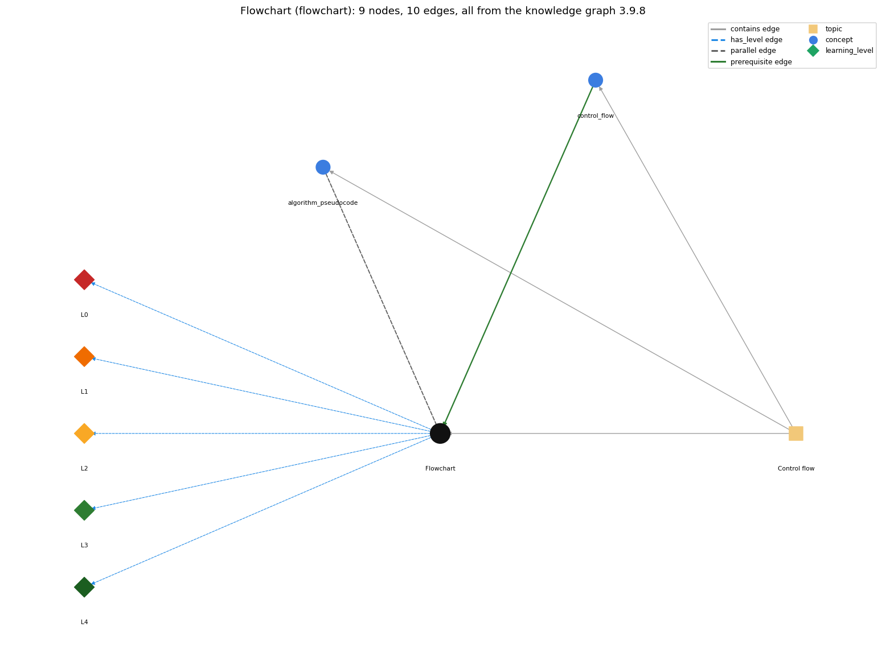

# Flowchart (`flowchart`)

a diagram whose paths correspond to the flow-of-control paths through a program

Section 1.3 1.3 Conditionals and Loops, topic 1.3.a Control flow. From the knowledge graph 3.9.8 (`data/raw/chapter1_kg_updated.json`).

## Concepts associated with flowchart (2)

| Concept | Description | How it is associated |
| --- | --- | --- |
| **algorithm\_pseudocode** | an algorithm is a sequence of steps that solves a problem; pseudocode outlines it in English and Java before it is coded | parallel concept composition rule (R) with it same topic (topic1.3.a) |
| **control\_flow** | the order in which statements are executed | prerequisite of it (it needs this) composition rule (R) with it same topic (topic1.3.a) |

## Every edge in this view and its full label (10)

| From | Edge | To | Full edge label |
| --- | --- | --- | --- |
| **control\_flow** | prerequisite | **flowchart** | A flowchart draws the flow of control: each path through the diagram is a path the program can take. grounding: book\_passage composition rule (R) of control\_flow with flowchart: A flowchart draws control flow: each path through the diagram is a possible path of execution, with a decision box for each if or loop test. composition rule (R) of flowchart with control\_flow: The flowchart's arrows are the program's control flow: sequence = a straight chain, if = branch and rejoin, loop = a back arrow to the test. Nesting a loop draws a loop inside a loop, and the diagram quickly becomes complex. |
| **algorithm\_pseudocode** | parallel | **flowchart** | Both describe an algorithm before it is code: a flowchart draws the flow of control as boxes and arrows, pseudocode writes the steps as English and Java text. grounding: book\_passage composition rule (R) of algorithm\_pseudocode with flowchart: A flowchart and pseudocode describe the same algorithm: one as a diagram of the flow of control, the other as text. |
| **flowchart** | has\_level | **flowchart@L0** | Flowchart -&gt; L0 (Prestructural): the answer holds a rule that contradicts Java (1 way). **[0] everyday\_reading** (E): Folk meaning: an everyday flowchart is a static picture or a decision tree read top to bottom once, so a novice reads a loop-back arrow as decoration and the diamond as a one-time question. In a program flowchart, each path is a possible execution, and an arrow returning to a diamond means the test is evaluated again. |
| **flowchart** | has\_level | **flowchart@L1** | Flowchart -&gt; L1 (Unistructural): the answer states one correct rule without applying it (2 ways). **[0] names\_the\_element** (N): Diagram: a flowchart is a diagram of control flow. Boxes are statements, diamonds are boolean tests with yes/no exits, and arrows show the order of execution. **[1] states\_the\_rule** (S): Every path through the flowchart corresponds to a flow-of-control path through the program. An if is a diamond whose branches rejoin; a while is a diamond whose yes branch runs the body and returns to the diamond. |
| **flowchart** | has\_level | **flowchart@L2** | Flowchart -&gt; L2 (Multistructural): the answer applies the rules of Flowchart to every part of the code, in order (3 ways). **[0] line\_by\_line\_trace** (LT): Execution order: start at the entry; execute each box when reached; at a diamond evaluate the condition and follow the yes or no arrow; follow back arrows to re-test; stop at the exit. **[1] output\_prediction** (OP): The result of reading a flowchart for given inputs is the path taken (the sequence of boxes and branch choices) and so the output. For \`if (x &gt; y) max = x; else max = y;\` with x = 2, y = 5, the path goes to the no branch and sets max = 5. **[2] one\_step\_execution** (OS): One step moves along one arrow: either execute one box (changing the variables it assigns) or evaluate one diamond (changing nothing, choosing yes or no). |
| **flowchart** | has\_level | **flowchart@L3** | Flowchart -&gt; L3 (Relational): the answer relates the parts (3 ways). **[0] relation\_to\_neighbour** (R): The flowchart's arrows are the program's control flow: sequence = a straight chain, if = branch and rejoin, loop = a back arrow to the test. Nesting a loop draws a loop inside a loop, and the diagram quickly becomes complex. **[1] relation\_to\_neighbour** (R): Both describe an algorithm before it is code: a flowchart draws the flow of control as boxes and arrows, pseudocode writes the steps as English and Java text. **[2] purpose\_of\_the\_whole** (P): Purpose: to visualise and understand the control flow of basic building blocks (if, while, for) and to check where each path leads. It is not a way to design whole modern programs. |
| **flowchart** | has\_level | **flowchart@L4** | Flowchart -&gt; L4 (Extended abstract): the answer reasons beyond the given code (4 ways). **[0] predict\_a\_change** (C): Moving the back arrow from the diamond to the body box changes a while into a do-while (test after). Removing the back arrow turns the loop into an if. Swapping the yes and no labels swaps the branches. **[1] transfer\_to\_a\_new\_program** (X): Use a flowchart to understand a single if, while, for or a small nesting. For larger programs, use indentation, traces and a limited set of structured constructs instead: flowcharts of complex control flow are hard to read. **[2] diagnose\_an\_error** (D): rule broken: A loop's back arrow must return to the test, not straight to the body. Kind: silent logic error. Trigger class: Drawing or tracing the while body as repeating without re-checking the diamond: the body runs again after the condition is false. **[3] diagnose\_an\_error** (D): rule broken: A diamond must have both yes and no exits. Kind: silent logic error. Trigger class: Omitting the no path (e.g. for an if without else, or a loop exit): the diagram has no path for the false case. |
| **topic1.3.a** | contains | **algorithm\_pseudocode** | topic topic1.3.a contains algorithm\_pseudocode |
| **topic1.3.a** | contains | **control\_flow** | topic topic1.3.a contains control\_flow |
| **topic1.3.a** | contains | **flowchart** | topic topic1.3.a contains flowchart |
