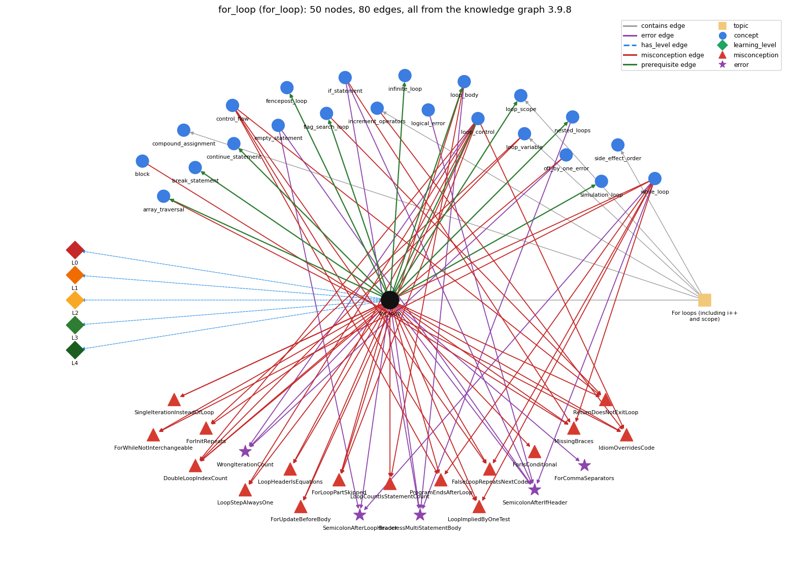

# for_loop (`for_loop`)

a while with init/condition/update packaged together

Section 1.3 Conditionals and Loops, topic 1.3.d For loops (including i++ and scope).

## At a glance

- **Needs first:** `loop_control`
- **Leads to:** `array_traversal`, `break_statement`, `continue_statement`, `fencepost_loop`, `flag_search_loop`, `infinite_loop`, `loop_body`, `loop_scope`, `nested_loops`, `simulation_loop`
- **Learned alongside:** nothing
- **Misconceptions:** `DoubleLoopIndexCount`, `FalseLoopRepeatsNextCode`, `ForInitRepeats`, `ForIsConditional`, `ForLoopPartSkipped`, `ForUpdateBeforeBody`, `ForWhileNotInterchangeable`, `IdiomOverridesCode`, `LoopCountIsStatementCount`, `LoopHeaderIsEquations`, `LoopImpliedByOneTest`, `LoopStepAlwaysOne`, `MissingBraces`, `ProgramEndsAfterLoop`, `ReturnDoesNotExitLoop`, `SingleIterationInsteadOfLoop`
- **Errors:** `BracelessMultiStatementBody`, `ForCommaSeparators`, `SemicolonAfterIfHeader`, `SemicolonAfterLoopHeader`, `WrongIterationCount`
- **Levels:** L0, L1, L2, L3, L4

Everything below comes from the knowledge graph 3.9.8 (`data/raw/chapter1_kg_updated.json`): 80 edges around this concept. The edge logic, the wrong and right rules and the exact rules of the ways are copied word for word from the graph.

## To work on (1)

- misconceptions with no L0 way linked to them: MissingBraces, ReturnDoesNotExitLoop, SingleIterationInsteadOfLoop

## What it needs first (1)

A prerequisite edge means the other concept has to be understood before `for_loop`.

### `loop_control` comes before `for_loop`

*the three slots: init ; condition ; update*

- **Edge:** `pre:loop_control->for_loop`
- **Exact edge logic:** The for header is exactly the three control slots, and the body runs after the test and before the update on each pass.
- **Grounding:** book\_passage
- **Composition rule (R) of `for_loop` with `loop_control`:** The for header is exactly the three loop-control slots; the body runs after the test and before the update on each pass.
- **Composition rule (R) of `loop_control` with `for_loop`:** The for header is exactly the three control slots, separated by semicolons; the body runs after the test and before the update.

## What it leads to (10)

These concepts need `for_loop` first.

### `for_loop` comes before `array_traversal`

*walking the array with an index loop*

- **Edge:** `pre:for_loop->array_traversal`
- **Exact edge logic:** for (int i = 0; i &lt; a.length; i++) gives i every valid index exactly once, in increasing order.
- **Grounding:** book\_passage
- **Composition rule (R) of `for_loop` with `array_traversal`:** for (int i = 0; i &lt; N; i++) gives i each valid index 0..N-1 exactly once in increasing order, the standard way to process every array element.
- **Composition rule (R) of `array_traversal` with `for_loop`:** for (int i = 0; i &lt; a.length; i++) gives i every valid index exactly once, in increasing order; the bound must be &lt; a.length, not &lt;=.

### `for_loop` comes before `break_statement`

*break -- immediately exits the innermost loop or switch*

- **Edge:** `pre:for_loop->break_statement`
- **Exact edge logic:** break leaves the for loop at once, without running the rest of the body or the remaining passes.
- **Grounding:** book\_passage

### `for_loop` comes before `continue_statement`

*continue -- skips to the next iteration of the innermost loop*

- **Edge:** `pre:for_loop->continue_statement`
- **Exact edge logic:** continue skips the rest of the loop body; in a for loop control goes straight to the increment statement and then the next test.
- **Grounding:** book\_passage
- **Composition rule (R) of `for_loop` with `continue_statement`:** In a for loop, continue skips the rest of the body and transfers control directly to the increment, then the next test; this is one of the few places where the for/while equivalence fails.
- **Composition rule (R) of `continue_statement` with `for_loop`:** In a for loop the increment still runs after continue, so the loop always advances. This is why the for/while equivalence has an exception: in the rewritten while, a continue jumps past the \`&lt;increment&gt;;\` at the end of the body.

### `for_loop` comes before `fencepost_loop`

*n items need n - 1 separators: one item handled outside the loop*

- **Edge:** `pre:for_loop->fencepost_loop`
- **Exact edge logic:** A fencepost loop is a for loop with one item handled outside it.
- **Grounding:** questionable
- **Composition rule (R) of `for_loop` with `fencepost_loop`:** A fencepost loop is a for loop that handles one item (the first or last) outside the loop so that separators come out n-1 times for n items.
- **Composition rule (R) of `fencepost_loop` with `for_loop`:** The for loop's bounds must match the handled-outside item: if a[0] is printed before the loop, the loop must start at \`i = 1\`. Starting at 0 duplicates the first item, and \`i &lt;= n\` runs past the end.

### `for_loop` comes before `flag_search_loop`

*a boolean flag that a loop sets once and never resets*

- **Edge:** `pre:for_loop->flag_search_loop`
- **Exact edge logic:** A flag search loop sets a boolean flag inside a loop when a pass finds the condition, and leaves it set afterwards.
- **Grounding:** questionable
- **Composition rule (R) of `for_loop` with `flag_search_loop`:** A flag search loop is a for loop that sets a boolean flag when some pass finds the target and leaves it set afterwards; the flag must be declared before the loop.
- **Composition rule (R) of `flag_search_loop` with `for_loop`:** The flag must be declared before the for loop to be visible after it. The for loop's test can include \`!found\` to stop at the first find; without that, the loop runs all passes, and the flag still works because it is one-way.

### `for_loop` comes before `infinite_loop`

*a loop whose condition never becomes false*

- **Edge:** `pre:for_loop->infinite_loop`
- **Exact edge logic:** A for loop whose condition never becomes false (or is left out) repeats forever unless a break ends it.
- **Grounding:** spec\_passage

### `for_loop` comes before `loop_body`

*the block repeated each pass*

- **Edge:** `pre:for_loop->loop_body`
- **Exact edge logic:** The statements in braces after the for header are the loop body; they run once on every pass, between the test and the increment, exactly as in a while loop.
- **Grounding:** book\_passage

### `for_loop` comes before `loop_scope`

*lifetime/scope of variables in/around the loop*

- **Edge:** `pre:for_loop->loop_scope`
- **Exact edge logic:** A variable declared in the for header exists only from its declaration to the end of the for statement's block.
- **Grounding:** book\_passage
- **Composition rule (R) of `for_loop` with `loop_scope`:** A variable declared in the for header is in scope only in the header and the body, so it cannot be used after the loop.
- **Composition rule (R) of `loop_scope` with `for_loop`:** A variable declared in the for header exists only from its declaration to the end of the for statement, so for and while versions differ: in the while version the counter is still available after the loop.

### `for_loop` comes before `nested_loops`

*a loop inside a loop*

- **Edge:** `pre:for_loop->nested_loops`
- **Exact edge logic:** In nested loops the inner for runs its complete set of passes for every single pass of the outer for.
- **Grounding:** book\_passage
- **Composition rule (R) of `for_loop` with `nested_loops`:** A for may be the body of another for: the inner for runs its complete set of passes for every single pass of the outer one.
- **Composition rule (R) of `nested_loops` with `for_loop`:** Usually both loops are for loops: the inner for runs its complete set of passes for every single pass of the outer for.

### `for_loop` comes before `simulation_loop`

*take many random steps*

- **Edge:** `pre:for_loop->simulation_loop`
- **Exact edge logic:** The simulation is a for loop over t = 0 ... T - 1 that makes one random move per pass.
- **Grounding:** book\_passage
- **Composition rule (R) of `for_loop` with `simulation_loop`:** A simulation runs a fixed number of trials with an outer for loop (for (int t = 0; t &lt; T; t++)), each trial simulated inside the body.
- **Composition rule (R) of `simulation_loop` with `for_loop`:** A counted for loop with t &lt; T fixes the number of moves at T; the loop variable t is scoped to the loop.

## Learned alongside (0)

A parallel edge joins two concepts that sit side by side: neither is needed before the other.

No parallel edge touches this concept.

## Misconceptions (16)

A misconception edge states the wrong rule a student may hold about this concept, and the right rule.

### DoubleLoopIndexCount

- **Edge:** `for_loop` &rarr; `DoubleLoopIndexCount` (misconception)
- **Exact edge logic (the wrong rule):** for (double x = 0.0; x &lt;= 1.0; x += 0.1) runs exactly 11 times.
- **Twin logic (the right rule):** Using a double as a for-loop index is legal but bad practice: the number of iterations depends on an equality test between double values, which may not give the result you expect.
- **Wrong belief (on the node):** for (double x = 0.0; x &lt;= 1.0; x += 0.1) runs exactly 11 times.
- **Correct rule (on the node):** Using a double as a for-loop index is legal but bad practice: the number of iterations depends on an equality test between double values, which may not give the result you expect.
- **Provenance:** textbook
- **Role of this concept:** primary
- **L0 way linked to it:** yes
- **L0 way [2] misconception, exact rule:** wrong rule: for (double x = 0.0; x &lt;= 1.0; x += 0.1) runs exactly 11 times. Right rule: Using a double as a for-loop index is legal but bad practice: the number of iterations depends on an equality test between double values, which may not give the result you expect.
- **Edge `loop_control` &rarr; `DoubleLoopIndexCount`, exact edge logic:** for (double x = 0.0; x &lt;= 1.0; x += 0.1) runs exactly 11 times. **Twin logic:** Using a double as a for-loop index is legal but bad practice: the number of iterations depends on an equality test between double values, which may not give the result you expect. (role: context)
- **Edge `loop_variable` &rarr; `DoubleLoopIndexCount`, exact edge logic:** for (double x = 0.0; x &lt;= 1.0; x += 0.1) runs exactly 11 times. **Twin logic:** Using a double as a for-loop index is legal but bad practice: the number of iterations depends on an equality test between double values, which may not give the result you expect. (role: context)
- **Edge `off_by_one_error` &rarr; `DoubleLoopIndexCount`, exact edge logic:** for (double x = 0.0; x &lt;= 1.0; x += 0.1) runs exactly 11 times. **Twin logic:** Using a double as a for-loop index is legal but bad practice: the number of iterations depends on an equality test between double values, which may not give the result you expect. (role: context)

### FalseLoopRepeatsNextCode

- **Edge:** `for_loop` &rarr; `FalseLoopRepeatsNextCode` (misconception)
- **Exact edge logic (the wrong rule):** A loop is an iterative if-else: while the condition is true the body repeats, and when it is false the code after the loop repeats.
- **Twin logic (the right rule):** Only the body is repeated; once the condition is false the code after the loop runs once.
- **Wrong belief (on the node):** A loop is an iterative if-else: while the condition is true the body repeats, and when it is false the code after the loop repeats.
- **Correct rule (on the node):** Only the body is repeated; once the condition is false the code after the loop runs once.
- **Provenance:** published
- **Role of this concept:** primary
- **L0 way linked to it:** yes
- **L0 way [6] misconception, exact rule:** wrong rule: A loop is an iterative if-else: while the condition is true the body repeats, and when it is false the code after the loop repeats. Right rule: Only the body is repeated; once the condition is false the code after the loop runs once.
- **Edge `control_flow` &rarr; `FalseLoopRepeatsNextCode`, exact edge logic:** A loop is an iterative if-else: while the condition is true the body repeats, and when it is false the code after the loop repeats. **Twin logic:** Only the body is repeated; once the condition is false the code after the loop runs once. (role: context)
- **Edge `while_loop` &rarr; `FalseLoopRepeatsNextCode`, exact edge logic:** A loop is an iterative if-else: while the condition is true the body repeats, and when it is false the code after the loop repeats. **Twin logic:** Only the body is repeated; once the condition is false the code after the loop runs once. (role: context)

### ForInitRepeats

- **Edge:** `for_loop` &rarr; `ForInitRepeats` (misconception)
- **Exact edge logic (the wrong rule):** The initialization of a for loop runs again after a pass of the body.
- **Twin logic (the right rule):** The initialization runs exactly once, before the first condition test.
- **Wrong belief (on the node):** The initialization of a for loop runs again after a pass of the body.
- **Correct rule (on the node):** The initialization runs exactly once, before the first condition test.
- **Provenance:** published
- **Role of this concept:** primary
- **L0 way linked to it:** yes
- **L0 way [8] misconception, exact rule:** wrong rule: The initialization of a for loop runs again after a pass of the body. Right rule: The initialization runs exactly once, before the first condition test.
- **Edge `loop_variable` &rarr; `ForInitRepeats`, exact edge logic:** The initialization of a for loop runs again after a pass of the body. **Twin logic:** The initialization runs exactly once, before the first condition test. (role: context)

### ForIsConditional

- **Edge:** `for_loop` &rarr; `ForIsConditional` (misconception)
- **Exact edge logic (the wrong rule):** The body of a for statement executes at most once.
- **Twin logic (the right rule):** The body of a for statement runs once for every pass on which the condition is true, which can be many times.
- **Wrong belief (on the node):** The body of a for statement executes at most once.
- **Correct rule (on the node):** The body of a for statement runs once for every pass on which the condition is true, which can be many times.
- **Provenance:** published
- **Role of this concept:** primary
- **L0 way linked to it:** yes
- **L0 way [1] misconception, exact rule:** wrong rule: The body of a for statement executes at most once. Right rule: The body of a for statement runs once for every pass on which the condition is true, which can be many times.
- **L0 way [11] inconsistent\_trace, exact rule:** Applies the for sequencing rule (LT) unevenly: updates before the body on the first pass only, re-runs the init after a pass, or skips the test on some passes. (here mixing in: "The body of a for statement executes at most once")

### ForLoopPartSkipped

- **Edge:** `for_loop` &rarr; `ForLoopPartSkipped` (misconception)
- **Exact edge logic (the wrong rule):** A pass of a loop may leave out one of its parts (the condition test, the body, the update, or the initialization).
- **Twin logic (the right rule):** Each pass of a for loop runs test, then body, then update, every time; the initialization runs once, at the start.
- **Wrong belief (on the node):** A pass of a loop may leave out one of its parts (the condition test, the body, the update, or the initialization).
- **Correct rule (on the node):** Each pass of a for loop runs test, then body, then update, every time; the initialization runs once, at the start.
- **Provenance:** published
- **Role of this concept:** primary
- **L0 way linked to it:** yes
- **L0 way [7] misconception, exact rule:** wrong rule: A pass of a loop may leave out one of its parts (the condition test, the body, the update, or the initialization). Right rule: Each pass of a for loop runs test, then body, then update, every time; the initialization runs once, at the start.
- **Edge `loop_body` &rarr; `ForLoopPartSkipped`, exact edge logic:** A pass of a loop may leave out one of its parts (the condition test, the body, the update, or the initialization). **Twin logic:** Each pass of a for loop runs test, then body, then update, every time; the initialization runs once, at the start. (role: context)
- **Edge `loop_control` &rarr; `ForLoopPartSkipped`, exact edge logic:** A pass of a loop may leave out one of its parts (the condition test, the body, the update, or the initialization). **Twin logic:** Each pass of a for loop runs test, then body, then update, every time; the initialization runs once, at the start. (role: context)

### ForUpdateBeforeBody

- **Edge:** `for_loop` &rarr; `ForUpdateBeforeBody` (misconception)
- **Exact edge logic (the wrong rule):** The update part of a for header (e.g. i = i - 4) runs before the body on each pass, so the first pass already sees the updated value.
- **Twin logic (the right rule):** The update runs after the body, before the next condition test; the first pass uses the initial value.
- **Wrong belief (on the node):** The update part of a for header (e.g. i = i - 4) runs before the body on each pass, so the first pass already sees the updated value.
- **Correct rule (on the node):** The update runs after the body, before the next condition test; the first pass uses the initial value.
- **Provenance:** published
- **Role of this concept:** primary
- **L0 way linked to it:** yes
- **L0 way [9] misconception, exact rule:** wrong rule: The update part of a for header (e.g. i = i - 4) runs before the body on each pass, so the first pass already sees the updated value. Right rule: The update runs after the body, before the next condition test; the first pass uses the initial value.
- **Edge `loop_control` &rarr; `ForUpdateBeforeBody`, exact edge logic:** The update part of a for header (e.g. i = i - 4) runs before the body on each pass, so the first pass already sees the updated value. **Twin logic:** The update runs after the body, before the next condition test; the first pass uses the initial value. (role: context)

### ForWhileNotInterchangeable

- **Edge:** `for_loop` &rarr; `ForWhileNotInterchangeable` (misconception)
- **Exact edge logic (the wrong rule):** Some loops can only be written with for, others only with while.
- **Twin logic (the right rule):** Any for loop can be rewritten as a while loop and vice versa; for just packages init, test and update.
- **Wrong belief (on the node):** Some loops can only be written with for, others only with while.
- **Correct rule (on the node):** Any for loop can be rewritten as a while loop and vice versa; for just packages init, test and update.
- **Provenance:** textbook
- **Role of this concept:** primary
- **L0 way linked to it:** yes
- **L0 way [3] misconception, exact rule:** wrong rule: Some loops can only be written with for, others only with while. Right rule: Any for loop can be rewritten as a while loop and vice versa; for just packages init, test and update.
- **Edge `while_loop` &rarr; `ForWhileNotInterchangeable`, exact edge logic:** Some loops can only be written with for, others only with while. **Twin logic:** Any for loop can be rewritten as a while loop and vice versa; for just packages init, test and update. (role: context)

### IdiomOverridesCode

- **Edge:** `for_loop` &rarr; `IdiomOverridesCode` (misconception)
- **Exact edge logic (the wrong rule):** An array loop processes the whole array from index 0 to length-1 and increments its index at the end of the body, whatever the code says.
- **Twin logic (the right rule):** The loop visits exactly the indices that its initialisation, guard and update produce, in the order in which its statements are written.
- **Wrong belief (on the node):** An array loop processes the whole array from index 0 to length-1 and increments its index at the end of the body, whatever the code says.
- **Correct rule (on the node):** The loop visits exactly the indices that its initialisation, guard and update produce, in the order in which its statements are written.
- **Provenance:** published
- **Role of this concept:** context
- **L0 way linked to it:** yes
- **L0 way [13] misconception, exact rule:** wrong rule: An array loop processes the whole array from index 0 to length-1 and increments its index at the end of the body, whatever the code says. Right rule: The loop visits exactly the indices that its initialisation, guard and update produce, in the order in which its statements are written.
- **Edge `array_traversal` &rarr; `IdiomOverridesCode`, exact edge logic:** An array loop processes the whole array from index 0 to length-1 and increments its index at the end of the body, whatever the code says. **Twin logic:** The loop visits exactly the indices that its initialisation, guard and update produce, in the order in which its statements are written. (role: primary)
- **Edge `increment_operators` &rarr; `IdiomOverridesCode`, exact edge logic:** An array loop processes the whole array from index 0 to length-1 and increments its index at the end of the body, whatever the code says. **Twin logic:** The loop visits exactly the indices that its initialisation, guard and update produce, in the order in which its statements are written. (role: context)
- **Edge `loop_control` &rarr; `IdiomOverridesCode`, exact edge logic:** An array loop processes the whole array from index 0 to length-1 and increments its index at the end of the body, whatever the code says. **Twin logic:** The loop visits exactly the indices that its initialisation, guard and update produce, in the order in which its statements are written. (role: context)

### LoopCountIsStatementCount

- **Edge:** `for_loop` &rarr; `LoopCountIsStatementCount` (misconception)
- **Exact edge logic (the wrong rule):** The repeat count of a counted loop says how many of the body statements are executed.
- **Twin logic (the right rule):** The repeat count is how many times the whole body runs; every pass runs all body statements.
- **Wrong belief (on the node):** The repeat count of a counted loop says how many of the body statements are executed.
- **Correct rule (on the node):** The repeat count is how many times the whole body runs; every pass runs all body statements.
- **Provenance:** published
- **Role of this concept:** primary
- **L0 way linked to it:** yes
- **L0 way [5] misconception, exact rule:** wrong rule: The repeat count of a counted loop says how many of the body statements are executed. Right rule: The repeat count is how many times the whole body runs; every pass runs all body statements.
- **Edge `loop_body` &rarr; `LoopCountIsStatementCount`, exact edge logic:** The repeat count of a counted loop says how many of the body statements are executed. **Twin logic:** The repeat count is how many times the whole body runs; every pass runs all body statements. (role: context)

### LoopHeaderIsEquations

- **Edge:** `for_loop` &rarr; `LoopHeaderIsEquations` (misconception)
- **Exact edge logic (the wrong rule):** The initialization, condition and update of a for header are equations that all hold at the same time.
- **Twin logic (the right rule):** The three header parts are statements run at different moments: init once, then condition test, body, update, repeated.
- **Wrong belief (on the node):** The initialization, condition and update of a for header are equations that all hold at the same time.
- **Correct rule (on the node):** The three header parts are statements run at different moments: init once, then condition test, body, update, repeated.
- **Provenance:** published
- **Role of this concept:** primary
- **L0 way linked to it:** yes
- **L0 way [4] misconception, exact rule:** wrong rule: The initialization, condition and update of a for header are equations that all hold at the same time. Right rule: The three header parts are statements run at different moments: init once, then condition test, body, update, repeated.
- **Edge `loop_control` &rarr; `LoopHeaderIsEquations`, exact edge logic:** The initialization, condition and update of a for header are equations that all hold at the same time. **Twin logic:** The three header parts are statements run at different moments: init once, then condition test, body, update, repeated. (role: context)

### LoopImpliedByOneTest

- **Edge:** `for_loop` &rarr; `LoopImpliedByOneTest` (misconception)
- **Exact edge logic (the wrong rule):** Testing one case is enough; Java will repeat the test for the other values by itself.
- **Twin logic (the right rule):** A statement runs once each time control reaches it; repeating a test for many values needs a loop.
- **Wrong belief (on the node):** Testing one case is enough; Java will repeat the test for the other values by itself.
- **Correct rule (on the node):** A statement runs once each time control reaches it; repeating a test for many values needs a loop.
- **Provenance:** published
- **Role of this concept:** context
- **L0 way linked to it:** yes
- **L0 way [12] misconception, exact rule:** wrong rule: Testing one case is enough; Java will repeat the test for the other values by itself. Right rule: A statement runs once each time control reaches it; repeating a test for many values needs a loop.
- **Edge `control_flow` &rarr; `LoopImpliedByOneTest`, exact edge logic:** Testing one case is enough; Java will repeat the test for the other values by itself. **Twin logic:** A statement runs once each time control reaches it; repeating a test for many values needs a loop. (role: context)
- **Edge `while_loop` &rarr; `LoopImpliedByOneTest`, exact edge logic:** Testing one case is enough; Java will repeat the test for the other values by itself. **Twin logic:** A statement runs once each time control reaches it; repeating a test for many values needs a loop. (role: primary)

### LoopStepAlwaysOne

- **Edge:** `for_loop` &rarr; `LoopStepAlwaysOne` (misconception)
- **Exact edge logic (the wrong rule):** A loop variable always goes up or down by 1, whatever the update says (so i = i - 4 is read as i--).
- **Twin logic (the right rule):** The loop variable changes exactly as the update expression says (i += 2, i = i - 4, i \*= 2, ...).
- **Wrong belief (on the node):** A loop variable always goes up or down by 1, whatever the update says (so i = i - 4 is read as i--).
- **Correct rule (on the node):** The loop variable changes exactly as the update expression says (i += 2, i = i - 4, i \*= 2, ...).
- **Provenance:** published
- **Role of this concept:** primary
- **L0 way linked to it:** yes
- **L0 way [10] misconception, exact rule:** wrong rule: A loop variable always goes up or down by 1, whatever the update says (so i = i - 4 is read as i--). Right rule: The loop variable changes exactly as the update expression says (i += 2, i = i - 4, i \*= 2, ...).
- **Edge `loop_control` &rarr; `LoopStepAlwaysOne`, exact edge logic:** A loop variable always goes up or down by 1, whatever the update says (so i = i - 4 is read as i--). **Twin logic:** The loop variable changes exactly as the update expression says (i += 2, i = i - 4, i \*= 2, ...). (role: context)

### MissingBraces

- **Edge:** `for_loop` &rarr; `MissingBraces` (misconception)
- **Exact edge logic (the wrong rule):** Omits braces around a single-statement body of if, for or while.
- **Twin logic (the right rule):** Braces are optional for a single-statement body, but using them anyway avoids bugs when statements are added later.
- **Wrong belief (on the node):** Omits braces around a single-statement body of if, for or while.
- **Correct rule (on the node):** Braces are optional for a single-statement body, but using them anyway avoids bugs when statements are added later.
- **Provenance:** rule\_dictionary
- **Role of this concept:** context
- **L0 way linked to it:** no
- **Edge `block` &rarr; `MissingBraces`, exact edge logic:** Omits braces around a single-statement body of if, for or while. **Twin logic:** Braces are optional for a single-statement body, but using them anyway avoids bugs when statements are added later. (role: context)
- **Edge `if_statement` &rarr; `MissingBraces`, exact edge logic:** Omits braces around a single-statement body of if, for or while. **Twin logic:** Braces are optional for a single-statement body, but using them anyway avoids bugs when statements are added later. (role: primary)
- **Edge `while_loop` &rarr; `MissingBraces`, exact edge logic:** Omits braces around a single-statement body of if, for or while. **Twin logic:** Braces are optional for a single-statement body, but using them anyway avoids bugs when statements are added later. (role: context)

### ProgramEndsAfterLoop

- **Edge:** `for_loop` &rarr; `ProgramEndsAfterLoop` (misconception)
- **Exact edge logic (the wrong rule):** When a loop finishes the program ends, so code after the loop never runs.
- **Twin logic (the right rule):** When the loop condition becomes false, control continues with the first statement after the loop.
- **Wrong belief (on the node):** When a loop finishes the program ends, so code after the loop never runs.
- **Correct rule (on the node):** When the loop condition becomes false, control continues with the first statement after the loop.
- **Provenance:** published
- **Role of this concept:** context
- **L0 way linked to it:** yes
- **L0 way [14] misconception, exact rule:** wrong rule: When a loop finishes the program ends, so code after the loop never runs. Right rule: When the loop condition becomes false, control continues with the first statement after the loop.
- **Edge `control_flow` &rarr; `ProgramEndsAfterLoop`, exact edge logic:** When a loop finishes the program ends, so code after the loop never runs. **Twin logic:** When the loop condition becomes false, control continues with the first statement after the loop. (role: context)
- **Edge `while_loop` &rarr; `ProgramEndsAfterLoop`, exact edge logic:** When a loop finishes the program ends, so code after the loop never runs. **Twin logic:** When the loop condition becomes false, control continues with the first statement after the loop. (role: primary)

### ReturnDoesNotExitLoop

- **Edge:** `for_loop` &rarr; `ReturnDoesNotExitLoop` (misconception)
- **Exact edge logic (the wrong rule):** A return inside a loop does not end the loop; it sets a value each pass (the last one is returned) or returns several values.
- **Twin logic (the right rule):** When return executes, the method ends at once, so the loop stops on that pass.
- **Wrong belief (on the node):** A return inside a loop does not end the loop; it sets a value each pass (the last one is returned) or returns several values.
- **Correct rule (on the node):** When return executes, the method ends at once, so the loop stops on that pass.
- **Provenance:** published
- **Role of this concept:** context
- **L0 way linked to it:** no
- **Edge `control_flow` &rarr; `ReturnDoesNotExitLoop`, exact edge logic:** A return inside a loop does not end the loop; it sets a value each pass (the last one is returned) or returns several values. **Twin logic:** When return executes, the method ends at once, so the loop stops on that pass. (role: primary)
- **Edge `flag_search_loop` &rarr; `ReturnDoesNotExitLoop`, exact edge logic:** A return inside a loop does not end the loop; it sets a value each pass (the last one is returned) or returns several values. **Twin logic:** When return executes, the method ends at once, so the loop stops on that pass. (role: context)

### SingleIterationInsteadOfLoop

- **Edge:** `for_loop` &rarr; `SingleIterationInsteadOfLoop` (misconception)
- **Exact edge logic (the wrong rule):** A task that must be repeated is written once, without a loop, as if one pass were enough.
- **Twin logic (the right rule):** A step that must happen several times (or an unknown number of times) needs a loop such as while or for; code without a loop runs once.
- **Wrong belief (on the node):** A task that must be repeated is written once, without a loop, as if one pass were enough.
- **Correct rule (on the node):** A step that must happen several times (or an unknown number of times) needs a loop such as while or for; code without a loop runs once.
- **Provenance:** published
- **Role of this concept:** context
- **L0 way linked to it:** no
- **Edge `while_loop` &rarr; `SingleIterationInsteadOfLoop`, exact edge logic:** A task that must be repeated is written once, without a loop, as if one pass were enough. **Twin logic:** A step that must happen several times (or an unknown number of times) needs a loop such as while or for; code without a loop runs once. (role: primary)

## Errors (5)

An error edge states the rule that gets broken in a program, and the right rule.

### BracelessMultiStatementBody

- **Edge:** `for_loop` &rarr; `BracelessMultiStatementBody` (error)
- **Exact edge logic (the wrong rule):** Indenting several statements under an if or for makes them all part of its body, even without braces.
- **Twin logic (the right rule):** Without braces only the first statement belongs to the if/for; the rest run once, after it.
- **Wrong belief (on the node):** Indenting several statements under an if or for makes them all part of its body, even without braces.
- **Correct rule (on the node):** Without braces only the first statement belongs to the if/for; the rest run once, after it.
- **Provenance:** textbook
- **Role of this concept:** context
- **Edge `if_statement` &rarr; `BracelessMultiStatementBody`, exact edge logic:** Indenting several statements under an if or for makes them all part of its body, even without braces. **Twin logic:** Without braces only the first statement belongs to the if/for; the rest run once, after it. (role: context)
- **Edge `loop_body` &rarr; `BracelessMultiStatementBody`, exact edge logic:** Indenting several statements under an if or for makes them all part of its body, even without braces. **Twin logic:** Without braces only the first statement belongs to the if/for; the rest run once, after it. (role: primary)
- **Edge `nested_loops` &rarr; `BracelessMultiStatementBody`, exact edge logic:** Indenting several statements under an if or for makes them all part of its body, even without braces. **Twin logic:** Without braces only the first statement belongs to the if/for; the rest run once, after it. (role: context)

### ForCommaSeparators

- **Edge:** `for_loop` &rarr; `ForCommaSeparators` (error)
- **Exact edge logic (the wrong rule):** Writes for (int i = 0, i &lt; n, i++).
- **Twin logic (the right rule):** The three parts of a for header are separated by semicolons; commas only separate several statements inside the init or the update part.
- **Wrong belief (on the node):** Writes for (int i = 0, i &lt; n, i++).
- **Correct rule (on the node):** The three parts of a for header are separated by semicolons; commas only separate several statements inside the init or the update part.
- **Provenance:** published
- **Role of this concept:** primary

### SemicolonAfterIfHeader

- **Edge:** `for_loop` &rarr; `SemicolonAfterIfHeader` (error)
- **Exact edge logic (the wrong rule):** if (x &gt; 0); System.out.println("positive"); prints only for positive x.
- **Twin logic (the right rule):** The ; ends the if with an empty statement, so the next line always runs.
- **Wrong belief (on the node):** if (x &gt; 0); System.out.println("positive"); prints only for positive x.
- **Correct rule (on the node):** The ; ends the if with an empty statement, so the next line always runs.
- **Provenance:** published
- **Role of this concept:** context
- **Edge `empty_statement` &rarr; `SemicolonAfterIfHeader`, exact edge logic:** if (x &gt; 0); System.out.println("positive"); prints only for positive x. **Twin logic:** The ; ends the if with an empty statement, so the next line always runs. (role: context)
- **Edge `if_statement` &rarr; `SemicolonAfterIfHeader`, exact edge logic:** if (x &gt; 0); System.out.println("positive"); prints only for positive x. **Twin logic:** The ; ends the if with an empty statement, so the next line always runs. (role: primary)
- **Edge `logical_error` &rarr; `SemicolonAfterIfHeader`, exact edge logic:** if (x &gt; 0); System.out.println("positive"); prints only for positive x. **Twin logic:** The ; ends the if with an empty statement, so the next line always runs. (role: context)
- **Edge `while_loop` &rarr; `SemicolonAfterIfHeader`, exact edge logic:** if (x &gt; 0); System.out.println("positive"); prints only for positive x. **Twin logic:** The ; ends the if with an empty statement, so the next line always runs. (role: context)

### SemicolonAfterLoopHeader

- **Edge:** `for_loop` &rarr; `SemicolonAfterLoopHeader` (error)
- **Exact edge logic (the wrong rule):** Puts a ; right after for (...) or while (...).
- **Twin logic (the right rule):** A ; right after the loop header is a null (empty) loop body, so the statements written after it are not repeated by the loop.
- **Wrong belief (on the node):** Puts a ; right after for (...) or while (...).
- **Correct rule (on the node):** A ; right after the loop header is a null (empty) loop body, so the statements written after it are not repeated by the loop.
- **Provenance:** textbook
- **Role of this concept:** primary
- **Edge `empty_statement` &rarr; `SemicolonAfterLoopHeader`, exact edge logic:** Puts a ; right after for (...) or while (...). **Twin logic:** A ; right after the loop header is a null (empty) loop body, so the statements written after it are not repeated by the loop. (role: context)
- **Edge `while_loop` &rarr; `SemicolonAfterLoopHeader`, exact edge logic:** Puts a ; right after for (...) or while (...). **Twin logic:** A ; right after the loop header is a null (empty) loop body, so the statements written after it are not repeated by the loop. (role: context)

### WrongIterationCount

- **Edge:** `for_loop` &rarr; `WrongIterationCount` (error)
- **Exact edge logic (the wrong rule):** Updates the loop counter so that the loop runs the wrong number of times.
- **Twin logic (the right rule):** The init, test and update together decide the number of passes; trace them to check the count.
- **Wrong belief (on the node):** Updates the loop counter so that the loop runs the wrong number of times.
- **Correct rule (on the node):** The init, test and update together decide the number of passes; trace them to check the count.
- **Provenance:** published
- **Role of this concept:** primary
- **Edge `loop_control` &rarr; `WrongIterationCount`, exact edge logic:** Updates the loop counter so that the loop runs the wrong number of times. **Twin logic:** The init, test and update together decide the number of passes; trace them to check the count. (role: context)
- **Edge `off_by_one_error` &rarr; `WrongIterationCount`, exact edge logic:** Updates the loop counter so that the loop runs the wrong number of times. **Twin logic:** The init, test and update together decide the number of passes; trace them to check the count. (role: context)

## Levels L0 to L4 (5 of 5)

Each level edge lists the ways a student shows that level, each with its exact rule.

### L0: Prestructural / sensorimotor

L0 for for loop: the answer holds a rule that contradicts Java.

*Deciding question: Does every rule the answer applies to for loop agree with the language rule? If it reads the code with everyday meanings, applies a wrong rule, or switches rules within one trace, it is L0. A slip in an otherwise rule-correct trace is L2 with an error, not L0.*

- **Edge:** `for_loop` &rarr; `for_loop@L0` (has_level)
- **Exact edge logic:** for loop -&gt; L0 (Prestructural): the answer holds a rule that contradicts Java (15 ways).

Ways (15), each with its exact rule:

- **[0] everyday\_reading** (rule type E, folk-meaning rule): Folk meaning: English 'for each ...' or 'for 10 times' names a whole collection or a count to be handled at once, and a maths reading treats the header as simultaneous conditions. A Java for is a while loop in compact form: one init, then test-body-update repeated, one pass at a time.
- **[1] misconception** (rule type M, wrong rule / right rule) &rarr; `ForIsConditional`: wrong rule: The body of a for statement executes at most once. Right rule: The body of a for statement runs once for every pass on which the condition is true, which can be many times.
- **[2] misconception** (rule type M, wrong rule / right rule) &rarr; `DoubleLoopIndexCount`: wrong rule: for (double x = 0.0; x &lt;= 1.0; x += 0.1) runs exactly 11 times. Right rule: Using a double as a for-loop index is legal but bad practice: the number of iterations depends on an equality test between double values, which may not give the result you expect.
- **[3] misconception** (rule type M, wrong rule / right rule) &rarr; `ForWhileNotInterchangeable`: wrong rule: Some loops can only be written with for, others only with while. Right rule: Any for loop can be rewritten as a while loop and vice versa; for just packages init, test and update.
- **[4] misconception** (rule type M, wrong rule / right rule) &rarr; `LoopHeaderIsEquations`: wrong rule: The initialization, condition and update of a for header are equations that all hold at the same time. Right rule: The three header parts are statements run at different moments: init once, then condition test, body, update, repeated.
- **[5] misconception** (rule type M, wrong rule / right rule) &rarr; `LoopCountIsStatementCount`: wrong rule: The repeat count of a counted loop says how many of the body statements are executed. Right rule: The repeat count is how many times the whole body runs; every pass runs all body statements.
- **[6] misconception** (rule type M, wrong rule / right rule) &rarr; `FalseLoopRepeatsNextCode`: wrong rule: A loop is an iterative if-else: while the condition is true the body repeats, and when it is false the code after the loop repeats. Right rule: Only the body is repeated; once the condition is false the code after the loop runs once.
- **[7] misconception** (rule type M, wrong rule / right rule) &rarr; `ForLoopPartSkipped`: wrong rule: A pass of a loop may leave out one of its parts (the condition test, the body, the update, or the initialization). Right rule: Each pass of a for loop runs test, then body, then update, every time; the initialization runs once, at the start.
- **[8] misconception** (rule type M, wrong rule / right rule) &rarr; `ForInitRepeats`: wrong rule: The initialization of a for loop runs again after a pass of the body. Right rule: The initialization runs exactly once, before the first condition test.
- **[9] misconception** (rule type M, wrong rule / right rule) &rarr; `ForUpdateBeforeBody`: wrong rule: The update part of a for header (e.g. i = i - 4) runs before the body on each pass, so the first pass already sees the updated value. Right rule: The update runs after the body, before the next condition test; the first pass uses the initial value.
- **[10] misconception** (rule type M, wrong rule / right rule) &rarr; `LoopStepAlwaysOne`: wrong rule: A loop variable always goes up or down by 1, whatever the update says (so i = i - 4 is read as i--). Right rule: The loop variable changes exactly as the update expression says (i += 2, i = i - 4, i \*= 2, ...).
- **[11] inconsistent\_trace** (rule type T, uneven-application rule) &rarr; `ForIsConditional`: Applies the for sequencing rule (LT) unevenly: updates before the body on the first pass only, re-runs the init after a pass, or skips the test on some passes. (here mixing in: "The body of a for statement executes at most once")
- **[12] misconception** (rule type M, wrong rule / right rule) &rarr; `LoopImpliedByOneTest`: wrong rule: Testing one case is enough; Java will repeat the test for the other values by itself. Right rule: A statement runs once each time control reaches it; repeating a test for many values needs a loop.
- **[13] misconception** (rule type M, wrong rule / right rule) &rarr; `IdiomOverridesCode`: wrong rule: An array loop processes the whole array from index 0 to length-1 and increments its index at the end of the body, whatever the code says. Right rule: The loop visits exactly the indices that its initialisation, guard and update produce, in the order in which its statements are written.
- **[14] misconception** (rule type M, wrong rule / right rule) &rarr; `ProgramEndsAfterLoop`: wrong rule: When a loop finishes the program ends, so code after the loop never runs. Right rule: When the loop condition becomes false, control continues with the first statement after the loop.

### L1: Unistructural / atom x text surface

L1 for for loop: the answer states one correct rule without applying it.

*Deciding question: Does the answer cover every part of the code, in order, with the values (L2)? If it covers one part or only states the rule, it is L1.*

- **Edge:** `for_loop` &rarr; `for_loop@L1` (has_level)
- **Exact edge logic:** for loop -&gt; L1 (Unistructural): the answer states one correct rule without applying it (2 ways).

Ways (2), each with its exact rule:

- **[0] names\_the\_element** (rule type N, identity rule): The for statement is a loop that packages an initialization, a loop-continuation condition and an increment in its header around a body.
- **[1] states\_the\_rule** (rule type S, declarative rule): Syntax: for (&lt;initialize&gt;; &lt;boolean expression&gt;; &lt;increment&gt;) { &lt;statements&gt; }, with the three parts separated by semicolons; it is, with only a few exceptions, equivalent to &lt;initialize&gt;; while (&lt;boolean expression&gt;) { &lt;statements&gt; &lt;increment&gt;; }.

### L2: Multistructural / block x execution / preoperational

L2 for for loop: the answer applies these rules to every part of the code, in order.

*Deciding question: Is the answer many segments mapped onto lines (L2), or one segment stating the purpose of the whole (L3)? A correct output with no value-by-value justification is not levelled.*

- **Edge:** `for_loop` &rarr; `for_loop@L2` (has_level)
- **Exact edge logic:** for loop -&gt; L2 (Multistructural): the answer applies the rules of for loop to every part of the code, in order (3 ways).

Ways (3), each with its exact rule:

- **[0] line\_by\_line\_trace** (rule type LT, operational sequencing rule): Run the initializer once; then repeatedly: test the condition (stop if false), execute the body, run the update.
- **[1] output\_prediction** (rule type OP, evaluation / result rule): A for statement has no value; the passes it makes are fixed by its header: for (int i = 1; i &lt;= N; i++) sum += i; leaves sum = N(N+1)/2, and for (int i = 2; i &lt;= 8; i += 2) prints 2, 4, 6, 8,.
- **[2] one\_step\_execution** (rule type OS, state-transition rule): One pass: the test reads the loop variable; the body applies its changes once; the update then changes the loop variable by its rule; the initializer changes state only once, before the first test.

### L3: Relational / relations x function (concrete operational begins)

L3 for for loop: the answer relates the parts by these rules.

*Deciding question: Was the purpose deduced from the code, or only guessed from traced input/output pairs (then L2)? Does the answer stay within the given code (L3), or reason about changed code, an error class or a new program (L4)?*

- **Edge:** `for_loop` &rarr; `for_loop@L3` (has_level)
- **Exact edge logic:** for loop -&gt; L3 (Relational): the answer relates the parts (9 ways).

Ways (9), each with its exact rule:

- **[0] relation\_to\_neighbour** (rule type R, composition rule (with a neighbour)): The for header is exactly the three loop-control slots; the body runs after the test and before the update on each pass.
- **[1] relation\_to\_neighbour** (rule type R, composition rule (with a neighbour)): A for may be the body of another for: the inner for runs its complete set of passes for every single pass of the outer one.
- **[2] relation\_to\_neighbour** (rule type R, composition rule (with a neighbour)): for (int i = 0; i &lt; N; i++) gives i each valid index 0..N-1 exactly once in increasing order, the standard way to process every array element.
- **[3] relation\_to\_neighbour** (rule type R, composition rule (with a neighbour)): A simulation runs a fixed number of trials with an outer for loop (for (int t = 0; t &lt; T; t++)), each trial simulated inside the body.
- **[4] relation\_to\_neighbour** (rule type R, composition rule (with a neighbour)): In a for loop, continue skips the rest of the body and transfers control directly to the increment, then the next test; this is one of the few places where the for/while equivalence fails.
- **[5] relation\_to\_neighbour** (rule type R, composition rule (with a neighbour)): A variable declared in the for header is in scope only in the header and the body, so it cannot be used after the loop.
- **[6] relation\_to\_neighbour** (rule type R, composition rule (with a neighbour)): A fencepost loop is a for loop that handles one item (the first or last) outside the loop so that separators come out n-1 times for n items.
- **[7] relation\_to\_neighbour** (rule type R, composition rule (with a neighbour)): A flag search loop is a for loop that sets a boolean flag when some pass finds the target and leaves it set afterwards; the flag must be declared before the loop.
- **[8] purpose\_of\_the\_whole** (rule type P, plan / role rule): Plan: counted loop / counter-controlled repetition - do the body a known number of times, with the loop variable as a stepper (index, term number, trial number).

### L4: Extended abstract (concrete-operational reversibility and conservation)

L4 for for loop: the answer reasons beyond the given code by these rules.

*Deciding question: Does the answer link the code to a broader context: a changed program, a class of inputs, an unseen problem? Re-tracing changed code value by value is L2; fixing one given failing case is L3.*

- **Edge:** `for_loop` &rarr; `for_loop@L4` (has_level)
- **Exact edge logic:** for loop -&gt; L4 (Extended abstract): the answer reasons beyond the given code (8 ways).

Ways (8), each with its exact rule:

- **[0] predict\_a\_change** (rule type C, conservation rule) &rarr; `ForIsConditional`: Rewriting a for as the equivalent while (init before, update at the end of the body) keeps behaviour, except that continue then skips the update and the loop variable stays in scope after the loop. Changing the bound or the step changes the pass count predictably (&lt; to &lt;= adds one pass).
- **[1] diagnose\_an\_error** (rule type D, error rule): rule broken: The three parts of a for header are separated by semicolons; commas only separate several statements inside the init or the update. Kind: compile-time. Trigger class: Writing for (int i = 0, i &lt; n, i++): the compiler parses the commas as more declarators in the init and reports a syntax error.
- **[2] diagnose\_an\_error** (rule type D, error rule): rule broken: A ; right after while (...) or for (...) is an empty statement that is the whole loop body; the block written next is not repeated. Kind: silent logic error. Trigger class: for (...); { body } runs the body once after the loop ends; while (cond); with a cond that the empty body cannot change hangs forever (infinite loop) when cond starts true.
- **[3] transfer\_to\_a\_new\_program** (rule type X, applicability rule): Use for when there is an initialization, an increment and a continuation test and the loop variable is not needed after the loop; use while when the loop variable is needed later or the number of passes depends on what happens in the body.
- **[4] diagnose\_an\_error** (rule type D, error rule): rule broken: A ; right after if (...) is an empty statement that forms the whole then branch; the following statement or block is no longer part of the if. Kind: silent logic error. Trigger class: Any if (cond); followed by a statement or block: that statement runs for every input, whatever cond is (it compiles without error).
- **[5] diagnose\_an\_error** (rule type D, error rule): rule broken: The number of passes is fixed by the init, the test and the update together. Kind: silent logic error. Trigger class: Wrong start value, &lt; vs &lt;=, a wrong step, or an extra update of the counter in the body (or outside the loop): the loop runs too few or too many passes (off by one, or skips values).
- **[6] diagnose\_an\_error** (rule type D, error rule): rule broken: Without braces, the body of an if, while or for is exactly one statement; indentation does not add statements to it. Kind: silent logic error. Trigger class: A braceless header followed by two or more indented statements: only the first is controlled, the others run once, after the if/loop, on every input.
- **[7] diagnose\_an\_error** (rule type D, error rule): rule broken: A variable declared in the for initializer exists only inside the for statement. Kind: compile-time. Trigger class: Reading i after for (int i = 0; ...) {...}: 'cannot find symbol'.

## Same topic

`for_loop` belongs to the topic **For loops (including i++ and scope)** (`topic1.3.d`). The topic also contains: `compound_assignment`, `increment_operators`, `loop_scope`, `loop_variable`, `side_effect_order`.

## Rules of the concept (37)

- **Book** (SW-1e, p. 55 (pdf 65)): "This alternate notation is not fundamentally different from the basic while loop, but it is widely used because it often allows us to write more compact and more readable programs than if we used only while statements."
- **Book** (OT-For, ): "The initialization expression initializes the loop; it's executed once, as the loop begins."
- **Book** (OT-For, ): "When the termination expression evaluates to false, the loop terminates."
- **Book** (OT-For, ): "The increment expression is invoked after each iteration through the loop; it is perfectly acceptable for this expression to increment or decrement a value."
- **Book** (SW-1.3, ): "Java's for loop is a direct way to express such loops."
- **E** (folk-meaning rule): Folk meaning: English 'for each ...' or 'for 10 times' names a whole collection or a count to be handled at once, and a maths reading treats the header as simultaneous conditions. A Java for is a while loop in compact form: one init, then test-body-update repeated, one pass at a time.
- **M** (wrong rule / right rule): ForIsConditional: wrong: The body of a for statement executes at most once. \| right: The body of a for statement runs once for every pass on which the condition is true, which can be many times.
- **M** (wrong rule / right rule): DoubleLoopIndexCount: wrong: for (double x = 0.0; x &lt;= 1.0; x += 0.1) runs exactly 11 times. \| right: Using a double as a for-loop index is legal but bad practice: the number of iterations depends on an equality test between double values, which may not give the result you expect.
- **M** (wrong rule / right rule): ForWhileNotInterchangeable: wrong: Some loops can only be written with for, others only with while. \| right: Any for loop can be rewritten as a while loop and vice versa; for just packages init, test and update.
- **M** (wrong rule / right rule): LoopImpliedByOneTest: wrong: Testing one case is enough; Java will repeat the test for the other values by itself. \| right: A statement runs once each time control reaches it; repeating a test for many values needs a loop.
- **M** (wrong rule / right rule): IdiomOverridesCode: wrong: An array loop processes the whole array from index 0 to length-1 and increments its index at the end of the body, whatever the code says. \| right: The loop visits exactly the indices that its initialisation, guard and update produce, in the order in which its statements are written.
- **M** (wrong rule / right rule): LoopHeaderIsEquations: wrong: The initialization, condition and update of a for header are equations that all hold at the same time. \| right: The three header parts are statements run at different moments: init once, then condition test, body, update, repeated.
- **M** (wrong rule / right rule): LoopCountIsStatementCount: wrong: The repeat count of a counted loop says how many of the body statements are executed. \| right: The repeat count is how many times the whole body runs; every pass runs all body statements.
- **M** (wrong rule / right rule): ProgramEndsAfterLoop: wrong: When a loop finishes the program ends, so code after the loop never runs. \| right: When the loop condition becomes false, control continues with the first statement after the loop.
- **M** (wrong rule / right rule): FalseLoopRepeatsNextCode: wrong: A loop is an iterative if-else: while the condition is true the body repeats, and when it is false the code after the loop repeats. \| right: Only the body is repeated; once the condition is false the code after the loop runs once.
- **M** (wrong rule / right rule): ForLoopPartSkipped: wrong: A pass of a loop may leave out one of its parts (the condition test, the body, the update, or the initialization). \| right: Each pass of a for loop runs test, then body, then update, every time; the initialization runs once, at the start.
- **M** (wrong rule / right rule): ForInitRepeats: wrong: The initialization of a for loop runs again after a pass of the body. \| right: The initialization runs exactly once, before the first condition test.
- **M** (wrong rule / right rule): ForUpdateBeforeBody: wrong: The update part of a for header (e.g. i = i - 4) runs before the body on each pass, so the first pass already sees the updated value. \| right: The update runs after the body, before the next condition test; the first pass uses the initial value.
- **M** (wrong rule / right rule): LoopStepAlwaysOne: wrong: A loop variable always goes up or down by 1, whatever the update says (so i = i - 4 is read as i--). \| right: The loop variable changes exactly as the update expression says (i += 2, i = i - 4, i \*= 2, ...).
- **T** (uneven-application rule): Applies the for sequencing rule (LT) unevenly: updates before the body on the first pass only, re-runs the init after a pass, or skips the test on some passes.
- **N** (identity rule): The for statement is a loop that packages an initialization, a loop-continuation condition and an increment in its header around a body.
- **S** (declarative rule): Syntax: for (&lt;initialize&gt;; &lt;boolean expression&gt;; &lt;increment&gt;) { &lt;statements&gt; }, with the three parts separated by semicolons; it is, with only a few exceptions, equivalent to &lt;initialize&gt;; while (&lt;boolean expression&gt;) { &lt;statements&gt; &lt;increment&gt;; }.
- **LT** (operational sequencing rule): Run the initializer once; then repeatedly: test the condition (stop if false), execute the body, run the update.
- **OP** (evaluation / result rule): A for statement has no value; the passes it makes are fixed by its header: for (int i = 1; i &lt;= N; i++) sum += i; leaves sum = N(N+1)/2, and for (int i = 2; i &lt;= 8; i += 2) prints 2, 4, 6, 8,.
- **OS** (state-transition rule): One pass: the test reads the loop variable; the body applies its changes once; the update then changes the loop variable by its rule; the initializer changes state only once, before the first test.
- **R** (composition rule (with a neighbour)): with loop\_control: The for header is exactly the three loop-control slots; the body runs after the test and before the update on each pass.
- **R** (composition rule (with a neighbour)): with nested\_loops: A for may be the body of another for: the inner for runs its complete set of passes for every single pass of the outer one.
- **R** (composition rule (with a neighbour)): with array\_traversal: for (int i = 0; i &lt; N; i++) gives i each valid index 0..N-1 exactly once in increasing order, the standard way to process every array element.
- **R** (composition rule (with a neighbour)): with simulation\_loop: A simulation runs a fixed number of trials with an outer for loop (for (int t = 0; t &lt; T; t++)), each trial simulated inside the body.
- **R** (composition rule (with a neighbour)): with continue\_statement: In a for loop, continue skips the rest of the body and transfers control directly to the increment, then the next test; this is one of the few places where the for/while equivalence fails.
- **R** (composition rule (with a neighbour)): with loop\_scope: A variable declared in the for header is in scope only in the header and the body, so it cannot be used after the loop.
- **R** (composition rule (with a neighbour)): with fencepost\_loop: A fencepost loop is a for loop that handles one item (the first or last) outside the loop so that separators come out n-1 times for n items.
- **R** (composition rule (with a neighbour)): with flag\_search\_loop: A flag search loop is a for loop that sets a boolean flag when some pass finds the target and leaves it set afterwards; the flag must be declared before the loop.
- **P** (plan / role rule): Plan: counted loop / counter-controlled repetition - do the body a known number of times, with the loop variable as a stepper (index, term number, trial number).
- **C** (conservation rule): Rewriting a for as the equivalent while (init before, update at the end of the body) keeps behaviour, except that continue then skips the update and the loop variable stays in scope after the loop. Changing the bound or the step changes the pass count predictably (&lt; to &lt;= adds one pass).
- **D** (error rule): rule broken: The three parts of a for header are separated by semicolons; commas only separate several statements inside the init or the update. (compile-time)
- **D** (error rule): rule broken: A ; right after if (...) is an empty statement that forms the whole then branch; the following statement or block is no longer part of the if. (silent logic error)
- **D** (error rule): rule broken: A ; right after while (...) or for (...) is an empty statement that is the whole loop body; the block written next is not repeated. (silent logic error)
- **D** (error rule): rule broken: The number of passes is fixed by the init, the test and the update together. (silent logic error)
- **D** (error rule): rule broken: Without braces, the body of an if, while or for is exactly one statement; indentation does not add statements to it. (silent logic error)
- **D** (error rule): rule broken: A variable declared in the for initializer exists only inside the for statement. (compile-time)
- **X** (applicability rule): Use for when there is an initialization, an increment and a continuation test and the loop variable is not needed after the loop; use while when the loop variable is needed later or the number of passes depends on what happens in the body.

## How it is found in code and answers (reader block)

- **Aliases:** for loop, for loops
- **Code patterns:** `\bfor\s*\(`
- **Operator symbols:** none
- **Java types:** none

## The whole prerequisite chain

- **Everything it builds on (15):** `arithmetic_operators`, `boolean`, `boolean_expression`, `comparison_operators`, `data_type`, `do_while_loop`, `expression`, `identifier`, `literal`, `logical_operators`, `loop_control`, `loop_variable`, `primitive_type`, `variable`, `while_loop`
- **Everything that builds on it (29):** `accumulator_pattern`, `array_copy`, `array_reversal`, `array_traversal`, `boolean_flag_array`, `break_statement`, `continue_statement`, `convergence_rate`, `counter_pattern`, `enhanced_for`, `fencepost_loop`, `flag_search_loop`, `frequency_counting`, `function_plotting`, `infinite_loop`, `labeled_break`, `loop_body`, `loop_scope`, `matrix_operations`, `monte_carlo_simulation`, `nested_loops`, `power_method`, `row_major_order`, `running_extreme`, `sentinel_loop`, `simulation_loop`, `standard_audio`, `switch_statement`, `two_models`

## Every edge in this view and its exact edge logic (80)

All the edges drawn in the picture, in the order: prerequisite, parallel, misconception, error, has_level, contains.

**1. `for_loop` &rarr; `array_traversal`** (prerequisite)

- **Exact edge logic:** for (int i = 0; i &lt; a.length; i++) gives i every valid index exactly once, in increasing order.
- **Grounding:** book\_passage
- **Composition rule (R) of `for_loop` with `array_traversal`:** for (int i = 0; i &lt; N; i++) gives i each valid index 0..N-1 exactly once in increasing order, the standard way to process every array element.
- **Composition rule (R) of `array_traversal` with `for_loop`:** for (int i = 0; i &lt; a.length; i++) gives i every valid index exactly once, in increasing order; the bound must be &lt; a.length, not &lt;=.

**2. `for_loop` &rarr; `break_statement`** (prerequisite)

- **Exact edge logic:** break leaves the for loop at once, without running the rest of the body or the remaining passes.
- **Grounding:** book\_passage

**3. `for_loop` &rarr; `continue_statement`** (prerequisite)

- **Exact edge logic:** continue skips the rest of the loop body; in a for loop control goes straight to the increment statement and then the next test.
- **Grounding:** book\_passage
- **Composition rule (R) of `for_loop` with `continue_statement`:** In a for loop, continue skips the rest of the body and transfers control directly to the increment, then the next test; this is one of the few places where the for/while equivalence fails.
- **Composition rule (R) of `continue_statement` with `for_loop`:** In a for loop the increment still runs after continue, so the loop always advances. This is why the for/while equivalence has an exception: in the rewritten while, a continue jumps past the \`&lt;increment&gt;;\` at the end of the body.

**4. `for_loop` &rarr; `fencepost_loop`** (prerequisite)

- **Exact edge logic:** A fencepost loop is a for loop with one item handled outside it.
- **Grounding:** questionable
- **Composition rule (R) of `for_loop` with `fencepost_loop`:** A fencepost loop is a for loop that handles one item (the first or last) outside the loop so that separators come out n-1 times for n items.
- **Composition rule (R) of `fencepost_loop` with `for_loop`:** The for loop's bounds must match the handled-outside item: if a[0] is printed before the loop, the loop must start at \`i = 1\`. Starting at 0 duplicates the first item, and \`i &lt;= n\` runs past the end.

**5. `for_loop` &rarr; `flag_search_loop`** (prerequisite)

- **Exact edge logic:** A flag search loop sets a boolean flag inside a loop when a pass finds the condition, and leaves it set afterwards.
- **Grounding:** questionable
- **Composition rule (R) of `for_loop` with `flag_search_loop`:** A flag search loop is a for loop that sets a boolean flag when some pass finds the target and leaves it set afterwards; the flag must be declared before the loop.
- **Composition rule (R) of `flag_search_loop` with `for_loop`:** The flag must be declared before the for loop to be visible after it. The for loop's test can include \`!found\` to stop at the first find; without that, the loop runs all passes, and the flag still works because it is one-way.

**6. `for_loop` &rarr; `infinite_loop`** (prerequisite)

- **Exact edge logic:** A for loop whose condition never becomes false (or is left out) repeats forever unless a break ends it.
- **Grounding:** spec\_passage

**7. `for_loop` &rarr; `loop_body`** (prerequisite)

- **Exact edge logic:** The statements in braces after the for header are the loop body; they run once on every pass, between the test and the increment, exactly as in a while loop.
- **Grounding:** book\_passage

**8. `for_loop` &rarr; `loop_scope`** (prerequisite)

- **Exact edge logic:** A variable declared in the for header exists only from its declaration to the end of the for statement's block.
- **Grounding:** book\_passage
- **Composition rule (R) of `for_loop` with `loop_scope`:** A variable declared in the for header is in scope only in the header and the body, so it cannot be used after the loop.
- **Composition rule (R) of `loop_scope` with `for_loop`:** A variable declared in the for header exists only from its declaration to the end of the for statement, so for and while versions differ: in the while version the counter is still available after the loop.

**9. `for_loop` &rarr; `nested_loops`** (prerequisite)

- **Exact edge logic:** In nested loops the inner for runs its complete set of passes for every single pass of the outer for.
- **Grounding:** book\_passage
- **Composition rule (R) of `for_loop` with `nested_loops`:** A for may be the body of another for: the inner for runs its complete set of passes for every single pass of the outer one.
- **Composition rule (R) of `nested_loops` with `for_loop`:** Usually both loops are for loops: the inner for runs its complete set of passes for every single pass of the outer for.

**10. `for_loop` &rarr; `simulation_loop`** (prerequisite)

- **Exact edge logic:** The simulation is a for loop over t = 0 ... T - 1 that makes one random move per pass.
- **Grounding:** book\_passage
- **Composition rule (R) of `for_loop` with `simulation_loop`:** A simulation runs a fixed number of trials with an outer for loop (for (int t = 0; t &lt; T; t++)), each trial simulated inside the body.
- **Composition rule (R) of `simulation_loop` with `for_loop`:** A counted for loop with t &lt; T fixes the number of moves at T; the loop variable t is scoped to the loop.

**11. `loop_control` &rarr; `for_loop`** (prerequisite)

- **Exact edge logic:** The for header is exactly the three control slots, and the body runs after the test and before the update on each pass.
- **Grounding:** book\_passage
- **Composition rule (R) of `loop_control` with `for_loop`:** The for header is exactly the three control slots, separated by semicolons; the body runs after the test and before the update.
- **Composition rule (R) of `for_loop` with `loop_control`:** The for header is exactly the three loop-control slots; the body runs after the test and before the update on each pass.

**12. `for_loop` &rarr; `DoubleLoopIndexCount`** (misconception)

- **Exact edge logic (the wrong rule):** for (double x = 0.0; x &lt;= 1.0; x += 0.1) runs exactly 11 times.
- **Twin logic (the right rule):** Using a double as a for-loop index is legal but bad practice: the number of iterations depends on an equality test between double values, which may not give the result you expect.
- **Role:** primary

**13. `for_loop` &rarr; `FalseLoopRepeatsNextCode`** (misconception)

- **Exact edge logic (the wrong rule):** A loop is an iterative if-else: while the condition is true the body repeats, and when it is false the code after the loop repeats.
- **Twin logic (the right rule):** Only the body is repeated; once the condition is false the code after the loop runs once.
- **Role:** primary

**14. `for_loop` &rarr; `ForInitRepeats`** (misconception)

- **Exact edge logic (the wrong rule):** The initialization of a for loop runs again after a pass of the body.
- **Twin logic (the right rule):** The initialization runs exactly once, before the first condition test.
- **Role:** primary

**15. `for_loop` &rarr; `ForIsConditional`** (misconception)

- **Exact edge logic (the wrong rule):** The body of a for statement executes at most once.
- **Twin logic (the right rule):** The body of a for statement runs once for every pass on which the condition is true, which can be many times.
- **Role:** primary

**16. `for_loop` &rarr; `ForLoopPartSkipped`** (misconception)

- **Exact edge logic (the wrong rule):** A pass of a loop may leave out one of its parts (the condition test, the body, the update, or the initialization).
- **Twin logic (the right rule):** Each pass of a for loop runs test, then body, then update, every time; the initialization runs once, at the start.
- **Role:** primary

**17. `for_loop` &rarr; `ForUpdateBeforeBody`** (misconception)

- **Exact edge logic (the wrong rule):** The update part of a for header (e.g. i = i - 4) runs before the body on each pass, so the first pass already sees the updated value.
- **Twin logic (the right rule):** The update runs after the body, before the next condition test; the first pass uses the initial value.
- **Role:** primary

**18. `for_loop` &rarr; `ForWhileNotInterchangeable`** (misconception)

- **Exact edge logic (the wrong rule):** Some loops can only be written with for, others only with while.
- **Twin logic (the right rule):** Any for loop can be rewritten as a while loop and vice versa; for just packages init, test and update.
- **Role:** primary

**19. `for_loop` &rarr; `IdiomOverridesCode`** (misconception)

- **Exact edge logic (the wrong rule):** An array loop processes the whole array from index 0 to length-1 and increments its index at the end of the body, whatever the code says.
- **Twin logic (the right rule):** The loop visits exactly the indices that its initialisation, guard and update produce, in the order in which its statements are written.
- **Role:** context

**20. `for_loop` &rarr; `LoopCountIsStatementCount`** (misconception)

- **Exact edge logic (the wrong rule):** The repeat count of a counted loop says how many of the body statements are executed.
- **Twin logic (the right rule):** The repeat count is how many times the whole body runs; every pass runs all body statements.
- **Role:** primary

**21. `for_loop` &rarr; `LoopHeaderIsEquations`** (misconception)

- **Exact edge logic (the wrong rule):** The initialization, condition and update of a for header are equations that all hold at the same time.
- **Twin logic (the right rule):** The three header parts are statements run at different moments: init once, then condition test, body, update, repeated.
- **Role:** primary

**22. `for_loop` &rarr; `LoopImpliedByOneTest`** (misconception)

- **Exact edge logic (the wrong rule):** Testing one case is enough; Java will repeat the test for the other values by itself.
- **Twin logic (the right rule):** A statement runs once each time control reaches it; repeating a test for many values needs a loop.
- **Role:** context

**23. `for_loop` &rarr; `LoopStepAlwaysOne`** (misconception)

- **Exact edge logic (the wrong rule):** A loop variable always goes up or down by 1, whatever the update says (so i = i - 4 is read as i--).
- **Twin logic (the right rule):** The loop variable changes exactly as the update expression says (i += 2, i = i - 4, i \*= 2, ...).
- **Role:** primary

**24. `for_loop` &rarr; `MissingBraces`** (misconception)

- **Exact edge logic (the wrong rule):** Omits braces around a single-statement body of if, for or while.
- **Twin logic (the right rule):** Braces are optional for a single-statement body, but using them anyway avoids bugs when statements are added later.
- **Role:** context

**25. `for_loop` &rarr; `ProgramEndsAfterLoop`** (misconception)

- **Exact edge logic (the wrong rule):** When a loop finishes the program ends, so code after the loop never runs.
- **Twin logic (the right rule):** When the loop condition becomes false, control continues with the first statement after the loop.
- **Role:** context

**26. `for_loop` &rarr; `ReturnDoesNotExitLoop`** (misconception)

- **Exact edge logic (the wrong rule):** A return inside a loop does not end the loop; it sets a value each pass (the last one is returned) or returns several values.
- **Twin logic (the right rule):** When return executes, the method ends at once, so the loop stops on that pass.
- **Role:** context

**27. `for_loop` &rarr; `SingleIterationInsteadOfLoop`** (misconception)

- **Exact edge logic (the wrong rule):** A task that must be repeated is written once, without a loop, as if one pass were enough.
- **Twin logic (the right rule):** A step that must happen several times (or an unknown number of times) needs a loop such as while or for; code without a loop runs once.
- **Role:** context

**28. `array_traversal` &rarr; `IdiomOverridesCode`** (misconception)

- **Exact edge logic (the wrong rule):** An array loop processes the whole array from index 0 to length-1 and increments its index at the end of the body, whatever the code says.
- **Twin logic (the right rule):** The loop visits exactly the indices that its initialisation, guard and update produce, in the order in which its statements are written.
- **Role:** primary

**29. `block` &rarr; `MissingBraces`** (misconception)

- **Exact edge logic (the wrong rule):** Omits braces around a single-statement body of if, for or while.
- **Twin logic (the right rule):** Braces are optional for a single-statement body, but using them anyway avoids bugs when statements are added later.
- **Role:** context

**30. `control_flow` &rarr; `FalseLoopRepeatsNextCode`** (misconception)

- **Exact edge logic (the wrong rule):** A loop is an iterative if-else: while the condition is true the body repeats, and when it is false the code after the loop repeats.
- **Twin logic (the right rule):** Only the body is repeated; once the condition is false the code after the loop runs once.
- **Role:** context

**31. `control_flow` &rarr; `LoopImpliedByOneTest`** (misconception)

- **Exact edge logic (the wrong rule):** Testing one case is enough; Java will repeat the test for the other values by itself.
- **Twin logic (the right rule):** A statement runs once each time control reaches it; repeating a test for many values needs a loop.
- **Role:** context

**32. `control_flow` &rarr; `ProgramEndsAfterLoop`** (misconception)

- **Exact edge logic (the wrong rule):** When a loop finishes the program ends, so code after the loop never runs.
- **Twin logic (the right rule):** When the loop condition becomes false, control continues with the first statement after the loop.
- **Role:** context

**33. `control_flow` &rarr; `ReturnDoesNotExitLoop`** (misconception)

- **Exact edge logic (the wrong rule):** A return inside a loop does not end the loop; it sets a value each pass (the last one is returned) or returns several values.
- **Twin logic (the right rule):** When return executes, the method ends at once, so the loop stops on that pass.
- **Role:** primary

**34. `flag_search_loop` &rarr; `ReturnDoesNotExitLoop`** (misconception)

- **Exact edge logic (the wrong rule):** A return inside a loop does not end the loop; it sets a value each pass (the last one is returned) or returns several values.
- **Twin logic (the right rule):** When return executes, the method ends at once, so the loop stops on that pass.
- **Role:** context

**35. `if_statement` &rarr; `MissingBraces`** (misconception)

- **Exact edge logic (the wrong rule):** Omits braces around a single-statement body of if, for or while.
- **Twin logic (the right rule):** Braces are optional for a single-statement body, but using them anyway avoids bugs when statements are added later.
- **Role:** primary

**36. `increment_operators` &rarr; `IdiomOverridesCode`** (misconception)

- **Exact edge logic (the wrong rule):** An array loop processes the whole array from index 0 to length-1 and increments its index at the end of the body, whatever the code says.
- **Twin logic (the right rule):** The loop visits exactly the indices that its initialisation, guard and update produce, in the order in which its statements are written.
- **Role:** context

**37. `loop_body` &rarr; `ForLoopPartSkipped`** (misconception)

- **Exact edge logic (the wrong rule):** A pass of a loop may leave out one of its parts (the condition test, the body, the update, or the initialization).
- **Twin logic (the right rule):** Each pass of a for loop runs test, then body, then update, every time; the initialization runs once, at the start.
- **Role:** context

**38. `loop_body` &rarr; `LoopCountIsStatementCount`** (misconception)

- **Exact edge logic (the wrong rule):** The repeat count of a counted loop says how many of the body statements are executed.
- **Twin logic (the right rule):** The repeat count is how many times the whole body runs; every pass runs all body statements.
- **Role:** context

**39. `loop_control` &rarr; `DoubleLoopIndexCount`** (misconception)

- **Exact edge logic (the wrong rule):** for (double x = 0.0; x &lt;= 1.0; x += 0.1) runs exactly 11 times.
- **Twin logic (the right rule):** Using a double as a for-loop index is legal but bad practice: the number of iterations depends on an equality test between double values, which may not give the result you expect.
- **Role:** context

**40. `loop_control` &rarr; `ForLoopPartSkipped`** (misconception)

- **Exact edge logic (the wrong rule):** A pass of a loop may leave out one of its parts (the condition test, the body, the update, or the initialization).
- **Twin logic (the right rule):** Each pass of a for loop runs test, then body, then update, every time; the initialization runs once, at the start.
- **Role:** context

**41. `loop_control` &rarr; `ForUpdateBeforeBody`** (misconception)

- **Exact edge logic (the wrong rule):** The update part of a for header (e.g. i = i - 4) runs before the body on each pass, so the first pass already sees the updated value.
- **Twin logic (the right rule):** The update runs after the body, before the next condition test; the first pass uses the initial value.
- **Role:** context

**42. `loop_control` &rarr; `IdiomOverridesCode`** (misconception)

- **Exact edge logic (the wrong rule):** An array loop processes the whole array from index 0 to length-1 and increments its index at the end of the body, whatever the code says.
- **Twin logic (the right rule):** The loop visits exactly the indices that its initialisation, guard and update produce, in the order in which its statements are written.
- **Role:** context

**43. `loop_control` &rarr; `LoopHeaderIsEquations`** (misconception)

- **Exact edge logic (the wrong rule):** The initialization, condition and update of a for header are equations that all hold at the same time.
- **Twin logic (the right rule):** The three header parts are statements run at different moments: init once, then condition test, body, update, repeated.
- **Role:** context

**44. `loop_control` &rarr; `LoopStepAlwaysOne`** (misconception)

- **Exact edge logic (the wrong rule):** A loop variable always goes up or down by 1, whatever the update says (so i = i - 4 is read as i--).
- **Twin logic (the right rule):** The loop variable changes exactly as the update expression says (i += 2, i = i - 4, i \*= 2, ...).
- **Role:** context

**45. `loop_variable` &rarr; `DoubleLoopIndexCount`** (misconception)

- **Exact edge logic (the wrong rule):** for (double x = 0.0; x &lt;= 1.0; x += 0.1) runs exactly 11 times.
- **Twin logic (the right rule):** Using a double as a for-loop index is legal but bad practice: the number of iterations depends on an equality test between double values, which may not give the result you expect.
- **Role:** context

**46. `loop_variable` &rarr; `ForInitRepeats`** (misconception)

- **Exact edge logic (the wrong rule):** The initialization of a for loop runs again after a pass of the body.
- **Twin logic (the right rule):** The initialization runs exactly once, before the first condition test.
- **Role:** context

**47. `off_by_one_error` &rarr; `DoubleLoopIndexCount`** (misconception)

- **Exact edge logic (the wrong rule):** for (double x = 0.0; x &lt;= 1.0; x += 0.1) runs exactly 11 times.
- **Twin logic (the right rule):** Using a double as a for-loop index is legal but bad practice: the number of iterations depends on an equality test between double values, which may not give the result you expect.
- **Role:** context

**48. `while_loop` &rarr; `FalseLoopRepeatsNextCode`** (misconception)

- **Exact edge logic (the wrong rule):** A loop is an iterative if-else: while the condition is true the body repeats, and when it is false the code after the loop repeats.
- **Twin logic (the right rule):** Only the body is repeated; once the condition is false the code after the loop runs once.
- **Role:** context

**49. `while_loop` &rarr; `ForWhileNotInterchangeable`** (misconception)

- **Exact edge logic (the wrong rule):** Some loops can only be written with for, others only with while.
- **Twin logic (the right rule):** Any for loop can be rewritten as a while loop and vice versa; for just packages init, test and update.
- **Role:** context

**50. `while_loop` &rarr; `LoopImpliedByOneTest`** (misconception)

- **Exact edge logic (the wrong rule):** Testing one case is enough; Java will repeat the test for the other values by itself.
- **Twin logic (the right rule):** A statement runs once each time control reaches it; repeating a test for many values needs a loop.
- **Role:** primary

**51. `while_loop` &rarr; `MissingBraces`** (misconception)

- **Exact edge logic (the wrong rule):** Omits braces around a single-statement body of if, for or while.
- **Twin logic (the right rule):** Braces are optional for a single-statement body, but using them anyway avoids bugs when statements are added later.
- **Role:** context

**52. `while_loop` &rarr; `ProgramEndsAfterLoop`** (misconception)

- **Exact edge logic (the wrong rule):** When a loop finishes the program ends, so code after the loop never runs.
- **Twin logic (the right rule):** When the loop condition becomes false, control continues with the first statement after the loop.
- **Role:** primary

**53. `while_loop` &rarr; `SingleIterationInsteadOfLoop`** (misconception)

- **Exact edge logic (the wrong rule):** A task that must be repeated is written once, without a loop, as if one pass were enough.
- **Twin logic (the right rule):** A step that must happen several times (or an unknown number of times) needs a loop such as while or for; code without a loop runs once.
- **Role:** primary

**54. `for_loop` &rarr; `BracelessMultiStatementBody`** (error)

- **Exact edge logic (the wrong rule):** Indenting several statements under an if or for makes them all part of its body, even without braces.
- **Twin logic (the right rule):** Without braces only the first statement belongs to the if/for; the rest run once, after it.
- **Role:** context

**55. `for_loop` &rarr; `ForCommaSeparators`** (error)

- **Exact edge logic (the wrong rule):** Writes for (int i = 0, i &lt; n, i++).
- **Twin logic (the right rule):** The three parts of a for header are separated by semicolons; commas only separate several statements inside the init or the update part.
- **Role:** primary

**56. `for_loop` &rarr; `SemicolonAfterIfHeader`** (error)

- **Exact edge logic (the wrong rule):** if (x &gt; 0); System.out.println("positive"); prints only for positive x.
- **Twin logic (the right rule):** The ; ends the if with an empty statement, so the next line always runs.
- **Role:** context

**57. `for_loop` &rarr; `SemicolonAfterLoopHeader`** (error)

- **Exact edge logic (the wrong rule):** Puts a ; right after for (...) or while (...).
- **Twin logic (the right rule):** A ; right after the loop header is a null (empty) loop body, so the statements written after it are not repeated by the loop.
- **Role:** primary

**58. `for_loop` &rarr; `WrongIterationCount`** (error)

- **Exact edge logic (the wrong rule):** Updates the loop counter so that the loop runs the wrong number of times.
- **Twin logic (the right rule):** The init, test and update together decide the number of passes; trace them to check the count.
- **Role:** primary

**59. `empty_statement` &rarr; `SemicolonAfterIfHeader`** (error)

- **Exact edge logic (the wrong rule):** if (x &gt; 0); System.out.println("positive"); prints only for positive x.
- **Twin logic (the right rule):** The ; ends the if with an empty statement, so the next line always runs.
- **Role:** context

**60. `empty_statement` &rarr; `SemicolonAfterLoopHeader`** (error)

- **Exact edge logic (the wrong rule):** Puts a ; right after for (...) or while (...).
- **Twin logic (the right rule):** A ; right after the loop header is a null (empty) loop body, so the statements written after it are not repeated by the loop.
- **Role:** context

**61. `if_statement` &rarr; `BracelessMultiStatementBody`** (error)

- **Exact edge logic (the wrong rule):** Indenting several statements under an if or for makes them all part of its body, even without braces.
- **Twin logic (the right rule):** Without braces only the first statement belongs to the if/for; the rest run once, after it.
- **Role:** context

**62. `if_statement` &rarr; `SemicolonAfterIfHeader`** (error)

- **Exact edge logic (the wrong rule):** if (x &gt; 0); System.out.println("positive"); prints only for positive x.
- **Twin logic (the right rule):** The ; ends the if with an empty statement, so the next line always runs.
- **Role:** primary

**63. `logical_error` &rarr; `SemicolonAfterIfHeader`** (error)

- **Exact edge logic (the wrong rule):** if (x &gt; 0); System.out.println("positive"); prints only for positive x.
- **Twin logic (the right rule):** The ; ends the if with an empty statement, so the next line always runs.
- **Role:** context

**64. `loop_body` &rarr; `BracelessMultiStatementBody`** (error)

- **Exact edge logic (the wrong rule):** Indenting several statements under an if or for makes them all part of its body, even without braces.
- **Twin logic (the right rule):** Without braces only the first statement belongs to the if/for; the rest run once, after it.
- **Role:** primary

**65. `loop_control` &rarr; `WrongIterationCount`** (error)

- **Exact edge logic (the wrong rule):** Updates the loop counter so that the loop runs the wrong number of times.
- **Twin logic (the right rule):** The init, test and update together decide the number of passes; trace them to check the count.
- **Role:** context

**66. `nested_loops` &rarr; `BracelessMultiStatementBody`** (error)

- **Exact edge logic (the wrong rule):** Indenting several statements under an if or for makes them all part of its body, even without braces.
- **Twin logic (the right rule):** Without braces only the first statement belongs to the if/for; the rest run once, after it.
- **Role:** context

**67. `off_by_one_error` &rarr; `WrongIterationCount`** (error)

- **Exact edge logic (the wrong rule):** Updates the loop counter so that the loop runs the wrong number of times.
- **Twin logic (the right rule):** The init, test and update together decide the number of passes; trace them to check the count.
- **Role:** context

**68. `while_loop` &rarr; `SemicolonAfterIfHeader`** (error)

- **Exact edge logic (the wrong rule):** if (x &gt; 0); System.out.println("positive"); prints only for positive x.
- **Twin logic (the right rule):** The ; ends the if with an empty statement, so the next line always runs.
- **Role:** context

**69. `while_loop` &rarr; `SemicolonAfterLoopHeader`** (error)

- **Exact edge logic (the wrong rule):** Puts a ; right after for (...) or while (...).
- **Twin logic (the right rule):** A ; right after the loop header is a null (empty) loop body, so the statements written after it are not repeated by the loop.
- **Role:** context

**70. `for_loop` &rarr; `for_loop@L0`** (has_level)

- **Exact edge logic:** for loop -&gt; L0 (Prestructural): the answer holds a rule that contradicts Java (15 ways).
  - **[0] everyday\_reading** (rule type E, folk-meaning rule): Folk meaning: English 'for each ...' or 'for 10 times' names a whole collection or a count to be handled at once, and a maths reading treats the header as simultaneous conditions. A Java for is a while loop in compact form: one init, then test-body-update repeated, one pass at a time.
  - **[1] misconception** (rule type M, wrong rule / right rule) &rarr; `ForIsConditional`: wrong rule: The body of a for statement executes at most once. Right rule: The body of a for statement runs once for every pass on which the condition is true, which can be many times.
  - **[2] misconception** (rule type M, wrong rule / right rule) &rarr; `DoubleLoopIndexCount`: wrong rule: for (double x = 0.0; x &lt;= 1.0; x += 0.1) runs exactly 11 times. Right rule: Using a double as a for-loop index is legal but bad practice: the number of iterations depends on an equality test between double values, which may not give the result you expect.
  - **[3] misconception** (rule type M, wrong rule / right rule) &rarr; `ForWhileNotInterchangeable`: wrong rule: Some loops can only be written with for, others only with while. Right rule: Any for loop can be rewritten as a while loop and vice versa; for just packages init, test and update.
  - **[4] misconception** (rule type M, wrong rule / right rule) &rarr; `LoopHeaderIsEquations`: wrong rule: The initialization, condition and update of a for header are equations that all hold at the same time. Right rule: The three header parts are statements run at different moments: init once, then condition test, body, update, repeated.
  - **[5] misconception** (rule type M, wrong rule / right rule) &rarr; `LoopCountIsStatementCount`: wrong rule: The repeat count of a counted loop says how many of the body statements are executed. Right rule: The repeat count is how many times the whole body runs; every pass runs all body statements.
  - **[6] misconception** (rule type M, wrong rule / right rule) &rarr; `FalseLoopRepeatsNextCode`: wrong rule: A loop is an iterative if-else: while the condition is true the body repeats, and when it is false the code after the loop repeats. Right rule: Only the body is repeated; once the condition is false the code after the loop runs once.
  - **[7] misconception** (rule type M, wrong rule / right rule) &rarr; `ForLoopPartSkipped`: wrong rule: A pass of a loop may leave out one of its parts (the condition test, the body, the update, or the initialization). Right rule: Each pass of a for loop runs test, then body, then update, every time; the initialization runs once, at the start.
  - **[8] misconception** (rule type M, wrong rule / right rule) &rarr; `ForInitRepeats`: wrong rule: The initialization of a for loop runs again after a pass of the body. Right rule: The initialization runs exactly once, before the first condition test.
  - **[9] misconception** (rule type M, wrong rule / right rule) &rarr; `ForUpdateBeforeBody`: wrong rule: The update part of a for header (e.g. i = i - 4) runs before the body on each pass, so the first pass already sees the updated value. Right rule: The update runs after the body, before the next condition test; the first pass uses the initial value.
  - **[10] misconception** (rule type M, wrong rule / right rule) &rarr; `LoopStepAlwaysOne`: wrong rule: A loop variable always goes up or down by 1, whatever the update says (so i = i - 4 is read as i--). Right rule: The loop variable changes exactly as the update expression says (i += 2, i = i - 4, i \*= 2, ...).
  - **[11] inconsistent\_trace** (rule type T, uneven-application rule) &rarr; `ForIsConditional`: Applies the for sequencing rule (LT) unevenly: updates before the body on the first pass only, re-runs the init after a pass, or skips the test on some passes. (here mixing in: "The body of a for statement executes at most once")
  - **[12] misconception** (rule type M, wrong rule / right rule) &rarr; `LoopImpliedByOneTest`: wrong rule: Testing one case is enough; Java will repeat the test for the other values by itself. Right rule: A statement runs once each time control reaches it; repeating a test for many values needs a loop.
  - **[13] misconception** (rule type M, wrong rule / right rule) &rarr; `IdiomOverridesCode`: wrong rule: An array loop processes the whole array from index 0 to length-1 and increments its index at the end of the body, whatever the code says. Right rule: The loop visits exactly the indices that its initialisation, guard and update produce, in the order in which its statements are written.
  - **[14] misconception** (rule type M, wrong rule / right rule) &rarr; `ProgramEndsAfterLoop`: wrong rule: When a loop finishes the program ends, so code after the loop never runs. Right rule: When the loop condition becomes false, control continues with the first statement after the loop.

**71. `for_loop` &rarr; `for_loop@L1`** (has_level)

- **Exact edge logic:** for loop -&gt; L1 (Unistructural): the answer states one correct rule without applying it (2 ways).
  - **[0] names\_the\_element** (rule type N, identity rule): The for statement is a loop that packages an initialization, a loop-continuation condition and an increment in its header around a body.
  - **[1] states\_the\_rule** (rule type S, declarative rule): Syntax: for (&lt;initialize&gt;; &lt;boolean expression&gt;; &lt;increment&gt;) { &lt;statements&gt; }, with the three parts separated by semicolons; it is, with only a few exceptions, equivalent to &lt;initialize&gt;; while (&lt;boolean expression&gt;) { &lt;statements&gt; &lt;increment&gt;; }.

**72. `for_loop` &rarr; `for_loop@L2`** (has_level)

- **Exact edge logic:** for loop -&gt; L2 (Multistructural): the answer applies the rules of for loop to every part of the code, in order (3 ways).
  - **[0] line\_by\_line\_trace** (rule type LT, operational sequencing rule): Run the initializer once; then repeatedly: test the condition (stop if false), execute the body, run the update.
  - **[1] output\_prediction** (rule type OP, evaluation / result rule): A for statement has no value; the passes it makes are fixed by its header: for (int i = 1; i &lt;= N; i++) sum += i; leaves sum = N(N+1)/2, and for (int i = 2; i &lt;= 8; i += 2) prints 2, 4, 6, 8,.
  - **[2] one\_step\_execution** (rule type OS, state-transition rule): One pass: the test reads the loop variable; the body applies its changes once; the update then changes the loop variable by its rule; the initializer changes state only once, before the first test.

**73. `for_loop` &rarr; `for_loop@L3`** (has_level)

- **Exact edge logic:** for loop -&gt; L3 (Relational): the answer relates the parts (9 ways).
  - **[0] relation\_to\_neighbour** (rule type R, composition rule (with a neighbour)): The for header is exactly the three loop-control slots; the body runs after the test and before the update on each pass.
  - **[1] relation\_to\_neighbour** (rule type R, composition rule (with a neighbour)): A for may be the body of another for: the inner for runs its complete set of passes for every single pass of the outer one.
  - **[2] relation\_to\_neighbour** (rule type R, composition rule (with a neighbour)): for (int i = 0; i &lt; N; i++) gives i each valid index 0..N-1 exactly once in increasing order, the standard way to process every array element.
  - **[3] relation\_to\_neighbour** (rule type R, composition rule (with a neighbour)): A simulation runs a fixed number of trials with an outer for loop (for (int t = 0; t &lt; T; t++)), each trial simulated inside the body.
  - **[4] relation\_to\_neighbour** (rule type R, composition rule (with a neighbour)): In a for loop, continue skips the rest of the body and transfers control directly to the increment, then the next test; this is one of the few places where the for/while equivalence fails.
  - **[5] relation\_to\_neighbour** (rule type R, composition rule (with a neighbour)): A variable declared in the for header is in scope only in the header and the body, so it cannot be used after the loop.
  - **[6] relation\_to\_neighbour** (rule type R, composition rule (with a neighbour)): A fencepost loop is a for loop that handles one item (the first or last) outside the loop so that separators come out n-1 times for n items.
  - **[7] relation\_to\_neighbour** (rule type R, composition rule (with a neighbour)): A flag search loop is a for loop that sets a boolean flag when some pass finds the target and leaves it set afterwards; the flag must be declared before the loop.
  - **[8] purpose\_of\_the\_whole** (rule type P, plan / role rule): Plan: counted loop / counter-controlled repetition - do the body a known number of times, with the loop variable as a stepper (index, term number, trial number).

**74. `for_loop` &rarr; `for_loop@L4`** (has_level)

- **Exact edge logic:** for loop -&gt; L4 (Extended abstract): the answer reasons beyond the given code (8 ways).
  - **[0] predict\_a\_change** (rule type C, conservation rule) &rarr; `ForIsConditional`: Rewriting a for as the equivalent while (init before, update at the end of the body) keeps behaviour, except that continue then skips the update and the loop variable stays in scope after the loop. Changing the bound or the step changes the pass count predictably (&lt; to &lt;= adds one pass).
  - **[1] diagnose\_an\_error** (rule type D, error rule): rule broken: The three parts of a for header are separated by semicolons; commas only separate several statements inside the init or the update. Kind: compile-time. Trigger class: Writing for (int i = 0, i &lt; n, i++): the compiler parses the commas as more declarators in the init and reports a syntax error.
  - **[2] diagnose\_an\_error** (rule type D, error rule): rule broken: A ; right after while (...) or for (...) is an empty statement that is the whole loop body; the block written next is not repeated. Kind: silent logic error. Trigger class: for (...); { body } runs the body once after the loop ends; while (cond); with a cond that the empty body cannot change hangs forever (infinite loop) when cond starts true.
  - **[3] transfer\_to\_a\_new\_program** (rule type X, applicability rule): Use for when there is an initialization, an increment and a continuation test and the loop variable is not needed after the loop; use while when the loop variable is needed later or the number of passes depends on what happens in the body.
  - **[4] diagnose\_an\_error** (rule type D, error rule): rule broken: A ; right after if (...) is an empty statement that forms the whole then branch; the following statement or block is no longer part of the if. Kind: silent logic error. Trigger class: Any if (cond); followed by a statement or block: that statement runs for every input, whatever cond is (it compiles without error).
  - **[5] diagnose\_an\_error** (rule type D, error rule): rule broken: The number of passes is fixed by the init, the test and the update together. Kind: silent logic error. Trigger class: Wrong start value, &lt; vs &lt;=, a wrong step, or an extra update of the counter in the body (or outside the loop): the loop runs too few or too many passes (off by one, or skips values).
  - **[6] diagnose\_an\_error** (rule type D, error rule): rule broken: Without braces, the body of an if, while or for is exactly one statement; indentation does not add statements to it. Kind: silent logic error. Trigger class: A braceless header followed by two or more indented statements: only the first is controlled, the others run once, after the if/loop, on every input.
  - **[7] diagnose\_an\_error** (rule type D, error rule): rule broken: A variable declared in the for initializer exists only inside the for statement. Kind: compile-time. Trigger class: Reading i after for (int i = 0; ...) {...}: 'cannot find symbol'.

**75. `topic1.3.d` &rarr; `for_loop`** (contains)

- topic `topic1.3.d` contains `for_loop`

**76. `topic1.3.d` &rarr; `compound_assignment`** (contains)

- topic `topic1.3.d` contains `compound_assignment`

**77. `topic1.3.d` &rarr; `increment_operators`** (contains)

- topic `topic1.3.d` contains `increment_operators`

**78. `topic1.3.d` &rarr; `loop_scope`** (contains)

- topic `topic1.3.d` contains `loop_scope`

**79. `topic1.3.d` &rarr; `loop_variable`** (contains)

- topic `topic1.3.d` contains `loop_variable`

**80. `topic1.3.d` &rarr; `side_effect_order`** (contains)

- topic `topic1.3.d` contains `side_effect_order`
