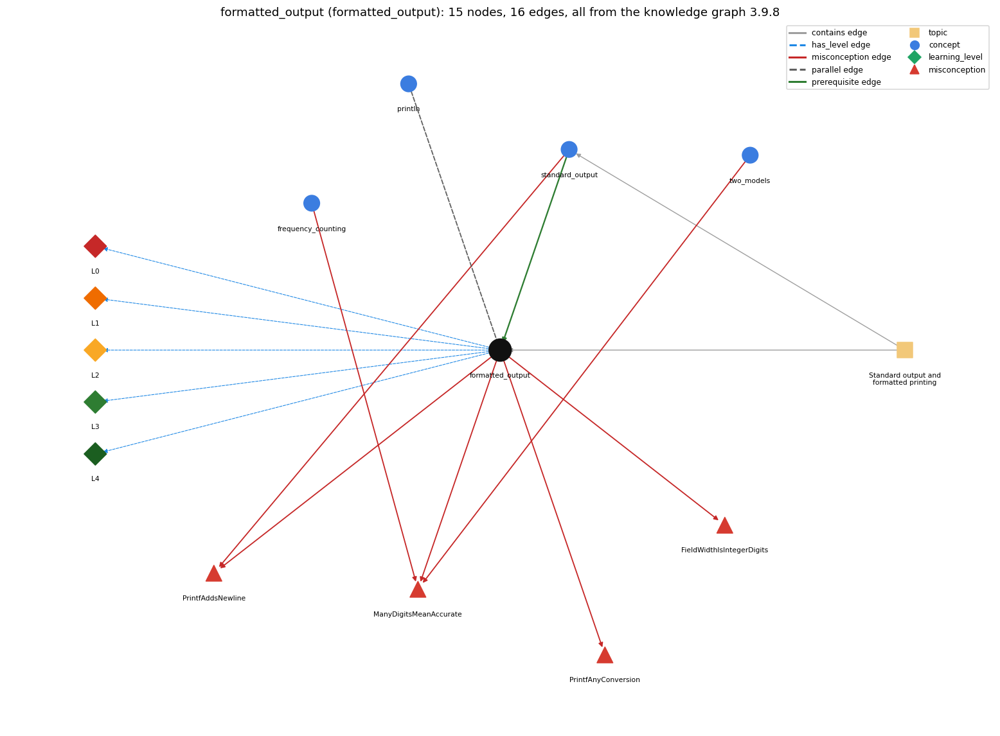

# formatted_output (`formatted_output`)

printf with a format string such as %d, %.2f, %s

Section 1.5 Input and Output, topic 1.5.b Standard output and formatted printing.

## At a glance

- **Needs first:** `standard_output`
- **Leads to:** nothing
- **Learned alongside:** `println`
- **Misconceptions:** `FieldWidthIsIntegerDigits`, `ManyDigitsMeanAccurate`, `PrintfAddsNewline`, `PrintfAnyConversion`
- **Errors:** none
- **Levels:** L0, L1, L2, L3, L4

Everything below comes from the knowledge graph 3.9.8 (`data/raw/chapter1_kg_updated.json`): 16 edges around this concept, each explained in the graph's own words.

## What it needs first (1)

A prerequisite edge means the other concept has to be understood before `formatted_output`.

### `standard_output` comes before `formatted_output`

*StdOut / System.out*

printf writes to standard output, like print, but formats each value first.

- **Grounding:** book passage
- **How `formatted_output` combines with `standard_output`:** printf output goes into the same stream as print/println and lands at the point in the stream where it was called. It does not end the line.
- **How `standard_output` combines with `formatted_output`:** printf writes to the same stream as print and println, so mixed calls appear in call order. Unlike println, printf ends a line only when the format contains \n.

## What it leads to (0)

These concepts need `formatted_output` first.

No concept has this one as a prerequisite.

## Learned alongside (1)

A parallel edge joins two concepts that sit side by side: neither is needed before the other.

### `formatted_output` alongside `println`

*System.out.println -- output with a trailing newline*

println prints each number with all its digits and ends the line; printf formats each value by its conversion code and starts a new line only when \n is in the format string.

- **Grounding:** book passage
- **How `formatted_output` combines with `println`:** println prints a double with all its digits (about 15 places) and always ends the line. printf("%.2f\n", x) controls the digits and ends the line only because of \n.
- **How `println` combines with `formatted_output`:** println prints numbers with all their digits and always ends the line; printf formats each value by its conversion code and ends the line only where the format has %n or \n.

## Misconceptions (4)

A misconception edge states the wrong rule a student may hold about this concept, and the right rule.

### FieldWidthIsIntegerDigits

- **Wrong rule:** %2.4f prints two digits before the decimal point and four after.
- **Right rule:** The number before the point is the width of the whole field; %7.2f means 7 characters in total with 2 digits after the decimal point.
- **Role of this concept:** primary
- **Shows at level L0 as:** misconception: wrong rule: %2.4f prints two digits before the decimal point and four after. Right rule: The first number is the width of the whole field. %7.2f means 7 characters in total, with 2 digits after the decimal point.

### ManyDigitsMeanAccurate

- **Wrong rule:** A result printed with many decimal places must be accurate to those places.
- **Right rule:** A program does not produce accurate answers simply because it can print numbers to many decimal places of precision; ensuring accuracy is often the most difficult challenge.
- **Role of this concept:** context
- **Shows at level L0 as:** misconception: wrong rule: A result printed with many decimal places must be accurate to those places. Right rule: Printing precision is only formatting. A value printed to many places can still be inaccurate, and ensuring accuracy is the hard part.
- **Also an edge from `frequency_counting`:** A result printed with many decimal places must be accurate to those places.
- **Also an edge from `two_models`:** A result printed with many decimal places must be accurate to those places.

### PrintfAddsNewline

- **Wrong rule:** printf() ends the line like println().
- **Right rule:** printf() does not add a newline; put \n in the format string to end the line.
- **Role of this concept:** primary
- **Shows at level L0 as:** misconception: wrong rule: printf() ends the line like println(). Right rule: printf() adds no newline. Put \n (or %n) in the format string.
- **Also an edge from `standard_output`:** printf() ends the line like println().

### PrintfAnyConversion

- **Wrong rule:** Any conversion code (%d, %f, %s) works with any argument type.
- **Right rule:** Each conversion code must match its argument's type (any type works with %s); %d with a double or %f with an int throws an IllegalFormatConversionException at run time.
- **Role of this concept:** primary
- **Shows at level L0 as:** misconception: wrong rule: Any conversion code (%d, %f, %s) works with any argument type. Right rule: The conversion must fit the argument's type (%s accepts any type). printf("%12d", Math.PI) or printf("%4.2f", 512) throws IllegalFormatConversionException at run time.
- **Shows at level L0 as:** inconsistent trace: Points to LT (specifiers are paired with arguments left to right, and the other characters pass through). An uneven trace pairs a specifier with the wrong argument, drops the literal text between specifiers, or pads on the wrong side on some fields. (here mixing in: "Any conversion code (%d, %f, %s) works with any argument type")

## Errors (0)

An error edge states the rule that gets broken in a program, and the right rule.

The graph has no error edge from this concept.

## Levels L0 to L4 (5 of 5)

Each level edge lists the ways a student shows that level, each with its exact rule.

### L0: Prestructural / sensorimotor

L0 for formatted output: the answer holds a rule that contradicts Java.

*Deciding question: Does every rule the answer applies to formatted output agree with the language rule? If it reads the code with everyday meanings, applies a wrong rule, or switches rules within one trace, it is L0. A slip in an otherwise rule-correct trace is L2 with an error, not L0.*

formatted output -&gt; L0 (Prestructural): the answer holds a rule that contradicts Java (6 ways).

- **everyday reading** (folk-meaning rule): In maths \`7.2\` (or %2.4f) reads as a decimal number, or as '7 digits before the point, 2 after'. In a format specifier the number before the point is the total field width and the number after it is the digits after the decimal point. Also \`%\` is not 'percent'.
- **misconception** (wrong rule / right rule; shows `PrintfAnyConversion`): wrong rule: Any conversion code (%d, %f, %s) works with any argument type. Right rule: The conversion must fit the argument's type (%s accepts any type). printf("%12d", Math.PI) or printf("%4.2f", 512) throws IllegalFormatConversionException at run time.
- **misconception** (wrong rule / right rule; shows `FieldWidthIsIntegerDigits`): wrong rule: %2.4f prints two digits before the decimal point and four after. Right rule: The first number is the width of the whole field. %7.2f means 7 characters in total, with 2 digits after the decimal point.
- **misconception** (wrong rule / right rule; shows `PrintfAddsNewline`): wrong rule: printf() ends the line like println(). Right rule: printf() adds no newline. Put \n (or %n) in the format string.
- **inconsistent trace** (uneven-application rule; shows `PrintfAnyConversion`): Points to LT (specifiers are paired with arguments left to right, and the other characters pass through). An uneven trace pairs a specifier with the wrong argument, drops the literal text between specifiers, or pads on the wrong side on some fields. (here mixing in: "Any conversion code (%d, %f, %s) works with any argument type")
- **misconception** (wrong rule / right rule; shows `ManyDigitsMeanAccurate`): wrong rule: A result printed with many decimal places must be accurate to those places. Right rule: Printing precision is only formatting. A value printed to many places can still be inaccurate, and ensuring accuracy is the hard part.

### L1: Unistructural / atom x text surface

L1 for formatted output: the answer states one correct rule without applying it.

*Deciding question: Does the answer cover every part of the code, in order, with the values (L2)? If it covers one part or only states the rule, it is L1.*

formatted output -&gt; L1 (Unistructural): the answer states one correct rule without applying it (2 ways).

- **names the element** (identity rule): printf is the formatted-print method of standard output. It takes a format string and arguments and writes the formatted string.
- **states the rule** (declarative rule): A format specifier has the form %[argument\_index$][flags][width][.precision]conversion: d for integer types, f for floating-point values, s for String or any type. The width is a minimum character count, and for f the precision is the number of digits after the point.

### L2: Multistructural / block x execution / preoperational

L2 for formatted output: the answer applies these rules to every part of the code, in order.

*Deciding question: Is the answer many segments mapped onto lines (L2), or one segment stating the purpose of the whole (L3)? A correct output with no value-by-value justification is not levelled.*

formatted output -&gt; L2 (Multistructural): the answer applies the rules of formatted output to every part of the code, in order (3 ways).

- **line by line trace** (operational sequencing rule): The arguments are evaluated first. The format string is then scanned left to right: ordinary characters are copied, and each specifier takes the next argument, converts it, rounds it to the precision and pads it with blanks to the width (left side by default, right side with the \`-\` flag).
- **output prediction** (evaluation / result rule): The output is the formatted text. printf("%7.5f", Math.PI) gives 3.14159, printf("PI is approximately %.2f\n", Math.PI) gives \`PI is approximately 3.14\` and a newline, and printf("%5d", 42) gives \`   42\`. Rounding is half-up.
- **one step execution** (state-transition rule): One call appends one formatted string to standard output and adds no newline unless \n or %n is in the format. The stored values of the arguments do not change (only their printed form is rounded).

### L3: Relational / relations x function (concrete operational begins)

L3 for formatted output: the answer relates the parts by these rules.

*Deciding question: Was the purpose deduced from the code, or only guessed from traced input/output pairs (then L2)? Does the answer stay within the given code (L3), or reason about changed code, an error class or a new program (L4)?*

formatted output -&gt; L3 (Relational): the answer relates the parts (3 ways).

- **relation to neighbour** (composition rule (with a neighbour)): printf output goes into the same stream as print/println and lands at the point in the stream where it was called. It does not end the line.
- **relation to neighbour** (composition rule (with a neighbour)): println prints a double with all its digits (about 15 places) and always ends the line. printf("%.2f\n", x) controls the digits and ends the line only because of \n.
- **purpose of the whole** (plan / role rule): Plan: table printing. Inside a loop, one fixed format string with a specifier per column prints aligned rows (e.g. a loan table) at a chosen precision.

### L4: Extended abstract (concrete-operational reversibility and conservation)

L4 for formatted output: the answer reasons beyond the given code by these rules.

*Deciding question: Does the answer link the code to a broader context: a changed program, a class of inputs, an unseen problem? Re-tracing changed code value by value is L2; fixing one given failing case is L3.*

formatted output -&gt; L4 (Extended abstract): the answer reasons beyond the given code (5 ways).

- **predict a change** (conservation rule; shows `PrintfAnyConversion`): Changing the precision changes only the printed digits, not the stored value. Changing the width changes only the padding. A width smaller than the converted text is ignored, so nothing is truncated.
- **transfer to a new program** (applicability rule): Use printf when the number of digits, the field width or column alignment matters (tables, money, reports). For quick checks of a value, println is enough.
- **diagnose an error** (error rule): rule broken: The conversion code must match the argument type. Kind: run-time exception. Trigger class: %d with a double, or %f with an int (e.g. printf("%4.2f", 512)): IllegalFormatConversionException.
- **diagnose an error** (error rule): rule broken: There must be an argument for every specifier, and the format syntax must be legal. Kind: run-time exception. Trigger class: More specifiers than arguments (e.g. printf("%d %d", 3)), or a malformed specifier: an IllegalFormatException subclass such as MissingFormatArgumentException.
- **diagnose an error** (error rule): rule broken: printf adds no line separator. Kind: silent logic error. Trigger class: A printf in a loop without \n: all rows run together on one line.

## Same topic

`formatted_output` belongs to the topic **Standard output and formatted printing** (`topic1.5.b`). The topic also contains: `standard_output`.

## Rules of the concept (19)

- **folk-meaning rule:** In maths \`7.2\` (or %2.4f) reads as a decimal number, or as '7 digits before the point, 2 after'. In a format specifier the number before the point is the total field width and the number after it is the digits after the decimal point. Also \`%\` is not 'percent'.
- **wrong rule / right rule:** PrintfAnyConversion: wrong: Any conversion code (%d, %f, %s) works with any argument type. \| right: The conversion must fit the argument's type (%s accepts any type). printf("%12d", Math.PI) or printf("%4.2f", 512) throws IllegalFormatConversionException at run time.
- **wrong rule / right rule:** FieldWidthIsIntegerDigits: wrong: %2.4f prints two digits before the decimal point and four after. \| right: The first number is the width of the whole field. %7.2f means 7 characters in total, with 2 digits after the decimal point.
- **wrong rule / right rule:** PrintfAddsNewline: wrong: printf() ends the line like println(). \| right: printf() adds no newline. Put \n (or %n) in the format string.
- **wrong rule / right rule:** ManyDigitsMeanAccurate: wrong: A result printed with many decimal places must be accurate to those places. \| right: Printing precision is only formatting. A value printed to many places can still be inaccurate, and ensuring accuracy is the hard part.
- **uneven-application rule:** Points to LT (specifiers are paired with arguments left to right, and the other characters pass through). An uneven trace pairs a specifier with the wrong argument, drops the literal text between specifiers, or pads on the wrong side on some fields.
- **identity rule:** printf is the formatted-print method of standard output. It takes a format string and arguments and writes the formatted string.
- **declarative rule:** A format specifier has the form %[argument\_index$][flags][width][.precision]conversion: d for integer types, f for floating-point values, s for String or any type. The width is a minimum character count, and for f the precision is the number of digits after the point.
- **operational sequencing rule:** The arguments are evaluated first. The format string is then scanned left to right: ordinary characters are copied, and each specifier takes the next argument, converts it, rounds it to the precision and pads it with blanks to the width (left side by default, right side with the \`-\` flag).
- **evaluation / result rule:** The output is the formatted text. printf("%7.5f", Math.PI) gives 3.14159, printf("PI is approximately %.2f\n", Math.PI) gives \`PI is approximately 3.14\` and a newline, and printf("%5d", 42) gives \`   42\`. Rounding is half-up.
- **state-transition rule:** One call appends one formatted string to standard output and adds no newline unless \n or %n is in the format. The stored values of the arguments do not change (only their printed form is rounded).
- **composition rule (with a neighbour):** with standard\_output: printf output goes into the same stream as print/println and lands at the point in the stream where it was called. It does not end the line.
- **composition rule (with a neighbour):** with println: println prints a double with all its digits (about 15 places) and always ends the line. printf("%.2f\n", x) controls the digits and ends the line only because of \n.
- **plan / role rule:** Plan: table printing. Inside a loop, one fixed format string with a specifier per column prints aligned rows (e.g. a loan table) at a chosen precision.
- **conservation rule:** Changing the precision changes only the printed digits, not the stored value. Changing the width changes only the padding. A width smaller than the converted text is ignored, so nothing is truncated.
- **error rule:** rule broken: The conversion code must match the argument type. (run-time exception)
- **error rule:** rule broken: There must be an argument for every specifier, and the format syntax must be legal. (run-time exception)
- **error rule:** rule broken: printf adds no line separator. (silent logic error)
- **applicability rule:** Use printf when the number of digits, the field width or column alignment matters (tables, money, reports). For quick checks of a value, println is enough.

## The whole prerequisite chain

- **Everything it builds on (2):** `standard_output`, `stream_model`
- **Everything that builds on it (0):** nothing
