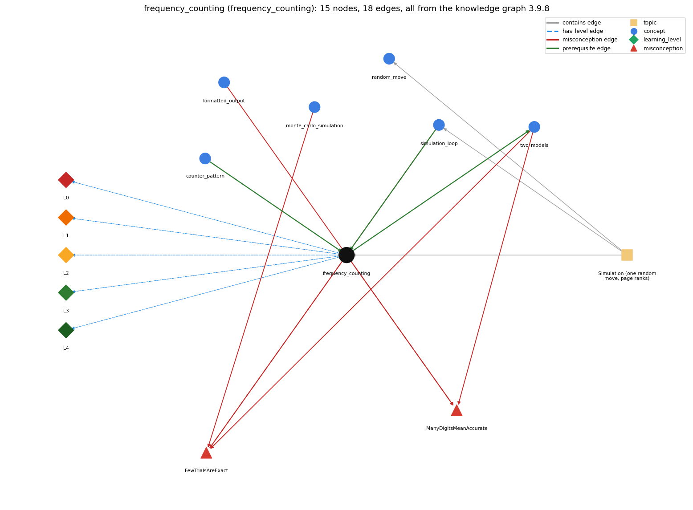

# frequency_counting (`frequency_counting`)

tally visits to estimate page rank

Section 1.6 Case Study: Random Web Surfer, topic 1.6.b Simulation (one random move, page ranks).

## At a glance

- **Needs first:** `counter_pattern`, `simulation_loop`
- **Leads to:** `two_models`
- **Learned alongside:** nothing
- **Misconceptions:** `FewTrialsAreExact`, `ManyDigitsMeanAccurate`
- **Errors:** none
- **Levels:** L0, L1, L2, L3, L4

Everything below comes from the knowledge graph 3.9.8 (`data/raw/chapter1_kg_updated.json`): 18 edges around this concept, each explained in the graph's own words.

## What it needs first (2)

A prerequisite edge means the other concept has to be understood before `frequency_counting`.

### `counter_pattern` comes before `frequency_counting`

*counting occurrences across passes*

Frequency counting keeps one counter per value in an array, freq[page]++.

- **Grounding:** book passage

### `simulation_loop` comes before `frequency_counting`

*take many random steps*

On each pass the simulation adds 1 to freq[page] for the page just reached.

- **Grounding:** book passage
- **How `frequency_counting` combines with `simulation_loop`:** The increment is the last statement of each pass, so the counts tally the pages reached by the T moves (sum = T).
- **How `simulation_loop` combines with `frequency_counting`:** freq[page]++ must come after the move and inside the loop, once per pass, so the counts total T.

## What it leads to (1)

These concepts need `frequency_counting` first.

### `frequency_counting` comes before `two_models`

*simulation vs. repeated matrix multiplication (mixing)*

The visit fractions freq[j] / T estimate the same page ranks that repeated matrix multiplication computes.

- **Grounding:** book passage
- **How `frequency_counting` combines with `two_models`:** freq[i]/T converges to the same page ranks the power method computes, but only as an estimate.
- **How `two_models` combines with `frequency_counting`:** freq[j]/T is the simulation's estimate of the same ranks; it carries sampling error the power method does not.

## Learned alongside (0)

A parallel edge joins two concepts that sit side by side: neither is needed before the other.

No parallel edge touches this concept.

## Misconceptions (2)

A misconception edge states the wrong rule a student may hold about this concept, and the right rule.

### FewTrialsAreExact

- **Wrong rule:** A short simulation gives the exact page ranks.
- **Right rule:** A simulation only estimates the page ranks: RandomSurfer needs 10^n moves to get answers precise to n decimal places and many more moves for those answers to become accurate (tens of thousands of moves for two accurate places, millions for three).
- **Role of this concept:** primary
- **Shows at level L0 as:** misconception: wrong rule: A short simulation gives the exact page ranks. Right rule: freq[i]/T is only an estimate: about 10^n moves for n-digit precision and many more for accuracy.
- **Shows at level L0 as:** inconsistent trace: Applies LT (increment after each move, divide by T after the loop) unevenly: e.g. incrementing the page before the move on some passes, or dividing inside the loop. (here mixing in: "A short simulation gives the exact page ranks")
- **Also an edge from `monte_carlo_simulation`:** A short simulation gives the exact page ranks.
- **Also an edge from `simulation_loop`:** A short simulation gives the exact page ranks.
- **Also an edge from `two_models`:** A short simulation gives the exact page ranks.

### ManyDigitsMeanAccurate

- **Wrong rule:** A result printed with many decimal places must be accurate to those places.
- **Right rule:** A program does not produce accurate answers simply because it can print numbers to many decimal places of precision; ensuring accuracy is often the most difficult challenge.
- **Role of this concept:** primary
- **Shows at level L0 as:** misconception: wrong rule: A result printed with many decimal places must be accurate to those places. Right rule: Printing %8.5f does not make the estimate accurate to 5 places; ensuring accuracy is often the hardest part.
- **Also an edge from `formatted_output`:** A result printed with many decimal places must be accurate to those places.
- **Also an edge from `two_models`:** A result printed with many decimal places must be accurate to those places.

## Errors (0)

An error edge states the rule that gets broken in a program, and the right rule.

The graph has no error edge from this concept.

## Levels L0 to L4 (5 of 5)

Each level edge lists the ways a student shows that level, each with its exact rule.

### L0: Prestructural / sensorimotor

L0 for frequency counting: the answer holds a rule that contradicts Java.

*Deciding question: Does every rule the answer applies to frequency counting agree with the language rule? If it reads the code with everyday meanings, applies a wrong rule, or switches rules within one trace, it is L0. A slip in an otherwise rule-correct trace is L2 with an error, not L0.*

frequency counting -&gt; L0 (Prestructural): the answer holds a rule that contradicts Java (4 ways).

- **everyday reading** (folk-meaning rule): Everyday "rank" means a position in a list (1st, 2nd) and "frequency" a rate; here a page's rank is a probability, estimated by the fraction freq[i]/T of moves that land on it.
- **misconception** (wrong rule / right rule; shows `FewTrialsAreExact`): wrong rule: A short simulation gives the exact page ranks. Right rule: freq[i]/T is only an estimate: about 10^n moves for n-digit precision and many more for accuracy.
- **misconception** (wrong rule / right rule; shows `ManyDigitsMeanAccurate`): wrong rule: A result printed with many decimal places must be accurate to those places. Right rule: Printing %8.5f does not make the estimate accurate to 5 places; ensuring accuracy is often the hardest part.
- **inconsistent trace** (uneven-application rule; shows `FewTrialsAreExact`): Applies LT (increment after each move, divide by T after the loop) unevenly: e.g. incrementing the page before the move on some passes, or dividing inside the loop. (here mixing in: "A short simulation gives the exact page ranks")

### L1: Unistructural / atom x text surface

L1 for frequency counting: the answer states one correct rule without applying it.

*Deciding question: Does the answer cover every part of the code, in order, with the values (L2)? If it covers one part or only states the rule, it is L1.*

frequency counting -&gt; L1 (Unistructural): the answer states one correct rule without applying it (2 ways).

- **names the element** (identity rule): A counting technique: an int array freq[] with one counter per page, incremented each time the surfer lands there; dividing by T gives the visit frequencies.
- **states the rule** (declarative rule): RandomSurfer counts the number of times the surfer visits each page; dividing that count by the number of moves estimates the probability of ending on the page (its rank).

### L2: Multistructural / block x execution / preoperational

L2 for frequency counting: the answer applies these rules to every part of the code, in order.

*Deciding question: Is the answer many segments mapped onto lines (L2), or one segment stating the purpose of the whole (L3)? A correct output with no value-by-value justification is not levelled.*

frequency counting -&gt; L2 (Multistructural): the answer applies the rules of frequency counting to every part of the code, in order (3 ways).

- **line by line trace** (operational sequencing rule): freq is created (all zeros) before the loop; each pass ends with freq[page]++; after the loop, each (double) freq[i] / T is computed (cast first, then divide) and printed.
- **output prediction** (evaluation / result rule): Integer counts summing to T; the printed fractions are doubles in [0, 1] summing to about 1 (e.g. 0.27280 0.26530 0.14820 0.24830 0.06540 after 10000 moves).
- **one step execution** (state-transition rule): One count step adds 1 to exactly one element, freq[page]; all other counts are unchanged.

### L3: Relational / relations x function (concrete operational begins)

L3 for frequency counting: the answer relates the parts by these rules.

*Deciding question: Was the purpose deduced from the code, or only guessed from traced input/output pairs (then L2)? Does the answer stay within the given code (L3), or reason about changed code, an error class or a new program (L4)?*

frequency counting -&gt; L3 (Relational): the answer relates the parts (3 ways).

- **relation to neighbour** (composition rule (with a neighbour)): The increment is the last statement of each pass, so the counts tally the pages reached by the T moves (sum = T).
- **relation to neighbour** (composition rule (with a neighbour)): freq[i]/T converges to the same page ranks the power method computes, but only as an estimate.
- **purpose of the whole** (plan / role rule): Counter plan per bucket (a tally array indexed by outcome): each freq[i] is a gatherer accumulating visits to page i, and the array holds the histogram that stabilises to the ranks.

### L4: Extended abstract (concrete-operational reversibility and conservation)

L4 for frequency counting: the answer reasons beyond the given code by these rules.

*Deciding question: Does the answer link the code to a broader context: a changed program, a class of inputs, an unseen problem? Re-tracing changed code value by value is L2; fixing one given failing case is L3.*

frequency counting -&gt; L4 (Extended abstract): the answer reasons beyond the given code (4 ways).

- **predict a change** (conservation rule; shows `FewTrialsAreExact`): Invariant: the counts sum to T, so the fractions sum to 1; dividing before casting ((double)(freq[i] / T)) or counting outside the loop breaks it.
- **transfer to a new program** (applicability rule): Use whenever a probability is estimated from repeated random trials (histograms, Monte Carlo); not when the exact probabilities can be computed, as with the power method.
- **diagnose an error** (error rule): rule broken: Casting must apply before the division. Kind: silent logic error. Trigger class: (double) (freq[i] / T) or freq[i] / T: integer division gives 0 for every page that is not visited on every move.
- **diagnose an error** (error rule): rule broken: A local array must be created before use. Kind: compile-time. Trigger class: int[] freq; declared without new int[N] and then incremented: compile error, variable might not have been initialized.

## Same topic

`frequency_counting` belongs to the topic **Simulation (one random move, page ranks)** (`topic1.6.b`). The topic also contains: `random_move`, `simulation_loop`.

## Rules of the concept (16)

- **folk-meaning rule:** Everyday "rank" means a position in a list (1st, 2nd) and "frequency" a rate; here a page's rank is a probability, estimated by the fraction freq[i]/T of moves that land on it.
- **wrong rule / right rule:** FewTrialsAreExact: wrong: A short simulation gives the exact page ranks. \| right: freq[i]/T is only an estimate: about 10^n moves for n-digit precision and many more for accuracy.
- **wrong rule / right rule:** ManyDigitsMeanAccurate: wrong: A result printed with many decimal places must be accurate to those places. \| right: Printing %8.5f does not make the estimate accurate to 5 places; ensuring accuracy is often the hardest part.
- **uneven-application rule:** Applies LT (increment after each move, divide by T after the loop) unevenly: e.g. incrementing the page before the move on some passes, or dividing inside the loop.
- **identity rule:** A counting technique: an int array freq[] with one counter per page, incremented each time the surfer lands there; dividing by T gives the visit frequencies.
- **declarative rule:** RandomSurfer counts the number of times the surfer visits each page; dividing that count by the number of moves estimates the probability of ending on the page (its rank).
- **operational sequencing rule:** freq is created (all zeros) before the loop; each pass ends with freq[page]++; after the loop, each (double) freq[i] / T is computed (cast first, then divide) and printed.
- **evaluation / result rule:** Integer counts summing to T; the printed fractions are doubles in [0, 1] summing to about 1 (e.g. 0.27280 0.26530 0.14820 0.24830 0.06540 after 10000 moves).
- **state-transition rule:** One count step adds 1 to exactly one element, freq[page]; all other counts are unchanged.
- **composition rule (with a neighbour):** with simulation\_loop: The increment is the last statement of each pass, so the counts tally the pages reached by the T moves (sum = T).
- **composition rule (with a neighbour):** with two\_models: freq[i]/T converges to the same page ranks the power method computes, but only as an estimate.
- **plan / role rule:** Counter plan per bucket (a tally array indexed by outcome): each freq[i] is a gatherer accumulating visits to page i, and the array holds the histogram that stabilises to the ranks.
- **conservation rule:** Invariant: the counts sum to T, so the fractions sum to 1; dividing before casting ((double)(freq[i] / T)) or counting outside the loop breaks it.
- **error rule:** rule broken: Casting must apply before the division. (silent logic error)
- **error rule:** rule broken: A local array must be created before use. (compile-time)
- **applicability rule:** Use whenever a probability is estimated from repeated random trials (histograms, Monte Carlo); not when the exact probabilities can be computed, as with the power method.

## The whole prerequisite chain

- **Everything it builds on (36):** `arithmetic_operators`, `array_creation`, `array_declaration`, `array_initializer`, `assignment`, `boolean`, `boolean_expression`, `comparison_operators`, `counter_pattern`, `data_structure`, `data_type`, `declaration`, `do_while_loop`, `expression`, `for_loop`, `identifier`, `increment_operators`, `indexing`, `input_graph`, `literal`, `logical_operators`, `loop_body`, `loop_control`, `loop_variable`, `math_library`, `method_call`, `primitive_type`, `random_move`, `simulation_loop`, `standard_input`, `stream_model`, `teleportation`, `transition_matrix`, `two_dimensional_array`, `variable`, `while_loop`
- **Everything that builds on it (1):** `two_models`
