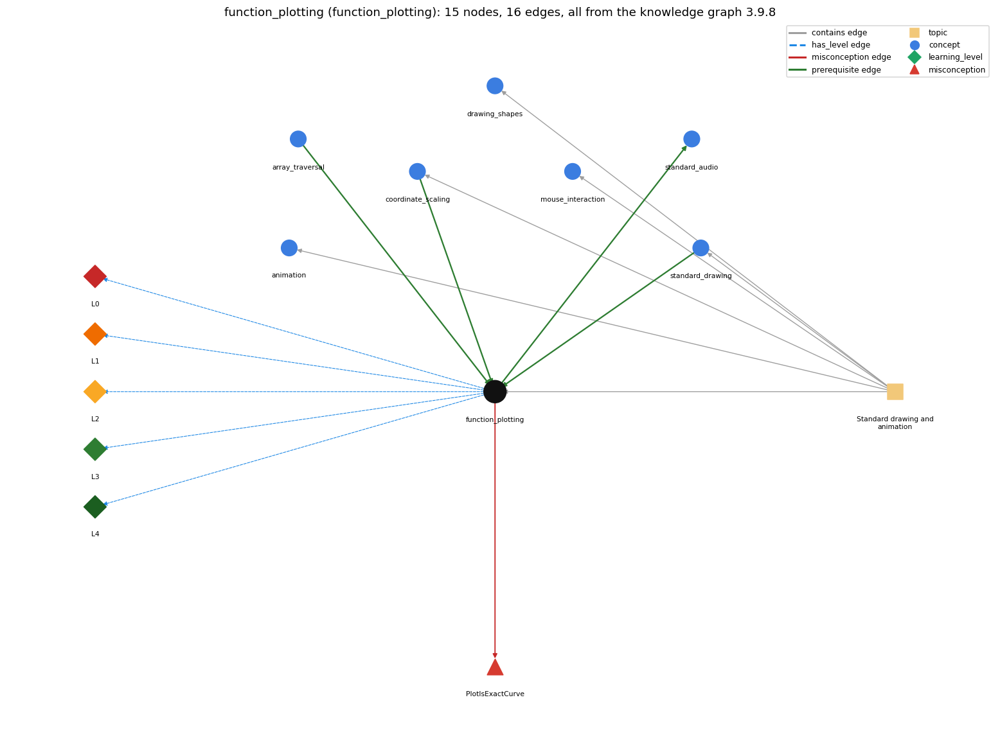

# function_plotting (`function_plotting`)

sampling a function and joining the points with lines

Section 1.5 Input and Output, topic 1.5.e Standard drawing and animation. From the knowledge graph 3.9.8 (`data/raw/chapter1_kg_updated.json`).

## Concepts associated with function\_plotting (7)

| Concept | Description | How it is associated |
| --- | --- | --- |
| **animation** | StdDraw animation: clear, draw, show, pause in a loop | same topic (topic1.5.e) |
| **array\_traversal** | walking the array with an index loop | prerequisite of it (it needs this) composition rule (R) with it |
| **coordinate\_scaling** | StdDraw's unit square and setXscale/setYscale | prerequisite of it (it needs this) composition rule (R) with it same topic (topic1.5.e) |
| **drawing\_shapes** | outline vs filled shapes, square half-length, colour and text | same topic (topic1.5.e) |
| **mouse\_interaction** | reading mouse position and clicks from StdDraw | same topic (topic1.5.e) |
| **standard\_audio** | StdAudio: sound as an array of samples | builds on it (needs it) composition rule (R) with it |
| **standard\_drawing** | StdDraw -- graphical output (book-specific) | prerequisite of it (it needs this) same topic (topic1.5.e) |

## Every edge in this view and its full label (16)

| From | Edge | To | Full edge label |
| --- | --- | --- | --- |
| **array\_traversal** | prerequisite | **function\_plotting** | The sample points are kept in arrays and traversed. grounding: book\_passage composition rule (R) of array\_traversal with function\_plotting: Sample points are computed into x[] and y[] by one traversal and drawn by another. composition rule (R) of function\_plotting with array\_traversal: The arrays have N+1 elements (indices 0..N). The drawing loop starts at i = 1 so that x[i-1] stays in bounds; starting at 0 would access x[-1]. |
| **coordinate\_scaling** | prerequisite | **function\_plotting** | Before plotting, the x-scale is set to the interval and the y-scale to the range of function values so the curve fits the canvas. grounding: book\_passage composition rule (R) of coordinate\_scaling with function\_plotting: Before plotting, set the x-scale to the sampled interval and the y-scale to the function's min and max, so the curve fits the canvas. composition rule (R) of function\_plotting with coordinate\_scaling: The x-scale must match the sampled interval and the y-scale the function's range; otherwise the curve is clipped or squashed. |
| **function\_plotting** | prerequisite | **standard\_audio** | A sound wave is sampled at regular intervals exactly as a function is sampled for plotting, giving the array of samples that StdAudio plays. grounding: book\_passage composition rule (R) of function\_plotting with standard\_audio: A sound wave is sampled at regular intervals in exactly the way a function is sampled for plotting. The same array can be drawn or played. composition rule (R) of standard\_audio with function\_plotting: Sampling for sound is the same as sampling for a plot. The same array can be sent to StdDraw and to StdAudio. |
| **standard\_drawing** | prerequisite | **function\_plotting** | A function is plotted by drawing its sampled points and lines with StdDraw. grounding: book\_passage |
| **function\_plotting** | misconception | **PlotIsExactCurve** | **wrong rule:** The drawn plot is the exact curve. **right rule:** It is a piecewise linear approximation through the sampled points. role: primary |
| **function\_plotting** | has\_level | **function\_plotting@L0** | function plotting -&gt; L0 (Prestructural): the answer holds a rule that contradicts Java (3 ways). **[0] everyday\_reading** (E): The everyday 'graph of a function' is an exact, smooth curve. A program can only evaluate the function at finitely many sampled points and join them with straight segments. **[1] misconception** (M) &rarr; PlotIsExactCurve: wrong rule: The drawn plot is the exact curve. Right rule: The plot is a piecewise linear approximation through the sampled points. With too few samples it can miss major fluctuations. **[2] inconsistent\_trace** (T) &rarr; PlotIsExactCurve: Points to LT (fill x[], fill y[], set the scales, then draw segment i from point i-1 to point i). An uneven trace pairs x[i] with y[i-1], or draws before setting the scale. (here mixing in: "The drawn plot is the exact curve") |
| **function\_plotting** | has\_level | **function\_plotting@L1** | function plotting -&gt; L1 (Unistructural): the answer states one correct rule without applying it (2 ways). **[0] names\_the\_element** (N): Function plotting is a sampling technique: evaluate f at evenly spaced x-values, store the values in arrays, set the scales, and connect consecutive points with lines. **[1] states\_the\_rule** (S): Sample the function by choosing x-values and evaluating f at each one. Connecting successive points with lines gives a piecewise linear approximation. |
| **function\_plotting** | has\_level | **function\_plotting@L2** | function plotting -&gt; L2 (Multistructural): the answer applies the rules of function plotting to every part of the code, in order (3 ways). **[0] line\_by\_line\_trace** (LT): 1) x[i] = Math.PI \* i / N for i = 0..N. 2) y[i] = f(x[i]). 3) setXscale and setYscale. 4) For i = 1..N, line(x[i-1], y[i-1], x[i], y[i]). **[1] output\_prediction** (OP): The plot is N line segments through N+1 sample points. With N = 20 the curve is jagged and misses wiggles; with N = 200 it looks smooth. **[2] one\_step\_execution** (OS): One drawing iteration draws one segment between consecutive samples i-1 and i. It changes no array values. |
| **function\_plotting** | has\_level | **function\_plotting@L3** | function plotting -&gt; L3 (Relational): the answer relates the parts (4 ways). **[0] relation\_to\_neighbour** (R): The arrays have N+1 elements (indices 0..N). The drawing loop starts at i = 1 so that x[i-1] stays in bounds; starting at 0 would access x[-1]. **[1] relation\_to\_neighbour** (R): A sound wave is sampled at regular intervals in exactly the way a function is sampled for plotting. The same array can be drawn or played. **[2] relation\_to\_neighbour** (R): The x-scale must match the sampled interval and the y-scale the function's range; otherwise the curve is clipped or squashed. **[3] purpose\_of\_the\_whole** (P): Plan: sample, then connect (a prototypical sampling computation). The arrays are containers of samples and i is a stepper. |
| **function\_plotting** | has\_level | **function\_plotting@L4** | function plotting -&gt; L4 (Extended abstract): the answer reasons beyond the given code (5 ways). **[0] predict\_a\_change** (C) &rarr; PlotIsExactCurve: Increasing N makes the curve smoother and keeps the end points, but costs time. Decreasing N keeps the sampled points but can lose features between them. **[1] transfer\_to\_a\_new\_program** (X): Use sampled plotting to see the shape of a function or data series. For exact values, print them. For smooth curves with few points, the book later uses a different method (Section 2.4). **[2] diagnose\_an\_error** (D): rule broken: Array indices must stay in 0..N. Kind: run-time exception. Trigger class: The drawing loop starts at i = 0 (so x[i-1] is x[-1]) or runs to i &lt;= N+1: ArrayIndexOutOfBoundsException. **[3] diagnose\_an\_error** (D): rule broken: The sample must be dense enough for the function. Kind: silent logic error. Trigger class: N is too small for a rapidly oscillating f, so the plot misses major fluctuations. **[4] diagnose\_an\_error** (D): rule broken: The y-scale must cover the function's range. Kind: silent logic error. Trigger class: The default unit square, or a wrong y-range, cuts off the negative part of sin(4x) + sin(20x). |
| **topic1.5.e** | contains | **animation** | topic topic1.5.e contains animation |
| **topic1.5.e** | contains | **coordinate\_scaling** | topic topic1.5.e contains coordinate\_scaling |
| **topic1.5.e** | contains | **drawing\_shapes** | topic topic1.5.e contains drawing\_shapes |
| **topic1.5.e** | contains | **function\_plotting** | topic topic1.5.e contains function\_plotting |
| **topic1.5.e** | contains | **mouse\_interaction** | topic topic1.5.e contains mouse\_interaction |
| **topic1.5.e** | contains | **standard\_drawing** | topic topic1.5.e contains standard\_drawing |
