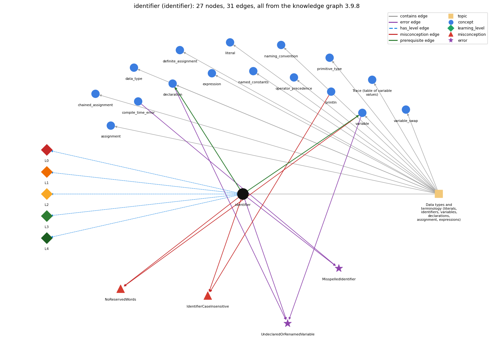

# identifier (`identifier`)

a name for a variable, method or class; case-sensitive, no spaces, not a keyword

Section 1.2 Built-in Types of Data, topic 1.2.a Data types and terminology (literals, identifiers, variables, declarations, assignment, expressions). From the knowledge graph 3.9.8 (`data/raw/chapter1_kg_updated.json`).

## Concepts associated with identifier (16)

| Concept | Description | How it is associated |
| --- | --- | --- |
| **assignment** | = stores the computed value of the right side | same topic (topic1.2.a) |
| **chained\_assignment** | a = b = 0 assigns right to left | same topic (topic1.2.a) |
| **compile\_time\_error** | an error javac reports before the program can run (syntax, types) | shares error MisspelledIdentifier |
| **data\_type** | a set of values and the operations defined on them | same topic (topic1.2.a) |
| **declaration** | int x; -- introduces a variable name and its type | builds on it (needs it) composition rule (R) with it shares error UndeclaredOrRenamedVariable same topic (topic1.2.a) |
| **definite\_assignment** | a local variable must be assigned before it is read | same topic (topic1.2.a) |
| **expression** | anything that evaluates to a value | same topic (topic1.2.a) |
| **literal** | a constant value written in code (42, 3.14, true, 'a', "hi") | same topic (topic1.2.a) |
| **named\_constants** | final constants in UPPER\_CASE instead of magic numbers | same topic (topic1.2.a) |
| **naming\_convention** | choosing meaningful names: full words, lowerCamelCase, single letters only for throwaway loop counters | same topic (topic1.2.a) |
| **operator\_precedence** | the order operators bind in an expression | same topic (topic1.2.a) |
| **primitive\_type** | int, double, boolean, char | same topic (topic1.2.a) |
| **println** | System.out.println -- output with a trailing newline | shares misconception IdentifierCaseInsensitive |
| **program\_trace** | a table of the values of the variables after each statement, used to check what code does | same topic (topic1.2.a) |
| **variable** | a named, typed box that holds a value | builds on it (needs it) composition rule (R) with it shares error UndeclaredOrRenamedVariable shares misconception NoReservedWords same topic (topic1.2.a) |
| **variable\_swap** | exchanging two variables needs a temporary | same topic (topic1.2.a) |

## Every edge in this view and its full label (31)

| From | Edge | To | Full edge label |
| --- | --- | --- | --- |
| **identifier** | prerequisite | **declaration** | A declaration pairs a type with an identifier, e.g. int count;. grounding: book\_passage composition rule (R) of identifier with declaration: A declaration binds the identifier to a type. Every later use must repeat exactly that spelling, or the compiler cannot resolve it. composition rule (R) of declaration with identifier: A declaration binds a legal identifier to a type, and that identifier must not already be declared in the same scope. |
| **identifier** | prerequisite | **variable** | Every variable is named by an identifier that follows the naming rules. grounding: book\_passage composition rule (R) of identifier with variable: Each variable is named by one identifier, which must be unique within its scope: declaring a second local with the same name in that scope is a compile error. composition rule (R) of variable with identifier: Each variable is named by an identifier, which must be legal and unique within the variable's scope. |
| **identifier** | misconception | **IdentifierCaseInsensitive** | **wrong rule:** System.out.Println and System.out.println name the same method. **right rule:** Java is case-sensitive: names of variables, methods and classes that differ only in capitalization are different names. role: primary |
| **identifier** | misconception | **NoReservedWords** | **wrong rule:** A keyword such as int or class can be used as a variable name. **right rule:** Keywords are reserved by Java and cannot be used as variable names. role: primary |
| **println** | misconception | **IdentifierCaseInsensitive** | **wrong rule:** System.out.Println and System.out.println name the same method. **right rule:** Java is case-sensitive: names of variables, methods and classes that differ only in capitalization are different names. role: context |
| **variable** | misconception | **NoReservedWords** | **wrong rule:** A keyword such as int or class can be used as a variable name. **right rule:** Keywords are reserved by Java and cannot be used as variable names. role: context |
| **compile\_time\_error** | error | **MisspelledIdentifier** | **wrong rule:** Writes Sytem.out.prinln or a misspelled variable name. **right rule:** Every name must be spelled exactly, including capitalization. role: context |
| **declaration** | error | **UndeclaredOrRenamedVariable** | **wrong rule:** Uses a variable that was never declared, or under a different name (studentTotal vs total). **right rule:** Every variable must be declared, and used with exactly the declared name. role: context |
| **identifier** | error | **MisspelledIdentifier** | **wrong rule:** Writes Sytem.out.prinln or a misspelled variable name. **right rule:** Every name must be spelled exactly, including capitalization. role: primary |
| **identifier** | error | **UndeclaredOrRenamedVariable** | **wrong rule:** Uses a variable that was never declared, or under a different name (studentTotal vs total). **right rule:** Every variable must be declared, and used with exactly the declared name. role: context |
| **variable** | error | **UndeclaredOrRenamedVariable** | **wrong rule:** Uses a variable that was never declared, or under a different name (studentTotal vs total). **right rule:** Every variable must be declared, and used with exactly the declared name. role: primary |
| **identifier** | has\_level | **identifier@L0** | identifier -&gt; L0 (Prestructural): the answer holds a rule that contradicts Java (4 ways). **[0] everyday\_reading** (E): In English, Total, total and TOTAL are the same word, and names may contain spaces or hyphens (max-value). Java identifiers are case-sensitive and may use only letters, digits, \_ and $, so total and Total are different names and max-value is a subtraction. **[1] misconception** (M) &rarr; IdentifierCaseInsensitive: wrong rule: System.out.Println and System.out.println name the same method. Right rule: Java is case-sensitive: names of variables, methods and classes that differ only in capitalization are different names. **[2] misconception** (M) &rarr; NoReservedWords: wrong rule: keywords may be reused as identifiers. Right rule: Keywords are reserved by Java and cannot be used as variable names. **[3] inconsistent\_trace** (T) &rarr; IdentifierCaseInsensitive: Points to LT (a name refers to the declaration with exactly that spelling in scope). Applied unevenly, a student treats Count and count as one variable in one statement but as two in another. (here mixing in: "System.out.Println and System.out.println name the same method") |
| **identifier** | has\_level | **identifier@L1** | identifier -&gt; L1 (Unistructural): the answer states one correct rule without applying it (2 ways). **[0] names\_the\_element** (N): Identifier: a name for a variable, method or class, made of letters, digits, \_ and $ and not starting with a digit. **[1] states\_the\_rule** (S): An identifier is a sequence of letters, digits, \_ and $ whose first character is not a digit. Identifiers are case-sensitive, and reserved words such as int, public or class cannot be used. |
| **identifier** | has\_level | **identifier@L2** | identifier -&gt; L2 (Multistructural): the answer applies the rules of identifier to every part of the code, in order (3 ways). **[0] line\_by\_line\_trace** (LT): When an identifier appears, the compiler looks it up by exact spelling among the declarations in scope (an error if none matches). At run time a variable's name is replaced by that variable's current value. **[1] output\_prediction** (OP): An identifier used as an expression yields the current value of the variable it names, with that variable's declared type. abc, Ab$, abc123 and a\_b are legal names; Ab\*, 1abc and a+b are not. **[2] one\_step\_execution** (OS): A name does nothing at run time. Only an assignment (or ++ or op=) with the name on its left changes the variable it names. |
| **identifier** | has\_level | **identifier@L3** | identifier -&gt; L3 (Relational): the answer relates the parts (3 ways). **[0] relation\_to\_neighbour** (R): Each variable is named by one identifier, which must be unique within its scope: declaring a second local with the same name in that scope is a compile error. **[1] relation\_to\_neighbour** (R): A declaration binds the identifier to a type. Every later use must repeat exactly that spelling, or the compiler cannot resolve it. **[2] purpose\_of\_the\_whole** (P): Identifiers let code refer to values and code by name. Descriptive names make each variable's role readable to people, though names have no effect on what the program computes. |
| **identifier** | has\_level | **identifier@L4** | identifier -&gt; L4 (Extended abstract): the answer reasons beyond the given code (6 ways). **[0] predict\_a\_change** (C) &rarr; IdentifierCaseInsensitive: Renaming an identifier consistently at its declaration and every use leaves behavior unchanged. Renaming only some occurrences, or changing only the capitalization, breaks compilation with 'cannot find symbol'. **[1] diagnose\_an\_error** (D): rule broken: Identifiers are case-sensitive and must match a declaration exactly; a name that matches nothing in scope cannot be resolved. Kind: compile-time. Trigger class: Any use whose spelling or capitalization differs from the declaration or library name (Sytem, prinln, Println, studentTotl): compiler reports 'cannot find symbol'. **[2] transfer\_to\_a\_new\_program** (X): Every variable, method and class needs an identifier. Pick descriptive lowerCamelCase names, and use single letters only for short-lived loop indices or standard maths symbols. A name never stands in for a value; only literals and expressions do that. **[3] diagnose\_an\_error** (D): rule broken: Every variable must be declared (with a type) before use and referred to by exactly the declared name, inside its scope. Kind: compile-time. Trigger class: Use of a name that was never declared, was declared under another name, or is used outside the block where it was declared: 'cannot find symbol' (one missing declaration can produce several errors). **[4] diagnose\_an\_error** (D): rule broken: Reserved words cannot be used as identifiers. Kind: compile-time. Trigger class: Naming a variable new, class, int, public and so on: '&lt;identifier&gt; expected' or 'not a statement'. **[5] diagnose\_an\_error** (D): rule broken: An identifier may not start with a digit or contain spaces or operator symbols. Kind: compile-time. Trigger class: Names like 2ndValue, max value or max-value: syntax errors, or max - value parsed as a subtraction. |
| **topic1.2.a** | contains | **assignment** | topic topic1.2.a contains assignment |
| **topic1.2.a** | contains | **chained\_assignment** | topic topic1.2.a contains chained\_assignment |
| **topic1.2.a** | contains | **data\_type** | topic topic1.2.a contains data\_type |
| **topic1.2.a** | contains | **declaration** | topic topic1.2.a contains declaration |
| **topic1.2.a** | contains | **definite\_assignment** | topic topic1.2.a contains definite\_assignment |
| **topic1.2.a** | contains | **expression** | topic topic1.2.a contains expression |
| **topic1.2.a** | contains | **identifier** | topic topic1.2.a contains identifier |
| **topic1.2.a** | contains | **literal** | topic topic1.2.a contains literal |
| **topic1.2.a** | contains | **named\_constants** | topic topic1.2.a contains named\_constants |
| **topic1.2.a** | contains | **naming\_convention** | topic topic1.2.a contains naming\_convention |
| **topic1.2.a** | contains | **operator\_precedence** | topic topic1.2.a contains operator\_precedence |
| **topic1.2.a** | contains | **primitive\_type** | topic topic1.2.a contains primitive\_type |
| **topic1.2.a** | contains | **program\_trace** | topic topic1.2.a contains program\_trace |
| **topic1.2.a** | contains | **variable** | topic topic1.2.a contains variable |
| **topic1.2.a** | contains | **variable\_swap** | topic topic1.2.a contains variable\_swap |
