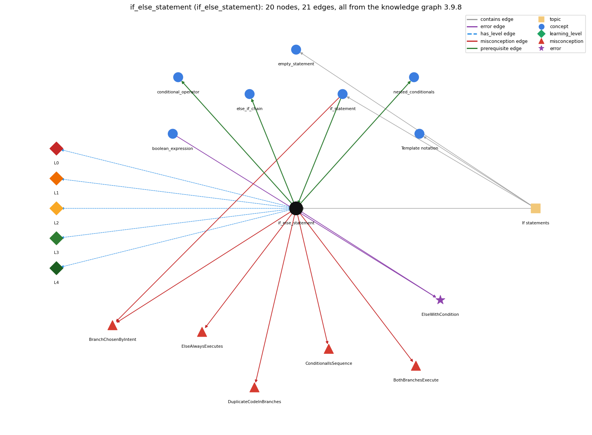

# if_else_statement (`if_else_statement`)

choose one of two blocks

Section 1.3 Conditionals and Loops, topic 1.3.b If statements.

## At a glance

- **Needs first:** `if_statement`
- **Leads to:** `conditional_operator`, `else_if_chain`, `nested_conditionals`
- **Learned alongside:** nothing
- **Misconceptions:** `BothBranchesExecute`, `BranchChosenByIntent`, `ConditionalIsSequence`, `DuplicateCodeInBranches`, `ElseAlwaysExecutes`
- **Errors:** `ElseWithCondition`
- **Levels:** L0, L1, L2, L3, L4

Everything below comes from the knowledge graph 3.9.8 (`data/raw/chapter1_kg_updated.json`): 21 edges around this concept, each explained in the graph's own words.

## What it needs first (1)

A prerequisite edge means the other concept has to be understood before `if_else_statement`.

### `if_statement` comes before `if_else_statement`

*run a block only when the condition holds*

if-else extends if with a second block that runs exactly when the condition is false.

- **Grounding:** book passage
- **How `if_else_statement` combines with `if_statement`:** if-else is an if with a second branch for the false case; dropping the else gives a plain if in which the false case does nothing.
- **How `if_statement` combines with `if_else_statement`:** if-else extends if with a second branch that runs exactly when the condition is false; a lone if has an implicit empty else-case.

## What it leads to (3)

These concepts need `if_else_statement` first.

### `if_else_statement` comes before `conditional_operator`

*c ? a : b -- an expression that picks one of two values*

c ? a : b is the expression form of if (c) ... else ....

- **Grounding:** questionable
- **How `if_else_statement` combines with `conditional_operator`:** c ? a : b is the expression form of if (c) v = a; else v = b;: it yields a value of one branch, evaluating only the selected operand.
- **How `conditional_operator` combines with `if_else_statement`:** \`v = c ? a : b;\` is the expression form of \`if (c) v = a; else v = b;\`. It can be used inside a larger expression (an argument or concatenation), but it cannot replace an if-else whose branches are statements without values.

### `if_else_statement` comes before `else_if_chain`

*if ... else if ... else picks exactly one branch*

An else-if chain is an if-else whose else part is another if.

- **Grounding:** book passage
- **How `if_else_statement` combines with `else_if_chain`:** An else-if chain is an if-else whose else part is another if-else, repeated; the final else catches all remaining cases.
- **How `else_if_chain` combines with `if_else_statement`:** An else-if chain is an if-else whose else part is another if-else, so every rule of if-else (one test, one branch) applies at each link.

### `if_else_statement` comes before `nested_conditionals`

*else-if chains and conditionals inside conditionals*

Nesting puts an if or if-else inside a branch of another if-else; an else-if chain is the common case where the else branch is itself an if.

- **Grounding:** book passage
- **How `if_else_statement` combines with `nested_conditionals`:** Either branch may itself be an if or if-else, which nests conditionals; without braces an inner else pairs with the innermost if.
- **How `nested_conditionals` combines with `if_else_statement`:** Nesting puts an if or if-else inside a branch of another if-else; when the inner statement fills the else branch it forms an else-if chain.

## Learned alongside (0)

A parallel edge joins two concepts that sit side by side: neither is needed before the other.

No parallel edge touches this concept.

## Misconceptions (5)

A misconception edge states the wrong rule a student may hold about this concept, and the right rule.

### BothBranchesExecute

- **Wrong rule:** Both the then branch and the else branch run.
- **Right rule:** Exactly one of the two branches runs.
- **Role of this concept:** primary
- **Shows at level L0 as:** misconception: wrong rule: Both the then branch and the else branch run. Right rule: Exactly one of the two branches runs.

### BranchChosenByIntent

- **Wrong rule:** Which branch runs is decided by what the programmer meant or by code outside the if, not by whether the condition is true.
- **Right rule:** The then branch runs exactly when the condition evaluates to true at the moment it is tested; otherwise the else branch (if any) runs.
- **Role of this concept:** context
- **Shows at level L0 as:** misconception: wrong rule: Which branch runs is decided by what the programmer meant or by code outside the if, not by whether the condition is true. Right rule: The then branch runs exactly when the condition evaluates to true at the moment it is tested; otherwise the else branch (if any) runs.
- **Also an edge from `if_statement`:** Which branch runs is decided by what the programmer meant or by code outside the if, not by whether the condition is true.

### ConditionalIsSequence

- **Wrong rule:** if (c) A else B is the same as if (c) A followed by if (!c) B.
- **Right rule:** In if-else, c is tested once and exactly one of A or B runs, even if A changes the variables that c uses.
- **Role of this concept:** primary
- **Shows at level L0 as:** misconception: wrong rule: if-else is the same as two separate ifs. Right rule: In if-else, c is tested once and exactly one of A or B runs, even if A changes the variables that c uses.
- **Shows at level L0 as:** inconsistent trace: Applies the if-else rule (LT) unevenly: on some traces runs both branches, re-tests the condition after the then branch to decide whether to run the else branch, or runs the else branch whatever the condition. (here mixing in: "if-else is the same as two separate ifs")

### DuplicateCodeInBranches

- **Wrong rule:** Writes the same statements in both branches of an if-else.
- **Right rule:** Code common to both branches belongs before or after the if-else.
- **Role of this concept:** primary
- **Shows at level L0 as:** misconception: wrong rule: Writes the same statements in both branches of an if-else. Right rule: Code common to both branches belongs before or after the if-else.

### ElseAlwaysExecutes

- **Wrong rule:** The else branch of an if-else statement always executes.
- **Right rule:** The else branch runs only when the if condition is false.
- **Role of this concept:** primary
- **Shows at level L0 as:** misconception: wrong rule: The else branch of an if-else statement always executes. Right rule: The else branch runs only when the if condition is false.

## Errors (1)

An error edge states the rule that gets broken in a program, and the right rule.

### ElseWithCondition

- **Wrong rule:** Writes else (x &gt; 0) with a condition but no if.
- **Right rule:** else takes no condition; use else if (x &gt; 0).
- **Role of this concept:** primary
- **Also an edge from `boolean_expression`:** Writes else (x &gt; 0) with a condition but no if.

## Levels L0 to L4 (5 of 5)

Each level edge lists the ways a student shows that level, each with its exact rule.

### L0: Prestructural / sensorimotor

L0 for if else statement: the answer holds a rule that contradicts Java.

*Deciding question: Does every rule the answer applies to if else statement agree with the language rule? If it reads the code with everyday meanings, applies a wrong rule, or switches rules within one trace, it is L0. A slip in an otherwise rule-correct trace is L2 with an error, not L0.*

if else statement -&gt; L0 (Prestructural): the answer holds a rule that contradicts Java (7 ways).

- **everyday reading** (folk-meaning rule): Folk meaning: in English 'otherwise' can be heard as 'and then also', and 'if ... else ...' as two separate rules that are each checked. In Java the condition is tested once and exactly one of the two branches runs.
- **misconception** (wrong rule / right rule; shows `ConditionalIsSequence`): wrong rule: if-else is the same as two separate ifs. Right rule: In if-else, c is tested once and exactly one of A or B runs, even if A changes the variables that c uses.
- **misconception** (wrong rule / right rule; shows `ElseAlwaysExecutes`): wrong rule: The else branch of an if-else statement always executes. Right rule: The else branch runs only when the if condition is false.
- **misconception** (wrong rule / right rule; shows `BothBranchesExecute`): wrong rule: Both the then branch and the else branch run. Right rule: Exactly one of the two branches runs.
- **misconception** (wrong rule / right rule; shows `DuplicateCodeInBranches`): wrong rule: Writes the same statements in both branches of an if-else. Right rule: Code common to both branches belongs before or after the if-else.
- **inconsistent trace** (uneven-application rule; shows `ConditionalIsSequence`): Applies the if-else rule (LT) unevenly: on some traces runs both branches, re-tests the condition after the then branch to decide whether to run the else branch, or runs the else branch whatever the condition. (here mixing in: "if-else is the same as two separate ifs")
- **misconception** (wrong rule / right rule; shows `BranchChosenByIntent`): wrong rule: Which branch runs is decided by what the programmer meant or by code outside the if, not by whether the condition is true. Right rule: The then branch runs exactly when the condition evaluates to true at the moment it is tested; otherwise the else branch (if any) runs.

### L1: Unistructural / atom x text surface

L1 for if else statement: the answer states one correct rule without applying it.

*Deciding question: Does the answer cover every part of the code, in order, with the values (L2)? If it covers one part or only states the rule, it is L1.*

if else statement -&gt; L1 (Unistructural): the answer states one correct rule without applying it (2 ways).

- **names the element** (identity rule): The if-else statement is a two-way conditional: it executes one of two statements (or blocks) depending on a boolean condition.
- **states the rule** (declarative rule): Syntax: if (&lt;boolean expression&gt;) &lt;statements T&gt; else &lt;statements F&gt;; it executes one or the other, but not both: T if the condition is true, F otherwise.

### L2: Multistructural / block x execution / preoperational

L2 for if else statement: the answer applies these rules to every part of the code, in order.

*Deciding question: Is the answer many segments mapped onto lines (L2), or one segment stating the purpose of the whole (L3)? A correct output with no value-by-value justification is not levelled.*

if else statement -&gt; L2 (Multistructural): the answer applies the rules of if else statement to every part of the code, in order (3 ways).

- **line by line trace** (operational sequencing rule): Evaluate the condition once; if true execute the then branch, otherwise execute the else branch; then continue with the statement after the whole if-else (the condition is not re-tested).
- **output prediction** (evaluation / result rule): Exactly one branch's effects occur; e.g. if (x &gt; y) max = x; else max = y; leaves max equal to the larger value, and the coin flip prints either Heads or Tails, never both.
- **one step execution** (state-transition rule): One execution reads the condition's variables and applies the effects of exactly one branch; a change made by the then branch to the condition's variables cannot cause the else branch to run.

### L3: Relational / relations x function (concrete operational begins)

L3 for if else statement: the answer relates the parts by these rules.

*Deciding question: Was the purpose deduced from the code, or only guessed from traced input/output pairs (then L2)? Does the answer stay within the given code (L3), or reason about changed code, an error class or a new program (L4)?*

if else statement -&gt; L3 (Relational): the answer relates the parts (5 ways).

- **relation to neighbour** (composition rule (with a neighbour)): if-else is an if with a second branch for the false case; dropping the else gives a plain if in which the false case does nothing.
- **relation to neighbour** (composition rule (with a neighbour)): Either branch may itself be an if or if-else, which nests conditionals; without braces an inner else pairs with the innermost if.
- **relation to neighbour** (composition rule (with a neighbour)): c ? a : b is the expression form of if (c) v = a; else v = b;: it yields a value of one branch, evaluating only the selected operand.
- **relation to neighbour** (composition rule (with a neighbour)): An else-if chain is an if-else whose else part is another if-else, repeated; the final else catches all remaining cases.
- **purpose of the whole** (plan / role rule): Plan: two-way choice / alternative action - compute one of two results (max of two values, heads or tails, error message or quotient).

### L4: Extended abstract (concrete-operational reversibility and conservation)

L4 for if else statement: the answer reasons beyond the given code by these rules.

*Deciding question: Does the answer link the code to a broader context: a changed program, a class of inputs, an unseen problem? Re-tracing changed code value by value is L2; fixing one given failing case is L3.*

if else statement -&gt; L4 (Extended abstract): the answer reasons beyond the given code (5 ways).

- **predict a change** (conservation rule; shows `ConditionalIsSequence`): Swapping the two branches and negating the condition preserves behaviour; swapping the branches alone inverts it. Replacing if-else with two separate ifs is not equivalent when the then branch changes a variable used in the condition.
- **diagnose an error** (error rule): rule broken: else takes no condition: it is the branch for the false case of the preceding if; a further test needs else if (...). Kind: compile-time. Trigger class: Writing else (x &gt; 0) stmt; the compiler reads (x &gt; 0) as the start of an expression statement, which is not a valid statement, and reports an error.
- **transfer to a new program** (applicability rule): Use if-else when exactly one of two actions must happen; use a plain if when nothing happens in the false case, an else-if chain or switch for more than two mutually exclusive cases, and c ? a : b when you only need to choose a value.
- **diagnose an error** (error rule): rule broken: Code common to both branches belongs before or after the if-else. Kind: silent logic error. Trigger class: A statement duplicated in both branches and later edited in only one: the two cases silently diverge.
- **diagnose an error** (error rule): rule broken: An else must directly follow the then statement of an if. Kind: compile-time. Trigger class: if (c) x = 1; y = 2; else x = 0;: the else has no matching if ('else without if').

## Same topic

`if_else_statement` belongs to the topic **If statements** (`topic1.3.b`). The topic also contains: `empty_statement`, `if_statement`, `syntax_template`.

## Rules of the concept (22)

- **folk-meaning rule:** Folk meaning: in English 'otherwise' can be heard as 'and then also', and 'if ... else ...' as two separate rules that are each checked. In Java the condition is tested once and exactly one of the two branches runs.
- **wrong rule / right rule:** BothBranchesExecute: wrong: Both the then branch and the else branch run. \| right: Exactly one of the two branches runs.
- **wrong rule / right rule:** ConditionalIsSequence: wrong: if-else is the same as two separate ifs \| right: In if-else, c is tested once and exactly one of A or B runs, even if A changes the variables that c uses.
- **wrong rule / right rule:** DuplicateCodeInBranches: wrong: Writes the same statements in both branches of an if-else. \| right: Code common to both branches belongs before or after the if-else.
- **wrong rule / right rule:** ElseAlwaysExecutes: wrong: The else branch of an if-else statement always executes. \| right: The else branch runs only when the if condition is false.
- **wrong rule / right rule:** BranchChosenByIntent: wrong: Which branch runs is decided by what the programmer meant or by code outside the if, not by whether the condition is true. \| right: The then branch runs exactly when the condition evaluates to true at the moment it is tested; otherwise the else branch (if any) runs.
- **uneven-application rule:** Applies the if-else rule (LT) unevenly: on some traces runs both branches, re-tests the condition after the then branch to decide whether to run the else branch, or runs the else branch whatever the condition.
- **identity rule:** The if-else statement is a two-way conditional: it executes one of two statements (or blocks) depending on a boolean condition.
- **declarative rule:** Syntax: if (&lt;boolean expression&gt;) &lt;statements T&gt; else &lt;statements F&gt;; it executes one or the other, but not both: T if the condition is true, F otherwise.
- **operational sequencing rule:** Evaluate the condition once; if true execute the then branch, otherwise execute the else branch; then continue with the statement after the whole if-else (the condition is not re-tested).
- **evaluation / result rule:** Exactly one branch's effects occur; e.g. if (x &gt; y) max = x; else max = y; leaves max equal to the larger value, and the coin flip prints either Heads or Tails, never both.
- **state-transition rule:** One execution reads the condition's variables and applies the effects of exactly one branch; a change made by the then branch to the condition's variables cannot cause the else branch to run.
- **composition rule (with a neighbour):** with if\_statement: if-else is an if with a second branch for the false case; dropping the else gives a plain if in which the false case does nothing.
- **composition rule (with a neighbour):** with nested\_conditionals: Either branch may itself be an if or if-else, which nests conditionals; without braces an inner else pairs with the innermost if.
- **composition rule (with a neighbour):** with conditional\_operator: c ? a : b is the expression form of if (c) v = a; else v = b;: it yields a value of one branch, evaluating only the selected operand.
- **composition rule (with a neighbour):** with else\_if\_chain: An else-if chain is an if-else whose else part is another if-else, repeated; the final else catches all remaining cases.
- **plan / role rule:** Plan: two-way choice / alternative action - compute one of two results (max of two values, heads or tails, error message or quotient).
- **conservation rule:** Swapping the two branches and negating the condition preserves behaviour; swapping the branches alone inverts it. Replacing if-else with two separate ifs is not equivalent when the then branch changes a variable used in the condition.
- **error rule:** rule broken: else takes no condition: it is the branch for the false case of the preceding if; a further test needs else if (...). (compile-time)
- **error rule:** rule broken: Code common to both branches belongs before or after the if-else. (silent logic error)
- **error rule:** rule broken: An else must directly follow the then statement of an if. (compile-time)
- **applicability rule:** Use if-else when exactly one of two actions must happen; use a plain if when nothing happens in the false case, an else-if chain or switch for more than two mutually exclusive cases, and c ? a : b when you only need to choose a value.

## The whole prerequisite chain

- **Everything it builds on (17):** `arithmetic_operators`, `boolean`, `boolean_expression`, `class_declaration`, `comparison_operators`, `control_flow`, `data_type`, `expression`, `identifier`, `if_statement`, `literal`, `logical_operators`, `main_method`, `primitive_type`, `program_text`, `statement`, `variable`
- **Everything that builds on it (4):** `conditional_operator`, `dangling_else`, `else_if_chain`, `nested_conditionals`
