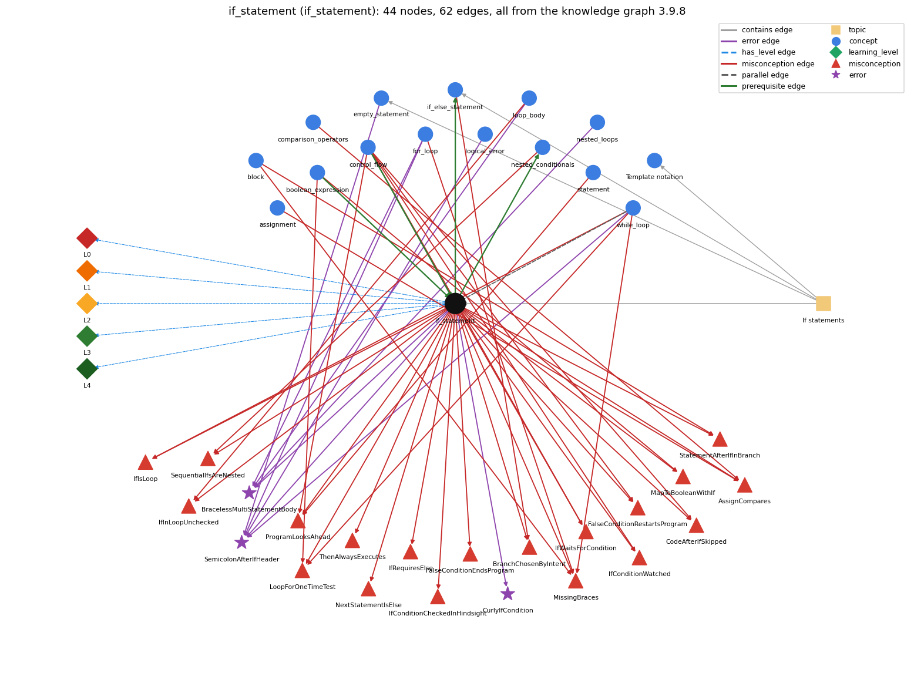

# if_statement (`if_statement`)

run a block only when the condition holds

Section 1.3 Conditionals and Loops, topic 1.3.b If statements.

## At a glance

- **Needs first:** `boolean_expression`, `control_flow`
- **Leads to:** `if_else_statement`, `nested_conditionals`
- **Learned alongside:** `while_loop`
- **Misconceptions:** `AssignCompares`, `BranchChosenByIntent`, `CodeAfterIfSkipped`, `FalseConditionEndsProgram`, `FalseConditionRestartsProgram`, `IfConditionCheckedInHindsight`, `IfConditionWatched`, `IfInLoopUnchecked`, `IfIsLoop`, `IfRequiresElse`, `IfWaitsForCondition`, `LoopForOneTimeTest`, `MapToBooleanWithIf`, `MissingBraces`, `NextStatementIsElse`, `ProgramLooksAhead`, `SequentialIfsAreNested`, `StatementAfterIfInBranch`, `ThenAlwaysExecutes`
- **Errors:** `BracelessMultiStatementBody`, `CurlyIfCondition`, `SemicolonAfterIfHeader`
- **Levels:** L0, L1, L2, L3, L4

Everything below comes from the knowledge graph 3.9.8 (`data/raw/chapter1_kg_updated.json`): 62 edges around this concept. The edge logic, the wrong and right rules and the exact rules of the ways are copied word for word from the graph.

## To work on (1)

- misconceptions with no L0 way linked to them: MissingBraces

## What it needs first (2)

A prerequisite edge means the other concept has to be understood before `if_statement`.

### `boolean_expression` comes before `if_statement`

*an expression that evaluates to true/false*

- **Edge:** `pre:boolean_expression->if_statement`
- **Exact edge logic:** An if runs its block only when its boolean expression evaluates to true.
- **Grounding:** book\_passage
- **Composition rule (R) of `if_statement` with `boolean_expression`:** The condition must be a boolean expression; a non-boolean condition such as if (t = goal) with int t is a compile-time error, while if (b = false) with boolean b compiles and assigns.
- **Composition rule (R) of `boolean_expression` with `if_statement`:** The if statement evaluates its boolean expression once and runs its block only when the value is true; the expression must have type boolean, so if (x = 5) with int x does not compile.

### `control_flow` comes before `if_statement`

*the order in which statements are executed*

- **Edge:** `pre:control_flow->if_statement`
- **Exact edge logic:** An if changes the default top-to-bottom flow by running a block only when its condition is true.
- **Grounding:** book\_passage
- **Composition rule (R) of `if_statement` with `control_flow`:** An if is a fork in the control flow: one path through the body, one around it, both rejoining at the next statement.
- **Composition rule (R) of `control_flow` with `if_statement`:** An if changes the default top-to-bottom flow: its condition is tested once when control reaches it, its block runs only if true, and in both cases control then continues with the next statement.

## What it leads to (2)

These concepts need `if_statement` first.

### `if_statement` comes before `if_else_statement`

*choose one of two blocks*

- **Edge:** `pre:if_statement->if_else_statement`
- **Exact edge logic:** if-else extends if with a second block that runs exactly when the condition is false.
- **Grounding:** book\_passage
- **Composition rule (R) of `if_statement` with `if_else_statement`:** if-else extends if with a second branch that runs exactly when the condition is false; a lone if has an implicit empty else-case.
- **Composition rule (R) of `if_else_statement` with `if_statement`:** if-else is an if with a second branch for the false case; dropping the else gives a plain if in which the false case does nothing.

### `if_statement` comes before `nested_conditionals`

*else-if chains and conditionals inside conditionals*

- **Edge:** `pre:if_statement->nested_conditionals`
- **Exact edge logic:** An if statement can sit inside the body of another if; the inner one is tested only when the outer condition is true.
- **Grounding:** book\_passage

## Learned alongside (1)

A parallel edge joins two concepts that sit side by side: neither is needed before the other.

### `if_statement` alongside `while_loop`

*repeat a block while a condition holds*

- **Edge:** `par:if_statement~while_loop`
- **Exact edge logic:** if and while have the same form, but if tests its condition once and runs the block at most once, while while tests again after every pass and repeats the block as long as the condition is true.
- **Grounding:** book\_passage

## Misconceptions (19)

A misconception edge states the wrong rule a student may hold about this concept, and the right rule.

### AssignCompares

- **Edge:** `if_statement` &rarr; `AssignCompares` (misconception)
- **Exact edge logic (the wrong rule):** = compares two values instead of assigning
- **Twin logic (the right rule):** x = y copies the value of y into x; x == y is what compares them.
- **Wrong belief (on the node):** = compares two values instead of assigning
- **Correct rule (on the node):** x = y copies the value of y into x; x == y is what compares them.
- **Provenance:** published
- **Role of this concept:** context
- **L0 way linked to it:** yes
- **L0 way [15] misconception, exact rule:** wrong rule: = compares two values instead of assigning. Right rule: x = y copies the value of y into x; x == y is what compares them.
- **Edge `assignment` &rarr; `AssignCompares`, exact edge logic:** x = y checks whether x and y are equal. **Twin logic:** x = y copies the value of y into x; x == y is what compares them. (role: primary)
- **Edge `comparison_operators` &rarr; `AssignCompares`, exact edge logic:** = compares two values instead of assigning **Twin logic:** x = y copies the value of y into x; x == y is what compares them. (role: context)

### BranchChosenByIntent

- **Edge:** `if_statement` &rarr; `BranchChosenByIntent` (misconception)
- **Exact edge logic (the wrong rule):** Which branch runs is decided by what the programmer meant or by code outside the if, not by whether the condition is true.
- **Twin logic (the right rule):** The then branch runs exactly when the condition evaluates to true at the moment it is tested; otherwise the else branch (if any) runs.
- **Wrong belief (on the node):** Which branch runs is decided by what the programmer meant or by code outside the if, not by whether the condition is true.
- **Correct rule (on the node):** The then branch runs exactly when the condition evaluates to true at the moment it is tested; otherwise the else branch (if any) runs.
- **Provenance:** published
- **Role of this concept:** primary
- **L0 way linked to it:** yes
- **L0 way [8] misconception, exact rule:** wrong rule: Which branch runs is decided by what the programmer meant or by code outside the if, not by whether the condition is true. Right rule: The then branch runs exactly when the condition evaluates to true at the moment it is tested; otherwise the else branch (if any) runs.
- **Edge `if_else_statement` &rarr; `BranchChosenByIntent`, exact edge logic:** Which branch runs is decided by what the programmer meant or by code outside the if, not by whether the condition is true. **Twin logic:** The then branch runs exactly when the condition evaluates to true at the moment it is tested; otherwise the else branch (if any) runs. (role: context)

### CodeAfterIfSkipped

- **Edge:** `if_statement` &rarr; `CodeAfterIfSkipped` (misconception)
- **Exact edge logic (the wrong rule):** When the then branch runs, the code after the if is skipped.
- **Twin logic (the right rule):** After the if finishes, execution continues with the next statement either way.
- **Wrong belief (on the node):** When the then branch runs, the code after the if is skipped.
- **Correct rule (on the node):** After the if finishes, execution continues with the next statement either way.
- **Provenance:** published
- **Role of this concept:** primary
- **L0 way linked to it:** yes
- **L0 way [5] misconception, exact rule:** wrong rule: When the then branch runs, the code after the if is skipped. Right rule: After the if finishes, execution continues with the next statement either way.
- **Edge `control_flow` &rarr; `CodeAfterIfSkipped`, exact edge logic:** When the then branch runs, the code after the if is skipped. **Twin logic:** After the if finishes, execution continues with the next statement either way. (role: context)

### FalseConditionEndsProgram

- **Edge:** `if_statement` &rarr; `FalseConditionEndsProgram` (misconception)
- **Exact edge logic (the wrong rule):** A false condition with no else ends the program.
- **Twin logic (the right rule):** When an if condition is false and there is no else, execution continues with the statement after the if.
- **Wrong belief (on the node):** A false condition with no else ends the program.
- **Correct rule (on the node):** When an if condition is false and there is no else, execution continues with the statement after the if.
- **Provenance:** published
- **Role of this concept:** primary
- **L0 way linked to it:** yes
- **L0 way [3] misconception, exact rule:** wrong rule: A false condition with no else ends the program. Right rule: When an if condition is false and there is no else, execution continues with the statement after the if.

### FalseConditionRestartsProgram

- **Edge:** `if_statement` &rarr; `FalseConditionRestartsProgram` (misconception)
- **Exact edge logic (the wrong rule):** When an if condition is false (and there is no else), control jumps back to the start of the program.
- **Twin logic (the right rule):** A false condition skips the then branch and execution continues with the statement after the if statement.
- **Wrong belief (on the node):** When an if condition is false (and there is no else), control jumps back to the start of the program.
- **Correct rule (on the node):** A false condition skips the then branch and execution continues with the statement after the if statement.
- **Provenance:** published
- **Role of this concept:** primary
- **L0 way linked to it:** yes
- **L0 way [10] misconception, exact rule:** wrong rule: When an if condition is false (and there is no else), control jumps back to the start of the program. Right rule: A false condition skips the then branch and execution continues with the statement after the if statement.
- **Edge `control_flow` &rarr; `FalseConditionRestartsProgram`, exact edge logic:** When an if condition is false (and there is no else), control jumps back to the start of the program. **Twin logic:** A false condition skips the then branch and execution continues with the statement after the if statement. (role: context)

### IfConditionCheckedInHindsight

- **Edge:** `if_statement` &rarr; `IfConditionCheckedInHindsight` (misconception)
- **Exact edge logic (the wrong rule):** Whether the branch runs is decided by the condition after the branch, or from the point inside the body where the condition becomes true.
- **Twin logic (the right rule):** The condition is tested once, before the branch; the whole branch runs if it was true at that moment and none of it runs otherwise.
- **Wrong belief (on the node):** Whether the branch runs is decided by the condition after the branch, or from the point inside the body where the condition becomes true.
- **Correct rule (on the node):** The condition is tested once, before the branch; the whole branch runs if it was true at that moment and none of it runs otherwise.
- **Provenance:** published
- **Role of this concept:** primary
- **L0 way linked to it:** yes
- **L0 way [12] misconception, exact rule:** wrong rule: Whether the branch runs is decided by the condition after the branch, or from the point inside the body where the condition becomes true. Right rule: The condition is tested once, before the branch; the whole branch runs if it was true at that moment and none of it runs otherwise.

### IfConditionWatched

- **Edge:** `if_statement` &rarr; `IfConditionWatched` (misconception)
- **Exact edge logic (the wrong rule):** An if statement watches its condition while the program runs and fires as soon as the condition becomes true (if = whenever).
- **Twin logic (the right rule):** An if condition is tested once, when control reaches the if statement; later changes to the variables do not trigger the branch.
- **Wrong belief (on the node):** An if statement watches its condition while the program runs and fires as soon as the condition becomes true (if = whenever).
- **Correct rule (on the node):** An if condition is tested once, when control reaches the if statement; later changes to the variables do not trigger the branch.
- **Provenance:** published
- **Role of this concept:** primary
- **L0 way linked to it:** yes
- **L0 way [11] misconception, exact rule:** wrong rule: An if statement watches its condition while the program runs and fires as soon as the condition becomes true (if = whenever). Right rule: An if condition is tested once, when control reaches the if statement; later changes to the variables do not trigger the branch.
- **Edge `control_flow` &rarr; `IfConditionWatched`, exact edge logic:** An if statement watches its condition while the program runs and fires as soon as the condition becomes true (if = whenever). **Twin logic:** An if condition is tested once, when control reaches the if statement; later changes to the variables do not trigger the branch. (role: context)

### IfInLoopUnchecked

- **Edge:** `if_statement` &rarr; `IfInLoopUnchecked` (misconception)
- **Exact edge logic (the wrong rule):** An if inside a loop body runs its branch on every pass without testing its condition.
- **Twin logic (the right rule):** The if condition is tested again on every pass, with the current values, so the branch runs only on passes where it is true.
- **Wrong belief (on the node):** An if inside a loop body runs its branch on every pass without testing its condition.
- **Correct rule (on the node):** The if condition is tested again on every pass, with the current values, so the branch runs only on passes where it is true.
- **Provenance:** published
- **Role of this concept:** primary
- **L0 way linked to it:** yes
- **L0 way [13] misconception, exact rule:** wrong rule: An if inside a loop body runs its branch on every pass without testing its condition. Right rule: The if condition is tested again on every pass, with the current values, so the branch runs only on passes where it is true.
- **Edge `loop_body` &rarr; `IfInLoopUnchecked`, exact edge logic:** An if inside a loop body runs its branch on every pass without testing its condition. **Twin logic:** The if condition is tested again on every pass, with the current values, so the branch runs only on passes where it is true. (role: context)

### IfIsLoop

- **Edge:** `if_statement` &rarr; `IfIsLoop` (misconception)
- **Exact edge logic (the wrong rule):** The if body keeps repeating as long as its condition stays true.
- **Twin logic (the right rule):** An if body runs at most once; only a loop repeats its body.
- **Wrong belief (on the node):** an if body repeats while its condition holds
- **Correct rule (on the node):** An if body runs at most once; only a loop repeats its body.
- **Provenance:** published
- **Role of this concept:** primary
- **L0 way linked to it:** yes
- **L0 way [1] misconception, exact rule:** wrong rule: an if body repeats while its condition holds. Right rule: An if body runs at most once; only a loop repeats its body.
- **L0 way [14] inconsistent\_trace, exact rule:** Applies the if rule (LT) unevenly: tests the condition on some visits but not others (e.g. runs the branch on every loop pass without testing), runs the branch after a false test, or re-checks the condition after the branch has run. (here mixing in: "an if body repeats while its condition holds")
- **Edge `while_loop` &rarr; `IfIsLoop`, exact edge logic:** A while loop runs its body once when the condition is true, just like an if. **Twin logic:** A while tests its condition again after every pass and keeps repeating while the condition stays true. (role: context)

### IfRequiresElse

- **Edge:** `if_statement` &rarr; `IfRequiresElse` (misconception)
- **Exact edge logic (the wrong rule):** Every if statement requires an else.
- **Twin logic (the right rule):** An if statement may stand alone; the else part is optional.
- **Wrong belief (on the node):** Every if statement requires an else.
- **Correct rule (on the node):** An if statement may stand alone; the else part is optional.
- **Provenance:** published
- **Role of this concept:** primary
- **L0 way linked to it:** yes
- **L0 way [2] misconception, exact rule:** wrong rule: Every if statement requires an else. Right rule: An if statement may stand alone; the else part is optional.

### IfWaitsForCondition

- **Edge:** `if_statement` &rarr; `IfWaitsForCondition` (misconception)
- **Exact edge logic (the wrong rule):** An IF statement earlier in the program stays active and fires later, e.g. inside a later loop, when its condition becomes true.
- **Twin logic (the right rule):** An if is evaluated once when control reaches it; afterwards it is inactive unless control returns to it.
- **Wrong belief (on the node):** An IF statement earlier in the program stays active and fires later, e.g. inside a later loop, when its condition becomes true.
- **Correct rule (on the node):** An if is evaluated once when control reaches it; afterwards it is inactive unless control returns to it.
- **Provenance:** published
- **Role of this concept:** primary
- **L0 way linked to it:** yes
- **L0 way [7] misconception, exact rule:** wrong rule: An IF statement earlier in the program stays active and fires later, e.g. inside a later loop, when its condition becomes true. Right rule: An if is evaluated once when control reaches it; afterwards it is inactive unless control returns to it.
- **Edge `control_flow` &rarr; `IfWaitsForCondition`, exact edge logic:** An IF statement earlier in the program stays active and fires later, e.g. inside a later loop, when its condition becomes true. **Twin logic:** An if is evaluated once when control reaches it; afterwards it is inactive unless control returns to it. (role: context)

### LoopForOneTimeTest

- **Edge:** `if_statement` &rarr; `LoopForOneTimeTest` (misconception)
- **Exact edge logic (the wrong rule):** Uses a loop where a condition needs to be tested only once.
- **Twin logic (the right rule):** A test made once is an if; a loop repeats.
- **Wrong belief (on the node):** Uses a loop where a condition needs to be tested only once.
- **Correct rule (on the node):** A test made once is an if; a loop repeats.
- **Provenance:** published
- **Role of this concept:** context
- **L0 way linked to it:** yes
- **L0 way [16] misconception, exact rule:** wrong rule: Uses a loop where a condition needs to be tested only once. Right rule: A test made once is an if; a loop repeats.
- **Edge `boolean_expression` &rarr; `LoopForOneTimeTest`, exact edge logic:** Uses a loop where a condition needs to be tested only once. **Twin logic:** A test made once is an if; a loop repeats. (role: context)
- **Edge `while_loop` &rarr; `LoopForOneTimeTest`, exact edge logic:** Uses a loop where a condition needs to be tested only once. **Twin logic:** A test made once is an if; a loop repeats. (role: primary)

### MapToBooleanWithIf

- **Edge:** `if_statement` &rarr; `MapToBooleanWithIf` (misconception)
- **Exact edge logic (the wrong rule):** you need an if to turn a boolean expression into a boolean
- **Twin logic (the right rule):** ok = (x &gt; y); stores the result of the comparison directly.
- **Wrong belief (on the node):** you need an if to turn a boolean expression into a boolean
- **Correct rule (on the node):** ok = (x &gt; y); stores the result of the comparison directly.
- **Provenance:** published
- **Role of this concept:** context
- **L0 way linked to it:** yes
- **L0 way [17] misconception, exact rule:** wrong rule: you need an if to turn a boolean expression into a boolean. Right rule: ok = (x &gt; y); stores the result of the comparison directly.
- **Edge `boolean_expression` &rarr; `MapToBooleanWithIf`, exact edge logic:** To store whether x &gt; y in a boolean you need if (x &gt; y) ok = true; else ok = false;. **Twin logic:** ok = (x &gt; y); stores the result of the comparison directly. (role: primary)

### MissingBraces

- **Edge:** `if_statement` &rarr; `MissingBraces` (misconception)
- **Exact edge logic (the wrong rule):** Omits braces around a single-statement body of if, for or while.
- **Twin logic (the right rule):** Braces are optional for a single-statement body, but using them anyway avoids bugs when statements are added later.
- **Wrong belief (on the node):** Omits braces around a single-statement body of if, for or while.
- **Correct rule (on the node):** Braces are optional for a single-statement body, but using them anyway avoids bugs when statements are added later.
- **Provenance:** rule\_dictionary
- **Role of this concept:** primary
- **L0 way linked to it:** no
- **Edge `block` &rarr; `MissingBraces`, exact edge logic:** Omits braces around a single-statement body of if, for or while. **Twin logic:** Braces are optional for a single-statement body, but using them anyway avoids bugs when statements are added later. (role: context)
- **Edge `for_loop` &rarr; `MissingBraces`, exact edge logic:** Omits braces around a single-statement body of if, for or while. **Twin logic:** Braces are optional for a single-statement body, but using them anyway avoids bugs when statements are added later. (role: context)
- **Edge `while_loop` &rarr; `MissingBraces`, exact edge logic:** Omits braces around a single-statement body of if, for or while. **Twin logic:** Braces are optional for a single-statement body, but using them anyway avoids bugs when statements are added later. (role: context)

### NextStatementIsElse

- **Edge:** `if_statement` &rarr; `NextStatementIsElse` (misconception)
- **Exact edge logic (the wrong rule):** In if (c) A; B; the statement B runs only when c is false.
- **Twin logic (the right rule):** B is not part of the if; it runs every time.
- **Wrong belief (on the node):** In if (c) A; B; the statement B runs only when c is false.
- **Correct rule (on the node):** B is not part of the if; it runs every time.
- **Provenance:** published
- **Role of this concept:** primary
- **L0 way linked to it:** yes
- **L0 way [6] misconception, exact rule:** wrong rule: In if (c) A; B; the statement B runs only when c is false. Right rule: B is not part of the if; it runs every time.

### ProgramLooksAhead

- **Edge:** `if_statement` &rarr; `ProgramLooksAhead` (misconception)
- **Exact edge logic (the wrong rule):** The program knows or sees what later lines will do and acts on those goals at the current line, e.g. it stops 'at ten' because it wants to draw a box.
- **Twin logic (the right rule):** Each statement executes using only the current state; later lines have no effect until control reaches them.
- **Wrong belief (on the node):** The program knows or sees what later lines will do and acts on those goals at the current line, e.g. it stops 'at ten' because it wants to draw a box.
- **Correct rule (on the node):** Each statement executes using only the current state; later lines have no effect until control reaches them.
- **Provenance:** published
- **Role of this concept:** context
- **L0 way linked to it:** yes
- **L0 way [18] misconception, exact rule:** wrong rule: The program knows or sees what later lines will do and acts on those goals at the current line, e.g. it stops 'at ten' because it wants to draw a box. Right rule: Each statement executes using only the current state; later lines have no effect until control reaches them.
- **Edge `control_flow` &rarr; `ProgramLooksAhead`, exact edge logic:** The program knows or sees what later lines will do and acts on those goals at the current line, e.g. it stops 'at ten' because it wants to draw a box. **Twin logic:** Each statement executes using only the current state; later lines have no effect until control reaches them. (role: primary)
- **Edge `statement` &rarr; `ProgramLooksAhead`, exact edge logic:** The program knows or sees what later lines will do and acts on those goals at the current line, e.g. it stops 'at ten' because it wants to draw a box. **Twin logic:** Each statement executes using only the current state; later lines have no effect until control reaches them. (role: context)

### SequentialIfsAreNested

- **Edge:** `if_statement` &rarr; `SequentialIfsAreNested` (misconception)
- **Exact edge logic (the wrong rule):** Of two if statements one after the other, the second runs its body only if both conditions are true.
- **Twin logic (the right rule):** Two ifs in sequence are independent: each tests only its own condition.
- **Wrong belief (on the node):** Of two if statements one after the other, the second runs its body only if both conditions are true.
- **Correct rule (on the node):** Two ifs in sequence are independent: each tests only its own condition.
- **Provenance:** published
- **Role of this concept:** context
- **L0 way linked to it:** yes
- **L0 way [19] misconception, exact rule:** wrong rule: Of two if statements one after the other, the second runs its body only if both conditions are true. Right rule: Two ifs in sequence are independent: each tests only its own condition.
- **Edge `nested_conditionals` &rarr; `SequentialIfsAreNested`, exact edge logic:** Of two if statements one after the other, the second runs its body only if both conditions are true. **Twin logic:** Two ifs in sequence are independent: each tests only its own condition. (role: primary)

### StatementAfterIfInBranch

- **Edge:** `if_statement` &rarr; `StatementAfterIfInBranch` (misconception)
- **Exact edge logic (the wrong rule):** A statement placed after the if statement belongs to its branch, so it runs only when the condition is true.
- **Twin logic (the right rule):** The branch ends at its closing brace (or after its single statement); the next statement runs whatever the condition was.
- **Wrong belief (on the node):** A statement placed after the if statement belongs to its branch, so it runs only when the condition is true.
- **Correct rule (on the node):** The branch ends at its closing brace (or after its single statement); the next statement runs whatever the condition was.
- **Provenance:** published
- **Role of this concept:** primary
- **L0 way linked to it:** yes
- **L0 way [9] misconception, exact rule:** wrong rule: A statement placed after the if statement belongs to its branch, so it runs only when the condition is true. Right rule: The branch ends at its closing brace (or after its single statement); the next statement runs whatever the condition was.
- **Edge `block` &rarr; `StatementAfterIfInBranch`, exact edge logic:** A statement placed after the if statement belongs to its branch, so it runs only when the condition is true. **Twin logic:** The branch ends at its closing brace (or after its single statement); the next statement runs whatever the condition was. (role: context)

### ThenAlwaysExecutes

- **Edge:** `if_statement` &rarr; `ThenAlwaysExecutes` (misconception)
- **Exact edge logic (the wrong rule):** The then branch always runs.
- **Twin logic (the right rule):** The then branch runs only when the condition is true.
- **Wrong belief (on the node):** The then branch always runs.
- **Correct rule (on the node):** The then branch runs only when the condition is true.
- **Provenance:** published
- **Role of this concept:** primary
- **L0 way linked to it:** yes
- **L0 way [4] misconception, exact rule:** wrong rule: The then branch always runs. Right rule: The then branch runs only when the condition is true.

## Errors (3)

An error edge states the rule that gets broken in a program, and the right rule.

### BracelessMultiStatementBody

- **Edge:** `if_statement` &rarr; `BracelessMultiStatementBody` (error)
- **Exact edge logic (the wrong rule):** Indenting several statements under an if or for makes them all part of its body, even without braces.
- **Twin logic (the right rule):** Without braces only the first statement belongs to the if/for; the rest run once, after it.
- **Wrong belief (on the node):** Indenting several statements under an if or for makes them all part of its body, even without braces.
- **Correct rule (on the node):** Without braces only the first statement belongs to the if/for; the rest run once, after it.
- **Provenance:** textbook
- **Role of this concept:** context
- **Edge `for_loop` &rarr; `BracelessMultiStatementBody`, exact edge logic:** Indenting several statements under an if or for makes them all part of its body, even without braces. **Twin logic:** Without braces only the first statement belongs to the if/for; the rest run once, after it. (role: context)
- **Edge `loop_body` &rarr; `BracelessMultiStatementBody`, exact edge logic:** Indenting several statements under an if or for makes them all part of its body, even without braces. **Twin logic:** Without braces only the first statement belongs to the if/for; the rest run once, after it. (role: primary)
- **Edge `nested_loops` &rarr; `BracelessMultiStatementBody`, exact edge logic:** Indenting several statements under an if or for makes them all part of its body, even without braces. **Twin logic:** Without braces only the first statement belongs to the if/for; the rest run once, after it. (role: context)

### CurlyIfCondition

- **Edge:** `if_statement` &rarr; `CurlyIfCondition` (error)
- **Exact edge logic (the wrong rule):** Writes the if condition inside { } instead of ( ).
- **Twin logic (the right rule):** The condition of an if is written in parentheses.
- **Wrong belief (on the node):** Writes the if condition inside { } instead of ( ).
- **Correct rule (on the node):** The condition of an if is written in parentheses.
- **Provenance:** published
- **Role of this concept:** primary

### SemicolonAfterIfHeader

- **Edge:** `if_statement` &rarr; `SemicolonAfterIfHeader` (error)
- **Exact edge logic (the wrong rule):** if (x &gt; 0); System.out.println("positive"); prints only for positive x.
- **Twin logic (the right rule):** The ; ends the if with an empty statement, so the next line always runs.
- **Wrong belief (on the node):** if (x &gt; 0); System.out.println("positive"); prints only for positive x.
- **Correct rule (on the node):** The ; ends the if with an empty statement, so the next line always runs.
- **Provenance:** published
- **Role of this concept:** primary
- **Edge `empty_statement` &rarr; `SemicolonAfterIfHeader`, exact edge logic:** if (x &gt; 0); System.out.println("positive"); prints only for positive x. **Twin logic:** The ; ends the if with an empty statement, so the next line always runs. (role: context)
- **Edge `for_loop` &rarr; `SemicolonAfterIfHeader`, exact edge logic:** if (x &gt; 0); System.out.println("positive"); prints only for positive x. **Twin logic:** The ; ends the if with an empty statement, so the next line always runs. (role: context)
- **Edge `logical_error` &rarr; `SemicolonAfterIfHeader`, exact edge logic:** if (x &gt; 0); System.out.println("positive"); prints only for positive x. **Twin logic:** The ; ends the if with an empty statement, so the next line always runs. (role: context)
- **Edge `while_loop` &rarr; `SemicolonAfterIfHeader`, exact edge logic:** if (x &gt; 0); System.out.println("positive"); prints only for positive x. **Twin logic:** The ; ends the if with an empty statement, so the next line always runs. (role: context)

## Levels L0 to L4 (5 of 5)

Each level edge lists the ways a student shows that level, each with its exact rule.

### L0: Prestructural / sensorimotor

L0 for if statement: the answer holds a rule that contradicts Java.

*Deciding question: Does every rule the answer applies to if statement agree with the language rule? If it reads the code with everyday meanings, applies a wrong rule, or switches rules within one trace, it is L0. A slip in an otherwise rule-correct trace is L2 with an error, not L0.*

- **Edge:** `if_statement` &rarr; `if_statement@L0` (has_level)
- **Exact edge logic:** if statement -&gt; L0 (Prestructural): the answer holds a rule that contradicts Java (20 ways).

Ways (20), each with its exact rule:

- **[0] everyday\_reading** (rule type E, folk-meaning rule): Folk meaning: English 'if' (and 'whenever') states a standing rule that stays in force and fires whenever its condition becomes true. A Java if is evaluated once, when control reaches it, and then is 'taken off the books'; changing the variables later does not re-trigger it.
- **[1] misconception** (rule type M, wrong rule / right rule) &rarr; `IfIsLoop`: wrong rule: an if body repeats while its condition holds. Right rule: An if body runs at most once; only a loop repeats its body.
- **[2] misconception** (rule type M, wrong rule / right rule) &rarr; `IfRequiresElse`: wrong rule: Every if statement requires an else. Right rule: An if statement may stand alone; the else part is optional.
- **[3] misconception** (rule type M, wrong rule / right rule) &rarr; `FalseConditionEndsProgram`: wrong rule: A false condition with no else ends the program. Right rule: When an if condition is false and there is no else, execution continues with the statement after the if.
- **[4] misconception** (rule type M, wrong rule / right rule) &rarr; `ThenAlwaysExecutes`: wrong rule: The then branch always runs. Right rule: The then branch runs only when the condition is true.
- **[5] misconception** (rule type M, wrong rule / right rule) &rarr; `CodeAfterIfSkipped`: wrong rule: When the then branch runs, the code after the if is skipped. Right rule: After the if finishes, execution continues with the next statement either way.
- **[6] misconception** (rule type M, wrong rule / right rule) &rarr; `NextStatementIsElse`: wrong rule: In if (c) A; B; the statement B runs only when c is false. Right rule: B is not part of the if; it runs every time.
- **[7] misconception** (rule type M, wrong rule / right rule) &rarr; `IfWaitsForCondition`: wrong rule: An IF statement earlier in the program stays active and fires later, e.g. inside a later loop, when its condition becomes true. Right rule: An if is evaluated once when control reaches it; afterwards it is inactive unless control returns to it.
- **[8] misconception** (rule type M, wrong rule / right rule) &rarr; `BranchChosenByIntent`: wrong rule: Which branch runs is decided by what the programmer meant or by code outside the if, not by whether the condition is true. Right rule: The then branch runs exactly when the condition evaluates to true at the moment it is tested; otherwise the else branch (if any) runs.
- **[9] misconception** (rule type M, wrong rule / right rule) &rarr; `StatementAfterIfInBranch`: wrong rule: A statement placed after the if statement belongs to its branch, so it runs only when the condition is true. Right rule: The branch ends at its closing brace (or after its single statement); the next statement runs whatever the condition was.
- **[10] misconception** (rule type M, wrong rule / right rule) &rarr; `FalseConditionRestartsProgram`: wrong rule: When an if condition is false (and there is no else), control jumps back to the start of the program. Right rule: A false condition skips the then branch and execution continues with the statement after the if statement.
- **[11] misconception** (rule type M, wrong rule / right rule) &rarr; `IfConditionWatched`: wrong rule: An if statement watches its condition while the program runs and fires as soon as the condition becomes true (if = whenever). Right rule: An if condition is tested once, when control reaches the if statement; later changes to the variables do not trigger the branch.
- **[12] misconception** (rule type M, wrong rule / right rule) &rarr; `IfConditionCheckedInHindsight`: wrong rule: Whether the branch runs is decided by the condition after the branch, or from the point inside the body where the condition becomes true. Right rule: The condition is tested once, before the branch; the whole branch runs if it was true at that moment and none of it runs otherwise.
- **[13] misconception** (rule type M, wrong rule / right rule) &rarr; `IfInLoopUnchecked`: wrong rule: An if inside a loop body runs its branch on every pass without testing its condition. Right rule: The if condition is tested again on every pass, with the current values, so the branch runs only on passes where it is true.
- **[14] inconsistent\_trace** (rule type T, uneven-application rule) &rarr; `IfIsLoop`: Applies the if rule (LT) unevenly: tests the condition on some visits but not others (e.g. runs the branch on every loop pass without testing), runs the branch after a false test, or re-checks the condition after the branch has run. (here mixing in: "an if body repeats while its condition holds")
- **[15] misconception** (rule type M, wrong rule / right rule) &rarr; `AssignCompares`: wrong rule: = compares two values instead of assigning. Right rule: x = y copies the value of y into x; x == y is what compares them.
- **[16] misconception** (rule type M, wrong rule / right rule) &rarr; `LoopForOneTimeTest`: wrong rule: Uses a loop where a condition needs to be tested only once. Right rule: A test made once is an if; a loop repeats.
- **[17] misconception** (rule type M, wrong rule / right rule) &rarr; `MapToBooleanWithIf`: wrong rule: you need an if to turn a boolean expression into a boolean. Right rule: ok = (x &gt; y); stores the result of the comparison directly.
- **[18] misconception** (rule type M, wrong rule / right rule) &rarr; `ProgramLooksAhead`: wrong rule: The program knows or sees what later lines will do and acts on those goals at the current line, e.g. it stops 'at ten' because it wants to draw a box. Right rule: Each statement executes using only the current state; later lines have no effect until control reaches them.
- **[19] misconception** (rule type M, wrong rule / right rule) &rarr; `SequentialIfsAreNested`: wrong rule: Of two if statements one after the other, the second runs its body only if both conditions are true. Right rule: Two ifs in sequence are independent: each tests only its own condition.

### L1: Unistructural / atom x text surface

L1 for if statement: the answer states one correct rule without applying it.

*Deciding question: Does the answer cover every part of the code, in order, with the values (L2)? If it covers one part or only states the rule, it is L1.*

- **Edge:** `if_statement` &rarr; `if_statement@L1` (has_level)
- **Exact edge logic:** if statement -&gt; L1 (Unistructural): the answer states one correct rule without applying it (2 ways).

Ways (2), each with its exact rule:

- **[0] names\_the\_element** (rule type N, identity rule): The if statement is a conditional (selection) statement: it runs a statement or block only when a boolean condition is true.
- **[1] states\_the\_rule** (rule type S, declarative rule): Syntax: if (&lt;boolean expression&gt;) &lt;statement or { block }&gt;; the braces are optional when the body is a single statement. The expression must have type boolean (or Boolean), and the body is executed if and only if the expression is true.

### L2: Multistructural / block x execution / preoperational

L2 for if statement: the answer applies these rules to every part of the code, in order.

*Deciding question: Is the answer many segments mapped onto lines (L2), or one segment stating the purpose of the whole (L3)? A correct output with no value-by-value justification is not levelled.*

- **Edge:** `if_statement` &rarr; `if_statement@L2` (has_level)
- **Exact edge logic:** if statement -&gt; L2 (Multistructural): the answer applies the rules of if statement to every part of the code, in order (3 ways).

Ways (3), each with its exact rule:

- **[0] line\_by\_line\_trace** (rule type LT, operational sequencing rule): Evaluate the condition once; if true, execute the body; then, in either case, continue with the statement after the if.
- **[1] output\_prediction** (rule type OP, evaluation / result rule): An if produces no value; its observable result is that the body's effects (assignments, output) happen exactly once when the condition is true and not at all when it is false; e.g. if (x &lt; 0) x = -x; leaves x = 5 for 5 and gives 5 for -5.
- **[2] one\_step\_execution** (rule type OS, state-transition rule): One execution reads the variables in the condition, changes nothing by the test itself (unless the condition has a side effect), and, when true, applies the body's changes once; control then moves to the next statement.

### L3: Relational / relations x function (concrete operational begins)

L3 for if statement: the answer relates the parts by these rules.

*Deciding question: Was the purpose deduced from the code, or only guessed from traced input/output pairs (then L2)? Does the answer stay within the given code (L3), or reason about changed code, an error class or a new program (L4)?*

- **Edge:** `if_statement` &rarr; `if_statement@L3` (has_level)
- **Exact edge logic:** if statement -&gt; L3 (Relational): the answer relates the parts (5 ways).

Ways (5), each with its exact rule:

- **[0] relation\_to\_neighbour** (rule type R, composition rule (with a neighbour)): The condition must be a boolean expression; a non-boolean condition such as if (t = goal) with int t is a compile-time error, while if (b = false) with boolean b compiles and assigns.
- **[1] relation\_to\_neighbour** (rule type R, composition rule (with a neighbour)): if-else extends if with a second branch that runs exactly when the condition is false; a lone if has an implicit empty else-case.
- **[2] relation\_to\_neighbour** (rule type R, composition rule (with a neighbour)): An if is a fork in the control flow: one path through the body, one around it, both rejoining at the next statement.
- **[3] relation\_to\_neighbour** (rule type R, composition rule (with a neighbour)): if and while have the same form, but if tests its condition once and runs the block at most once, while while tests again after every pass and repeats the block as long as the condition is true.
- **[4] purpose\_of\_the\_whole** (rule type P, plan / role rule): Plan: guard / conditional action - do something only for the inputs that need it (absolute value, put two values in order, error check before dividing).

### L4: Extended abstract (concrete-operational reversibility and conservation)

L4 for if statement: the answer reasons beyond the given code by these rules.

*Deciding question: Does the answer link the code to a broader context: a changed program, a class of inputs, an unseen problem? Re-tracing changed code value by value is L2; fixing one given failing case is L3.*

- **Edge:** `if_statement` &rarr; `if_statement@L4` (has_level)
- **Exact edge logic:** if statement -&gt; L4 (Extended abstract): the answer reasons beyond the given code (7 ways).

Ways (7), each with its exact rule:

- **[0] predict\_a\_change** (rule type C, conservation rule) &rarr; `IfIsLoop`: Negating the condition swaps which inputs run the body; changing &lt; to &lt;= changes only the boundary value. Adding a statement under a braceless if does not put it in the body. Whatever the condition, code after the if still runs exactly once.
- **[1] diagnose\_an\_error** (rule type D, error rule): rule broken: A ; right after if (...) is an empty statement that forms the whole then branch; the following statement or block is no longer part of the if. Kind: silent logic error. Trigger class: Any if (cond); followed by a statement or block: that statement runs for every input, whatever cond is (it compiles without error).
- **[2] diagnose\_an\_error** (rule type D, error rule): rule broken: The if template is if (&lt;boolean expression&gt;) &lt;statement&gt;: the condition must be enclosed in parentheses. Kind: compile-time. Trigger class: Any if whose condition is written in { } or without ( ), e.g. if {x &gt; 0} ... or if a &gt; b { c = 0; }.
- **[3] transfer\_to\_a\_new\_program** (rule type X, applicability rule): Use an if when an action is needed for some inputs only and the test happens once at that point; use a loop if the action must repeat while the condition holds, and assign a boolean directly (ok = x &gt; y;) when you only need the truth value.
- **[4] diagnose\_an\_error** (rule type D, error rule): rule broken: Without braces, the body of an if, while or for is exactly one statement; indentation does not add statements to it. Kind: silent logic error. Trigger class: A braceless header followed by two or more indented statements: only the first is controlled, the others run once, after the if/loop, on every input.
- **[5] diagnose\_an\_error** (rule type D, error rule): rule broken: The condition of an if must have type boolean. Kind: compile-time. Trigger class: Using = instead of == with int operands, e.g. if (t = goal): 'incompatible types: int cannot be converted to boolean'.
- **[6] diagnose\_an\_error** (rule type D, error rule): rule broken: With boolean operands, = is assignment, not comparison. Kind: silent logic error. Trigger class: if (isPrime = false) with boolean isPrime: compiles, sets isPrime to false and the branch never runs.

## Same topic

`if_statement` belongs to the topic **If statements** (`topic1.3.b`). The topic also contains: `empty_statement`, `if_else_statement`, `syntax_template`.

## Rules of the concept (36)

- **Book** (SW-1e, p. 46 (pdf 56)): "One way to express these differences in Java is the if statement: if (&lt;boolean expression&gt;) { &lt;statements&gt; }"
- **Book** (SW-1e, p. 46 (pdf 56)): "If the sequence is a single statement, the curly braces are optional."
- **Book** (OT-If, ): "It tells your program to execute a certain section of code only if a particular test evaluates to true."
- **Book** (OT-If, ): "Omitting them can make the code more brittle."
- **Book** (GJS, ): "Braces are used with if, else, for, do and while statements, even when the body is empty"
- **Book** (SW-1.3, p. 46 (pdf 56)): "Most computations require different actions for different inputs."
- **E** (folk-meaning rule): Folk meaning: English 'if' (and 'whenever') states a standing rule that stays in force and fires whenever its condition becomes true. A Java if is evaluated once, when control reaches it, and then is 'taken off the books'; changing the variables later does not re-trigger it.
- **M** (wrong rule / right rule): AssignCompares: wrong: = compares two values instead of assigning \| right: x = y copies the value of y into x; x == y is what compares them.
- **M** (wrong rule / right rule): CodeAfterIfSkipped: wrong: When the then branch runs, the code after the if is skipped. \| right: After the if finishes, execution continues with the next statement either way.
- **M** (wrong rule / right rule): FalseConditionEndsProgram: wrong: A false condition with no else ends the program. \| right: When an if condition is false and there is no else, execution continues with the statement after the if.
- **M** (wrong rule / right rule): IfIsLoop: wrong: an if body repeats while its condition holds \| right: An if body runs at most once; only a loop repeats its body.
- **M** (wrong rule / right rule): IfRequiresElse: wrong: Every if statement requires an else. \| right: An if statement may stand alone; the else part is optional.
- **M** (wrong rule / right rule): LoopForOneTimeTest: wrong: Uses a loop where a condition needs to be tested only once. \| right: A test made once is an if; a loop repeats.
- **M** (wrong rule / right rule): MapToBooleanWithIf: wrong: you need an if to turn a boolean expression into a boolean \| right: ok = (x &gt; y); stores the result of the comparison directly.
- **M** (wrong rule / right rule): NextStatementIsElse: wrong: In if (c) A; B; the statement B runs only when c is false. \| right: B is not part of the if; it runs every time.
- **M** (wrong rule / right rule): ThenAlwaysExecutes: wrong: The then branch always runs. \| right: The then branch runs only when the condition is true.
- **M** (wrong rule / right rule): IfWaitsForCondition: wrong: An IF statement earlier in the program stays active and fires later, e.g. inside a later loop, when its condition becomes true. \| right: An if is evaluated once when control reaches it; afterwards it is inactive unless control returns to it.
- **M** (wrong rule / right rule): ProgramLooksAhead: wrong: The program knows or sees what later lines will do and acts on those goals at the current line, e.g. it stops 'at ten' because it wants to draw a box. \| right: Each statement executes using only the current state; later lines have no effect until control reaches them.
- **M** (wrong rule / right rule): BranchChosenByIntent: wrong: Which branch runs is decided by what the programmer meant or by code outside the if, not by whether the condition is true. \| right: The then branch runs exactly when the condition evaluates to true at the moment it is tested; otherwise the else branch (if any) runs.
- **M** (wrong rule / right rule): StatementAfterIfInBranch: wrong: A statement placed after the if statement belongs to its branch, so it runs only when the condition is true. \| right: The branch ends at its closing brace (or after its single statement); the next statement runs whatever the condition was.
- **M** (wrong rule / right rule): FalseConditionRestartsProgram: wrong: When an if condition is false (and there is no else), control jumps back to the start of the program. \| right: A false condition skips the then branch and execution continues with the statement after the if statement.
- **M** (wrong rule / right rule): IfConditionWatched: wrong: An if statement watches its condition while the program runs and fires as soon as the condition becomes true (if = whenever). \| right: An if condition is tested once, when control reaches the if statement; later changes to the variables do not trigger the branch.
- **M** (wrong rule / right rule): IfConditionCheckedInHindsight: wrong: Whether the branch runs is decided by the condition after the branch, or from the point inside the body where the condition becomes true. \| right: The condition is tested once, before the branch; the whole branch runs if it was true at that moment and none of it runs otherwise.
- **M** (wrong rule / right rule): SequentialIfsAreNested: wrong: Of two if statements one after the other, the second runs its body only if both conditions are true. \| right: Two ifs in sequence are independent: each tests only its own condition.
- **M** (wrong rule / right rule): IfInLoopUnchecked: wrong: An if inside a loop body runs its branch on every pass without testing its condition. \| right: The if condition is tested again on every pass, with the current values, so the branch runs only on passes where it is true.
- **T** (uneven-application rule): Applies the if rule (LT) unevenly: tests the condition on some visits but not others (e.g. runs the branch on every loop pass without testing), runs the branch after a false test, or re-checks the condition after the branch has run.
- **N** (identity rule): The if statement is a conditional (selection) statement: it runs a statement or block only when a boolean condition is true.
- **S** (declarative rule): Syntax: if (&lt;boolean expression&gt;) &lt;statement or { block }&gt;; the braces are optional when the body is a single statement. The expression must have type boolean (or Boolean), and the body is executed if and only if the expression is true.
- **LT** (operational sequencing rule): Evaluate the condition once; if true, execute the body; then, in either case, continue with the statement after the if.
- **OP** (evaluation / result rule): An if produces no value; its observable result is that the body's effects (assignments, output) happen exactly once when the condition is true and not at all when it is false; e.g. if (x &lt; 0) x = -x; leaves x = 5 for 5 and gives 5 for -5.
- **OS** (state-transition rule): One execution reads the variables in the condition, changes nothing by the test itself (unless the condition has a side effect), and, when true, applies the body's changes once; control then moves to the next statement.
- **R** (composition rule (with a neighbour)): with boolean\_expression: The condition must be a boolean expression; a non-boolean condition such as if (t = goal) with int t is a compile-time error, while if (b = false) with boolean b compiles and assigns.
- **R** (composition rule (with a neighbour)): with if\_else\_statement: if-else extends if with a second branch that runs exactly when the condition is false; a lone if has an implicit empty else-case.
- **R** (composition rule (with a neighbour)): with control\_flow: An if is a fork in the control flow: one path through the body, one around it, both rejoining at the next statement.
- **P** (plan / role rule): Plan: guard / conditional action - do something only for the inputs that need it (absolute value, put two values in order, error check before dividing).
- **C** (conservation rule): Negating the condition swaps which inputs run the body; changing &lt; to &lt;= changes only the boundary value. Adding a statement under a braceless if does not put it in the body. Whatever the condition, code after the if still runs exactly once.
- **D** (error rule): rule broken: The if template is if (&lt;boolean expression&gt;) &lt;statement&gt;: the condition must be enclosed in parentheses. (compile-time)
- **D** (error rule): rule broken: A ; right after if (...) is an empty statement that forms the whole then branch; the following statement or block is no longer part of the if. (silent logic error)
- **D** (error rule): rule broken: Without braces, the body of an if, while or for is exactly one statement; indentation does not add statements to it. (silent logic error)
- **D** (error rule): rule broken: The condition of an if must have type boolean. (compile-time)
- **D** (error rule): rule broken: With boolean operands, = is assignment, not comparison. (silent logic error)
- **X** (applicability rule): Use an if when an action is needed for some inputs only and the test happens once at that point; use a loop if the action must repeat while the condition holds, and assign a boolean directly (ok = x &gt; y;) when you only need the truth value.

## How it is found in code and answers (reader block)

- **Aliases:** if statement, if condition
- **Code patterns:** `\bif\s*\(`
- **Operator symbols:** none
- **Java types:** none

## The whole prerequisite chain

- **Everything it builds on (16):** `arithmetic_operators`, `boolean`, `boolean_expression`, `class_declaration`, `comparison_operators`, `control_flow`, `data_type`, `expression`, `identifier`, `literal`, `logical_operators`, `main_method`, `primitive_type`, `program_text`, `statement`, `variable`
- **Everything that builds on it (5):** `conditional_operator`, `dangling_else`, `else_if_chain`, `if_else_statement`, `nested_conditionals`

## Every edge in this view and its exact edge logic (62)

All the edges drawn in the picture, in the order: prerequisite, parallel, misconception, error, has_level, contains.

**1. `boolean_expression` &rarr; `if_statement`** (prerequisite)

- **Exact edge logic:** An if runs its block only when its boolean expression evaluates to true.
- **Grounding:** book\_passage
- **Composition rule (R) of `boolean_expression` with `if_statement`:** The if statement evaluates its boolean expression once and runs its block only when the value is true; the expression must have type boolean, so if (x = 5) with int x does not compile.
- **Composition rule (R) of `if_statement` with `boolean_expression`:** The condition must be a boolean expression; a non-boolean condition such as if (t = goal) with int t is a compile-time error, while if (b = false) with boolean b compiles and assigns.

**2. `control_flow` &rarr; `if_statement`** (prerequisite)

- **Exact edge logic:** An if changes the default top-to-bottom flow by running a block only when its condition is true.
- **Grounding:** book\_passage
- **Composition rule (R) of `control_flow` with `if_statement`:** An if changes the default top-to-bottom flow: its condition is tested once when control reaches it, its block runs only if true, and in both cases control then continues with the next statement.
- **Composition rule (R) of `if_statement` with `control_flow`:** An if is a fork in the control flow: one path through the body, one around it, both rejoining at the next statement.

**3. `if_statement` &rarr; `if_else_statement`** (prerequisite)

- **Exact edge logic:** if-else extends if with a second block that runs exactly when the condition is false.
- **Grounding:** book\_passage
- **Composition rule (R) of `if_statement` with `if_else_statement`:** if-else extends if with a second branch that runs exactly when the condition is false; a lone if has an implicit empty else-case.
- **Composition rule (R) of `if_else_statement` with `if_statement`:** if-else is an if with a second branch for the false case; dropping the else gives a plain if in which the false case does nothing.

**4. `if_statement` &rarr; `nested_conditionals`** (prerequisite)

- **Exact edge logic:** An if statement can sit inside the body of another if; the inner one is tested only when the outer condition is true.
- **Grounding:** book\_passage

**5. `if_statement` &harr; `while_loop`** (parallel)

- **Exact edge logic:** if and while have the same form, but if tests its condition once and runs the block at most once, while while tests again after every pass and repeats the block as long as the condition is true.
- **Grounding:** book\_passage

**6. `if_statement` &rarr; `AssignCompares`** (misconception)

- **Exact edge logic (the wrong rule):** = compares two values instead of assigning
- **Twin logic (the right rule):** x = y copies the value of y into x; x == y is what compares them.
- **Role:** context

**7. `if_statement` &rarr; `BranchChosenByIntent`** (misconception)

- **Exact edge logic (the wrong rule):** Which branch runs is decided by what the programmer meant or by code outside the if, not by whether the condition is true.
- **Twin logic (the right rule):** The then branch runs exactly when the condition evaluates to true at the moment it is tested; otherwise the else branch (if any) runs.
- **Role:** primary

**8. `if_statement` &rarr; `CodeAfterIfSkipped`** (misconception)

- **Exact edge logic (the wrong rule):** When the then branch runs, the code after the if is skipped.
- **Twin logic (the right rule):** After the if finishes, execution continues with the next statement either way.
- **Role:** primary

**9. `if_statement` &rarr; `FalseConditionEndsProgram`** (misconception)

- **Exact edge logic (the wrong rule):** A false condition with no else ends the program.
- **Twin logic (the right rule):** When an if condition is false and there is no else, execution continues with the statement after the if.
- **Role:** primary

**10. `if_statement` &rarr; `FalseConditionRestartsProgram`** (misconception)

- **Exact edge logic (the wrong rule):** When an if condition is false (and there is no else), control jumps back to the start of the program.
- **Twin logic (the right rule):** A false condition skips the then branch and execution continues with the statement after the if statement.
- **Role:** primary

**11. `if_statement` &rarr; `IfConditionCheckedInHindsight`** (misconception)

- **Exact edge logic (the wrong rule):** Whether the branch runs is decided by the condition after the branch, or from the point inside the body where the condition becomes true.
- **Twin logic (the right rule):** The condition is tested once, before the branch; the whole branch runs if it was true at that moment and none of it runs otherwise.
- **Role:** primary

**12. `if_statement` &rarr; `IfConditionWatched`** (misconception)

- **Exact edge logic (the wrong rule):** An if statement watches its condition while the program runs and fires as soon as the condition becomes true (if = whenever).
- **Twin logic (the right rule):** An if condition is tested once, when control reaches the if statement; later changes to the variables do not trigger the branch.
- **Role:** primary

**13. `if_statement` &rarr; `IfInLoopUnchecked`** (misconception)

- **Exact edge logic (the wrong rule):** An if inside a loop body runs its branch on every pass without testing its condition.
- **Twin logic (the right rule):** The if condition is tested again on every pass, with the current values, so the branch runs only on passes where it is true.
- **Role:** primary

**14. `if_statement` &rarr; `IfIsLoop`** (misconception)

- **Exact edge logic (the wrong rule):** The if body keeps repeating as long as its condition stays true.
- **Twin logic (the right rule):** An if body runs at most once; only a loop repeats its body.
- **Role:** primary

**15. `if_statement` &rarr; `IfRequiresElse`** (misconception)

- **Exact edge logic (the wrong rule):** Every if statement requires an else.
- **Twin logic (the right rule):** An if statement may stand alone; the else part is optional.
- **Role:** primary

**16. `if_statement` &rarr; `IfWaitsForCondition`** (misconception)

- **Exact edge logic (the wrong rule):** An IF statement earlier in the program stays active and fires later, e.g. inside a later loop, when its condition becomes true.
- **Twin logic (the right rule):** An if is evaluated once when control reaches it; afterwards it is inactive unless control returns to it.
- **Role:** primary

**17. `if_statement` &rarr; `LoopForOneTimeTest`** (misconception)

- **Exact edge logic (the wrong rule):** Uses a loop where a condition needs to be tested only once.
- **Twin logic (the right rule):** A test made once is an if; a loop repeats.
- **Role:** context

**18. `if_statement` &rarr; `MapToBooleanWithIf`** (misconception)

- **Exact edge logic (the wrong rule):** you need an if to turn a boolean expression into a boolean
- **Twin logic (the right rule):** ok = (x &gt; y); stores the result of the comparison directly.
- **Role:** context

**19. `if_statement` &rarr; `MissingBraces`** (misconception)

- **Exact edge logic (the wrong rule):** Omits braces around a single-statement body of if, for or while.
- **Twin logic (the right rule):** Braces are optional for a single-statement body, but using them anyway avoids bugs when statements are added later.
- **Role:** primary

**20. `if_statement` &rarr; `NextStatementIsElse`** (misconception)

- **Exact edge logic (the wrong rule):** In if (c) A; B; the statement B runs only when c is false.
- **Twin logic (the right rule):** B is not part of the if; it runs every time.
- **Role:** primary

**21. `if_statement` &rarr; `ProgramLooksAhead`** (misconception)

- **Exact edge logic (the wrong rule):** The program knows or sees what later lines will do and acts on those goals at the current line, e.g. it stops 'at ten' because it wants to draw a box.
- **Twin logic (the right rule):** Each statement executes using only the current state; later lines have no effect until control reaches them.
- **Role:** context

**22. `if_statement` &rarr; `SequentialIfsAreNested`** (misconception)

- **Exact edge logic (the wrong rule):** Of two if statements one after the other, the second runs its body only if both conditions are true.
- **Twin logic (the right rule):** Two ifs in sequence are independent: each tests only its own condition.
- **Role:** context

**23. `if_statement` &rarr; `StatementAfterIfInBranch`** (misconception)

- **Exact edge logic (the wrong rule):** A statement placed after the if statement belongs to its branch, so it runs only when the condition is true.
- **Twin logic (the right rule):** The branch ends at its closing brace (or after its single statement); the next statement runs whatever the condition was.
- **Role:** primary

**24. `if_statement` &rarr; `ThenAlwaysExecutes`** (misconception)

- **Exact edge logic (the wrong rule):** The then branch always runs.
- **Twin logic (the right rule):** The then branch runs only when the condition is true.
- **Role:** primary

**25. `assignment` &rarr; `AssignCompares`** (misconception)

- **Exact edge logic (the wrong rule):** x = y checks whether x and y are equal.
- **Twin logic (the right rule):** x = y copies the value of y into x; x == y is what compares them.
- **Role:** primary

**26. `block` &rarr; `MissingBraces`** (misconception)

- **Exact edge logic (the wrong rule):** Omits braces around a single-statement body of if, for or while.
- **Twin logic (the right rule):** Braces are optional for a single-statement body, but using them anyway avoids bugs when statements are added later.
- **Role:** context

**27. `block` &rarr; `StatementAfterIfInBranch`** (misconception)

- **Exact edge logic (the wrong rule):** A statement placed after the if statement belongs to its branch, so it runs only when the condition is true.
- **Twin logic (the right rule):** The branch ends at its closing brace (or after its single statement); the next statement runs whatever the condition was.
- **Role:** context

**28. `boolean_expression` &rarr; `LoopForOneTimeTest`** (misconception)

- **Exact edge logic (the wrong rule):** Uses a loop where a condition needs to be tested only once.
- **Twin logic (the right rule):** A test made once is an if; a loop repeats.
- **Role:** context

**29. `boolean_expression` &rarr; `MapToBooleanWithIf`** (misconception)

- **Exact edge logic (the wrong rule):** To store whether x &gt; y in a boolean you need if (x &gt; y) ok = true; else ok = false;.
- **Twin logic (the right rule):** ok = (x &gt; y); stores the result of the comparison directly.
- **Role:** primary

**30. `comparison_operators` &rarr; `AssignCompares`** (misconception)

- **Exact edge logic (the wrong rule):** = compares two values instead of assigning
- **Twin logic (the right rule):** x = y copies the value of y into x; x == y is what compares them.
- **Role:** context

**31. `control_flow` &rarr; `CodeAfterIfSkipped`** (misconception)

- **Exact edge logic (the wrong rule):** When the then branch runs, the code after the if is skipped.
- **Twin logic (the right rule):** After the if finishes, execution continues with the next statement either way.
- **Role:** context

**32. `control_flow` &rarr; `FalseConditionRestartsProgram`** (misconception)

- **Exact edge logic (the wrong rule):** When an if condition is false (and there is no else), control jumps back to the start of the program.
- **Twin logic (the right rule):** A false condition skips the then branch and execution continues with the statement after the if statement.
- **Role:** context

**33. `control_flow` &rarr; `IfConditionWatched`** (misconception)

- **Exact edge logic (the wrong rule):** An if statement watches its condition while the program runs and fires as soon as the condition becomes true (if = whenever).
- **Twin logic (the right rule):** An if condition is tested once, when control reaches the if statement; later changes to the variables do not trigger the branch.
- **Role:** context

**34. `control_flow` &rarr; `IfWaitsForCondition`** (misconception)

- **Exact edge logic (the wrong rule):** An IF statement earlier in the program stays active and fires later, e.g. inside a later loop, when its condition becomes true.
- **Twin logic (the right rule):** An if is evaluated once when control reaches it; afterwards it is inactive unless control returns to it.
- **Role:** context

**35. `control_flow` &rarr; `ProgramLooksAhead`** (misconception)

- **Exact edge logic (the wrong rule):** The program knows or sees what later lines will do and acts on those goals at the current line, e.g. it stops 'at ten' because it wants to draw a box.
- **Twin logic (the right rule):** Each statement executes using only the current state; later lines have no effect until control reaches them.
- **Role:** primary

**36. `for_loop` &rarr; `MissingBraces`** (misconception)

- **Exact edge logic (the wrong rule):** Omits braces around a single-statement body of if, for or while.
- **Twin logic (the right rule):** Braces are optional for a single-statement body, but using them anyway avoids bugs when statements are added later.
- **Role:** context

**37. `if_else_statement` &rarr; `BranchChosenByIntent`** (misconception)

- **Exact edge logic (the wrong rule):** Which branch runs is decided by what the programmer meant or by code outside the if, not by whether the condition is true.
- **Twin logic (the right rule):** The then branch runs exactly when the condition evaluates to true at the moment it is tested; otherwise the else branch (if any) runs.
- **Role:** context

**38. `loop_body` &rarr; `IfInLoopUnchecked`** (misconception)

- **Exact edge logic (the wrong rule):** An if inside a loop body runs its branch on every pass without testing its condition.
- **Twin logic (the right rule):** The if condition is tested again on every pass, with the current values, so the branch runs only on passes where it is true.
- **Role:** context

**39. `nested_conditionals` &rarr; `SequentialIfsAreNested`** (misconception)

- **Exact edge logic (the wrong rule):** Of two if statements one after the other, the second runs its body only if both conditions are true.
- **Twin logic (the right rule):** Two ifs in sequence are independent: each tests only its own condition.
- **Role:** primary

**40. `statement` &rarr; `ProgramLooksAhead`** (misconception)

- **Exact edge logic (the wrong rule):** The program knows or sees what later lines will do and acts on those goals at the current line, e.g. it stops 'at ten' because it wants to draw a box.
- **Twin logic (the right rule):** Each statement executes using only the current state; later lines have no effect until control reaches them.
- **Role:** context

**41. `while_loop` &rarr; `IfIsLoop`** (misconception)

- **Exact edge logic (the wrong rule):** A while loop runs its body once when the condition is true, just like an if.
- **Twin logic (the right rule):** A while tests its condition again after every pass and keeps repeating while the condition stays true.
- **Role:** context

**42. `while_loop` &rarr; `LoopForOneTimeTest`** (misconception)

- **Exact edge logic (the wrong rule):** Uses a loop where a condition needs to be tested only once.
- **Twin logic (the right rule):** A test made once is an if; a loop repeats.
- **Role:** primary

**43. `while_loop` &rarr; `MissingBraces`** (misconception)

- **Exact edge logic (the wrong rule):** Omits braces around a single-statement body of if, for or while.
- **Twin logic (the right rule):** Braces are optional for a single-statement body, but using them anyway avoids bugs when statements are added later.
- **Role:** context

**44. `if_statement` &rarr; `BracelessMultiStatementBody`** (error)

- **Exact edge logic (the wrong rule):** Indenting several statements under an if or for makes them all part of its body, even without braces.
- **Twin logic (the right rule):** Without braces only the first statement belongs to the if/for; the rest run once, after it.
- **Role:** context

**45. `if_statement` &rarr; `CurlyIfCondition`** (error)

- **Exact edge logic (the wrong rule):** Writes the if condition inside { } instead of ( ).
- **Twin logic (the right rule):** The condition of an if is written in parentheses.
- **Role:** primary

**46. `if_statement` &rarr; `SemicolonAfterIfHeader`** (error)

- **Exact edge logic (the wrong rule):** if (x &gt; 0); System.out.println("positive"); prints only for positive x.
- **Twin logic (the right rule):** The ; ends the if with an empty statement, so the next line always runs.
- **Role:** primary

**47. `empty_statement` &rarr; `SemicolonAfterIfHeader`** (error)

- **Exact edge logic (the wrong rule):** if (x &gt; 0); System.out.println("positive"); prints only for positive x.
- **Twin logic (the right rule):** The ; ends the if with an empty statement, so the next line always runs.
- **Role:** context

**48. `for_loop` &rarr; `BracelessMultiStatementBody`** (error)

- **Exact edge logic (the wrong rule):** Indenting several statements under an if or for makes them all part of its body, even without braces.
- **Twin logic (the right rule):** Without braces only the first statement belongs to the if/for; the rest run once, after it.
- **Role:** context

**49. `for_loop` &rarr; `SemicolonAfterIfHeader`** (error)

- **Exact edge logic (the wrong rule):** if (x &gt; 0); System.out.println("positive"); prints only for positive x.
- **Twin logic (the right rule):** The ; ends the if with an empty statement, so the next line always runs.
- **Role:** context

**50. `logical_error` &rarr; `SemicolonAfterIfHeader`** (error)

- **Exact edge logic (the wrong rule):** if (x &gt; 0); System.out.println("positive"); prints only for positive x.
- **Twin logic (the right rule):** The ; ends the if with an empty statement, so the next line always runs.
- **Role:** context

**51. `loop_body` &rarr; `BracelessMultiStatementBody`** (error)

- **Exact edge logic (the wrong rule):** Indenting several statements under an if or for makes them all part of its body, even without braces.
- **Twin logic (the right rule):** Without braces only the first statement belongs to the if/for; the rest run once, after it.
- **Role:** primary

**52. `nested_loops` &rarr; `BracelessMultiStatementBody`** (error)

- **Exact edge logic (the wrong rule):** Indenting several statements under an if or for makes them all part of its body, even without braces.
- **Twin logic (the right rule):** Without braces only the first statement belongs to the if/for; the rest run once, after it.
- **Role:** context

**53. `while_loop` &rarr; `SemicolonAfterIfHeader`** (error)

- **Exact edge logic (the wrong rule):** if (x &gt; 0); System.out.println("positive"); prints only for positive x.
- **Twin logic (the right rule):** The ; ends the if with an empty statement, so the next line always runs.
- **Role:** context

**54. `if_statement` &rarr; `if_statement@L0`** (has_level)

- **Exact edge logic:** if statement -&gt; L0 (Prestructural): the answer holds a rule that contradicts Java (20 ways).
  - **[0] everyday\_reading** (rule type E, folk-meaning rule): Folk meaning: English 'if' (and 'whenever') states a standing rule that stays in force and fires whenever its condition becomes true. A Java if is evaluated once, when control reaches it, and then is 'taken off the books'; changing the variables later does not re-trigger it.
  - **[1] misconception** (rule type M, wrong rule / right rule) &rarr; `IfIsLoop`: wrong rule: an if body repeats while its condition holds. Right rule: An if body runs at most once; only a loop repeats its body.
  - **[2] misconception** (rule type M, wrong rule / right rule) &rarr; `IfRequiresElse`: wrong rule: Every if statement requires an else. Right rule: An if statement may stand alone; the else part is optional.
  - **[3] misconception** (rule type M, wrong rule / right rule) &rarr; `FalseConditionEndsProgram`: wrong rule: A false condition with no else ends the program. Right rule: When an if condition is false and there is no else, execution continues with the statement after the if.
  - **[4] misconception** (rule type M, wrong rule / right rule) &rarr; `ThenAlwaysExecutes`: wrong rule: The then branch always runs. Right rule: The then branch runs only when the condition is true.
  - **[5] misconception** (rule type M, wrong rule / right rule) &rarr; `CodeAfterIfSkipped`: wrong rule: When the then branch runs, the code after the if is skipped. Right rule: After the if finishes, execution continues with the next statement either way.
  - **[6] misconception** (rule type M, wrong rule / right rule) &rarr; `NextStatementIsElse`: wrong rule: In if (c) A; B; the statement B runs only when c is false. Right rule: B is not part of the if; it runs every time.
  - **[7] misconception** (rule type M, wrong rule / right rule) &rarr; `IfWaitsForCondition`: wrong rule: An IF statement earlier in the program stays active and fires later, e.g. inside a later loop, when its condition becomes true. Right rule: An if is evaluated once when control reaches it; afterwards it is inactive unless control returns to it.
  - **[8] misconception** (rule type M, wrong rule / right rule) &rarr; `BranchChosenByIntent`: wrong rule: Which branch runs is decided by what the programmer meant or by code outside the if, not by whether the condition is true. Right rule: The then branch runs exactly when the condition evaluates to true at the moment it is tested; otherwise the else branch (if any) runs.
  - **[9] misconception** (rule type M, wrong rule / right rule) &rarr; `StatementAfterIfInBranch`: wrong rule: A statement placed after the if statement belongs to its branch, so it runs only when the condition is true. Right rule: The branch ends at its closing brace (or after its single statement); the next statement runs whatever the condition was.
  - **[10] misconception** (rule type M, wrong rule / right rule) &rarr; `FalseConditionRestartsProgram`: wrong rule: When an if condition is false (and there is no else), control jumps back to the start of the program. Right rule: A false condition skips the then branch and execution continues with the statement after the if statement.
  - **[11] misconception** (rule type M, wrong rule / right rule) &rarr; `IfConditionWatched`: wrong rule: An if statement watches its condition while the program runs and fires as soon as the condition becomes true (if = whenever). Right rule: An if condition is tested once, when control reaches the if statement; later changes to the variables do not trigger the branch.
  - **[12] misconception** (rule type M, wrong rule / right rule) &rarr; `IfConditionCheckedInHindsight`: wrong rule: Whether the branch runs is decided by the condition after the branch, or from the point inside the body where the condition becomes true. Right rule: The condition is tested once, before the branch; the whole branch runs if it was true at that moment and none of it runs otherwise.
  - **[13] misconception** (rule type M, wrong rule / right rule) &rarr; `IfInLoopUnchecked`: wrong rule: An if inside a loop body runs its branch on every pass without testing its condition. Right rule: The if condition is tested again on every pass, with the current values, so the branch runs only on passes where it is true.
  - **[14] inconsistent\_trace** (rule type T, uneven-application rule) &rarr; `IfIsLoop`: Applies the if rule (LT) unevenly: tests the condition on some visits but not others (e.g. runs the branch on every loop pass without testing), runs the branch after a false test, or re-checks the condition after the branch has run. (here mixing in: "an if body repeats while its condition holds")
  - **[15] misconception** (rule type M, wrong rule / right rule) &rarr; `AssignCompares`: wrong rule: = compares two values instead of assigning. Right rule: x = y copies the value of y into x; x == y is what compares them.
  - **[16] misconception** (rule type M, wrong rule / right rule) &rarr; `LoopForOneTimeTest`: wrong rule: Uses a loop where a condition needs to be tested only once. Right rule: A test made once is an if; a loop repeats.
  - **[17] misconception** (rule type M, wrong rule / right rule) &rarr; `MapToBooleanWithIf`: wrong rule: you need an if to turn a boolean expression into a boolean. Right rule: ok = (x &gt; y); stores the result of the comparison directly.
  - **[18] misconception** (rule type M, wrong rule / right rule) &rarr; `ProgramLooksAhead`: wrong rule: The program knows or sees what later lines will do and acts on those goals at the current line, e.g. it stops 'at ten' because it wants to draw a box. Right rule: Each statement executes using only the current state; later lines have no effect until control reaches them.
  - **[19] misconception** (rule type M, wrong rule / right rule) &rarr; `SequentialIfsAreNested`: wrong rule: Of two if statements one after the other, the second runs its body only if both conditions are true. Right rule: Two ifs in sequence are independent: each tests only its own condition.

**55. `if_statement` &rarr; `if_statement@L1`** (has_level)

- **Exact edge logic:** if statement -&gt; L1 (Unistructural): the answer states one correct rule without applying it (2 ways).
  - **[0] names\_the\_element** (rule type N, identity rule): The if statement is a conditional (selection) statement: it runs a statement or block only when a boolean condition is true.
  - **[1] states\_the\_rule** (rule type S, declarative rule): Syntax: if (&lt;boolean expression&gt;) &lt;statement or { block }&gt;; the braces are optional when the body is a single statement. The expression must have type boolean (or Boolean), and the body is executed if and only if the expression is true.

**56. `if_statement` &rarr; `if_statement@L2`** (has_level)

- **Exact edge logic:** if statement -&gt; L2 (Multistructural): the answer applies the rules of if statement to every part of the code, in order (3 ways).
  - **[0] line\_by\_line\_trace** (rule type LT, operational sequencing rule): Evaluate the condition once; if true, execute the body; then, in either case, continue with the statement after the if.
  - **[1] output\_prediction** (rule type OP, evaluation / result rule): An if produces no value; its observable result is that the body's effects (assignments, output) happen exactly once when the condition is true and not at all when it is false; e.g. if (x &lt; 0) x = -x; leaves x = 5 for 5 and gives 5 for -5.
  - **[2] one\_step\_execution** (rule type OS, state-transition rule): One execution reads the variables in the condition, changes nothing by the test itself (unless the condition has a side effect), and, when true, applies the body's changes once; control then moves to the next statement.

**57. `if_statement` &rarr; `if_statement@L3`** (has_level)

- **Exact edge logic:** if statement -&gt; L3 (Relational): the answer relates the parts (5 ways).
  - **[0] relation\_to\_neighbour** (rule type R, composition rule (with a neighbour)): The condition must be a boolean expression; a non-boolean condition such as if (t = goal) with int t is a compile-time error, while if (b = false) with boolean b compiles and assigns.
  - **[1] relation\_to\_neighbour** (rule type R, composition rule (with a neighbour)): if-else extends if with a second branch that runs exactly when the condition is false; a lone if has an implicit empty else-case.
  - **[2] relation\_to\_neighbour** (rule type R, composition rule (with a neighbour)): An if is a fork in the control flow: one path through the body, one around it, both rejoining at the next statement.
  - **[3] relation\_to\_neighbour** (rule type R, composition rule (with a neighbour)): if and while have the same form, but if tests its condition once and runs the block at most once, while while tests again after every pass and repeats the block as long as the condition is true.
  - **[4] purpose\_of\_the\_whole** (rule type P, plan / role rule): Plan: guard / conditional action - do something only for the inputs that need it (absolute value, put two values in order, error check before dividing).

**58. `if_statement` &rarr; `if_statement@L4`** (has_level)

- **Exact edge logic:** if statement -&gt; L4 (Extended abstract): the answer reasons beyond the given code (7 ways).
  - **[0] predict\_a\_change** (rule type C, conservation rule) &rarr; `IfIsLoop`: Negating the condition swaps which inputs run the body; changing &lt; to &lt;= changes only the boundary value. Adding a statement under a braceless if does not put it in the body. Whatever the condition, code after the if still runs exactly once.
  - **[1] diagnose\_an\_error** (rule type D, error rule): rule broken: A ; right after if (...) is an empty statement that forms the whole then branch; the following statement or block is no longer part of the if. Kind: silent logic error. Trigger class: Any if (cond); followed by a statement or block: that statement runs for every input, whatever cond is (it compiles without error).
  - **[2] diagnose\_an\_error** (rule type D, error rule): rule broken: The if template is if (&lt;boolean expression&gt;) &lt;statement&gt;: the condition must be enclosed in parentheses. Kind: compile-time. Trigger class: Any if whose condition is written in { } or without ( ), e.g. if {x &gt; 0} ... or if a &gt; b { c = 0; }.
  - **[3] transfer\_to\_a\_new\_program** (rule type X, applicability rule): Use an if when an action is needed for some inputs only and the test happens once at that point; use a loop if the action must repeat while the condition holds, and assign a boolean directly (ok = x &gt; y;) when you only need the truth value.
  - **[4] diagnose\_an\_error** (rule type D, error rule): rule broken: Without braces, the body of an if, while or for is exactly one statement; indentation does not add statements to it. Kind: silent logic error. Trigger class: A braceless header followed by two or more indented statements: only the first is controlled, the others run once, after the if/loop, on every input.
  - **[5] diagnose\_an\_error** (rule type D, error rule): rule broken: The condition of an if must have type boolean. Kind: compile-time. Trigger class: Using = instead of == with int operands, e.g. if (t = goal): 'incompatible types: int cannot be converted to boolean'.
  - **[6] diagnose\_an\_error** (rule type D, error rule): rule broken: With boolean operands, = is assignment, not comparison. Kind: silent logic error. Trigger class: if (isPrime = false) with boolean isPrime: compiles, sets isPrime to false and the branch never runs.

**59. `topic1.3.b` &rarr; `if_statement`** (contains)

- topic `topic1.3.b` contains `if_statement`

**60. `topic1.3.b` &rarr; `empty_statement`** (contains)

- topic `topic1.3.b` contains `empty_statement`

**61. `topic1.3.b` &rarr; `if_else_statement`** (contains)

- topic `topic1.3.b` contains `if_else_statement`

**62. `topic1.3.b` &rarr; `syntax_template`** (contains)

- topic `topic1.3.b` contains `syntax_template`
