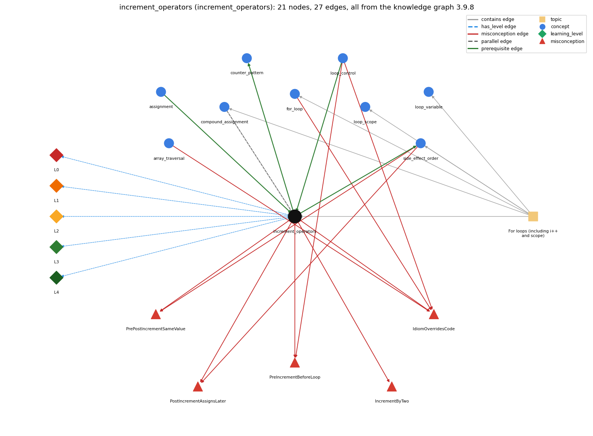

# increment_operators (`increment_operators`)

++ / -- (and +=)

Section 1.3 Conditionals and Loops, topic 1.3.d For loops (including i++ and scope).

## At a glance

- **Needs first:** `assignment`, `loop_control`
- **Leads to:** `counter_pattern`, `side_effect_order`
- **Learned alongside:** `compound_assignment`
- **Misconceptions:** `IdiomOverridesCode`, `IncrementByTwo`, `PostIncrementAssignsLater`, `PreIncrementBeforeLoop`, `PrePostIncrementSameValue`
- **Errors:** none
- **Levels:** L0, L1, L2, L3, L4

Everything below comes from the knowledge graph 3.9.8 (`data/raw/chapter1_kg_updated.json`): 27 edges around this concept. The edge logic, the wrong and right rules and the exact rules of the ways are copied word for word from the graph.

## To work on (0)

Nothing is missing for this concept.

## What it needs first (2)

A prerequisite edge means the other concept has to be understood before `increment_operators`.

### `assignment` comes before `increment_operators`

*= stores the computed value of the right side*

- **Edge:** `pre:assignment->increment_operators`
- **Exact edge logic:** i++ is shorthand for the assignment i = i + 1.
- **Grounding:** book\_passage
- **Composition rule (R) of `increment_operators` with `assignment`:** i++ is shorthand for the assignment i = i + 1 (and i += k for i = i + k), so it changes the variable's stored value.
- **Composition rule (R) of `assignment` with `increment_operators`:** As a statement, i++ has the same effect as the assignment i = i + 1.

### `loop_control` comes before `increment_operators`

*the three slots: init ; condition ; update*

- **Edge:** `pre:loop_control->increment_operators`
- **Exact edge logic:** The loop update i = i + 1 comes first; ++ (and +=) are then introduced as shorthand for that update.
- **Grounding:** book\_passage
- **Composition rule (R) of `increment_operators` with `loop_control`:** The usual for-loop update is i++ (shorthand for i = i + 1); as a stand-alone update statement ++i and i++ give the same loop.
- **Composition rule (R) of `loop_control` with `increment_operators`:** The update i = i + 1 is usually written i++ (or i += k for other steps); as a whole update statement ++i and i++ are equivalent.

## What it leads to (2)

These concepts need `increment_operators` first.

### `increment_operators` comes before `counter_pattern`

*counting occurrences across passes*

- **Edge:** `pre:increment_operators->counter_pattern`
- **Exact edge logic:** A counter is updated with count++, adding one on each pass that matches.
- **Grounding:** book\_passage

### `increment_operators` comes before `side_effect_order`

*i = i++ and other expressions with side effects*

- **Edge:** `pre:increment_operators->side_effect_order`
- **Exact edge logic:** The result depends on the value an increment expression evaluates to.
- **Grounding:** book\_passage
- **Composition rule (R) of `increment_operators` with `side_effect_order`:** Inside a larger expression the result depends on which value (old or new) the increment yields and on left-to-right evaluation, e.g. j += j++ in Exercise 1.3.6.
- **Composition rule (R) of `side_effect_order` with `increment_operators`:** The result of an expression with a side effect depends on the value the increment expression evaluates to: old for i++, new for ++i.

## Learned alongside (1)

A parallel edge joins two concepts that sit side by side: neither is needed before the other.

### `increment_operators` alongside `compound_assignment`

*x += e, x -= e, ... include a hidden cast*

- **Edge:** `par:increment_operators~compound_assignment`
- **Exact edge logic:** i++, ++i and i += 1 all add 1 to i; ++ and -- change a variable only by one and are normally used for integers, while i += k works for any amount and with any arithmetic operator (-=, \*=, /=, %=).
- **Grounding:** book\_passage

## Misconceptions (5)

A misconception edge states the wrong rule a student may hold about this concept, and the right rule.

### IdiomOverridesCode

- **Edge:** `increment_operators` &rarr; `IdiomOverridesCode` (misconception)
- **Exact edge logic (the wrong rule):** An array loop processes the whole array from index 0 to length-1 and increments its index at the end of the body, whatever the code says.
- **Twin logic (the right rule):** The loop visits exactly the indices that its initialisation, guard and update produce, in the order in which its statements are written.
- **Wrong belief (on the node):** An array loop processes the whole array from index 0 to length-1 and increments its index at the end of the body, whatever the code says.
- **Correct rule (on the node):** The loop visits exactly the indices that its initialisation, guard and update produce, in the order in which its statements are written.
- **Provenance:** published
- **Role of this concept:** context
- **L0 way linked to it:** yes
- **L0 way [6] misconception, exact rule:** wrong rule: An array loop processes the whole array from index 0 to length-1 and increments its index at the end of the body, whatever the code says. Right rule: The loop visits exactly the indices that its initialisation, guard and update produce, in the order in which its statements are written.
- **Edge `array_traversal` &rarr; `IdiomOverridesCode`, exact edge logic:** An array loop processes the whole array from index 0 to length-1 and increments its index at the end of the body, whatever the code says. **Twin logic:** The loop visits exactly the indices that its initialisation, guard and update produce, in the order in which its statements are written. (role: primary)
- **Edge `for_loop` &rarr; `IdiomOverridesCode`, exact edge logic:** An array loop processes the whole array from index 0 to length-1 and increments its index at the end of the body, whatever the code says. **Twin logic:** The loop visits exactly the indices that its initialisation, guard and update produce, in the order in which its statements are written. (role: context)
- **Edge `loop_control` &rarr; `IdiomOverridesCode`, exact edge logic:** An array loop processes the whole array from index 0 to length-1 and increments its index at the end of the body, whatever the code says. **Twin logic:** The loop visits exactly the indices that its initialisation, guard and update produce, in the order in which its statements are written. (role: context)

### IncrementByTwo

- **Edge:** `increment_operators` &rarr; `IncrementByTwo` (misconception)
- **Exact edge logic (the wrong rule):** i++ increases i by 2.
- **Twin logic (the right rule):** i++ (and ++i) increases i by exactly 1.
- **Wrong belief (on the node):** i++ increases i by 2.
- **Correct rule (on the node):** i++ (and ++i) increases i by exactly 1.
- **Provenance:** published
- **Role of this concept:** primary
- **L0 way linked to it:** yes
- **L0 way [2] misconception, exact rule:** wrong rule: i++ increases i by 2. Right rule: i++ (and ++i) increases i by exactly 1.

### PostIncrementAssignsLater

- **Edge:** `increment_operators` &rarr; `PostIncrementAssignsLater` (misconception)
- **Exact edge logic (the wrong rule):** i = i++ increases i by 1.
- **Twin logic (the right rule):** i++ evaluates to the old value, so i = i++ stores the old value back.
- **Wrong belief (on the node):** i = i++ increases i by 1.
- **Correct rule (on the node):** i++ evaluates to the old value, so i = i++ stores the old value back.
- **Provenance:** textbook
- **Role of this concept:** context
- **L0 way linked to it:** yes
- **L0 way [4] misconception, exact rule:** wrong rule: i = i++ increases i by 1. Right rule: i++ evaluates to the old value, so i = i++ stores the old value back.
- **Edge `side_effect_order` &rarr; `PostIncrementAssignsLater`, exact edge logic:** i = i++ increases i by 1. **Twin logic:** i++ evaluates to the old value, so i = i++ stores the old value back. (role: primary)

### PreIncrementBeforeLoop

- **Edge:** `increment_operators` &rarr; `PreIncrementBeforeLoop` (misconception)
- **Exact edge logic (the wrong rule):** ++i in the for-update runs before the body each pass
- **Twin logic (the right rule):** The update runs after each pass of the body, so with either ++i or i++ the first pass uses i = s.
- **Wrong belief (on the node):** ++i in the for-update runs before the body each pass
- **Correct rule (on the node):** The update runs after each pass of the body, so with either ++i or i++ the first pass uses i = s.
- **Provenance:** published
- **Role of this concept:** context
- **L0 way linked to it:** yes
- **L0 way [5] misconception, exact rule:** wrong rule: ++i in the for-update runs before the body each pass. Right rule: The update runs after each pass of the body, so with either ++i or i++ the first pass uses i = s.
- **Edge `loop_control` &rarr; `PreIncrementBeforeLoop`, exact edge logic:** With ++i in the update of for (int i = s; i &lt; n; ++i), i is increased before the body runs, so the first pass uses s + 1. **Twin logic:** The update runs after each pass of the body, so with either ++i or i++ the first pass uses i = s. (role: primary)

### PrePostIncrementSameValue

- **Edge:** `increment_operators` &rarr; `PrePostIncrementSameValue` (misconception)
- **Exact edge logic (the wrong rule):** x = i++ and x = ++i store the same value in x.
- **Twin logic (the right rule):** Both increment i, but ++i has the value after the increment and i++ the value before.
- **Wrong belief (on the node):** x = i++ and x = ++i store the same value in x.
- **Correct rule (on the node):** Both increment i, but ++i has the value after the increment and i++ the value before.
- **Provenance:** textbook
- **Role of this concept:** primary
- **L0 way linked to it:** yes
- **L0 way [1] misconception, exact rule:** wrong rule: x = i++ and x = ++i store the same value in x. Right rule: Both increment i, but ++i has the value after the increment and i++ the value before.
- **L0 way [3] inconsistent\_trace, exact rule:** Applies the increment rule (LT) unevenly: uses the old value in one expression and the new value in another for the same i++, or performs the increment at the end of the loop body instead of where it is written. (here mixing in: "x = i++ and x = ++i store the same value in x")
- **Edge `side_effect_order` &rarr; `PrePostIncrementSameValue`, exact edge logic:** x = i++ and x = ++i store the same value in x. **Twin logic:** Both increment i, but ++i has the value after the increment and i++ the value before. (role: context)

## Errors (0)

An error edge states the rule that gets broken in a program, and the right rule.

The graph has no error edge from this concept.

## Levels L0 to L4 (5 of 5)

Each level edge lists the ways a student shows that level, each with its exact rule.

### L0: Prestructural / sensorimotor

L0 for increment operators: the answer holds a rule that contradicts Java.

*Deciding question: Does every rule the answer applies to increment operators agree with the language rule? If it reads the code with everyday meanings, applies a wrong rule, or switches rules within one trace, it is L0. A slip in an otherwise rule-correct trace is L2 with an error, not L0.*

- **Edge:** `increment_operators` &rarr; `increment_operators@L0` (has_level)
- **Exact edge logic:** increment operators -&gt; L0 (Prestructural): the answer holds a rule that contradicts Java (7 ways).

Ways (7), each with its exact rule:

- **[0] everyday\_reading** (rule type E, folk-meaning rule): Folk meaning: '++' reads as 'plus plus' (add twice) or as a maths symbol with no effect, and i++ inside an expression is read as 'add 1 at some later time'. In Java i++ and ++i each add exactly 1 to i immediately when evaluated; they differ only in the value the expression yields.
- **[1] misconception** (rule type M, wrong rule / right rule) &rarr; `PrePostIncrementSameValue`: wrong rule: x = i++ and x = ++i store the same value in x. Right rule: Both increment i, but ++i has the value after the increment and i++ the value before.
- **[2] misconception** (rule type M, wrong rule / right rule) &rarr; `IncrementByTwo`: wrong rule: i++ increases i by 2. Right rule: i++ (and ++i) increases i by exactly 1.
- **[3] inconsistent\_trace** (rule type T, uneven-application rule) &rarr; `PrePostIncrementSameValue`: Applies the increment rule (LT) unevenly: uses the old value in one expression and the new value in another for the same i++, or performs the increment at the end of the loop body instead of where it is written. (here mixing in: "x = i++ and x = ++i store the same value in x")
- **[4] misconception** (rule type M, wrong rule / right rule) &rarr; `PostIncrementAssignsLater`: wrong rule: i = i++ increases i by 1. Right rule: i++ evaluates to the old value, so i = i++ stores the old value back.
- **[5] misconception** (rule type M, wrong rule / right rule) &rarr; `PreIncrementBeforeLoop`: wrong rule: ++i in the for-update runs before the body each pass. Right rule: The update runs after each pass of the body, so with either ++i or i++ the first pass uses i = s.
- **[6] misconception** (rule type M, wrong rule / right rule) &rarr; `IdiomOverridesCode`: wrong rule: An array loop processes the whole array from index 0 to length-1 and increments its index at the end of the body, whatever the code says. Right rule: The loop visits exactly the indices that its initialisation, guard and update produce, in the order in which its statements are written.

### L1: Unistructural / atom x text surface

L1 for increment operators: the answer states one correct rule without applying it.

*Deciding question: Does the answer cover every part of the code, in order, with the values (L2)? If it covers one part or only states the rule, it is L1.*

- **Edge:** `increment_operators` &rarr; `increment_operators@L1` (has_level)
- **Exact edge logic:** increment operators -&gt; L1 (Unistructural): the answer states one correct rule without applying it (2 ways).

Ways (2), each with its exact rule:

- **[0] names\_the\_element** (rule type N, identity rule): ++ and -- are the increment and decrement operators: shorthand that adds 1 to (or subtracts 1 from) a numeric variable.
- **[1] states\_the\_rule** (rule type S, declarative rule): ++ has the same effect as i = i + 1 and -- the same as i = i - 1; as statements i++ and ++i are the same, but in expressions ++i has the value after the increment and i++ the value before.

### L2: Multistructural / block x execution / preoperational

L2 for increment operators: the answer applies these rules to every part of the code, in order.

*Deciding question: Is the answer many segments mapped onto lines (L2), or one segment stating the purpose of the whole (L3)? A correct output with no value-by-value justification is not levelled.*

- **Edge:** `increment_operators` &rarr; `increment_operators@L2` (has_level)
- **Exact edge logic:** increment operators -&gt; L2 (Multistructural): the answer applies the rules of increment operators to every part of the code, in order (3 ways).

Ways (3), each with its exact rule:

- **[0] line\_by\_line\_trace** (rule type LT, operational sequencing rule): i++: fetch the value of i (that is the expression's value), then store i + 1 into i. ++i: store i + 1 into i, and the new value is the expression's value. Both happen before the rest of the enclosing expression continues.
- **[1] output\_prediction** (rule type OP, evaluation / result rule): With i = 5: x = i++ gives x = 5, i = 6; x = ++i gives x = 6, i = 6; i = i++ leaves i = 5.
- **[2] one\_step\_execution** (rule type OS, state-transition rule): One execution changes exactly one variable (i) by exactly 1 and returns its old (i++) or new (++i) value.

### L3: Relational / relations x function (concrete operational begins)

L3 for increment operators: the answer relates the parts by these rules.

*Deciding question: Was the purpose deduced from the code, or only guessed from traced input/output pairs (then L2)? Does the answer stay within the given code (L3), or reason about changed code, an error class or a new program (L4)?*

- **Edge:** `increment_operators` &rarr; `increment_operators@L3` (has_level)
- **Exact edge logic:** increment operators -&gt; L3 (Relational): the answer relates the parts (5 ways).

Ways (5), each with its exact rule:

- **[0] relation\_to\_neighbour** (rule type R, composition rule (with a neighbour)): The usual for-loop update is i++ (shorthand for i = i + 1); as a stand-alone update statement ++i and i++ give the same loop.
- **[1] relation\_to\_neighbour** (rule type R, composition rule (with a neighbour)): Inside a larger expression the result depends on which value (old or new) the increment yields and on left-to-right evaluation, e.g. j += j++ in Exercise 1.3.6.
- **[2] relation\_to\_neighbour** (rule type R, composition rule (with a neighbour)): i++ is shorthand for the assignment i = i + 1 (and i += k for i = i + k), so it changes the variable's stored value.
- **[3] relation\_to\_neighbour** (rule type R, composition rule (with a neighbour)): i++, ++i and i += 1 all add 1 to i; ++ and -- change a variable only by one and are normally used for integers, while i += k works for any amount and with any arithmetic operator (-=, \*=, /=, %=).
- **[4] purpose\_of\_the\_whole** (rule type P, plan / role rule): Plan/role: the update of a stepper or counter (count++ in a counter, i++ in a counted loop).

### L4: Extended abstract (concrete-operational reversibility and conservation)

L4 for increment operators: the answer reasons beyond the given code by these rules.

*Deciding question: Does the answer link the code to a broader context: a changed program, a class of inputs, an unseen problem? Re-tracing changed code value by value is L2; fixing one given failing case is L3.*

- **Edge:** `increment_operators` &rarr; `increment_operators@L4` (has_level)
- **Exact edge logic:** increment operators -&gt; L4 (Extended abstract): the answer reasons beyond the given code (4 ways).

Ways (4), each with its exact rule:

- **[0] predict\_a\_change** (rule type C, conservation rule) &rarr; `PrePostIncrementSameValue`: As a stand-alone statement, replacing i++ by ++i, i += 1 or i = i + 1 preserves behaviour; inside an expression (x = i++ vs x = ++i) the swap changes the value used by 1.
- **[1] transfer\_to\_a\_new\_program** (rule type X, applicability rule): Use i++ / i-- as stand-alone statements and in for-loop updates; avoid them inside larger expressions (x = ++i), as the book does, and use += for steps other than 1.
- **[2] diagnose\_an\_error** (rule type D, error rule): rule broken: i = i++ stores the old value back. Kind: silent logic error. Trigger class: Writing i = i++ to increment: i never changes, so a loop driven by it is infinite.
- **[3] diagnose\_an\_error** (rule type D, error rule): rule broken: ++ and -- apply only to a variable. Kind: compile-time. Trigger class: Applying ++ to a value that is not a variable, e.g. 5++ or (i + 1)++: compile-time error.

## Same topic

`increment_operators` belongs to the topic **For loops (including i++ and scope)** (`topic1.3.d`). The topic also contains: `compound_assignment`, `for_loop`, `loop_scope`, `loop_variable`, `side_effect_order`.

## Rules of the concept (20)

- **Book** (SW-1e, p. 75 (pdf 85)): "In expressions, both increment i, but ++i has the value after the increment and i++ the value before the increment."
- **Book** (TJ-2e, p. 92 (pdf 114)): "Specifically, ++ is the increment operator; it has the same effect as i = i + 1."
- **Book** (OT-Op1, ): "The only difference is that the prefix version (++result) evaluates to the incremented value, whereas the postfix version (result++) evaluates to the original value."
- **E** (folk-meaning rule): Folk meaning: '++' reads as 'plus plus' (add twice) or as a maths symbol with no effect, and i++ inside an expression is read as 'add 1 at some later time'. In Java i++ and ++i each add exactly 1 to i immediately when evaluated; they differ only in the value the expression yields.
- **M** (wrong rule / right rule): PostIncrementAssignsLater: wrong: i = i++ increases i by 1. \| right: i++ evaluates to the old value, so i = i++ stores the old value back.
- **M** (wrong rule / right rule): PreIncrementBeforeLoop: wrong: ++i in the for-update runs before the body each pass \| right: The update runs after each pass of the body, so with either ++i or i++ the first pass uses i = s.
- **M** (wrong rule / right rule): PrePostIncrementSameValue: wrong: x = i++ and x = ++i store the same value in x. \| right: Both increment i, but ++i has the value after the increment and i++ the value before.
- **M** (wrong rule / right rule): IdiomOverridesCode: wrong: An array loop processes the whole array from index 0 to length-1 and increments its index at the end of the body, whatever the code says. \| right: The loop visits exactly the indices that its initialisation, guard and update produce, in the order in which its statements are written.
- **M** (wrong rule / right rule): IncrementByTwo: wrong: i++ increases i by 2. \| right: i++ (and ++i) increases i by exactly 1.
- **T** (uneven-application rule): Applies the increment rule (LT) unevenly: uses the old value in one expression and the new value in another for the same i++, or performs the increment at the end of the loop body instead of where it is written.
- **N** (identity rule): ++ and -- are the increment and decrement operators: shorthand that adds 1 to (or subtracts 1 from) a numeric variable.
- **S** (declarative rule): ++ has the same effect as i = i + 1 and -- the same as i = i - 1; as statements i++ and ++i are the same, but in expressions ++i has the value after the increment and i++ the value before.
- **LT** (operational sequencing rule): i++: fetch the value of i (that is the expression's value), then store i + 1 into i. ++i: store i + 1 into i, and the new value is the expression's value. Both happen before the rest of the enclosing expression continues.
- **OP** (evaluation / result rule): With i = 5: x = i++ gives x = 5, i = 6; x = ++i gives x = 6, i = 6; i = i++ leaves i = 5.
- **OS** (state-transition rule): One execution changes exactly one variable (i) by exactly 1 and returns its old (i++) or new (++i) value.
- **R** (composition rule (with a neighbour)): with loop\_control: The usual for-loop update is i++ (shorthand for i = i + 1); as a stand-alone update statement ++i and i++ give the same loop.
- **R** (composition rule (with a neighbour)): with side\_effect\_order: Inside a larger expression the result depends on which value (old or new) the increment yields and on left-to-right evaluation, e.g. j += j++ in Exercise 1.3.6.
- **R** (composition rule (with a neighbour)): with assignment: i++ is shorthand for the assignment i = i + 1 (and i += k for i = i + k), so it changes the variable's stored value.
- **P** (plan / role rule): Plan/role: the update of a stepper or counter (count++ in a counter, i++ in a counted loop).
- **C** (conservation rule): As a stand-alone statement, replacing i++ by ++i, i += 1 or i = i + 1 preserves behaviour; inside an expression (x = i++ vs x = ++i) the swap changes the value used by 1.
- **D** (error rule): rule broken: i = i++ stores the old value back. (silent logic error)
- **D** (error rule): rule broken: ++ and -- apply only to a variable. (compile-time)
- **X** (applicability rule): Use i++ / i-- as stand-alone statements and in for-loop updates; avoid them inside larger expressions (x = ++i), as the book does, and use += for steps other than 1.

## How it is found in code and answers (reader block)

- **Aliases:** increment, increments, decrement, plus plus, ++
- **Code patterns:** `\+\+|--`
- **Operator symbols:** none
- **Java types:** none

## The whole prerequisite chain

- **Everything it builds on (17):** `arithmetic_operators`, `assignment`, `boolean`, `boolean_expression`, `comparison_operators`, `data_type`, `declaration`, `do_while_loop`, `expression`, `identifier`, `literal`, `logical_operators`, `loop_control`, `loop_variable`, `primitive_type`, `variable`, `while_loop`
- **Everything that builds on it (5):** `counter_pattern`, `frequency_counting`, `monte_carlo_simulation`, `side_effect_order`, `two_models`

## Every edge in this view and its exact edge logic (27)

All the edges drawn in the picture, in the order: prerequisite, parallel, misconception, error, has_level, contains.

**1. `assignment` &rarr; `increment_operators`** (prerequisite)

- **Exact edge logic:** i++ is shorthand for the assignment i = i + 1.
- **Grounding:** book\_passage
- **Composition rule (R) of `assignment` with `increment_operators`:** As a statement, i++ has the same effect as the assignment i = i + 1.
- **Composition rule (R) of `increment_operators` with `assignment`:** i++ is shorthand for the assignment i = i + 1 (and i += k for i = i + k), so it changes the variable's stored value.

**2. `increment_operators` &rarr; `counter_pattern`** (prerequisite)

- **Exact edge logic:** A counter is updated with count++, adding one on each pass that matches.
- **Grounding:** book\_passage

**3. `increment_operators` &rarr; `side_effect_order`** (prerequisite)

- **Exact edge logic:** The result depends on the value an increment expression evaluates to.
- **Grounding:** book\_passage
- **Composition rule (R) of `increment_operators` with `side_effect_order`:** Inside a larger expression the result depends on which value (old or new) the increment yields and on left-to-right evaluation, e.g. j += j++ in Exercise 1.3.6.
- **Composition rule (R) of `side_effect_order` with `increment_operators`:** The result of an expression with a side effect depends on the value the increment expression evaluates to: old for i++, new for ++i.

**4. `loop_control` &rarr; `increment_operators`** (prerequisite)

- **Exact edge logic:** The loop update i = i + 1 comes first; ++ (and +=) are then introduced as shorthand for that update.
- **Grounding:** book\_passage
- **Composition rule (R) of `loop_control` with `increment_operators`:** The update i = i + 1 is usually written i++ (or i += k for other steps); as a whole update statement ++i and i++ are equivalent.
- **Composition rule (R) of `increment_operators` with `loop_control`:** The usual for-loop update is i++ (shorthand for i = i + 1); as a stand-alone update statement ++i and i++ give the same loop.

**5. `increment_operators` &harr; `compound_assignment`** (parallel)

- **Exact edge logic:** i++, ++i and i += 1 all add 1 to i; ++ and -- change a variable only by one and are normally used for integers, while i += k works for any amount and with any arithmetic operator (-=, \*=, /=, %=).
- **Grounding:** book\_passage

**6. `increment_operators` &rarr; `IdiomOverridesCode`** (misconception)

- **Exact edge logic (the wrong rule):** An array loop processes the whole array from index 0 to length-1 and increments its index at the end of the body, whatever the code says.
- **Twin logic (the right rule):** The loop visits exactly the indices that its initialisation, guard and update produce, in the order in which its statements are written.
- **Role:** context

**7. `increment_operators` &rarr; `IncrementByTwo`** (misconception)

- **Exact edge logic (the wrong rule):** i++ increases i by 2.
- **Twin logic (the right rule):** i++ (and ++i) increases i by exactly 1.
- **Role:** primary

**8. `increment_operators` &rarr; `PostIncrementAssignsLater`** (misconception)

- **Exact edge logic (the wrong rule):** i = i++ increases i by 1.
- **Twin logic (the right rule):** i++ evaluates to the old value, so i = i++ stores the old value back.
- **Role:** context

**9. `increment_operators` &rarr; `PreIncrementBeforeLoop`** (misconception)

- **Exact edge logic (the wrong rule):** ++i in the for-update runs before the body each pass
- **Twin logic (the right rule):** The update runs after each pass of the body, so with either ++i or i++ the first pass uses i = s.
- **Role:** context

**10. `increment_operators` &rarr; `PrePostIncrementSameValue`** (misconception)

- **Exact edge logic (the wrong rule):** x = i++ and x = ++i store the same value in x.
- **Twin logic (the right rule):** Both increment i, but ++i has the value after the increment and i++ the value before.
- **Role:** primary

**11. `array_traversal` &rarr; `IdiomOverridesCode`** (misconception)

- **Exact edge logic (the wrong rule):** An array loop processes the whole array from index 0 to length-1 and increments its index at the end of the body, whatever the code says.
- **Twin logic (the right rule):** The loop visits exactly the indices that its initialisation, guard and update produce, in the order in which its statements are written.
- **Role:** primary

**12. `for_loop` &rarr; `IdiomOverridesCode`** (misconception)

- **Exact edge logic (the wrong rule):** An array loop processes the whole array from index 0 to length-1 and increments its index at the end of the body, whatever the code says.
- **Twin logic (the right rule):** The loop visits exactly the indices that its initialisation, guard and update produce, in the order in which its statements are written.
- **Role:** context

**13. `loop_control` &rarr; `IdiomOverridesCode`** (misconception)

- **Exact edge logic (the wrong rule):** An array loop processes the whole array from index 0 to length-1 and increments its index at the end of the body, whatever the code says.
- **Twin logic (the right rule):** The loop visits exactly the indices that its initialisation, guard and update produce, in the order in which its statements are written.
- **Role:** context

**14. `loop_control` &rarr; `PreIncrementBeforeLoop`** (misconception)

- **Exact edge logic (the wrong rule):** With ++i in the update of for (int i = s; i &lt; n; ++i), i is increased before the body runs, so the first pass uses s + 1.
- **Twin logic (the right rule):** The update runs after each pass of the body, so with either ++i or i++ the first pass uses i = s.
- **Role:** primary

**15. `side_effect_order` &rarr; `PostIncrementAssignsLater`** (misconception)

- **Exact edge logic (the wrong rule):** i = i++ increases i by 1.
- **Twin logic (the right rule):** i++ evaluates to the old value, so i = i++ stores the old value back.
- **Role:** primary

**16. `side_effect_order` &rarr; `PrePostIncrementSameValue`** (misconception)

- **Exact edge logic (the wrong rule):** x = i++ and x = ++i store the same value in x.
- **Twin logic (the right rule):** Both increment i, but ++i has the value after the increment and i++ the value before.
- **Role:** context

**17. `increment_operators` &rarr; `increment_operators@L0`** (has_level)

- **Exact edge logic:** increment operators -&gt; L0 (Prestructural): the answer holds a rule that contradicts Java (7 ways).
  - **[0] everyday\_reading** (rule type E, folk-meaning rule): Folk meaning: '++' reads as 'plus plus' (add twice) or as a maths symbol with no effect, and i++ inside an expression is read as 'add 1 at some later time'. In Java i++ and ++i each add exactly 1 to i immediately when evaluated; they differ only in the value the expression yields.
  - **[1] misconception** (rule type M, wrong rule / right rule) &rarr; `PrePostIncrementSameValue`: wrong rule: x = i++ and x = ++i store the same value in x. Right rule: Both increment i, but ++i has the value after the increment and i++ the value before.
  - **[2] misconception** (rule type M, wrong rule / right rule) &rarr; `IncrementByTwo`: wrong rule: i++ increases i by 2. Right rule: i++ (and ++i) increases i by exactly 1.
  - **[3] inconsistent\_trace** (rule type T, uneven-application rule) &rarr; `PrePostIncrementSameValue`: Applies the increment rule (LT) unevenly: uses the old value in one expression and the new value in another for the same i++, or performs the increment at the end of the loop body instead of where it is written. (here mixing in: "x = i++ and x = ++i store the same value in x")
  - **[4] misconception** (rule type M, wrong rule / right rule) &rarr; `PostIncrementAssignsLater`: wrong rule: i = i++ increases i by 1. Right rule: i++ evaluates to the old value, so i = i++ stores the old value back.
  - **[5] misconception** (rule type M, wrong rule / right rule) &rarr; `PreIncrementBeforeLoop`: wrong rule: ++i in the for-update runs before the body each pass. Right rule: The update runs after each pass of the body, so with either ++i or i++ the first pass uses i = s.
  - **[6] misconception** (rule type M, wrong rule / right rule) &rarr; `IdiomOverridesCode`: wrong rule: An array loop processes the whole array from index 0 to length-1 and increments its index at the end of the body, whatever the code says. Right rule: The loop visits exactly the indices that its initialisation, guard and update produce, in the order in which its statements are written.

**18. `increment_operators` &rarr; `increment_operators@L1`** (has_level)

- **Exact edge logic:** increment operators -&gt; L1 (Unistructural): the answer states one correct rule without applying it (2 ways).
  - **[0] names\_the\_element** (rule type N, identity rule): ++ and -- are the increment and decrement operators: shorthand that adds 1 to (or subtracts 1 from) a numeric variable.
  - **[1] states\_the\_rule** (rule type S, declarative rule): ++ has the same effect as i = i + 1 and -- the same as i = i - 1; as statements i++ and ++i are the same, but in expressions ++i has the value after the increment and i++ the value before.

**19. `increment_operators` &rarr; `increment_operators@L2`** (has_level)

- **Exact edge logic:** increment operators -&gt; L2 (Multistructural): the answer applies the rules of increment operators to every part of the code, in order (3 ways).
  - **[0] line\_by\_line\_trace** (rule type LT, operational sequencing rule): i++: fetch the value of i (that is the expression's value), then store i + 1 into i. ++i: store i + 1 into i, and the new value is the expression's value. Both happen before the rest of the enclosing expression continues.
  - **[1] output\_prediction** (rule type OP, evaluation / result rule): With i = 5: x = i++ gives x = 5, i = 6; x = ++i gives x = 6, i = 6; i = i++ leaves i = 5.
  - **[2] one\_step\_execution** (rule type OS, state-transition rule): One execution changes exactly one variable (i) by exactly 1 and returns its old (i++) or new (++i) value.

**20. `increment_operators` &rarr; `increment_operators@L3`** (has_level)

- **Exact edge logic:** increment operators -&gt; L3 (Relational): the answer relates the parts (5 ways).
  - **[0] relation\_to\_neighbour** (rule type R, composition rule (with a neighbour)): The usual for-loop update is i++ (shorthand for i = i + 1); as a stand-alone update statement ++i and i++ give the same loop.
  - **[1] relation\_to\_neighbour** (rule type R, composition rule (with a neighbour)): Inside a larger expression the result depends on which value (old or new) the increment yields and on left-to-right evaluation, e.g. j += j++ in Exercise 1.3.6.
  - **[2] relation\_to\_neighbour** (rule type R, composition rule (with a neighbour)): i++ is shorthand for the assignment i = i + 1 (and i += k for i = i + k), so it changes the variable's stored value.
  - **[3] relation\_to\_neighbour** (rule type R, composition rule (with a neighbour)): i++, ++i and i += 1 all add 1 to i; ++ and -- change a variable only by one and are normally used for integers, while i += k works for any amount and with any arithmetic operator (-=, \*=, /=, %=).
  - **[4] purpose\_of\_the\_whole** (rule type P, plan / role rule): Plan/role: the update of a stepper or counter (count++ in a counter, i++ in a counted loop).

**21. `increment_operators` &rarr; `increment_operators@L4`** (has_level)

- **Exact edge logic:** increment operators -&gt; L4 (Extended abstract): the answer reasons beyond the given code (4 ways).
  - **[0] predict\_a\_change** (rule type C, conservation rule) &rarr; `PrePostIncrementSameValue`: As a stand-alone statement, replacing i++ by ++i, i += 1 or i = i + 1 preserves behaviour; inside an expression (x = i++ vs x = ++i) the swap changes the value used by 1.
  - **[1] transfer\_to\_a\_new\_program** (rule type X, applicability rule): Use i++ / i-- as stand-alone statements and in for-loop updates; avoid them inside larger expressions (x = ++i), as the book does, and use += for steps other than 1.
  - **[2] diagnose\_an\_error** (rule type D, error rule): rule broken: i = i++ stores the old value back. Kind: silent logic error. Trigger class: Writing i = i++ to increment: i never changes, so a loop driven by it is infinite.
  - **[3] diagnose\_an\_error** (rule type D, error rule): rule broken: ++ and -- apply only to a variable. Kind: compile-time. Trigger class: Applying ++ to a value that is not a variable, e.g. 5++ or (i + 1)++: compile-time error.

**22. `topic1.3.d` &rarr; `increment_operators`** (contains)

- topic `topic1.3.d` contains `increment_operators`

**23. `topic1.3.d` &rarr; `compound_assignment`** (contains)

- topic `topic1.3.d` contains `compound_assignment`

**24. `topic1.3.d` &rarr; `for_loop`** (contains)

- topic `topic1.3.d` contains `for_loop`

**25. `topic1.3.d` &rarr; `loop_scope`** (contains)

- topic `topic1.3.d` contains `loop_scope`

**26. `topic1.3.d` &rarr; `loop_variable`** (contains)

- topic `topic1.3.d` contains `loop_variable`

**27. `topic1.3.d` &rarr; `side_effect_order`** (contains)

- topic `topic1.3.d` contains `side_effect_order`
