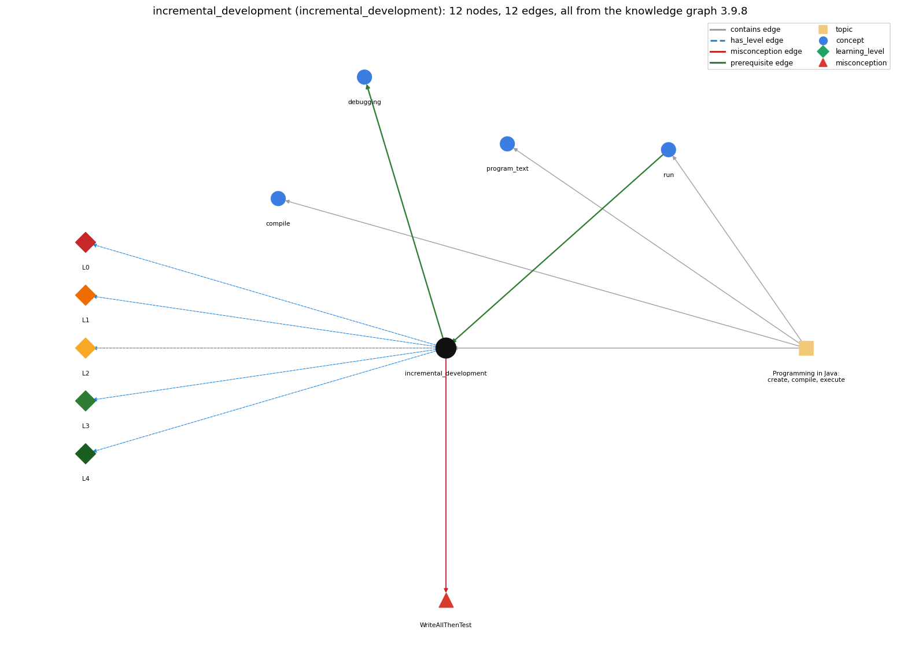

# incremental_development (`incremental_development`)

building a program in small steps from a version that works, compiling and testing after each change

Section 1.1 Your First Program, topic 1.1.a Programming in Java: create, compile, execute.

## At a glance

- **Needs first:** `run`
- **Leads to:** `debugging`
- **Learned alongside:** nothing
- **Misconceptions:** `WriteAllThenTest`
- **Errors:** none
- **Levels:** L0, L1, L2, L3, L4

Everything below comes from the knowledge graph 3.9.8 (`data/raw/chapter1_kg_updated.json`): 12 edges around this concept. The edge logic, the wrong and right rules and the exact rules of the ways are copied word for word from the graph.

## To work on (2)

- no code pattern or signal: the code cannot tag this concept
- no aliases: a student's words cannot name this concept

## What it needs first (1)

A prerequisite edge means the other concept has to be understood before `incremental_development`.

### `run` comes before `incremental_development`

*java executes main in the JVM*

- **Edge:** `pre:run->incremental_development`
- **Exact edge logic:** Each small step is run and checked before the next one is added.
- **Grounding:** book\_passage
- **Composition rule (R) of `incremental_development` with `run`:** Running after each step shows at once whether the new lines do what was intended.

## What it leads to (1)

These concepts need `incremental_development` first.

### `incremental_development` comes before `debugging`

*finding and fixing the cause of a wrong result or error by forming a hypothesis, changing the program and checking the prediction*

- **Edge:** `pre:incremental_development->debugging`
- **Exact edge logic:** Developing in small steps keeps debugging local: an error is in the change just made.
- **Grounding:** book\_passage
- **Composition rule (R) of `incremental_development` with `debugging`:** Small steps make debugging local: the newest change is the first suspect.
- **Composition rule (R) of `debugging` with `incremental_development`:** Small steps keep debugging short: the error is in the change just made.

## Learned alongside (0)

A parallel edge joins two concepts that sit side by side: neither is needed before the other.

No parallel edge touches this concept.

## Misconceptions (1)

A misconception edge states the wrong rule a student may hold about this concept, and the right rule.

### WriteAllThenTest

- **Edge:** `incremental_development` &rarr; `WriteAllThenTest` (misconception)
- **Exact edge logic (the wrong rule):** Write the whole program first, then compile and test it all at the end.
- **Twin logic (the right rule):** Start with a working program and make small changes, compiling and testing after each one, so an error is always in the last change.
- **Wrong belief (on the node):** Write the whole program first, then compile and test it all at the end.
- **Correct rule (on the node):** Start with a working program and make small changes, compiling and testing after each one, so an error is always in the last change.
- **Provenance:** textbook
- **Role of this concept:** primary
- **L0 way linked to it:** yes
- **L0 way [1] misconception, exact rule:** wrong rule: Write the whole program first, then compile and test it all at the end. Right rule: Start with a working program and make small changes, compiling and testing after each one, so an error is always in the last change.
- **L0 way [2] inconsistent\_trace, exact rule:** Applies incremental development unevenly: tests the first few steps one at a time, then adds a large block of untested code at once. (here mixing in: "Write the whole program first, then compile and test it all at the end")

## Errors (0)

An error edge states the rule that gets broken in a program, and the right rule.

The graph has no error edge from this concept.

## Levels L0 to L4 (5 of 5)

Each level edge lists the ways a student shows that level, each with its exact rule.

### L0: Prestructural / sensorimotor

L0 for incremental development: the answer holds a rule that contradicts Java.

*Deciding question: Does every rule the answer applies to incremental development agree with the language rule? If it reads the code with everyday meanings, applies a wrong rule, or switches rules within one trace, it is L0. A slip in an otherwise rule-correct trace is L2 with an error, not L0.*

- **Edge:** `incremental_development` &rarr; `incremental_development@L0` (has_level)
- **Exact edge logic:** incremental development -&gt; L0 (Prestructural): the answer holds a rule that contradicts Java (3 ways).

Ways (3), each with its exact rule:

- **[0] everyday\_reading** (rule type E, folk-meaning rule): Everyday writing is drafted all at once and revised at the end. A program is grown in small steps from a version that already works, compiling and running after each step.
- **[1] misconception** (rule type M, wrong rule / right rule) &rarr; `WriteAllThenTest`: wrong rule: Write the whole program first, then compile and test it all at the end. Right rule: Start with a working program and make small changes, compiling and testing after each one, so an error is always in the last change.
- **[2] inconsistent\_trace** (rule type T, uneven-application rule) &rarr; `WriteAllThenTest`: Applies incremental development unevenly: tests the first few steps one at a time, then adds a large block of untested code at once. (here mixing in: "Write the whole program first, then compile and test it all at the end")

### L1: Unistructural / atom x text surface

L1 for incremental development: the answer states one correct rule without applying it.

*Deciding question: Does the answer cover every part of the code, in order, with the values (L2)? If it covers one part or only states the rule, it is L1.*

- **Edge:** `incremental_development` &rarr; `incremental_development@L1` (has_level)
- **Exact edge logic:** incremental development -&gt; L1 (Unistructural): the answer states one correct rule without applying it (2 ways).

Ways (2), each with its exact rule:

- **[0] names\_the\_element** (rule type N, identity rule): Incremental development: growing a program in small, tested steps from a version that works.
- **[1] states\_the\_rule** (rule type S, declarative rule): Start with a working program and make small, incremental changes; at any point, if there is an error, you will know where to look. Use variables for intermediate values so you can check them.

### L2: Multistructural / block x execution / preoperational

L2 for incremental development: the answer applies these rules to every part of the code, in order.

*Deciding question: Is the answer many segments mapped onto lines (L2), or one segment stating the purpose of the whole (L3)? A correct output with no value-by-value justification is not levelled.*

- **Edge:** `incremental_development` &rarr; `incremental_development@L2` (has_level)
- **Exact edge logic:** incremental development -&gt; L2 (Multistructural): the answer applies the rules of incremental development to every part of the code, in order (3 ways).

Ways (3), each with its exact rule:

- **[0] line\_by\_line\_trace** (rule type LT, operational sequencing rule): Sequencing: write a few lines, compile, run and check them, then add the next few; never more than one untested change at a time.
- **[1] output\_prediction** (rule type OP, evaluation / result rule): Result: after every step there is a program that compiles and runs, and does a little more than before.
- **[2] one\_step\_execution** (rule type OS, state-transition rule): State transition: one step adds a small piece of code and ends with the program compiling and passing its checks again.

### L3: Relational / relations x function (concrete operational begins)

L3 for incremental development: the answer relates the parts by these rules.

*Deciding question: Was the purpose deduced from the code, or only guessed from traced input/output pairs (then L2)? Does the answer stay within the given code (L3), or reason about changed code, an error class or a new program (L4)?*

- **Edge:** `incremental_development` &rarr; `incremental_development@L3` (has_level)
- **Exact edge logic:** incremental development -&gt; L3 (Relational): the answer relates the parts (3 ways).

Ways (3), each with its exact rule:

- **[0] relation\_to\_neighbour** (rule type R, composition rule (with a neighbour)): Running after each step shows at once whether the new lines do what was intended.
- **[1] relation\_to\_neighbour** (rule type R, composition rule (with a neighbour)): Small steps make debugging local: the newest change is the first suspect.
- **[2] purpose\_of\_the\_whole** (rule type P, plan / role rule): Plan: keep a working program at all times so that errors are found where they are made.

### L4: Extended abstract (concrete-operational reversibility and conservation)

L4 for incremental development: the answer reasons beyond the given code by these rules.

*Deciding question: Does the answer link the code to a broader context: a changed program, a class of inputs, an unseen problem? Re-tracing changed code value by value is L2; fixing one given failing case is L3.*

- **Edge:** `incremental_development` &rarr; `incremental_development@L4` (has_level)
- **Exact edge logic:** incremental development -&gt; L4 (Extended abstract): the answer reasons beyond the given code (3 ways).

Ways (3), each with its exact rule:

- **[0] predict\_a\_change** (rule type C, conservation rule) &rarr; `WriteAllThenTest`: Conservation: each step must keep everything that already worked; if a step breaks it, that step is undone or fixed before going on.
- **[1] transfer\_to\_a\_new\_program** (rule type X, applicability rule): For any new program: get a minimal version running first (even just printing the inputs), then add one feature at a time, testing each.
- **[2] diagnose\_an\_error** (rule type D, error rule): rule broken: Compile and test after each small change. Kind: compile-time or logic error. Trigger class: many lines are written before the first compile, so the messages and wrong outputs cannot be traced to one change

## Same topic

`incremental_development` belongs to the topic **Programming in Java: create, compile, execute** (`topic1.1.a`). The topic also contains: `compile`, `program_text`, `run`.

## Rules of the concept (14)

- **Book** (TJ-2e, p. 62 (pdf 84)): "Start with a working program and make small, incremental changes. At any point, if there is an error, you will know where to look."
- **Book** (TJ-2e, p. 11 (pdf 33)): "Instead, start with a program that does something and make small modifications, debugging them as you go, until the program does what you want."
- **E** (folk-meaning rule): Everyday writing is drafted all at once and revised at the end. A program is grown in small steps from a version that already works, compiling and running after each step.
- **M** (wrong rule / right rule): WriteAllThenTest: wrong: Write the whole program first, then compile and test it all at the end. \| right: Start with a working program and make small changes, compiling and testing after each one, so an error is always in the last change.
- **T** (uneven-application rule): Applies incremental development unevenly: tests the first few steps one at a time, then adds a large block of untested code at once.
- **N** (identity rule): Incremental development: growing a program in small, tested steps from a version that works.
- **S** (declarative rule): Start with a working program and make small, incremental changes; at any point, if there is an error, you will know where to look. Use variables for intermediate values so you can check them.
- **LT** (operational sequencing rule): Sequencing: write a few lines, compile, run and check them, then add the next few; never more than one untested change at a time.
- **OP** (evaluation / result rule): Result: after every step there is a program that compiles and runs, and does a little more than before.
- **OS** (state-transition rule): State transition: one step adds a small piece of code and ends with the program compiling and passing its checks again.
- **R** (composition rule (with a neighbour)): with run: Running after each step shows at once whether the new lines do what was intended.
- **R** (composition rule (with a neighbour)): with debugging: Small steps make debugging local: the newest change is the first suspect.
- **P** (plan / role rule): Plan: keep a working program at all times so that errors are found where they are made.
- **C** (conservation rule): Conservation: each step must keep everything that already worked; if a step breaks it, that step is undone or fixed before going on.
- **D** (error rule): rule broken: Compile and test after each small change. (compile-time or logic error)
- **X** (applicability rule): For any new program: get a minimal version running first (even just printing the inputs), then add one feature at a time, testing each.

## How it is found in code and answers (reader block)

- **Aliases:** none
- **Code patterns:** none
- **Operator symbols:** none
- **Java types:** none

## The whole prerequisite chain

- **Everything it builds on (3):** `compile`, `program_text`, `run`
- **Everything that builds on it (1):** `debugging`

## Every edge in this view and its exact edge logic (12)

All the edges drawn in the picture, in the order: prerequisite, parallel, misconception, error, has_level, contains.

**1. `incremental_development` &rarr; `debugging`** (prerequisite)

- **Exact edge logic:** Developing in small steps keeps debugging local: an error is in the change just made.
- **Grounding:** book\_passage
- **Composition rule (R) of `incremental_development` with `debugging`:** Small steps make debugging local: the newest change is the first suspect.
- **Composition rule (R) of `debugging` with `incremental_development`:** Small steps keep debugging short: the error is in the change just made.

**2. `run` &rarr; `incremental_development`** (prerequisite)

- **Exact edge logic:** Each small step is run and checked before the next one is added.
- **Grounding:** book\_passage
- **Composition rule (R) of `incremental_development` with `run`:** Running after each step shows at once whether the new lines do what was intended.

**3. `incremental_development` &rarr; `WriteAllThenTest`** (misconception)

- **Exact edge logic (the wrong rule):** Write the whole program first, then compile and test it all at the end.
- **Twin logic (the right rule):** Start with a working program and make small changes, compiling and testing after each one, so an error is always in the last change.
- **Role:** primary

**4. `incremental_development` &rarr; `incremental_development@L0`** (has_level)

- **Exact edge logic:** incremental development -&gt; L0 (Prestructural): the answer holds a rule that contradicts Java (3 ways).
  - **[0] everyday\_reading** (rule type E, folk-meaning rule): Everyday writing is drafted all at once and revised at the end. A program is grown in small steps from a version that already works, compiling and running after each step.
  - **[1] misconception** (rule type M, wrong rule / right rule) &rarr; `WriteAllThenTest`: wrong rule: Write the whole program first, then compile and test it all at the end. Right rule: Start with a working program and make small changes, compiling and testing after each one, so an error is always in the last change.
  - **[2] inconsistent\_trace** (rule type T, uneven-application rule) &rarr; `WriteAllThenTest`: Applies incremental development unevenly: tests the first few steps one at a time, then adds a large block of untested code at once. (here mixing in: "Write the whole program first, then compile and test it all at the end")

**5. `incremental_development` &rarr; `incremental_development@L1`** (has_level)

- **Exact edge logic:** incremental development -&gt; L1 (Unistructural): the answer states one correct rule without applying it (2 ways).
  - **[0] names\_the\_element** (rule type N, identity rule): Incremental development: growing a program in small, tested steps from a version that works.
  - **[1] states\_the\_rule** (rule type S, declarative rule): Start with a working program and make small, incremental changes; at any point, if there is an error, you will know where to look. Use variables for intermediate values so you can check them.

**6. `incremental_development` &rarr; `incremental_development@L2`** (has_level)

- **Exact edge logic:** incremental development -&gt; L2 (Multistructural): the answer applies the rules of incremental development to every part of the code, in order (3 ways).
  - **[0] line\_by\_line\_trace** (rule type LT, operational sequencing rule): Sequencing: write a few lines, compile, run and check them, then add the next few; never more than one untested change at a time.
  - **[1] output\_prediction** (rule type OP, evaluation / result rule): Result: after every step there is a program that compiles and runs, and does a little more than before.
  - **[2] one\_step\_execution** (rule type OS, state-transition rule): State transition: one step adds a small piece of code and ends with the program compiling and passing its checks again.

**7. `incremental_development` &rarr; `incremental_development@L3`** (has_level)

- **Exact edge logic:** incremental development -&gt; L3 (Relational): the answer relates the parts (3 ways).
  - **[0] relation\_to\_neighbour** (rule type R, composition rule (with a neighbour)): Running after each step shows at once whether the new lines do what was intended.
  - **[1] relation\_to\_neighbour** (rule type R, composition rule (with a neighbour)): Small steps make debugging local: the newest change is the first suspect.
  - **[2] purpose\_of\_the\_whole** (rule type P, plan / role rule): Plan: keep a working program at all times so that errors are found where they are made.

**8. `incremental_development` &rarr; `incremental_development@L4`** (has_level)

- **Exact edge logic:** incremental development -&gt; L4 (Extended abstract): the answer reasons beyond the given code (3 ways).
  - **[0] predict\_a\_change** (rule type C, conservation rule) &rarr; `WriteAllThenTest`: Conservation: each step must keep everything that already worked; if a step breaks it, that step is undone or fixed before going on.
  - **[1] transfer\_to\_a\_new\_program** (rule type X, applicability rule): For any new program: get a minimal version running first (even just printing the inputs), then add one feature at a time, testing each.
  - **[2] diagnose\_an\_error** (rule type D, error rule): rule broken: Compile and test after each small change. Kind: compile-time or logic error. Trigger class: many lines are written before the first compile, so the messages and wrong outputs cannot be traced to one change

**9. `topic1.1.a` &rarr; `incremental_development`** (contains)

- topic `topic1.1.a` contains `incremental_development`

**10. `topic1.1.a` &rarr; `compile`** (contains)

- topic `topic1.1.a` contains `compile`

**11. `topic1.1.a` &rarr; `program_text`** (contains)

- topic `topic1.1.a` contains `program_text`

**12. `topic1.1.a` &rarr; `run`** (contains)

- topic `topic1.1.a` contains `run`
