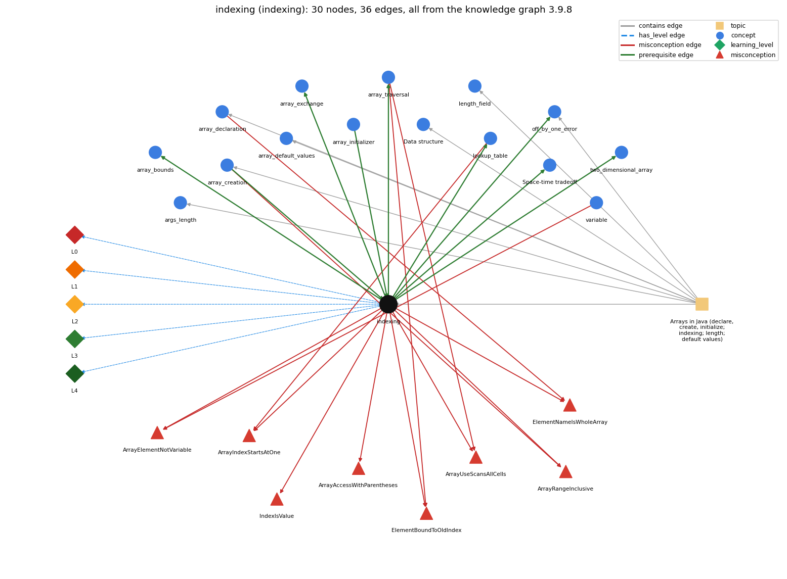

# indexing (`indexing`)

a[i] -- 0-based access

Section 1.4 Arrays, topic 1.4.a Arrays in Java (declare, create, initialize; indexing; length; default values).

## At a glance

- **Needs first:** `array_creation`, `array_initializer`
- **Leads to:** `array_bounds`, `array_exchange`, `array_traversal`, `lookup_table`, `off_by_one_error`, `space_time_tradeoff`, `two_dimensional_array`
- **Learned alongside:** nothing
- **Misconceptions:** `ArrayAccessWithParentheses`, `ArrayElementNotVariable`, `ArrayIndexStartsAtOne`, `ArrayRangeInclusive`, `ArrayUseScansAllCells`, `ElementBoundToOldIndex`, `ElementNameIsWholeArray`, `IndexIsValue`
- **Errors:** none
- **Levels:** L0, L1, L2, L3, L4

Everything below comes from the knowledge graph 3.9.8 (`data/raw/chapter1_kg_updated.json`): 36 edges around this concept, each explained in the graph's own words.

## What it needs first (2)

A prerequisite edge means the other concept has to be understood before `indexing`.

### `array_creation` comes before `indexing`

*new int[n] -- allocates n slots*

An array must be created with new before any of its elements a[i] can be accessed.

- **Grounding:** book passage
- **How `indexing` combines with `array_creation`:** An element can be indexed only after the array is created, and the n given to new sets the valid indices 0..n-1.
- **How `array_creation` combines with `indexing`:** Elements can be indexed only after creation, and the n given to new fixes the valid index range 0..n-1.

### `array_initializer` comes before `indexing`

*{1, 2, 3} literal initialization*

The values listed in braces are stored at indices 0, 1, 2, ... in order, and a[i] reads the value at index i.

- **Grounding:** spec passage

## What it leads to (7)

These concepts need `indexing` first.

### `indexing` comes before `array_bounds`

*valid indices are 0 .. length-1; otherwise throws*

Valid indexes run from 0 to a.length - 1; any other index throws an exception when it is used.

- **Grounding:** book passage
- **How `indexing` combines with `array_bounds`:** Every index value is checked against 0 and a.length at run time; any other value throws.
- **How `array_bounds` combines with `indexing`:** Every index value used in a[i] must satisfy 0 &lt;= i &lt;= a.length-1; the last element is a[a.length-1].

### `indexing` comes before `array_exchange`

*swap a[i] and a[j] through a temporary variable*

An exchange reads and writes a[i] and a[j] by index.

- **Grounding:** book passage
- **How `indexing` combines with `array_exchange`:** The exchange reads and writes elements only through their indices: t = a[i]; a[i] = a[j]; a[j] = t.
- **How `array_exchange` combines with `indexing`:** The exchange reads and writes elements only through their indices a[i] and a[j], which must both be in bounds.

### `indexing` comes before `array_traversal`

*walking the array with an index loop*

A traversal uses the loop variable i as the index, so a[i] reaches a different element on each pass.

- **Grounding:** book passage
- **How `indexing` combines with `array_traversal`:** A traversal uses the loop variable as the index, so the same expression a[i] reaches a different element on each pass.
- **How `array_traversal` combines with `indexing`:** The loop variable is used as the index, so a[i] reaches a different element on each pass.

### `indexing` comes before `lookup_table`

*an array of precomputed values or names indexed by position*

A lookup table is read by index, a[i].

- **Grounding:** book passage
- **How `indexing` combines with `lookup_table`:** A lookup table uses a data value as the index (months[m]), so the data must lie in 0..length-1.
- **How `lookup_table` combines with `indexing`:** The key itself is the index (months[m], rank[i]), so keys must fall in 0..length-1.

### `indexing` comes before `off_by_one_error`

*a loop or index that runs one time too many or too few (&lt; vs &lt;=, 0..n vs 1..n, length vs length-1)*

Indices start at 0, so the last element is a[N-1]; misreading this convention is the usual source of off-by-one errors.

- **Grounding:** book passage
- **How `off_by_one_error` combines with `indexing`:** Because indexing starts at 0, the last valid index is length-1, and that is the bound most often missed by one.

### `indexing` comes before `space_time_tradeoff`

*Space-time tradeoff: investing memory (an array of saved values) to save computation time*

Saved values are read back by index, H[i], instead of being recomputed.

- **Grounding:** book passage

### `indexing` comes before `two_dimensional_array`

*an array of arrays (a[i][j])*

A 1-D array uses one index a[i]; a 2-D array uses two, a[i][j], where the first index chooses the row array.

- **Grounding:** book passage
- **How `indexing` combines with `two_dimensional_array`:** a[i] on a 2-D array yields row i (itself a 1-D array), and a[i][j] then indexes into that row.
- **How `two_dimensional_array` combines with `indexing`:** A 2-D array uses two indices, and the first chooses the row array: a[i][j] is (a[i])[j].

## Learned alongside (0)

A parallel edge joins two concepts that sit side by side: neither is needed before the other.

No parallel edge touches this concept.

## Misconceptions (8)

A misconception edge states the wrong rule a student may hold about this concept, and the right rule.

### ArrayAccessWithParentheses

- **Wrong rule:** a(i) accesses element i of an array.
- **Right rule:** Array elements are accessed with square brackets, a[i].
- **Role of this concept:** primary
- **Shows at level L0 as:** misconception: wrong rule: a(i) accesses element i of an array. Right rule: Array elements are selected with square brackets, a[i]; a(i) would be a call of a method named a.

### ArrayElementNotVariable

- **Wrong rule:** An array element a[i] is not a variable, so it cannot be read into directly or used inside another index, as in a[a[i]].
- **Right rule:** Each element a[i] is a variable of the element type and can be used anywhere a variable of that type can, including as an index.
- **Role of this concept:** primary
- **Shows at level L0 as:** misconception: wrong rule: An array element a[i] is not a variable, so it cannot be read into directly or used inside another index, as in a[a[i]]. Right rule: Each element a[i] is a variable of the element type and can be used anywhere a variable of that type can, including as an index.
- **Also an edge from `variable`:** An array element a[i] is not a variable, so it cannot be read into directly or used inside another index, as in a[a[i]].

### ArrayIndexStartsAtOne

- **Wrong rule:** The first element of a is a[1].
- **Right rule:** Numbering begins with 0; the first element is a[0].
- **Role of this concept:** primary
- **Shows at level L0 as:** misconception: wrong rule: The first element of a is a[1]. Right rule: Numbering begins with 0; the first element is a[0].
- **Also an edge from `lookup_table`:** The first element of a is a[1].

### ArrayRangeInclusive

- **Wrong rule:** new int[n] has slots 0 to n, inclusive.
- **Right rule:** The slots are 0 to n - 1.
- **Role of this concept:** primary
- **Shows at level L0 as:** misconception: wrong rule: new int[n] has slots 0 to n, inclusive. Right rule: The slots are 0 to n - 1.
- **Also an edge from `array_creation`:** new int[n] has slots 0 to n, inclusive.

### ArrayUseScansAllCells

- **Wrong rule:** Using an array means every cell must be scanned.
- **Right rule:** Arrays allow random access: a[i] reaches one element directly, and a loop visits only the elements the task needs.
- **Role of this concept:** context
- **Shows at level L0 as:** misconception: wrong rule: Using an array means every cell must be scanned. Right rule: Arrays allow random access: a[i] reaches one element directly, and a loop visits only the elements the task needs.
- **Also an edge from `array_traversal`:** Using an array means every cell must be scanned.

### ElementBoundToOldIndex

- **Wrong rule:** After i changes, X[i] still refers to the element at the old value of i.
- **Right rule:** a[i] is evaluated with the current value of i each time it is used.
- **Role of this concept:** primary
- **Shows at level L0 as:** misconception: wrong rule: After i changes, X[i] still refers to the element at the old value of i. Right rule: a[i] is evaluated with the current value of i each time it is executed.
- **Also an edge from `array_traversal`:** After i changes, X[i] still refers to the element at the old value of i.

### ElementNameIsWholeArray

- **Wrong rule:** X[i] names the whole array, not one element.
- **Right rule:** The array is a; a[i] is the single element at index i.
- **Role of this concept:** primary
- **Shows at level L0 as:** misconception: wrong rule: X[i] names the whole array, not one element. Right rule: The array is a (a[] in the book); a[i] is the single element at index i.
- **Also an edge from `array_declaration`:** X[i] names the whole array, not one element.

### IndexIsValue

- **Wrong rule:** i and a[i] are the same thing, so the position is the stored value.
- **Right rule:** i is a position; a[i] is the value stored at that position.
- **Role of this concept:** primary
- **Shows at level L0 as:** misconception: wrong rule: i and a[i] are the same thing, so the position is the stored value. Right rule: i is a position; a[i] is the value stored at that position.
- **Shows at level L0 as:** inconsistent trace: Points to LT: in a[i], a is evaluated, then i with its current value, then the bounds check, then the element is read or written. Inconsistent application: i is updated on one line, but a later a[i] is traced with the old i. (here mixing in: "i and a[i] are the same thing, so the position is the stored value")

## Errors (0)

An error edge states the rule that gets broken in a program, and the right rule.

The graph has no error edge from this concept.

## Levels L0 to L4 (5 of 5)

Each level edge lists the ways a student shows that level, each with its exact rule.

### L0: Prestructural / sensorimotor

L0 for indexing: the answer holds a rule that contradicts Java.

*Deciding question: Does every rule the answer applies to indexing agree with the language rule? If it reads the code with everyday meanings, applies a wrong rule, or switches rules within one trace, it is L0. A slip in an otherwise rule-correct trace is L2 with an error, not L0.*

indexing -&gt; L0 (Prestructural): the answer holds a rule that contradicts Java (10 ways).

- **everyday reading** (folk-meaning rule): Folk meaning: everyday counting starts at 1 (first = number 1), maths subscripts a\_1..a\_n run from 1, and f(i) with parentheses means 'apply to i'. Java rule: a[i] uses square brackets and is 0-origin, so the first element is a[0] and the last is a[a.length-1].
- **misconception** (wrong rule / right rule; shows `IndexIsValue`): wrong rule: i and a[i] are the same thing, so the position is the stored value. Right rule: i is a position; a[i] is the value stored at that position.
- **misconception** (wrong rule / right rule; shows `ArrayIndexStartsAtOne`): wrong rule: The first element of a is a[1]. Right rule: Numbering begins with 0; the first element is a[0].
- **misconception** (wrong rule / right rule; shows `ArrayRangeInclusive`): wrong rule: new int[n] has slots 0 to n, inclusive. Right rule: The slots are 0 to n - 1.
- **misconception** (wrong rule / right rule; shows `ArrayAccessWithParentheses`): wrong rule: a(i) accesses element i of an array. Right rule: Array elements are selected with square brackets, a[i]; a(i) would be a call of a method named a.
- **misconception** (wrong rule / right rule; shows `ArrayElementNotVariable`): wrong rule: An array element a[i] is not a variable, so it cannot be read into directly or used inside another index, as in a[a[i]]. Right rule: Each element a[i] is a variable of the element type and can be used anywhere a variable of that type can, including as an index.
- **misconception** (wrong rule / right rule; shows `ElementNameIsWholeArray`): wrong rule: X[i] names the whole array, not one element. Right rule: The array is a (a[] in the book); a[i] is the single element at index i.
- **misconception** (wrong rule / right rule; shows `ElementBoundToOldIndex`): wrong rule: After i changes, X[i] still refers to the element at the old value of i. Right rule: a[i] is evaluated with the current value of i each time it is executed.
- **inconsistent trace** (uneven-application rule; shows `IndexIsValue`): Points to LT: in a[i], a is evaluated, then i with its current value, then the bounds check, then the element is read or written. Inconsistent application: i is updated on one line, but a later a[i] is traced with the old i. (here mixing in: "i and a[i] are the same thing, so the position is the stored value")
- **misconception** (wrong rule / right rule; shows `ArrayUseScansAllCells`): wrong rule: Using an array means every cell must be scanned. Right rule: Arrays allow random access: a[i] reaches one element directly, and a loop visits only the elements the task needs.

### L1: Unistructural / atom x text surface

L1 for indexing: the answer states one correct rule without applying it.

*Deciding question: Does the answer cover every part of the code, in order, with the values (L2)? If it covers one part or only states the rule, it is L1.*

indexing -&gt; L1 (Unistructural): the answer states one correct rule without applying it (2 ways).

- **names the element** (identity rule): Identity: an array access expression; a[i] names the single element variable at position i of the array a refers to.
- **states the rule** (declarative rule): Declarative: the index is any int-valued expression in square brackets; the valid indices of an array of length n are 0 to n-1, and an access outside that range throws ArrayIndexOutOfBoundsException.

### L2: Multistructural / block x execution / preoperational

L2 for indexing: the answer applies these rules to every part of the code, in order.

*Deciding question: Is the answer many segments mapped onto lines (L2), or one segment stating the purpose of the whole (L3)? A correct output with no value-by-value justification is not levelled.*

indexing -&gt; L2 (Multistructural): the answer applies the rules of indexing to every part of the code, in order (3 ways).

- **line by line trace** (operational sequencing rule): Sequencing: the array reference is evaluated before the index; the index expression is fully evaluated with current variable values; the bounds are checked; then the element is fetched or, on the left of =, becomes the target. In a[i] = a[j], the target a[i] is located before a[j] is read.
- **output prediction** (evaluation / result rule): Result: a[i] has the element type and the value currently stored at position i. For int[] a = {5, 7, 9}, a[1] is 7 and a[0] + a[2] is 14.
- **one step execution** (state-transition rule): State transition: reading a[i] changes nothing. a[i] = v changes only element i (i, a and all other elements are unchanged), and a[i]++ adds 1 to that one element.

### L3: Relational / relations x function (concrete operational begins)

L3 for indexing: the answer relates the parts by these rules.

*Deciding question: Was the purpose deduced from the code, or only guessed from traced input/output pairs (then L2)? Does the answer stay within the given code (L3), or reason about changed code, an error class or a new program (L4)?*

indexing -&gt; L3 (Relational): the answer relates the parts (8 ways).

- **relation to neighbour** (composition rule (with a neighbour)): An element can be indexed only after the array is created, and the n given to new sets the valid indices 0..n-1.
- **relation to neighbour** (composition rule (with a neighbour)): A traversal uses the loop variable as the index, so the same expression a[i] reaches a different element on each pass.
- **relation to neighbour** (composition rule (with a neighbour)): Every index value is checked against 0 and a.length at run time; any other value throws.
- **relation to neighbour** (composition rule (with a neighbour)): a[i] on a 2-D array yields row i (itself a 1-D array), and a[i][j] then indexes into that row.
- **relation to neighbour** (composition rule (with a neighbour)): The exchange reads and writes elements only through their indices: t = a[i]; a[i] = a[j]; a[j] = t.
- **relation to neighbour** (composition rule (with a neighbour)): A lookup table uses a data value as the index (months[m]), so the data must lie in 0..length-1.
- **relation to neighbour** (composition rule (with a neighbour)): Indices start at 0, so the last element is a[N-1]; misreading this convention is the usual source of off-by-one errors.
- **purpose of the whole** (plan / role rule): Plan/role: random access, reaching any element directly by its position in constant time (address plus index), so code touches only the elements it needs.

### L4: Extended abstract (concrete-operational reversibility and conservation)

L4 for indexing: the answer reasons beyond the given code by these rules.

*Deciding question: Does the answer link the code to a broader context: a changed program, a class of inputs, an unseen problem? Re-tracing changed code value by value is L2; fixing one given failing case is L3.*

indexing -&gt; L4 (Extended abstract): the answer reasons beyond the given code (6 ways).

- **predict a change** (conservation rule; shows `IndexIsValue`): Conservation: changing the index expression (i to i+1 or i-1) shifts which element is touched and can leave the bounds at the ends. Writing a[a[i]] instead of a[i] uses an element value as the index, a different access entirely. Changing what is stored never changes the positions.
- **transfer to a new program** (applicability rule): Applicability: index when you need a particular element by position, or when the position is computed from data (counts[score]++, months[m]). When every value is processed in order and the position is never needed, an enhanced for loop is simpler.
- **diagnose an error** (error rule): rule broken: The index must be in 0..a.length-1. Kind: run-time exception. Trigger class: index &lt; 0 or &gt;= a.length, e.g. a[a.length], a[i+1] on the last pass, a[i-1] at i = 0, a[0] of an empty array (ArrayIndexOutOfBoundsException)
- **diagnose an error** (error rule): rule broken: The index must have type int (after promotion); long or double indices are rejected. Kind: compile-time. Trigger class: a[1.5], a[x] with double x, or a[n] with long n (incompatible types: possible lossy conversion)
- **diagnose an error** (error rule): rule broken: Elements are selected with brackets, not parentheses. Kind: compile-time. Trigger class: a(i) is written for a[i] (cannot find symbol: method a)
- **diagnose an error** (error rule): rule broken: An index is a position, not the stored value. Kind: silent logic error. Trigger class: code uses i where a[i] is meant (or a[i] where i is meant), e.g. returning i as the maximum value or comparing positions instead of contents

## Same topic

`indexing` belongs to the topic **Arrays in Java (declare, create, initialize; indexing; length; default values)** (`topic1.4.a`). The topic also contains: `args_length`, `array_creation`, `array_declaration`, `array_default_values`, `data_structure`, `length_field`, `off_by_one_error`.

## Rules of the concept (28)

- **folk-meaning rule:** Folk meaning: everyday counting starts at 1 (first = number 1), maths subscripts a\_1..a\_n run from 1, and f(i) with parentheses means 'apply to i'. Java rule: a[i] uses square brackets and is 0-origin, so the first element is a[0] and the last is a[a.length-1].
- **wrong rule / right rule:** ArrayAccessWithParentheses: wrong: a(i) accesses element i of an array. \| right: Array elements are selected with square brackets, a[i]; a(i) would be a call of a method named a.
- **wrong rule / right rule:** ArrayIndexStartsAtOne: wrong: The first element of a is a[1]. \| right: Numbering begins with 0; the first element is a[0].
- **wrong rule / right rule:** ArrayRangeInclusive: wrong: new int[n] has slots 0 to n, inclusive. \| right: The slots are 0 to n - 1.
- **wrong rule / right rule:** IndexIsValue: wrong: i and a[i] are the same thing, so the position is the stored value. \| right: i is a position; a[i] is the value stored at that position.
- **wrong rule / right rule:** ArrayElementNotVariable: wrong: An array element a[i] is not a variable, so it cannot be read into directly or used inside another index, as in a[a[i]]. \| right: Each element a[i] is a variable of the element type and can be used anywhere a variable of that type can, including as an index.
- **wrong rule / right rule:** ElementNameIsWholeArray: wrong: X[i] names the whole array, not one element. \| right: The array is a (a[] in the book); a[i] is the single element at index i.
- **wrong rule / right rule:** ElementBoundToOldIndex: wrong: After i changes, X[i] still refers to the element at the old value of i. \| right: a[i] is evaluated with the current value of i each time it is executed.
- **wrong rule / right rule:** ArrayUseScansAllCells: wrong: Using an array means every cell must be scanned. \| right: Arrays allow random access: a[i] reaches one element directly, and a loop visits only the elements the task needs.
- **uneven-application rule:** Points to LT: in a[i], a is evaluated, then i with its current value, then the bounds check, then the element is read or written. Inconsistent application: i is updated on one line, but a later a[i] is traced with the old i.
- **identity rule:** Identity: an array access expression; a[i] names the single element variable at position i of the array a refers to.
- **declarative rule:** Declarative: the index is any int-valued expression in square brackets; the valid indices of an array of length n are 0 to n-1, and an access outside that range throws ArrayIndexOutOfBoundsException.
- **operational sequencing rule:** Sequencing: the array reference is evaluated before the index; the index expression is fully evaluated with current variable values; the bounds are checked; then the element is fetched or, on the left of =, becomes the target. In a[i] = a[j], the target a[i] is located before a[j] is read.
- **evaluation / result rule:** Result: a[i] has the element type and the value currently stored at position i. For int[] a = {5, 7, 9}, a[1] is 7 and a[0] + a[2] is 14.
- **state-transition rule:** State transition: reading a[i] changes nothing. a[i] = v changes only element i (i, a and all other elements are unchanged), and a[i]++ adds 1 to that one element.
- **composition rule (with a neighbour):** with array\_creation: An element can be indexed only after the array is created, and the n given to new sets the valid indices 0..n-1.
- **composition rule (with a neighbour):** with array\_traversal: A traversal uses the loop variable as the index, so the same expression a[i] reaches a different element on each pass.
- **composition rule (with a neighbour):** with array\_bounds: Every index value is checked against 0 and a.length at run time; any other value throws.
- **composition rule (with a neighbour):** with two\_dimensional\_array: a[i] on a 2-D array yields row i (itself a 1-D array), and a[i][j] then indexes into that row.
- **composition rule (with a neighbour):** with array\_exchange: The exchange reads and writes elements only through their indices: t = a[i]; a[i] = a[j]; a[j] = t.
- **composition rule (with a neighbour):** with lookup\_table: A lookup table uses a data value as the index (months[m]), so the data must lie in 0..length-1.
- **plan / role rule:** Plan/role: random access, reaching any element directly by its position in constant time (address plus index), so code touches only the elements it needs.
- **conservation rule:** Conservation: changing the index expression (i to i+1 or i-1) shifts which element is touched and can leave the bounds at the ends. Writing a[a[i]] instead of a[i] uses an element value as the index, a different access entirely. Changing what is stored never changes the positions.
- **error rule:** rule broken: The index must be in 0..a.length-1. (run-time exception)
- **error rule:** rule broken: The index must have type int (after promotion); long or double indices are rejected. (compile-time)
- **error rule:** rule broken: Elements are selected with brackets, not parentheses. (compile-time)
- **error rule:** rule broken: An index is a position, not the stored value. (silent logic error)
- **applicability rule:** Applicability: index when you need a particular element by position, or when the position is computed from data (counts[score]++, months[m]). When every value is processed in order and the position is never needed, an enhanced for loop is simpler.

## The whole prerequisite chain

- **Everything it builds on (5):** `array_creation`, `array_declaration`, `array_initializer`, `data_structure`, `data_type`
- **Everything that builds on it (33):** `array_bounds`, `array_copy`, `array_exchange`, `array_reversal`, `array_traversal`, `boolean_flag_array`, `convergence_rate`, `dangling_pages`, `enhanced_for`, `frequency_counting`, `function_plotting`, `input_graph`, `lookup_table`, `loop_guard`, `markov_chain`, `matrix_operations`, `multidimensional_array`, `normalization`, `off_by_one_error`, `power_method`, `ragged_array`, `random_move`, `row_major_order`, `run_time_error`, `running_extreme`, `sampling_without_replacement`, `shuffle`, `simulation_loop`, `space_time_tradeoff`, `standard_audio`, `transition_matrix`, `two_dimensional_array`, `two_models`
