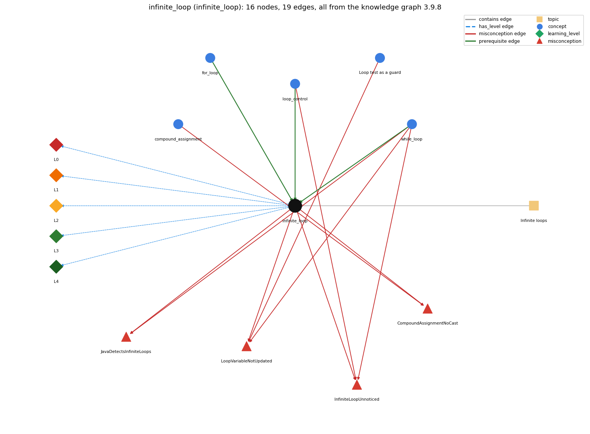

# infinite_loop (`infinite_loop`)

a loop whose condition never becomes false

Section 1.3 Conditionals and Loops, topic 1.3.h Infinite loops. From the knowledge graph 3.9.8 (`data/raw/chapter1_kg_updated.json`).

## Concepts associated with infinite\_loop (5)

| Concept | Description | How it is associated |
| --- | --- | --- |
| **compound\_assignment** | x += e, x -= e, ... include a hidden cast | shares misconception CompoundAssignmentNoCast |
| **for\_loop** | a while with init/condition/update packaged together | prerequisite of it (it needs this) |
| **loop\_control** | the three slots: init ; condition ; update | prerequisite of it (it needs this) composition rule (R) with it shares misconception InfiniteLoopUnnoticed |
| **loop\_guard** | putting the bounds check in the loop condition so the body never makes an out-of-bounds array access | shares misconception LoopVariableNotUpdated |
| **while\_loop** | repeat a block while a condition holds | prerequisite of it (it needs this) shares misconception InfiniteLoopUnnoticed shares misconception JavaDetectsInfiniteLoops shares misconception LoopVariableNotUpdated |

## Every edge in this view and its full label (19)

| From | Edge | To | Full edge label |
| --- | --- | --- | --- |
| **for\_loop** | prerequisite | **infinite\_loop** | A for loop whose condition never becomes false (or is left out) repeats forever unless a break ends it. grounding: spec\_passage |
| **loop\_control** | prerequisite | **infinite\_loop** | A loop is infinite when its update never moves the condition towards false. grounding: book\_passage composition rule (R) of loop\_control with infinite\_loop: A loop is infinite when the update never moves the variable toward making the condition false (e.g. condition i &gt; 3 with update i = i + 1). composition rule (R) of infinite\_loop with loop\_control: A loop is finite only if its update moves the control variable towards making the condition false. Wrong direction (\`i--\` with \`i &lt; n\`), wrong step (\`i += 0\` or \`x += 0.5\` on an int), or a condition that the update can step over (\`i != 10\` with \`i += 3\`) all give infinite loops. |
| **while\_loop** | prerequisite | **infinite\_loop** | A while loop whose condition never becomes false never ends. grounding: book\_passage |
| **compound\_assignment** | misconception | **CompoundAssignmentNoCast** | **wrong rule:** x += 0.5 adds one half to an int x. **right rule:** x += 0.5 is x = (int) (x + 0.5), so an int x does not change. role: primary |
| **infinite\_loop** | misconception | **CompoundAssignmentNoCast** | **wrong rule:** x += 0.5 adds one half to an int x. **right rule:** x += 0.5 is x = (int) (x + 0.5), so an int x does not change. role: context |
| **infinite\_loop** | misconception | **InfiniteLoopUnnoticed** | **wrong rule:** a condition that never goes false still terminates **right rule:** A while loop stops only when its condition is false at a check, so if no pass changes the variables in the condition, it never stops. role: primary |
| **infinite\_loop** | misconception | **JavaDetectsInfiniteLoops** | **wrong rule:** If my loop never ends, the compiler or Java will warn me. **right rule:** Java cannot detect infinite loops in general; you must check that the loop condition eventually becomes false. role: primary |
| **infinite\_loop** | misconception | **LoopVariableNotUpdated** | **wrong rule:** A while loop ends by itself even if nothing in the body changes the variable tested in the condition. **right rule:** If no statement in the body changes a variable in the condition, a condition that was true stays true and the loop never ends. role: context |
| **loop\_control** | misconception | **InfiniteLoopUnnoticed** | **wrong rule:** A while loop always stops on its own, even if nothing in its body can make the condition false. **right rule:** A while loop stops only when its condition is false at a check, so if no pass changes the variables in the condition, it never stops. role: context |
| **loop\_guard** | misconception | **LoopVariableNotUpdated** | **wrong rule:** A while loop ends by itself even if nothing in the body changes the variable tested in the condition. **right rule:** If no statement in the body changes a variable in the condition, a condition that was true stays true and the loop never ends. role: primary |
| **while\_loop** | misconception | **InfiniteLoopUnnoticed** | **wrong rule:** a condition that never goes false still terminates **right rule:** A while loop stops only when its condition is false at a check, so if no pass changes the variables in the condition, it never stops. role: context |
| **while\_loop** | misconception | **JavaDetectsInfiniteLoops** | **wrong rule:** If my loop never ends, the compiler or Java will warn me. **right rule:** Java cannot detect infinite loops in general; you must check that the loop condition eventually becomes false. role: context |
| **while\_loop** | misconception | **LoopVariableNotUpdated** | **wrong rule:** A while loop ends by itself even if nothing in the body changes the variable tested in the condition. **right rule:** If no statement in the body changes a variable in the condition, a condition that was true stays true and the loop never ends. role: context |
| **infinite\_loop** | has\_level | **infinite\_loop@L0** | infinite loop -&gt; L0 (Prestructural): the answer holds a rule that contradicts Java (6 ways). **[0] everyday\_reading** (E): Folk meaning: in everyday instructions ('lather, rinse, repeat', 'while the road is two lanes, continue north') the reader stops sensibly or watches the condition all the time. A Java loop repeats only while its condition is true at each test, and it never stops on its own if no pass makes the condition false. **[1] misconception** (M) &rarr; InfiniteLoopUnnoticed: wrong rule: A loop whose condition never goes false will still terminate. Right rule: A while loop stops only when its condition is false at a check, so if no pass changes the variables in the condition, it never stops. **[2] misconception** (M) &rarr; JavaDetectsInfiniteLoops: wrong rule: If my loop never ends, the compiler or Java will warn me. Right rule: Java cannot detect infinite loops in general (the halting problem); you must check that the condition eventually becomes false. **[3] inconsistent\_trace** (T) &rarr; InfiniteLoopUnnoticed: Applies the loop LT rule unevenly: on a trace, the update is assumed to happen on every pass even when it is skipped (e.g. by continue or inside an if), or the loop is assumed to stop when the condition becomes false in the middle of the body. The traced run then ends where the real one does not. (here mixing in: "a condition that never goes false still terminates") **[4] misconception** (M) &rarr; CompoundAssignmentNoCast: wrong rule: \`x += 0.5\` adds one half to an int x. Right rule: \`x += 0.5\` means \`x = (int) (x + 0.5)\`; the narrowing rounds toward zero, so a nonnegative int x keeps its value, and a loop relying on it never progresses. **[5] misconception** (M) &rarr; LoopVariableNotUpdated: wrong rule: A while loop ends by itself even if nothing in the body changes the variable tested in the condition. Right rule: If no statement in the body changes a variable in the condition, a condition that was true stays true and the loop never ends. |
| **infinite\_loop** | has\_level | **infinite\_loop@L1** | infinite loop -&gt; L1 (Unistructural): the answer states one correct rule without applying it (2 ways). **[0] names\_the\_element** (N): Loop bug/behaviour: a loop whose continuation condition never becomes false, so it runs until the program is killed (or overflow intervenes). **[1] states\_the\_rule** (S): A while or for loop terminates only if some pass makes its condition false at a test (or a break or return runs). Otherwise it repeats forever. The compiler does not check this. |
| **infinite\_loop** | has\_level | **infinite\_loop@L2** | infinite loop -&gt; L2 (Multistructural): the answer applies the rules of infinite loop to every part of the code, in order (3 ways). **[0] line\_by\_line\_trace** (LT): The same order as any loop: test, body, test... In an infinite loop the update either never runs or never moves the tested variables towards false, so every test yields true. **[1] output\_prediction** (OP): There is no final value. Either output scrolls forever (BadHellos with \`i &gt; 3\`) or nothing happens and the program 'hangs'. Over a very long run, int overflow may eventually make the test false (BadHellos stops after about 2^31 lines). **[2] one\_step\_execution** (OS): Each pass leaves the condition's variables either unchanged or moving away from false (i grows while the test is \`i &gt; 3\`). So the state after the pass satisfies the condition again. |
| **infinite\_loop** | has\_level | **infinite\_loop@L3** | infinite loop -&gt; L3 (Relational): the answer relates the parts (2 ways). **[0] relation\_to\_neighbour** (R): A loop is finite only if its update moves the control variable towards making the condition false. Wrong direction (\`i--\` with \`i &lt; n\`), wrong step (\`i += 0\` or \`x += 0.5\` on an int), or a condition that the update can step over (\`i != 10\` with \`i += 3\`) all give infinite loops. **[1] purpose\_of\_the\_whole** (P): Purpose: usually a bug. An intentional \`while (true)\` with an internal break or return is the 'loop-and-a-half' plan for servers, event loops and read-until-sentinel input. |
| **infinite\_loop** | has\_level | **infinite\_loop@L4** | infinite loop -&gt; L4 (Extended abstract): the answer reasons beyond the given code (7 ways). **[0] predict\_a\_change** (C) &rarr; InfiniteLoopUnnoticed: Changing the condition or update can turn a terminating loop into an infinite one (\`i &lt;= 10\` to \`i &gt; 3\`), or the reverse. The termination argument (a quantity that strictly moves towards the bound on every pass) must survive any change. **[1] transfer\_to\_a\_new\_program** (X): Write \`while (true)\` only when the exit is in the middle of the body and is certain (break or return on a sentinel or event). Otherwise, for each loop, state why the condition eventually becomes false. When a program seems stuck, add trace prints to tell an infinite loop from a slow one. **[2] diagnose\_an\_error** (D): rule broken: The body must change a variable in the condition so that it eventually becomes false. Kind: silent logic error. Trigger class: A forgotten \`i++\` (or an update inside an if or after a continue): the program hangs or prints forever. **[3] diagnose\_an\_error** (D): rule broken: An empty statement after the loop header becomes the body. Kind: silent logic error. Trigger class: \`while (i &lt; 10); { i++; }\`: the stray \`;\` is an empty body that never changes i. **[4] diagnose\_an\_error** (D): rule broken: Tests on doubles or on exact values can be stepped over. Kind: silent logic error. Trigger class: \`for (double x = 0.0; x != 1.0; x += 0.1)\` or \`while (i != 10) i += 3;\`: the variable jumps past the stopping value. **[5] diagnose\_an\_error** (D): rule broken: int arithmetic wraps without warning. Kind: silent logic error. Trigger class: \`for (int i = 0; i &lt;= Integer.MAX\_VALUE; i++)\`: i overflows to a negative value, so the test is never false. **[6] diagnose\_an\_error** (D): rule broken: Code after a loop that can never complete normally is unreachable. Kind: compile-time. Trigger class: Statements after \`while (true) { ... }\` with no break (unreachable statement). |
| **topic1.3.h** | contains | **infinite\_loop** | topic topic1.3.h contains infinite\_loop |
