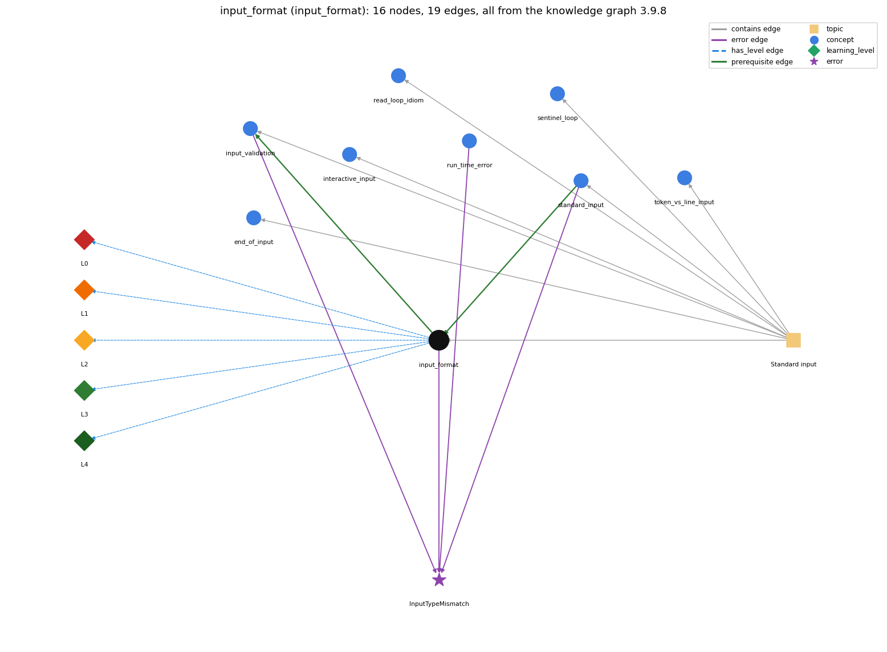

# input_format (`input_format`)

StdIn reads whitespace-separated tokens of the expected type

Section 1.5 Input and Output, topic 1.5.c Standard input. From the knowledge graph 3.9.8 (`data/raw/chapter1_kg_updated.json`).

## Concepts associated with input\_format (8)

| Concept | Description | How it is associated |
| --- | --- | --- |
| **end\_of\_input** | StdIn.isEmpty() and the end-of-file keystroke | same topic (topic1.5.c) |
| **input\_validation** | checking the next input before reading it | builds on it (needs it) composition rule (R) with it shares error InputTypeMismatch same topic (topic1.5.c) |
| **interactive\_input** | the user's input can change the program's control flow while it runs | same topic (topic1.5.c) |
| **read\_loop\_idiom** | reading until end-of-input | same topic (topic1.5.c) |
| **run\_time\_error** | an error raised while the program executes (e.g. ArrayIndexOutOfBounds, NumberFormatException) | shares error InputTypeMismatch |
| **sentinel\_loop** | reading until a special stop value (Rainfall problem) | same topic (topic1.5.c) |
| **standard\_input** | StdIn -- reading a stream of values | prerequisite of it (it needs this) composition rule (R) with it shares error InputTypeMismatch same topic (topic1.5.c) |
| **token\_vs\_line\_input** | reading tokens (readInt) versus whole lines (readLine) | same topic (topic1.5.c) |

## Every edge in this view and its full label (19)

| From | Edge | To | Full edge label |
| --- | --- | --- | --- |
| **input\_format** | prerequisite | **input\_validation** | Validation guards against input-format errors. grounding: book\_passage composition rule (R) of input\_format with input\_validation: A token in the wrong format makes a read throw, so validation must check before reading (e.g. Scanner.hasNextDouble) or read a String and test it. composition rule (R) of input\_validation with input\_format: Format errors throw at the read, so the type test must run before it. StdIn has no hasNextInt, so either read a String and parse it, or rely on the file's format. |
| **standard\_input** | prerequisite | **input\_format** | Input format rules apply to every StdIn read. grounding: book\_passage composition rule (R) of standard\_input with input\_format: The method called fixes the type the next token must have: readInt needs an int literal, and readDouble accepts 5 or 5.0. composition rule (R) of input\_format with standard\_input: Every StdIn read applies these format rules. The type of the method called decides which tokens are legal. |
| **input\_format** | error | **InputTypeMismatch** | **wrong rule:** StdIn.readInt() accepts any typed text such as abc or 12.2. **right rule:** If the next token is not an int (e.g. abc, 12.2, true), StdIn.readInt() throws a NumberFormatException at run time (Scanner.nextInt throws InputMismatchException). role: primary |
| **input\_validation** | error | **InputTypeMismatch** | **wrong rule:** StdIn.readInt() accepts any typed text such as abc or 12.2. **right rule:** If the next token is not an int (e.g. abc, 12.2, true), StdIn.readInt() throws a NumberFormatException at run time (Scanner.nextInt throws InputMismatchException). role: context |
| **run\_time\_error** | error | **InputTypeMismatch** | **wrong rule:** StdIn.readInt() accepts any typed text such as abc or 12.2. **right rule:** If the next token is not an int (e.g. abc, 12.2, true), StdIn.readInt() throws a NumberFormatException at run time (Scanner.nextInt throws InputMismatchException). role: context |
| **standard\_input** | error | **InputTypeMismatch** | **wrong rule:** StdIn.readInt() accepts any typed text such as abc or 12.2. **right rule:** If the next token is not an int (e.g. abc, 12.2, true), StdIn.readInt() throws a NumberFormatException at run time (Scanner.nextInt throws InputMismatchException). role: context |
| **input\_format** | has\_level | **input\_format@L0** | input format -&gt; L0 (Prestructural): the answer holds a rule that contradicts Java (1 way). **[0] everyday\_reading** (E): In everyday writing, layout carries meaning: one value per line, '1,000' with a comma, '12.' as a number. To StdIn, any run of whitespace is one separator, a token is a maximal run of non-whitespace, and it must be written as a Java literal of the expected type. |
| **input\_format** | has\_level | **input\_format@L1** | input format -&gt; L1 (Unistructural): the answer states one correct rule without applying it (2 ways). **[0] names\_the\_element** (N): Input format is the contract for the text on standard input: whitespace-separated tokens, each one a literal of the type the program asks for next. **[1] states\_the\_rule** (S): StdIn treats consecutive whitespace (spaces, tabs, newlines) as one space. Whenever the program expects a value of a type, the next token must be a value of that type. |
| **input\_format** | has\_level | **input\_format@L2** | input format -&gt; L2 (Multistructural): the answer applies the rules of input format to every part of the code, in order (3 ways). **[0] line\_by\_line\_trace** (LT): For each token read, leading whitespace is skipped, then the maximal non-whitespace run is taken and parsed. At a terminal, characters reach the program only a whole line at a time, after &lt;return&gt;. **[1] output\_prediction** (OP): The input \`  144\n\t233 \` gives readInt() 144, then 233. readDouble() on \`5\` gives 5.0. readInt() on \`12.2\` throws. **[2] one\_step\_execution** (OS): One token read consumes the leading whitespace and one token, and leaves the whitespace after it. |
| **input\_format** | has\_level | **input\_format@L3** | input format -&gt; L3 (Relational): the answer relates the parts (3 ways). **[0] relation\_to\_neighbour** (R): Every StdIn read applies these format rules. The type of the method called decides which tokens are legal. **[1] relation\_to\_neighbour** (R): A token in the wrong format makes a read throw, so validation must check before reading (e.g. Scanner.hasNextDouble) or read a String and test it. **[2] purpose\_of\_the\_whole** (P): A shared format convention lets independently produced data files feed a program. PlotFilter, for example, expects the first four numbers to be the bounding box. |
| **input\_format** | has\_level | **input\_format@L4** | input format -&gt; L4 (Extended abstract): the answer reasons beyond the given code (3 ways). **[0] predict\_a\_change** (C): Reformatting whitespace (spaces to newlines, extra blanks, tabs) keeps every read's result. Changing a token's form (5 to 5.0, or adding a comma) can break readInt. **[1] diagnose\_an\_error** (D): rule broken: The next token must be a literal of the requested type. Kind: run-time exception. Trigger class: Tokens like abc, 12.2, true or 1,000 when readInt() is called. **[2] transfer\_to\_a\_new\_program** (X): Whitespace-token format suits numeric data and single-word strings. When values contain spaces, or the line structure matters, use readLine. |
| **topic1.5.c** | contains | **end\_of\_input** | topic topic1.5.c contains end\_of\_input |
| **topic1.5.c** | contains | **input\_format** | topic topic1.5.c contains input\_format |
| **topic1.5.c** | contains | **input\_validation** | topic topic1.5.c contains input\_validation |
| **topic1.5.c** | contains | **interactive\_input** | topic topic1.5.c contains interactive\_input |
| **topic1.5.c** | contains | **read\_loop\_idiom** | topic topic1.5.c contains read\_loop\_idiom |
| **topic1.5.c** | contains | **sentinel\_loop** | topic topic1.5.c contains sentinel\_loop |
| **topic1.5.c** | contains | **standard\_input** | topic topic1.5.c contains standard\_input |
| **topic1.5.c** | contains | **token\_vs\_line\_input** | topic topic1.5.c contains token\_vs\_line\_input |
