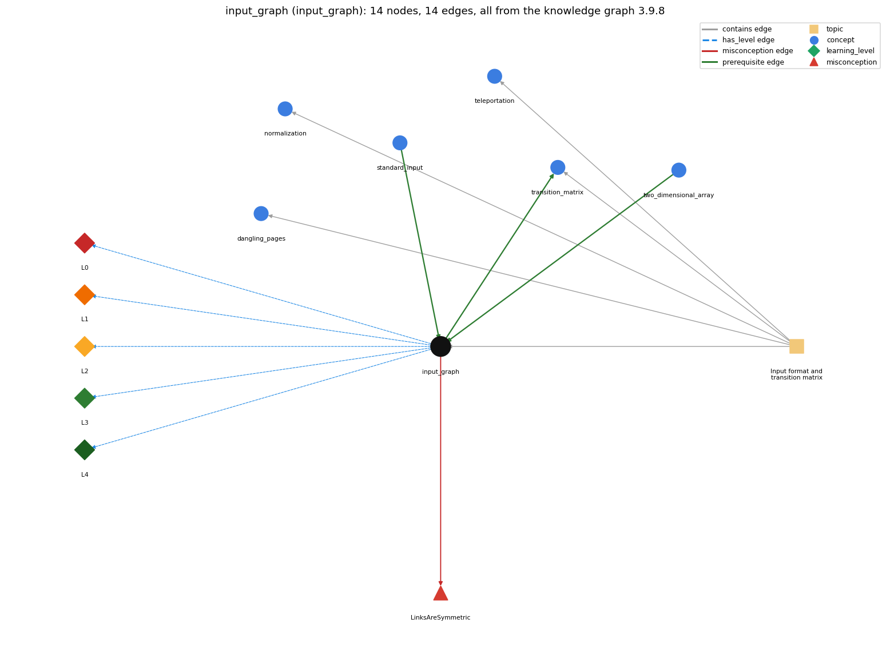

# input_graph (`input_graph`)

read the page links from input

Section 1.6 Case Study: Random Web Surfer, topic 1.6.a Input format and transition matrix.

## At a glance

- **Needs first:** `standard_input`, `two_dimensional_array`
- **Leads to:** `transition_matrix`
- **Learned alongside:** nothing
- **Misconceptions:** `LinksAreSymmetric`
- **Errors:** none
- **Levels:** L0, L1, L2, L3, L4

Everything below comes from the knowledge graph 3.9.8 (`data/raw/chapter1_kg_updated.json`): 14 edges around this concept. The edge logic, the wrong and right rules and the exact rules of the ways are copied word for word from the graph.

## To work on (1)

- no aliases: a student's words cannot name this concept

## What it needs first (2)

A prerequisite edge means the other concept has to be understood before `input_graph`.

### `standard_input` comes before `input_graph`

*StdIn -- reading a stream of values*

- **Edge:** `pre:standard_input->input_graph`
- **Exact edge logic:** The graph is read from standard input: first the number of pages n, then the link pairs i j.
- **Grounding:** book\_passage
- **Composition rule (R) of `input_graph` with `standard_input`:** The graph is consumed through StdIn as whitespace-separated tokens: readInt() for N, then a !StdIn.isEmpty() loop reading pairs; each value is consumed once, so the read order fixes which number is N, which is i and which is j.
- **Composition rule (R) of `standard_input` with `input_graph`:** The reads must follow the file's layout: one readInt() for n first, then pairs of readInt() for each link i j until isEmpty().

### `two_dimensional_array` comes before `input_graph`

*an array of arrays (a[i][j])*

- **Edge:** `pre:two_dimensional_array->input_graph`
- **Exact edge logic:** The links read from input are counted in a two-dimensional array, counts[i][j].
- **Grounding:** book\_passage

## What it leads to (1)

These concepts need `input_graph` first.

### `input_graph` comes before `transition_matrix`

*a 2-D array of move probabilities (rows sum to 1)*

- **Edge:** `pre:input_graph->transition_matrix`
- **Exact edge logic:** The links read from input fill counts[i][j], and each row of the transition matrix is built from those counts.
- **Grounding:** book\_passage
- **Composition rule (R) of `input_graph` with `transition_matrix`:** The tallies constrain the matrix: row i of the matrix is computed only from counts[i][] and outDegree[i], so a mistake in reading pair order (i/j swapped) moves probability mass into the wrong row.
- **Composition rule (R) of `transition_matrix` with `input_graph`:** Row i depends only on the tallies read for page i (counts[i][] and outDegree[i]); the matrix cannot be computed until all links have been read.

## Learned alongside (0)

A parallel edge joins two concepts that sit side by side: neither is needed before the other.

No parallel edge touches this concept.

## Misconceptions (1)

A misconception edge states the wrong rule a student may hold about this concept, and the right rule.

### LinksAreSymmetric

- **Edge:** `input_graph` &rarr; `LinksAreSymmetric` (misconception)
- **Exact edge logic (the wrong rule):** The pair i j in the input means pages i and j link to each other.
- **Twin logic (the right rule):** Each link is an ordered pair: i j means a link from page i to page j only.
- **Wrong belief (on the node):** The pair i j in the input means pages i and j link to each other.
- **Correct rule (on the node):** Each link is an ordered pair: i j means a link from page i to page j only.
- **Provenance:** derived
- **Role of this concept:** primary
- **L0 way linked to it:** yes
- **L0 way [1] misconception, exact rule:** wrong rule: The pair i j in the input means pages i and j link to each other. Right rule: Each pair is an ordered link from page i (the page containing the link) to page j (the page it refers to); 1 2 and 2 1 are two different links.
- **L0 way [2] inconsistent\_trace, exact rule:** Applies LT (read N once, then read i then j per pass) unevenly: e.g. treating the leading N as the first link endpoint, or on some passes reading only one integer so i and j drift out of step and later pairs are read as (j, next i). (here mixing in: "The pair i j in the input means pages i and j link to each other")

## Errors (0)

An error edge states the rule that gets broken in a program, and the right rule.

The graph has no error edge from this concept.

## Levels L0 to L4 (5 of 5)

Each level edge lists the ways a student shows that level, each with its exact rule.

### L0: Prestructural / sensorimotor

L0 for input graph: the answer holds a rule that contradicts Java.

*Deciding question: Does every rule the answer applies to input graph agree with the language rule? If it reads the code with everyday meanings, applies a wrong rule, or switches rules within one trace, it is L0. A slip in an otherwise rule-correct trace is L2 with an error, not L0.*

- **Edge:** `input_graph` &rarr; `input_graph@L0` (has_level)
- **Exact edge logic:** input graph -&gt; L0 (Prestructural): the answer holds a rule that contradicts Java (3 ways).

Ways (3), each with its exact rule:

- **[0] everyday\_reading** (rule type E, folk-meaning rule): In everyday graph drawings and in English, "a link between i and j" or "i j on a line" reads as a two-way connection, one record per line; in the input format the pair is ordered (i links to j only) and StdIn ignores line breaks, so pairs may be split or packed across lines.
- **[1] misconception** (rule type M, wrong rule / right rule) &rarr; `LinksAreSymmetric`: wrong rule: The pair i j in the input means pages i and j link to each other. Right rule: Each pair is an ordered link from page i (the page containing the link) to page j (the page it refers to); 1 2 and 2 1 are two different links.
- **[2] inconsistent\_trace** (rule type T, uneven-application rule) &rarr; `LinksAreSymmetric`: Applies LT (read N once, then read i then j per pass) unevenly: e.g. treating the leading N as the first link endpoint, or on some passes reading only one integer so i and j drift out of step and later pairs are read as (j, next i). (here mixing in: "The pair i j in the input means pages i and j link to each other")

### L1: Unistructural / atom x text surface

L1 for input graph: the answer states one correct rule without applying it.

*Deciding question: Does the answer cover every part of the code, in order, with the values (L2)? If it covers one part or only states the rule, it is L1.*

- **Edge:** `input_graph` &rarr; `input_graph@L1` (has_level)
- **Exact edge logic:** input graph -&gt; L1 (Unistructural): the answer states one correct rule without applying it (2 ways).

Ways (2), each with its exact rule:

- **[0] names\_the\_element** (rule type N, identity rule): A data format (the list-of-links representation of a web graph): one integer N, the number of pages 0..N-1, followed by ordered integer pairs i j, one per link.
- **[1] states\_the\_rule** (rule type S, declarative rule): Pages are numbered 0 to N-1; the input stream holds N followed by pairs of integers, the first naming the page containing the link and the second the page it refers to; whitespace between tokens is arbitrary.

### L2: Multistructural / block x execution / preoperational

L2 for input graph: the answer applies these rules to every part of the code, in order.

*Deciding question: Is the answer many segments mapped onto lines (L2), or one segment stating the purpose of the whole (L3)? A correct output with no value-by-value justification is not levelled.*

- **Edge:** `input_graph` &rarr; `input_graph@L2` (has_level)
- **Exact edge logic:** input graph -&gt; L2 (Multistructural): the answer applies the rules of input graph to every part of the code, in order (3 ways).

Ways (3), each with its exact rule:

- **[0] line\_by\_line\_trace** (rule type LT, operational sequencing rule): Transition reads N first with StdIn.readInt(), creates counts[N][N] and outDegree[N], then while !StdIn.isEmpty() reads i, then j, then increments outDegree[i] and counts[i][j]; the loop stops when only whitespace remains.
- **[1] output\_prediction** (rule type OP, evaluation / result rule): Reading the input yields integer tallies: counts[i][j] = number of i-&gt;j pairs and outDegree[i] = number of pairs starting at i; duplicate pairs count again, so tiny.txt gives counts[1][2] = 2 and outDegree = {1, 5, 1, 1, 2}.
- **[2] one\_step\_execution** (rule type OS, state-transition rule): One pass consumes exactly two tokens (i, j) from standard input and adds 1 to outDegree[i] and to counts[i][j]; no other entry changes and the tokens cannot be read again.

### L3: Relational / relations x function (concrete operational begins)

L3 for input graph: the answer relates the parts by these rules.

*Deciding question: Was the purpose deduced from the code, or only guessed from traced input/output pairs (then L2)? Does the answer stay within the given code (L3), or reason about changed code, an error class or a new program (L4)?*

- **Edge:** `input_graph` &rarr; `input_graph@L3` (has_level)
- **Exact edge logic:** input graph -&gt; L3 (Relational): the answer relates the parts (3 ways).

Ways (3), each with its exact rule:

- **[0] relation\_to\_neighbour** (rule type R, composition rule (with a neighbour)): The tallies constrain the matrix: row i of the matrix is computed only from counts[i][] and outDegree[i], so a mistake in reading pair order (i/j swapped) moves probability mass into the wrong row.
- **[1] relation\_to\_neighbour** (rule type R, composition rule (with a neighbour)): The graph is consumed through StdIn as whitespace-separated tokens: readInt() for N, then a !StdIn.isEmpty() loop reading pairs; each value is consumed once, so the read order fixes which number is N, which is i and which is j.
- **[2] purpose\_of\_the\_whole** (rule type P, plan / role rule): Data-driven code: keep the web model in a file and let a filter (Transition) read it from standard input, so any model can be studied without changing code; counts[i][j] and outDegree[i] act as per-cell counters (gatherers).

### L4: Extended abstract (concrete-operational reversibility and conservation)

L4 for input graph: the answer reasons beyond the given code by these rules.

*Deciding question: Does the answer link the code to a broader context: a changed program, a class of inputs, an unseen problem? Re-tracing changed code value by value is L2; fixing one given failing case is L3.*

- **Edge:** `input_graph` &rarr; `input_graph@L4` (has_level)
- **Exact edge logic:** input graph -&gt; L4 (Extended abstract): the answer reasons beyond the given code (5 ways).

Ways (5), each with its exact rule:

- **[0] predict\_a\_change** (rule type C, conservation rule) &rarr; `LinksAreSymmetric`: Reordering the pairs or the whitespace layout keeps every count (the tally is order-independent); reversing a pair (j i) or adding a duplicate pair changes the graph and hence the page ranks.
- **[1] transfer\_to\_a\_new\_program** (rule type X, applicability rule): Use this list-of-links format whenever a web (graph) model is read as data and then turned into a dense N-by-N matrix; it does not scale to millions of pages, where the matrix cannot be stored and graph data structures (Ch. 4) are needed.
- **[2] diagnose\_an\_error** (rule type D, error rule): rule broken: Page numbers must be in 0..N-1 (array index range). Kind: run-time exception. Trigger class: A pair containing a page number &gt;= N or negative: counts[i][j] or outDegree[i] throws ArrayIndexOutOfBoundsException.
- **[3] diagnose\_an\_error** (rule type D, error rule): rule broken: Every token must be an integer (readInt parses an int). Kind: run-time exception. Trigger class: A non-integer token such as a page name (www.com) or 1.5 in the input: StdIn.readInt() throws InputMismatchException.
- **[4] diagnose\_an\_error** (rule type D, error rule): rule broken: Links come in complete pairs. Kind: run-time exception. Trigger class: An odd number of integers after N: isEmpty() is false before the last i, then readInt() for j finds no token and StdIn throws an exception (NoSuchElementException).

## Same topic

`input_graph` belongs to the topic **Input format and transition matrix** (`topic1.6.a`). The topic also contains: `dangling_pages`, `normalization`, `teleportation`, `transition_matrix`.

## Rules of the concept (16)

- **Book** (SW-1e, p. 163 (pdf 173)): "a straightforward input format for the random surfer problem is an input stream consisting of an integer (the value of N) followed by a sequence of pairs of integers (the representations of all the links)."
- **Book** (SW-1.6, p. 163 (pdf 173)): "an integer (the value of n) followed by a sequence of pairs of integers (the representations of all the links)"
- **E** (folk-meaning rule): In everyday graph drawings and in English, "a link between i and j" or "i j on a line" reads as a two-way connection, one record per line; in the input format the pair is ordered (i links to j only) and StdIn ignores line breaks, so pairs may be split or packed across lines.
- **M** (wrong rule / right rule): LinksAreSymmetric: wrong: The pair i j in the input means pages i and j link to each other. \| right: Each pair is an ordered link from page i (the page containing the link) to page j (the page it refers to); 1 2 and 2 1 are two different links.
- **T** (uneven-application rule): Applies LT (read N once, then read i then j per pass) unevenly: e.g. treating the leading N as the first link endpoint, or on some passes reading only one integer so i and j drift out of step and later pairs are read as (j, next i).
- **N** (identity rule): A data format (the list-of-links representation of a web graph): one integer N, the number of pages 0..N-1, followed by ordered integer pairs i j, one per link.
- **S** (declarative rule): Pages are numbered 0 to N-1; the input stream holds N followed by pairs of integers, the first naming the page containing the link and the second the page it refers to; whitespace between tokens is arbitrary.
- **LT** (operational sequencing rule): Transition reads N first with StdIn.readInt(), creates counts[N][N] and outDegree[N], then while !StdIn.isEmpty() reads i, then j, then increments outDegree[i] and counts[i][j]; the loop stops when only whitespace remains.
- **OP** (evaluation / result rule): Reading the input yields integer tallies: counts[i][j] = number of i-&gt;j pairs and outDegree[i] = number of pairs starting at i; duplicate pairs count again, so tiny.txt gives counts[1][2] = 2 and outDegree = {1, 5, 1, 1, 2}.
- **OS** (state-transition rule): One pass consumes exactly two tokens (i, j) from standard input and adds 1 to outDegree[i] and to counts[i][j]; no other entry changes and the tokens cannot be read again.
- **R** (composition rule (with a neighbour)): with transition\_matrix: The tallies constrain the matrix: row i of the matrix is computed only from counts[i][] and outDegree[i], so a mistake in reading pair order (i/j swapped) moves probability mass into the wrong row.
- **R** (composition rule (with a neighbour)): with standard\_input: The graph is consumed through StdIn as whitespace-separated tokens: readInt() for N, then a !StdIn.isEmpty() loop reading pairs; each value is consumed once, so the read order fixes which number is N, which is i and which is j.
- **P** (plan / role rule): Data-driven code: keep the web model in a file and let a filter (Transition) read it from standard input, so any model can be studied without changing code; counts[i][j] and outDegree[i] act as per-cell counters (gatherers).
- **C** (conservation rule): Reordering the pairs or the whitespace layout keeps every count (the tally is order-independent); reversing a pair (j i) or adding a duplicate pair changes the graph and hence the page ranks.
- **D** (error rule): rule broken: Page numbers must be in 0..N-1 (array index range). (run-time exception)
- **D** (error rule): rule broken: Every token must be an integer (readInt parses an int). (run-time exception)
- **D** (error rule): rule broken: Links come in complete pairs. (run-time exception)
- **X** (applicability rule): Use this list-of-links format whenever a web (graph) model is read as data and then turned into a dense N-by-N matrix; it does not scale to millions of pages, where the matrix cannot be stored and graph data structures (Ch. 4) are needed.

## How it is found in code and answers (reader block)

- **Aliases:** none
- **Code patterns:** `\bcounts?\s*\[[^\]]+\]\s*\[[^\]]+\]\s*\+\+`, `\boutDegree\s*\[[^\]]+\]\s*\+\+`
- **Operator symbols:** none
- **Java types:** none
- **Signal read\_links** (scope program): `StdIn\.readInt\s*\(\s*\)[\s\S]{0,200}?\[\s*\w+\s*\]\s*\[\s*\w+\s*\]\s*\+\+`

## The whole prerequisite chain

- **Everything it builds on (9):** `array_creation`, `array_declaration`, `array_initializer`, `data_structure`, `data_type`, `indexing`, `standard_input`, `stream_model`, `two_dimensional_array`
- **Everything that builds on it (10):** `convergence_rate`, `dangling_pages`, `frequency_counting`, `markov_chain`, `normalization`, `power_method`, `random_move`, `simulation_loop`, `transition_matrix`, `two_models`

## Every edge in this view and its exact edge logic (14)

All the edges drawn in the picture, in the order: prerequisite, parallel, misconception, error, has_level, contains.

**1. `input_graph` &rarr; `transition_matrix`** (prerequisite)

- **Exact edge logic:** The links read from input fill counts[i][j], and each row of the transition matrix is built from those counts.
- **Grounding:** book\_passage
- **Composition rule (R) of `input_graph` with `transition_matrix`:** The tallies constrain the matrix: row i of the matrix is computed only from counts[i][] and outDegree[i], so a mistake in reading pair order (i/j swapped) moves probability mass into the wrong row.
- **Composition rule (R) of `transition_matrix` with `input_graph`:** Row i depends only on the tallies read for page i (counts[i][] and outDegree[i]); the matrix cannot be computed until all links have been read.

**2. `standard_input` &rarr; `input_graph`** (prerequisite)

- **Exact edge logic:** The graph is read from standard input: first the number of pages n, then the link pairs i j.
- **Grounding:** book\_passage
- **Composition rule (R) of `standard_input` with `input_graph`:** The reads must follow the file's layout: one readInt() for n first, then pairs of readInt() for each link i j until isEmpty().
- **Composition rule (R) of `input_graph` with `standard_input`:** The graph is consumed through StdIn as whitespace-separated tokens: readInt() for N, then a !StdIn.isEmpty() loop reading pairs; each value is consumed once, so the read order fixes which number is N, which is i and which is j.

**3. `two_dimensional_array` &rarr; `input_graph`** (prerequisite)

- **Exact edge logic:** The links read from input are counted in a two-dimensional array, counts[i][j].
- **Grounding:** book\_passage

**4. `input_graph` &rarr; `LinksAreSymmetric`** (misconception)

- **Exact edge logic (the wrong rule):** The pair i j in the input means pages i and j link to each other.
- **Twin logic (the right rule):** Each link is an ordered pair: i j means a link from page i to page j only.
- **Role:** primary

**5. `input_graph` &rarr; `input_graph@L0`** (has_level)

- **Exact edge logic:** input graph -&gt; L0 (Prestructural): the answer holds a rule that contradicts Java (3 ways).
  - **[0] everyday\_reading** (rule type E, folk-meaning rule): In everyday graph drawings and in English, "a link between i and j" or "i j on a line" reads as a two-way connection, one record per line; in the input format the pair is ordered (i links to j only) and StdIn ignores line breaks, so pairs may be split or packed across lines.
  - **[1] misconception** (rule type M, wrong rule / right rule) &rarr; `LinksAreSymmetric`: wrong rule: The pair i j in the input means pages i and j link to each other. Right rule: Each pair is an ordered link from page i (the page containing the link) to page j (the page it refers to); 1 2 and 2 1 are two different links.
  - **[2] inconsistent\_trace** (rule type T, uneven-application rule) &rarr; `LinksAreSymmetric`: Applies LT (read N once, then read i then j per pass) unevenly: e.g. treating the leading N as the first link endpoint, or on some passes reading only one integer so i and j drift out of step and later pairs are read as (j, next i). (here mixing in: "The pair i j in the input means pages i and j link to each other")

**6. `input_graph` &rarr; `input_graph@L1`** (has_level)

- **Exact edge logic:** input graph -&gt; L1 (Unistructural): the answer states one correct rule without applying it (2 ways).
  - **[0] names\_the\_element** (rule type N, identity rule): A data format (the list-of-links representation of a web graph): one integer N, the number of pages 0..N-1, followed by ordered integer pairs i j, one per link.
  - **[1] states\_the\_rule** (rule type S, declarative rule): Pages are numbered 0 to N-1; the input stream holds N followed by pairs of integers, the first naming the page containing the link and the second the page it refers to; whitespace between tokens is arbitrary.

**7. `input_graph` &rarr; `input_graph@L2`** (has_level)

- **Exact edge logic:** input graph -&gt; L2 (Multistructural): the answer applies the rules of input graph to every part of the code, in order (3 ways).
  - **[0] line\_by\_line\_trace** (rule type LT, operational sequencing rule): Transition reads N first with StdIn.readInt(), creates counts[N][N] and outDegree[N], then while !StdIn.isEmpty() reads i, then j, then increments outDegree[i] and counts[i][j]; the loop stops when only whitespace remains.
  - **[1] output\_prediction** (rule type OP, evaluation / result rule): Reading the input yields integer tallies: counts[i][j] = number of i-&gt;j pairs and outDegree[i] = number of pairs starting at i; duplicate pairs count again, so tiny.txt gives counts[1][2] = 2 and outDegree = {1, 5, 1, 1, 2}.
  - **[2] one\_step\_execution** (rule type OS, state-transition rule): One pass consumes exactly two tokens (i, j) from standard input and adds 1 to outDegree[i] and to counts[i][j]; no other entry changes and the tokens cannot be read again.

**8. `input_graph` &rarr; `input_graph@L3`** (has_level)

- **Exact edge logic:** input graph -&gt; L3 (Relational): the answer relates the parts (3 ways).
  - **[0] relation\_to\_neighbour** (rule type R, composition rule (with a neighbour)): The tallies constrain the matrix: row i of the matrix is computed only from counts[i][] and outDegree[i], so a mistake in reading pair order (i/j swapped) moves probability mass into the wrong row.
  - **[1] relation\_to\_neighbour** (rule type R, composition rule (with a neighbour)): The graph is consumed through StdIn as whitespace-separated tokens: readInt() for N, then a !StdIn.isEmpty() loop reading pairs; each value is consumed once, so the read order fixes which number is N, which is i and which is j.
  - **[2] purpose\_of\_the\_whole** (rule type P, plan / role rule): Data-driven code: keep the web model in a file and let a filter (Transition) read it from standard input, so any model can be studied without changing code; counts[i][j] and outDegree[i] act as per-cell counters (gatherers).

**9. `input_graph` &rarr; `input_graph@L4`** (has_level)

- **Exact edge logic:** input graph -&gt; L4 (Extended abstract): the answer reasons beyond the given code (5 ways).
  - **[0] predict\_a\_change** (rule type C, conservation rule) &rarr; `LinksAreSymmetric`: Reordering the pairs or the whitespace layout keeps every count (the tally is order-independent); reversing a pair (j i) or adding a duplicate pair changes the graph and hence the page ranks.
  - **[1] transfer\_to\_a\_new\_program** (rule type X, applicability rule): Use this list-of-links format whenever a web (graph) model is read as data and then turned into a dense N-by-N matrix; it does not scale to millions of pages, where the matrix cannot be stored and graph data structures (Ch. 4) are needed.
  - **[2] diagnose\_an\_error** (rule type D, error rule): rule broken: Page numbers must be in 0..N-1 (array index range). Kind: run-time exception. Trigger class: A pair containing a page number &gt;= N or negative: counts[i][j] or outDegree[i] throws ArrayIndexOutOfBoundsException.
  - **[3] diagnose\_an\_error** (rule type D, error rule): rule broken: Every token must be an integer (readInt parses an int). Kind: run-time exception. Trigger class: A non-integer token such as a page name (www.com) or 1.5 in the input: StdIn.readInt() throws InputMismatchException.
  - **[4] diagnose\_an\_error** (rule type D, error rule): rule broken: Links come in complete pairs. Kind: run-time exception. Trigger class: An odd number of integers after N: isEmpty() is false before the last i, then readInt() for j finds no token and StdIn throws an exception (NoSuchElementException).

**10. `topic1.6.a` &rarr; `input_graph`** (contains)

- topic `topic1.6.a` contains `input_graph`

**11. `topic1.6.a` &rarr; `dangling_pages`** (contains)

- topic `topic1.6.a` contains `dangling_pages`

**12. `topic1.6.a` &rarr; `normalization`** (contains)

- topic `topic1.6.a` contains `normalization`

**13. `topic1.6.a` &rarr; `teleportation`** (contains)

- topic `topic1.6.a` contains `teleportation`

**14. `topic1.6.a` &rarr; `transition_matrix`** (contains)

- topic `topic1.6.a` contains `transition_matrix`
