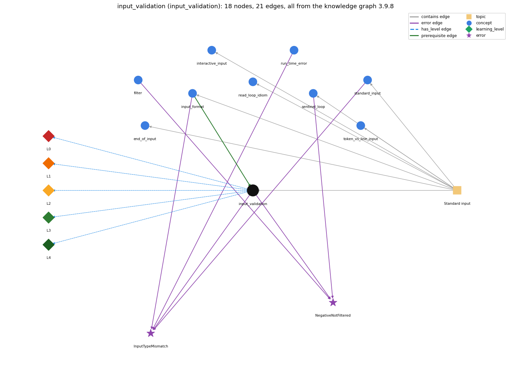

# input_validation (`input_validation`)

checking the next input before reading it

Section 1.5 Input and Output, topic 1.5.c Standard input. From the knowledge graph 3.9.8 (`data/raw/chapter1_kg_updated.json`).

## Concepts associated with input\_validation (9)

| Concept | Description | How it is associated |
| --- | --- | --- |
| **end\_of\_input** | StdIn.isEmpty() and the end-of-file keystroke | same topic (topic1.5.c) |
| **filter** | a program that reads standard input and writes standard output | shares error NegativeNotFiltered |
| **input\_format** | StdIn reads whitespace-separated tokens of the expected type | prerequisite of it (it needs this) composition rule (R) with it shares error InputTypeMismatch same topic (topic1.5.c) |
| **interactive\_input** | the user's input can change the program's control flow while it runs | same topic (topic1.5.c) |
| **read\_loop\_idiom** | reading until end-of-input | same topic (topic1.5.c) |
| **run\_time\_error** | an error raised while the program executes (e.g. ArrayIndexOutOfBounds, NumberFormatException) | shares error InputTypeMismatch |
| **sentinel\_loop** | reading until a special stop value (Rainfall problem) | shares error NegativeNotFiltered same topic (topic1.5.c) |
| **standard\_input** | StdIn -- reading a stream of values | shares error InputTypeMismatch same topic (topic1.5.c) |
| **token\_vs\_line\_input** | reading tokens (readInt) versus whole lines (readLine) | same topic (topic1.5.c) |

## Every edge in this view and its full label (21)

| From | Edge | To | Full edge label |
| --- | --- | --- | --- |
| **input\_format** | prerequisite | **input\_validation** | Validation guards against input-format errors. grounding: book\_passage composition rule (R) of input\_format with input\_validation: A token in the wrong format makes a read throw, so validation must check before reading (e.g. Scanner.hasNextDouble) or read a String and test it. composition rule (R) of input\_validation with input\_format: Format errors throw at the read, so the type test must run before it. StdIn has no hasNextInt, so either read a String and parse it, or rely on the file's format. |
| **filter** | error | **NegativeNotFiltered** | **wrong rule:** Adds negative rainfall values to the total. **right rule:** Values outside the range of interest must be filtered out (for example with if (t &gt;= lo &amp;&amp; t &lt;= hi)) before they are processed. role: context |
| **input\_format** | error | **InputTypeMismatch** | **wrong rule:** StdIn.readInt() accepts any typed text such as abc or 12.2. **right rule:** If the next token is not an int (e.g. abc, 12.2, true), StdIn.readInt() throws a NumberFormatException at run time (Scanner.nextInt throws InputMismatchException). role: primary |
| **input\_validation** | error | **InputTypeMismatch** | **wrong rule:** StdIn.readInt() accepts any typed text such as abc or 12.2. **right rule:** If the next token is not an int (e.g. abc, 12.2, true), StdIn.readInt() throws a NumberFormatException at run time (Scanner.nextInt throws InputMismatchException). role: context |
| **input\_validation** | error | **NegativeNotFiltered** | **wrong rule:** Adds negative rainfall values to the total. **right rule:** Values outside the range of interest must be filtered out (for example with if (t &gt;= lo &amp;&amp; t &lt;= hi)) before they are processed. role: context |
| **run\_time\_error** | error | **InputTypeMismatch** | **wrong rule:** StdIn.readInt() accepts any typed text such as abc or 12.2. **right rule:** If the next token is not an int (e.g. abc, 12.2, true), StdIn.readInt() throws a NumberFormatException at run time (Scanner.nextInt throws InputMismatchException). role: context |
| **sentinel\_loop** | error | **NegativeNotFiltered** | **wrong rule:** Adds negative rainfall values to the total. **right rule:** Values outside the range of interest must be filtered out (for example with if (t &gt;= lo &amp;&amp; t &lt;= hi)) before they are processed. role: primary |
| **standard\_input** | error | **InputTypeMismatch** | **wrong rule:** StdIn.readInt() accepts any typed text such as abc or 12.2. **right rule:** If the next token is not an int (e.g. abc, 12.2, true), StdIn.readInt() throws a NumberFormatException at run time (Scanner.nextInt throws InputMismatchException). role: context |
| **input\_validation** | has\_level | **input\_validation@L0** | input validation -&gt; L0 (Prestructural): the answer holds a rule that contradicts Java (1 way). **[0] everyday\_reading** (E): In everyday checking, something is checked after it has been accepted and stored. Novices place the check after the assignment. In code, the check must come before the value is read or stored, or a bad token has already thrown or polluted the data. |
| **input\_validation** | has\_level | **input\_validation@L1** | input validation -&gt; L1 (Unistructural): the answer states one correct rule without applying it (2 ways). **[0] names\_the\_element** (N): Input validation is guard code that checks that input is available, well-formed and in range before the program uses it (StdIn.isEmpty(), Scanner.hasNextDouble(), range tests). **[1] states\_the\_rule** (S): Test before reading: StdIn.isEmpty() tells whether more input is available, and hasNextDouble() tells whether the next token can be read as a double. If the test fails, report the error or prompt again instead of reading. |
| **input\_validation** | has\_level | **input\_validation@L2** | input validation -&gt; L2 (Multistructural): the answer applies the rules of input validation to every part of the code, in order (3 ways). **[0] line\_by\_line\_trace** (LT): Order: availability check, then type check, then read, then range check, then use. On failure, skip or re-prompt (a while loop when the number of wrong tries is unknown). **[1] output\_prediction** (OP): The checks return booleans. A validated program prints an error message, or prompts again, on bad input instead of crashing with an exception. **[2] one\_step\_execution** (OS): A check (isEmpty, hasNextDouble) consumes nothing. Only the read that follows, or an explicit in.next() that discards a bad token, advances the stream. |
| **input\_validation** | has\_level | **input\_validation@L3** | input validation -&gt; L3 (Relational): the answer relates the parts (2 ways). **[0] relation\_to\_neighbour** (R): Format errors throw at the read, so the type test must run before it. StdIn has no hasNextInt, so either read a String and parse it, or rely on the file's format. **[1] purpose\_of\_the\_whole** (P): Role: a guard. Plan: the input-validation (re-prompt) loop, which keeps asking until the value is acceptable. |
| **input\_validation** | has\_level | **input\_validation@L4** | input validation -&gt; L4 (Extended abstract): the answer reasons beyond the given code (4 ways). **[0] predict\_a\_change** (C): Adding validation leaves the output for valid input unchanged and changes behaviour only for invalid input. **[1] transfer\_to\_a\_new\_program** (X): Validate at the boundary where external data (users, files) enter the program, especially in interactive programs, where every possible input must be planned for. It is unnecessary for values the program itself generated. **[2] diagnose\_an\_error** (D): rule broken: Check the token type before reading it as a number. Kind: run-time exception. Trigger class: Non-numeric or wrongly typed tokens (abc, 12.2 for an int) reach readInt()/nextInt(). **[3] diagnose\_an\_error** (D): rule broken: Values outside the valid range must be filtered out before use. Kind: silent logic error. Trigger class: Out-of-range data (negative rainfall, values outside lo..hi) are processed because no range test comes before the update. |
| **topic1.5.c** | contains | **end\_of\_input** | topic topic1.5.c contains end\_of\_input |
| **topic1.5.c** | contains | **input\_format** | topic topic1.5.c contains input\_format |
| **topic1.5.c** | contains | **input\_validation** | topic topic1.5.c contains input\_validation |
| **topic1.5.c** | contains | **interactive\_input** | topic topic1.5.c contains interactive\_input |
| **topic1.5.c** | contains | **read\_loop\_idiom** | topic topic1.5.c contains read\_loop\_idiom |
| **topic1.5.c** | contains | **sentinel\_loop** | topic topic1.5.c contains sentinel\_loop |
| **topic1.5.c** | contains | **standard\_input** | topic topic1.5.c contains standard\_input |
| **topic1.5.c** | contains | **token\_vs\_line\_input** | topic topic1.5.c contains token\_vs\_line\_input |
