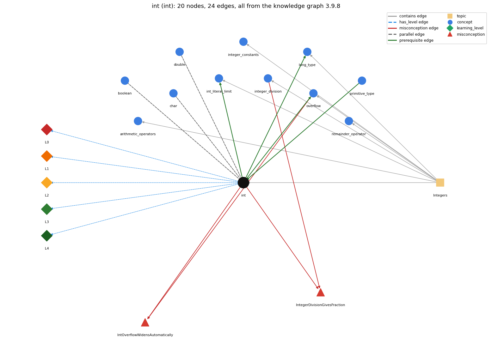

# int (`int`)

32-bit integer primitive

Section 1.2 Built-in Types of Data, topic 1.2.c Integers.

## At a glance

- **Needs first:** `primitive_type`
- **Leads to:** `int_literal_limit`, `long_type`, `overflow`
- **Learned alongside:** `boolean`, `char`, `double`
- **Misconceptions:** `IntOverflowWidensAutomatically`, `IntegerDivisionGivesFraction`
- **Errors:** none
- **Levels:** L0, L1, L2, L3, L4

Everything below comes from the knowledge graph 3.9.8 (`data/raw/chapter1_kg_updated.json`): 24 edges around this concept, each explained in the graph's own words.

## What it needs first (1)

A prerequisite edge means the other concept has to be understood before `int`.

### `primitive_type` comes before `int`

*int, double, boolean, char*

int is one of the eight primitive types, the one used for integers.

- **Grounding:** book passage
- **How `int` combines with `primitive_type`:** int is the 32-bit integral primitive type, and the default type for integer literals and arithmetic.
- **How `primitive_type` combines with `int`:** int is the 32-bit signed integral primitive. Arithmetic on byte, short and char is also carried out in int.

## What it leads to (3)

These concepts need `int` first.

### `int` comes before `int_literal_limit`

*2147483648 is legal only as -2147483648*

The limit on int literals is int's 32-bit range, -2147483648 to 2147483647.

- **Grounding:** book passage
- **How `int` combines with `int_literal_limit`:** An int literal must lie in int's range, so larger digit strings need an L (long) literal.
- **How `int_literal_limit` combines with `int`:** The literal limit is exactly int's 32-bit range, but it is checked only for literals: the literal 2147483648 is a compile-time error, whereas the expression 2147483647 + 1 compiles and overflows at run time to -2147483648.

### `int` comes before `long_type`

*64-bit integer type for values beyond the int range*

long is the wider integer type used when int's range is too small.

- **Grounding:** book passage
- **How `int` combines with `long_type`:** If either operand is long, the operation is 64-bit and the result is long. Storing a long into an int needs a cast.
- **How `long_type` combines with `int`:** long is the wider integer type: an int widens to long automatically, and mixing an int with a long in an operation gives a long.

### `int` comes before `overflow`

*int arithmetic wraps around outside the 32-bit range*

Overflow happens because an int has a fixed 32-bit range.

- **Grounding:** book passage
- **How `int` combines with `overflow`:** Because int has a fixed 32-bit range, results outside it wrap around silently.
- **How `overflow` combines with `int`:** Overflow is possible because int has a fixed 32-bit range, -2^31 to 2^31 - 1.

## Learned alongside (3)

A parallel edge joins two concepts that sit side by side: neither is needed before the other.

### `int` alongside `boolean`

*true/false primitive*

An int holds an integer and is a numeric type for computing with numbers; a boolean holds only true or false and is used for computing with logical values.

- **Grounding:** book passage
- **How `int` combines with `boolean`:** int and boolean do not convert into each other. Comparing ints gives a boolean (x &gt; 0), and an int cannot itself be used as a condition.
- **How `boolean` combines with `int`:** int and boolean never convert into each other; an int becomes a boolean only through a comparison (year % 4 == 0), and an int condition such as if (n) does not compile.

### `int` alongside `char`

*16-bit character primitive*

An int holds a whole number; a char holds one character, which Java stores as its numeric code.

- **Grounding:** book passage
- **How `int` combines with `char`:** In arithmetic a char is promoted to its int code. An int becomes a char only through a cast.
- **How `char` combines with `int`:** A char is stored as an unsigned 16-bit code, so in arithmetic it acts as an int ('a' + 1 is 98). Going from int to char needs a cast.

### `int` alongside `double`

*64-bit floating-point primitive*

With two ints, a / b drops the fractional part; if either a or b is a double, a / b keeps the fractional part.

- **Grounding:** book passage
- **How `int` combines with `double`:** int op double promotes the int and gives a double. A double becomes an int only through a cast, which truncates toward zero.
- **How `double` combines with `int`:** Type flow decides the division: with two int operands a / b discards the fraction (10/3 is 3, and double d = 10/3; stores 3.0); if either operand is double the other is promoted and the fraction is kept (10/3.0 is 3.3333333333333335).

## Misconceptions (2)

A misconception edge states the wrong rule a student may hold about this concept, and the right rule.

### IntOverflowWidensAutomatically

- **Wrong rule:** An int result that is too large is automatically stored as a bigger number.
- **Right rule:** int arithmetic is 32-bit; a result outside the range wraps around.
- **Role of this concept:** context
- **Shows at level L0 as:** misconception: wrong rule: An int result that is too large is automatically stored as a bigger number. Right rule: int arithmetic is 32-bit; a result outside the range wraps around.
- **Also an edge from `overflow`:** An int result that is too large is automatically stored as a bigger number.

### IntegerDivisionGivesFraction

- **Wrong rule:** 10 / 3 evaluates to 3.333....
- **Right rule:** Dividing two ints gives an int: the fractional part is discarded.
- **Role of this concept:** context
- **Shows at level L0 as:** misconception: wrong rule: 10 / 3 evaluates to 3.333. Right rule: Dividing two ints gives an int: the fractional part is discarded.
- **Shows at level L0 as:** inconsistent trace: Points to LT (each int operation is done immediately in 32-bit integer arithmetic). Applied unevenly, a student truncates 10 / 3 to 3 in one step but computes 10 / 3 \* 3 as 10, or wraps on one overflow but not another. (here mixing in: "10 / 3 evaluates to 3.333")
- **Also an edge from `integer_division`:** 10 / 3 evaluates to 3.333....

## Errors (0)

An error edge states the rule that gets broken in a program, and the right rule.

The graph has no error edge from this concept.

## Levels L0 to L4 (5 of 5)

Each level edge lists the ways a student shows that level, each with its exact rule.

### L0: Prestructural / sensorimotor

L0 for int: the answer holds a rule that contradicts Java.

*Deciding question: Does every rule the answer applies to int agree with the language rule? If it reads the code with everyday meanings, applies a wrong rule, or switches rules within one trace, it is L0. A slip in an otherwise rule-correct trace is L2 with an error, not L0.*

int -&gt; L0 (Prestructural): the answer holds a rule that contradicts Java (4 ways).

- **everyday reading** (folk-meaning rule): In maths integers are unbounded, and dividing two integers can give a fraction (10 / 3 = 3.33...). A Java int has a fixed 32-bit range, its / discards the fraction, and results outside the range wrap around.
- **misconception** (wrong rule / right rule; shows `IntegerDivisionGivesFraction`): wrong rule: 10 / 3 evaluates to 3.333. Right rule: Dividing two ints gives an int: the fractional part is discarded.
- **misconception** (wrong rule / right rule; shows `IntOverflowWidensAutomatically`): wrong rule: An int result that is too large is automatically stored as a bigger number. Right rule: int arithmetic is 32-bit; a result outside the range wraps around.
- **inconsistent trace** (uneven-application rule; shows `IntegerDivisionGivesFraction`): Points to LT (each int operation is done immediately in 32-bit integer arithmetic). Applied unevenly, a student truncates 10 / 3 to 3 in one step but computes 10 / 3 \* 3 as 10, or wraps on one overflow but not another. (here mixing in: "10 / 3 evaluates to 3.333")

### L1: Unistructural / atom x text surface

L1 for int: the answer states one correct rule without applying it.

*Deciding question: Does the answer cover every part of the code, in order, with the values (L2)? If it covers one part or only states the rule, it is L1.*

int -&gt; L1 (Unistructural): the answer states one correct rule without applying it (2 ways).

- **names the element** (identity rule): int: Java's 32-bit signed integer primitive type.
- **states the rule** (declarative rule): int values run from -2147483648 to 2147483647. + - \* / % take two ints and produce an int. / discards the fraction, and division or remainder by zero is not allowed.

### L2: Multistructural / block x execution / preoperational

L2 for int: the answer applies these rules to every part of the code, in order.

*Deciding question: Is the answer many segments mapped onto lines (L2), or one segment stating the purpose of the whole (L3)? A correct output with no value-by-value justification is not levelled.*

int -&gt; L2 (Multistructural): the answer applies the rules of int to every part of the code, in order (3 ways).

- **line by line trace** (operational sequencing rule): An int expression evaluates its operands left to right and applies \* / % before + -. Each operation is done at once in 32-bit precision, so every intermediate result is already truncated or wrapped.
- **output prediction** (evaluation / result rule): The result is an int: 5 + 3 is 8, 5 / 3 is 1, 5 % 3 is 2, 3 \* 5 - 2 is 13, and 1 / 0 is a run-time error.
- **one step execution** (state-transition rule): An assignment like n = n + 1 changes n by exactly 1, with no rounding. A result outside the range is stored wrapped around.

### L3: Relational / relations x function (concrete operational begins)

L3 for int: the answer relates the parts by these rules.

*Deciding question: Was the purpose deduced from the code, or only guessed from traced input/output pairs (then L2)? Does the answer stay within the given code (L3), or reason about changed code, an error class or a new program (L4)?*

int -&gt; L3 (Relational): the answer relates the parts (8 ways).

- **relation to neighbour** (composition rule (with a neighbour)): int op double promotes the int and gives a double. A double becomes an int only through a cast, which truncates toward zero.
- **relation to neighbour** (composition rule (with a neighbour)): int and boolean do not convert into each other. Comparing ints gives a boolean (x &gt; 0), and an int cannot itself be used as a condition.
- **relation to neighbour** (composition rule (with a neighbour)): In arithmetic a char is promoted to its int code. An int becomes a char only through a cast.
- **relation to neighbour** (composition rule (with a neighbour)): Because int has a fixed 32-bit range, results outside it wrap around silently.
- **relation to neighbour** (composition rule (with a neighbour)): If either operand is long, the operation is 64-bit and the result is long. Storing a long into an int needs a cast.
- **relation to neighbour** (composition rule (with a neighbour)): An int literal must lie in int's range, so larger digit strings need an L (long) literal.
- **relation to neighbour** (composition rule (with a neighbour)): int is the 32-bit integral primitive type, and the default type for integer literals and arithmetic.
- **purpose of the whole** (plan / role rule): int is used for counting and indexing: counters, loop steppers, array indices, sizes, and exact whole quantities (cents).

### L4: Extended abstract (concrete-operational reversibility and conservation)

L4 for int: the answer reasons beyond the given code by these rules.

*Deciding question: Does the answer link the code to a broader context: a changed program, a class of inputs, an unseen problem? Re-tracing changed code value by value is L2; fixing one given failing case is L3.*

int -&gt; L4 (Extended abstract): the answer reasons beyond the given code (5 ways).

- **predict a change** (conservation rule; shows `IntegerDivisionGivesFraction`): Changing a variable from int to double changes / from truncating to fractional, and output from 3 to 3.0. Multiplying before dividing keeps precision (59 \* 100 / 60 is 98, but 59 / 60 \* 100 is 0).
- **transfer to a new program** (applicability rule): Use int for whole quantities that stay under about 2 billion (counts, indices, cents). Use long beyond that, BigInteger when values are unbounded, and double for measurements or fractions.
- **diagnose an error** (error rule): rule broken: int division and remainder by zero are undefined. Kind: run-time exception. Trigger class: Any int / or % whose divisor evaluates to 0: ArithmeticException: / by zero.
- **diagnose an error** (error rule): rule broken: int results are only 32 bits and overflow is not reported. Kind: silent logic error. Trigger class: Results beyond about plus or minus 2.1 billion (big products, factorials above 12!, sums of large values): a wrapped, often negative, value.
- **diagnose an error** (error rule): rule broken: A double cannot be stored in an int without a cast. Kind: compile-time. Trigger class: int x = 1.1; or int avg = sum / 2.0;: 'possible lossy conversion from double to int'.

## Same topic

`int` belongs to the topic **Integers** (`topic1.2.c`). The topic also contains: `arithmetic_operators`, `int_literal_limit`, `integer_constants`, `integer_division`, `long_type`, `overflow`, `remainder_operator`.

## Rules of the concept (22)

- **folk-meaning rule:** In maths integers are unbounded, and dividing two integers can give a fraction (10 / 3 = 3.33...). A Java int has a fixed 32-bit range, its / discards the fraction, and results outside the range wrap around.
- **wrong rule / right rule:** IntOverflowWidensAutomatically: wrong: An int result that is too large is automatically stored as a bigger number. \| right: int arithmetic is 32-bit; a result outside the range wraps around.
- **wrong rule / right rule:** IntegerDivisionGivesFraction: wrong: 10 / 3 evaluates to 3.333.... \| right: Dividing two ints gives an int: the fractional part is discarded.
- **uneven-application rule:** Points to LT (each int operation is done immediately in 32-bit integer arithmetic). Applied unevenly, a student truncates 10 / 3 to 3 in one step but computes 10 / 3 \* 3 as 10, or wraps on one overflow but not another.
- **identity rule:** int: Java's 32-bit signed integer primitive type.
- **declarative rule:** int values run from -2147483648 to 2147483647. + - \* / % take two ints and produce an int. / discards the fraction, and division or remainder by zero is not allowed.
- **operational sequencing rule:** An int expression evaluates its operands left to right and applies \* / % before + -. Each operation is done at once in 32-bit precision, so every intermediate result is already truncated or wrapped.
- **evaluation / result rule:** The result is an int: 5 + 3 is 8, 5 / 3 is 1, 5 % 3 is 2, 3 \* 5 - 2 is 13, and 1 / 0 is a run-time error.
- **state-transition rule:** An assignment like n = n + 1 changes n by exactly 1, with no rounding. A result outside the range is stored wrapped around.
- **composition rule (with a neighbour):** with double: int op double promotes the int and gives a double. A double becomes an int only through a cast, which truncates toward zero.
- **composition rule (with a neighbour):** with boolean: int and boolean do not convert into each other. Comparing ints gives a boolean (x &gt; 0), and an int cannot itself be used as a condition.
- **composition rule (with a neighbour):** with char: In arithmetic a char is promoted to its int code. An int becomes a char only through a cast.
- **composition rule (with a neighbour):** with overflow: Because int has a fixed 32-bit range, results outside it wrap around silently.
- **composition rule (with a neighbour):** with long\_type: If either operand is long, the operation is 64-bit and the result is long. Storing a long into an int needs a cast.
- **composition rule (with a neighbour):** with int\_literal\_limit: An int literal must lie in int's range, so larger digit strings need an L (long) literal.
- **composition rule (with a neighbour):** with primitive\_type: int is the 32-bit integral primitive type, and the default type for integer literals and arithmetic.
- **plan / role rule:** int is used for counting and indexing: counters, loop steppers, array indices, sizes, and exact whole quantities (cents).
- **conservation rule:** Changing a variable from int to double changes / from truncating to fractional, and output from 3 to 3.0. Multiplying before dividing keeps precision (59 \* 100 / 60 is 98, but 59 / 60 \* 100 is 0).
- **error rule:** rule broken: int division and remainder by zero are undefined. (run-time exception)
- **error rule:** rule broken: int results are only 32 bits and overflow is not reported. (silent logic error)
- **error rule:** rule broken: A double cannot be stored in an int without a cast. (compile-time)
- **applicability rule:** Use int for whole quantities that stay under about 2 billion (counts, indices, cents). Use long beyond that, BigInteger when values are unbounded, and double for measurements or fractions.

## The whole prerequisite chain

- **Everything it builds on (2):** `data_type`, `primitive_type`
- **Everything that builds on it (4):** `int_literal_limit`, `integer_constants`, `long_type`, `overflow`
