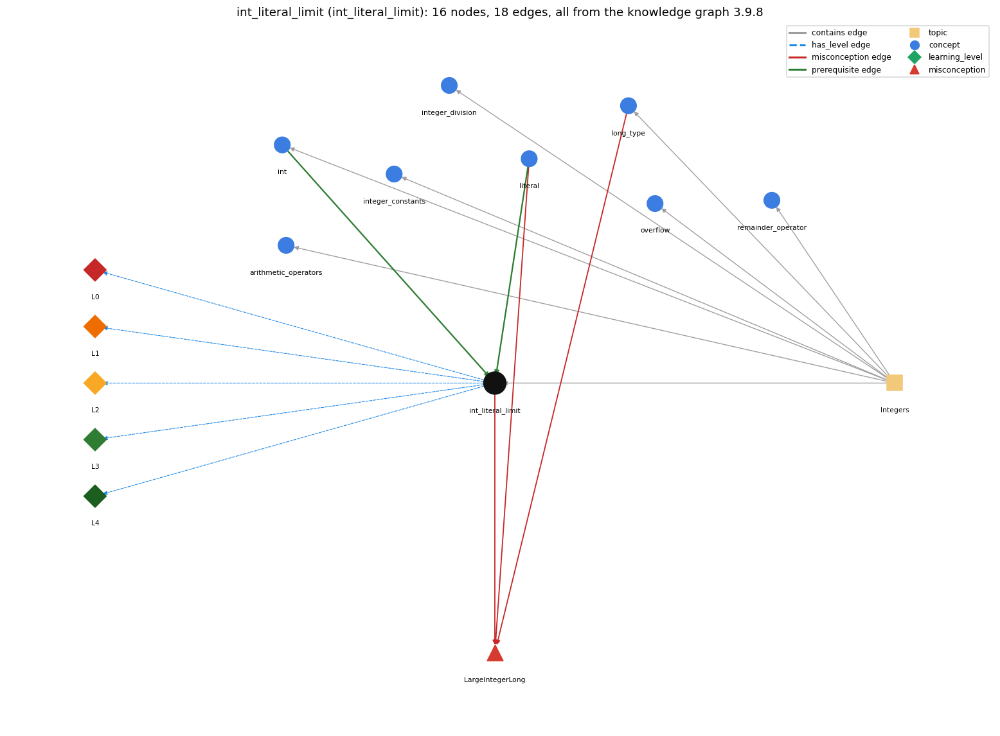

# int_literal_limit (`int_literal_limit`)

2147483648 is legal only as -2147483648

Section 1.2 Built-in Types of Data, topic 1.2.c Integers. From the knowledge graph 3.9.8 (`data/raw/chapter1_kg_updated.json`).

## Concepts associated with int\_literal\_limit (8)

| Concept | Description | How it is associated |
| --- | --- | --- |
| **arithmetic\_operators** | + - \* / % | same topic (topic1.2.c) |
| **int** | 32-bit integer primitive | prerequisite of it (it needs this) composition rule (R) with it same topic (topic1.2.c) |
| **integer\_constants** | Integer.MAX\_VALUE, Integer.MIN\_VALUE and their edge cases | same topic (topic1.2.c) |
| **integer\_division** | / on two ints truncates; % is the remainder | same topic (topic1.2.c) |
| **literal** | a constant value written in code (42, 3.14, true, 'a', "hi") | prerequisite of it (it needs this) composition rule (R) with it shares misconception LargeIntegerLong |
| **long\_type** | 64-bit integer type for values beyond the int range | shares misconception LargeIntegerLong same topic (topic1.2.c) |
| **overflow** | int arithmetic wraps around outside the 32-bit range | same topic (topic1.2.c) |
| **remainder\_operator** | % gives the remainder of integer division | same topic (topic1.2.c) |

## Every edge in this view and its full label (18)

| From | Edge | To | Full edge label |
| --- | --- | --- | --- |
| **int** | prerequisite | **int\_literal\_limit** | The limit on int literals is int's 32-bit range, -2147483648 to 2147483647. grounding: book\_passage composition rule (R) of int with int\_literal\_limit: An int literal must lie in int's range, so larger digit strings need an L (long) literal. composition rule (R) of int\_literal\_limit with int: The literal limit is exactly int's 32-bit range, but it is checked only for literals: the literal 2147483648 is a compile-time error, whereas the expression 2147483647 + 1 compiles and overflows at run time to -2147483648. |
| **literal** | prerequisite | **int\_literal\_limit** | An int literal is legal only if its value lies within the int range, so a digit sequence outside -2147483648..2147483647 is not a valid int literal. grounding: book\_passage composition rule (R) of literal with int\_literal\_limit: A literal without L must lie in -2147483648..2147483647, so 2147483648 alone is a compile error. Larger values need a long literal (2147483648L). composition rule (R) of int\_literal\_limit with literal: The general literal rule (a source-code representation of a value) is constrained here by int's range: a digit sequence outside -2147483648..2147483647 is not a valid int literal and must be written as a long literal with L. |
| **int\_literal\_limit** | misconception | **LargeIntegerLong** | **wrong rule:** a large integer literal is automatically long **right rule:** A sequence of digits is an int literal only if its value falls within the int range; for larger values the book advises the long type. role: context |
| **literal** | misconception | **LargeIntegerLong** | **wrong rule:** A whole-number literal that is too big for an int automatically becomes a long. **right rule:** A sequence of digits is an int literal only if its value falls within the int range; for larger values the book advises the long type. role: primary |
| **long\_type** | misconception | **LargeIntegerLong** | **wrong rule:** a large integer literal is automatically long **right rule:** A sequence of digits is an int literal only if its value falls within the int range; for larger values the book advises the long type. role: context |
| **int\_literal\_limit** | has\_level | **int\_literal\_limit@L0** | int literal limit -&gt; L0 (Prestructural): the answer holds a rule that contradicts Java (3 ways). **[0] everyday\_reading** (E): Folk meaning: in maths any string of digits names a number, and a very large number simply 'becomes' a bigger kind of number. Java rule: a digit sequence without an L suffix is an int literal and must denote a value in -2147483648..2147483647; 2147483648 is legal only as the operand of unary minus (-2147483648), and 3000000000 does not compile (write 3000000000L). **[1] misconception** (M) &rarr; LargeIntegerLong: wrong rule: A large integer literal is automatically long. Right rule: A digit sequence is an int literal only if its value lies within the int range; a larger literal such as 3000000000 is a compile-time error unless written with the L suffix (3000000000L), and the book advises the long type for values of ten digits or more. **[2] inconsistent\_trace** (T) &rarr; LargeIntegerLong: Points to LT (the compiler checks each literal's value against the int range when it reads the token, before any code runs). Applied unevenly: the student accepts one out-of-range literal as 'automatically long' but rejects another, or treats -2147483648 as illegal because 2147483648 alone is illegal, or expects the range check to apply to computed values such as 2147483647 + 1 (which compiles and wraps). (here mixing in: "a large integer literal is automatically long") |
| **int\_literal\_limit** | has\_level | **int\_literal\_limit@L1** | int literal limit -&gt; L1 (Unistructural): the answer states one correct rule without applying it (2 ways). **[0] names\_the\_element** (N): An int literal is a lexical constant: a source-code representation of an int value, written as decimal digits (optionally signed) whose value lies within the int range. **[1] states\_the\_rule** (S): A digit sequence is an int literal only when its decimal value lies between -2147483648 and 2147483647 inclusive; the magnitude 2147483648 may appear only as -2147483648; larger literals need the long suffix L. |
| **int\_literal\_limit** | has\_level | **int\_literal\_limit@L2** | int literal limit -&gt; L2 (Multistructural): the answer applies the rules of int literal limit to every part of the code, in order (3 ways). **[0] line\_by\_line\_trace** (LT): At compile time the compiler reads the digit token, converts it to a value and checks the range; at run time the literal is simply evaluated to that fixed value, and a leading minus is applied as unary negation to the literal's value. **[1] output\_prediction** (OP): A legal int literal evaluates to the int value it denotes (2147483647 is int 2147483647; -2147483648 is int Integer.MIN\_VALUE); an out-of-range literal has no value because the program does not compile. **[2] one\_step\_execution** (OS): Evaluating a literal changes no variable and always yields the same int; in int x = 2147483647; the only state change is x receiving that value. |
| **int\_literal\_limit** | has\_level | **int\_literal\_limit@L3** | int literal limit -&gt; L3 (Relational): the answer relates the parts (3 ways). **[0] relation\_to\_neighbour** (R): The general literal rule (a source-code representation of a value) is constrained here by int's range: a digit sequence outside -2147483648..2147483647 is not a valid int literal and must be written as a long literal with L. **[1] relation\_to\_neighbour** (R): The literal limit is exactly int's 32-bit range, but it is checked only for literals: the literal 2147483648 is a compile-time error, whereas the expression 2147483647 + 1 compiles and overflows at run time to -2147483648. **[2] purpose\_of\_the\_whole** (P): Used to write a fixed integer constant directly in code (Sajaniemi role: fixed value), including the extreme values; for the limits themselves the named constants Integer.MAX\_VALUE and Integer.MIN\_VALUE are clearer. |
| **int\_literal\_limit** | has\_level | **int\_literal\_limit@L4** | int literal limit -&gt; L4 (Extended abstract): the answer reasons beyond the given code (3 ways). **[0] predict\_a\_change** (C) &rarr; LargeIntegerLong: Adding one digit or one unit can push a literal out of range (2147483647 compiles, 2147483648 does not), and adding a leading minus can bring it back (-2147483648 compiles); rewriting the literal as the expression 2147483647 + 1 compiles but silently wraps. Invariant: the range check is applied to literal tokens at compile time, never to computed values. **[1] transfer\_to\_a\_new\_program** (X): Use a plain int literal for whole-number constants comfortably inside about plus or minus 2.1 billion; when values may reach ten digits use long with L-suffixed literals; for the extreme values use Integer.MAX\_VALUE and Integer.MIN\_VALUE rather than typing the digits. **[2] diagnose\_an\_error** (D): rule broken: An int literal must lie within the int range. Kind: compile-time. Trigger class: A digit sequence (without L) whose value exceeds 2147483647, or 2147483648 written without a leading minus, e.g. int big = 3000000000; (javac: integer number too large). |
| **topic1.2.c** | contains | **arithmetic\_operators** | topic topic1.2.c contains arithmetic\_operators |
| **topic1.2.c** | contains | **int** | topic topic1.2.c contains int |
| **topic1.2.c** | contains | **int\_literal\_limit** | topic topic1.2.c contains int\_literal\_limit |
| **topic1.2.c** | contains | **integer\_constants** | topic topic1.2.c contains integer\_constants |
| **topic1.2.c** | contains | **integer\_division** | topic topic1.2.c contains integer\_division |
| **topic1.2.c** | contains | **long\_type** | topic topic1.2.c contains long\_type |
| **topic1.2.c** | contains | **overflow** | topic topic1.2.c contains overflow |
| **topic1.2.c** | contains | **remainder\_operator** | topic topic1.2.c contains remainder\_operator |
