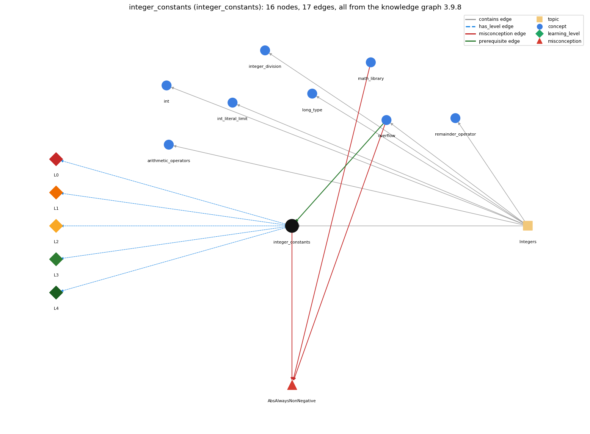

# integer_constants (`integer_constants`)

Integer.MAX\_VALUE, Integer.MIN\_VALUE and their edge cases

Section 1.2 Built-in Types of Data, topic 1.2.c Integers. From the knowledge graph 3.9.8 (`data/raw/chapter1_kg_updated.json`).

## Concepts associated with integer\_constants (8)

| Concept | Description | How it is associated |
| --- | --- | --- |
| **arithmetic\_operators** | + - \* / % | same topic (topic1.2.c) |
| **int** | 32-bit integer primitive | same topic (topic1.2.c) |
| **int\_literal\_limit** | 2147483648 is legal only as -2147483648 | same topic (topic1.2.c) |
| **integer\_division** | / on two ints truncates; % is the remainder | same topic (topic1.2.c) |
| **long\_type** | 64-bit integer type for values beyond the int range | same topic (topic1.2.c) |
| **math\_library** | Math.abs, Math.sqrt, Math.max, Math.random, Math.round ... | shares misconception AbsAlwaysNonNegative |
| **overflow** | int arithmetic wraps around outside the 32-bit range | prerequisite of it (it needs this) composition rule (R) with it shares misconception AbsAlwaysNonNegative same topic (topic1.2.c) |
| **remainder\_operator** | % gives the remainder of integer division | same topic (topic1.2.c) |

## Every edge in this view and its full label (17)

| From | Edge | To | Full edge label |
| --- | --- | --- | --- |
| **overflow** | prerequisite | **integer\_constants** | Integer.MAX\_VALUE is used to test for overflow: an int result that would go past it wraps around to a negative value. grounding: book\_passage composition rule (R) of overflow with integer\_constants: Integer.MAX\_VALUE and Integer.MIN\_VALUE mark the edges of the range. Testing a &gt; Integer.MAX\_VALUE - b before computing a + b avoids overflow. composition rule (R) of integer\_constants with overflow: Integer.MAX\_VALUE marks the overflow boundary: an int result past it wraps to a negative value, so a test such as sum &gt; Integer.MAX\_VALUE on an int is always false; an overflow guard must test before the operation (e.g. a &gt; Integer.MAX\_VALUE - b) or use long. |
| **integer\_constants** | misconception | **AbsAlwaysNonNegative** | **wrong rule:** Math.abs always returns a non-negative number. **right rule:** Math.abs(Integer.MIN\_VALUE) returns Integer.MIN\_VALUE, which is negative. role: context |
| **math\_library** | misconception | **AbsAlwaysNonNegative** | **wrong rule:** Math.abs always returns a non-negative number. **right rule:** Math.abs(Integer.MIN\_VALUE) returns Integer.MIN\_VALUE, which is negative. role: primary |
| **overflow** | misconception | **AbsAlwaysNonNegative** | **wrong rule:** Math.abs always returns a non-negative number. **right rule:** Math.abs(Integer.MIN\_VALUE) returns Integer.MIN\_VALUE, which is negative. role: context |
| **integer\_constants** | has\_level | **integer\_constants@L0** | integer constants -&gt; L0 (Prestructural): the answer holds a rule that contradicts Java (1 way). **[0] everyday\_reading** (E): Folk meaning: 'maximum' is a ceiling that nothing can pass (like a full tank, adding more leaves it full) and an absolute value is never negative. Java rule: int arithmetic wraps around silently, so Integer.MAX\_VALUE + 1 is Integer.MIN\_VALUE and Math.abs(Integer.MIN\_VALUE) is still -2147483648. |
| **integer\_constants** | has\_level | **integer\_constants@L1** | integer constants -&gt; L1 (Unistructural): the answer states one correct rule without applying it (2 ways). **[0] names\_the\_element** (N): Integer.MAX\_VALUE and Integer.MIN\_VALUE are named constants of the wrapper class Integer: the largest int, 2147483647 (2^31 - 1), and the smallest int, -2147483648 (-2^31). **[1] states\_the\_rule** (S): Each wrapper class defines MIN\_VALUE and MAX\_VALUE; for int the range is -2147483648 to 2147483647 inclusive, and results outside it are truncated (wrap) without any error signal. |
| **integer\_constants** | has\_level | **integer\_constants@L2** | integer constants -&gt; L2 (Multistructural): the answer applies the rules of integer constants to every part of the code, in order (3 ways). **[0] line\_by\_line\_trace** (LT): The constant is read like a variable when its expression is evaluated; then operators are applied in precedence order, left operand first, each in 32-bit int arithmetic, wrapping at each step that leaves the range. **[1] output\_prediction** (OP): Type int, value wrapped modulo 2^32: Integer.MAX\_VALUE + 1 is -2147483648, Integer.MIN\_VALUE - 1 is 2147483647, 2 \* Integer.MAX\_VALUE is -2, and Math.abs(Integer.MIN\_VALUE) is -2147483648. **[2] one\_step\_execution** (OS): Reading the constant changes nothing (it is final); after int a = Integer.MAX\_VALUE; a = a + 1; the variable a holds Integer.MIN\_VALUE, and no exception is raised. |
| **integer\_constants** | has\_level | **integer\_constants@L3** | integer constants -&gt; L3 (Relational): the answer relates the parts (2 ways). **[0] relation\_to\_neighbour** (R): Integer.MAX\_VALUE marks the overflow boundary: an int result past it wraps to a negative value, so a test such as sum &gt; Integer.MAX\_VALUE on an int is always false; an overflow guard must test before the operation (e.g. a &gt; Integer.MAX\_VALUE - b) or use long. **[1] purpose\_of\_the\_whole** (P): Used as the initial value of a most-wanted holder (Sajaniemi): max = Integer.MIN\_VALUE (or min = Integer.MAX\_VALUE) so the first real value always replaces it; also used as limits in overflow guards. |
| **integer\_constants** | has\_level | **integer\_constants@L4** | integer constants -&gt; L4 (Extended abstract): the answer reasons beyond the given code (3 ways). **[0] predict\_a\_change** (C): Changing the type from int to long moves the wrap point from 2^31 to 2^63 but does not remove it; replacing the initial max = Integer.MIN\_VALUE by max = 0 breaks the search for all-negative inputs. Invariant: the range is asymmetric, Integer.MIN\_VALUE == -Integer.MAX\_VALUE - 1, so negating MIN\_VALUE gives MIN\_VALUE back. **[1] transfer\_to\_a\_new\_program** (X): Use Integer.MAX\_VALUE / MIN\_VALUE as sentinels for min/max searches and as bounds in overflow checks instead of typing digits; when values can approach the limits, switch to long rather than relying on the int constants. **[2] diagnose\_an\_error** (D): rule broken: int arithmetic stays within Integer.MIN\_VALUE..Integer.MAX\_VALUE by wrapping, without error. Kind: silent logic error. Trigger class: Any int computation whose true result exceeds Integer.MAX\_VALUE or is below Integer.MIN\_VALUE: sums/products of large values, MAX\_VALUE + 1, -Integer.MIN\_VALUE, Math.abs(Integer.MIN\_VALUE). |
| **topic1.2.c** | contains | **arithmetic\_operators** | topic topic1.2.c contains arithmetic\_operators |
| **topic1.2.c** | contains | **int** | topic topic1.2.c contains int |
| **topic1.2.c** | contains | **int\_literal\_limit** | topic topic1.2.c contains int\_literal\_limit |
| **topic1.2.c** | contains | **integer\_constants** | topic topic1.2.c contains integer\_constants |
| **topic1.2.c** | contains | **integer\_division** | topic topic1.2.c contains integer\_division |
| **topic1.2.c** | contains | **long\_type** | topic topic1.2.c contains long\_type |
| **topic1.2.c** | contains | **overflow** | topic topic1.2.c contains overflow |
| **topic1.2.c** | contains | **remainder\_operator** | topic topic1.2.c contains remainder\_operator |
