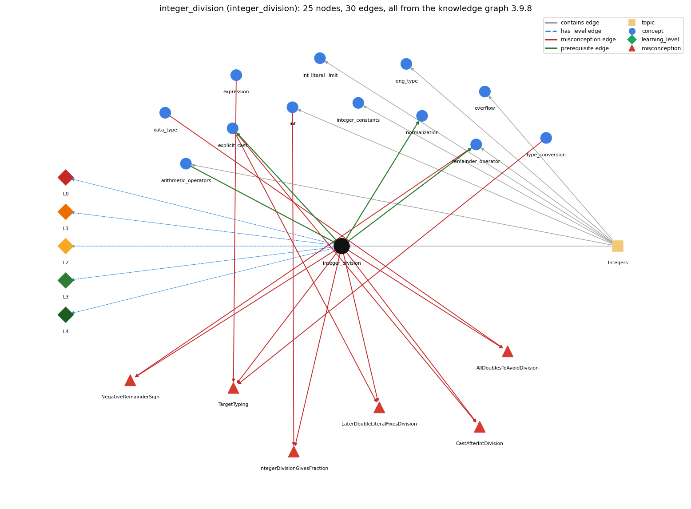

# integer_division (`integer_division`)

/ on two ints truncates; % is the remainder

Section 1.2 Built-in Types of Data, topic 1.2.c Integers.

## At a glance

- **Needs first:** `arithmetic_operators`
- **Leads to:** `explicit_cast`, `normalization`, `remainder_operator`
- **Learned alongside:** nothing
- **Misconceptions:** `AllDoublesToAvoidDivision`, `CastAfterIntDivision`, `IntegerDivisionGivesFraction`, `LaterDoubleLiteralFixesDivision`, `NegativeRemainderSign`, `TargetTyping`
- **Errors:** none
- **Levels:** L0, L1, L2, L3, L4

Everything below comes from the knowledge graph 3.9.8 (`data/raw/chapter1_kg_updated.json`): 30 edges around this concept. The edge logic, the wrong and right rules and the exact rules of the ways are copied word for word from the graph.

## To work on (0)

Nothing is missing for this concept.

## What it needs first (1)

A prerequisite edge means the other concept has to be understood before `integer_division`.

### `arithmetic_operators` comes before `integer_division`

*+ - \* / %*

- **Edge:** `pre:arithmetic_operators->integer_division`
- **Exact edge logic:** For ints a and b, / gives the whole quotient q and % gives the remainder r, so that a = b \* q + r.
- **Grounding:** book\_passage
- **Composition rule (R) of `integer_division` with `arithmetic_operators`:** / and % on ints are paired: q = a / b and r = a % b always satisfy a = b \* q + r.
- **Composition rule (R) of `arithmetic_operators` with `integer_division`:** For ints, / gives the truncated quotient and % the remainder, so (a / b) \* b + a % b == a.

## What it leads to (3)

These concepts need `integer_division` first.

### `integer_division` comes before `explicit_cast`

*(int) x -- converts between numeric types, truncating toward zero*

- **Edge:** `pre:integer_division->explicit_cast`
- **Exact edge logic:** To divide two ints and keep the fraction, one operand is cast to double before the division, as in (double) freq[i] / T; casting the finished quotient comes too late.
- **Grounding:** book\_passage

### `integer_division` comes before `normalization`

*scaling a row so its probabilities sum to 1*

- **Edge:** `pre:integer_division->normalization`
- **Exact edge logic:** Normalising must divide as doubles, because with two ints counts / total truncates to 0 whenever counts &lt; total.
- **Grounding:** order\_only
- **Composition rule (R) of `integer_division` with `normalization`:** Normalizing counts must divide as doubles. With two ints, counts / total truncates to 0 whenever counts &lt; total.
- **Composition rule (R) of `normalization` with `integer_division`:** Type flow decides the result: with a double operand anywhere to the left (.90\*...) the division is floating-point; with two ints it truncates (2/5 == 0).

### `integer_division` comes before `remainder_operator`

*% gives the remainder of integer division*

- **Edge:** `pre:integer_division->remainder_operator`
- **Exact edge logic:** % is the companion of integer division: a = (a / b) \* b + a % b.
- **Grounding:** book\_passage
- **Composition rule (R) of `integer_division` with `remainder_operator`:** % gives the remainder of the same truncating division: (a / b) \* b + a % b == a.
- **Composition rule (R) of `remainder_operator` with `integer_division`:** % is the companion of integer division, since a == (a / b) \* b + a % b. Both use the same quotient rounded toward 0.

## Learned alongside (0)

A parallel edge joins two concepts that sit side by side: neither is needed before the other.

No parallel edge touches this concept.

## Misconceptions (6)

A misconception edge states the wrong rule a student may hold about this concept, and the right rule.

### AllDoublesToAvoidDivision

- **Edge:** `integer_division` &rarr; `AllDoublesToAvoidDivision` (misconception)
- **Exact edge logic (the wrong rule):** Making every variable a double is the right fix for integer division.
- **Twin logic (the right rule):** Use int for countable things and double for measured ones; where a fraction is needed, make one operand of the division a double (or cast) instead of changing every type.
- **Wrong belief (on the node):** Making every variable a double is the right fix for integer division.
- **Correct rule (on the node):** Use int for countable things and double for measured ones; where a fraction is needed, make one operand of the division a double (or cast) instead of changing every type.
- **Provenance:** textbook
- **Role of this concept:** context
- **L0 way linked to it:** yes
- **L0 way [5] misconception, exact rule:** wrong rule: Making every variable a double is the right fix for integer division. Right rule: Use int for countable things and double for measured ones; where a fraction is needed, make one operand of the division a double (or cast) instead of changing every type.
- **Edge `data_type` &rarr; `AllDoublesToAvoidDivision`, exact edge logic:** Making every variable a double is the right fix for integer division. **Twin logic:** Use int for countable things and double for measured ones; where a fraction is needed, make one operand of the division a double (or cast) instead of changing every type. (role: primary)

### CastAfterIntDivision

- **Edge:** `integer_division` &rarr; `CastAfterIntDivision` (misconception)
- **Exact edge logic (the wrong rule):** (double) (3 / 5) is 0.6.
- **Twin logic (the right rule):** The integer division 3 / 5 = 0 happens before the cast, so the result is 0.0.
- **Wrong belief (on the node):** (double) (3 / 5) is 0.6.
- **Correct rule (on the node):** The integer division 3 / 5 = 0 happens before the cast, so the result is 0.0.
- **Provenance:** textbook
- **Role of this concept:** context
- **L0 way linked to it:** yes
- **L0 way [6] misconception, exact rule:** wrong rule: (double) (3 / 5) is 0.6. Right rule: The integer division 3 / 5 = 0 happens before the cast, so the result is 0.0.
- **Edge `explicit_cast` &rarr; `CastAfterIntDivision`, exact edge logic:** (double) (3 / 5) is 0.6. **Twin logic:** The integer division 3 / 5 = 0 happens before the cast, so the result is 0.0. (role: primary)

### IntegerDivisionGivesFraction

- **Edge:** `integer_division` &rarr; `IntegerDivisionGivesFraction` (misconception)
- **Exact edge logic (the wrong rule):** 10 / 3 evaluates to 3.333....
- **Twin logic (the right rule):** Dividing two ints gives an int: the fractional part is discarded.
- **Wrong belief (on the node):** 10 / 3 evaluates to 3.333....
- **Correct rule (on the node):** Dividing two ints gives an int: the fractional part is discarded.
- **Provenance:** textbook
- **Role of this concept:** primary
- **L0 way linked to it:** yes
- **L0 way [2] misconception, exact rule:** wrong rule: 10 / 3 evaluates to 3.333. Right rule: Dividing two ints gives an int: the fractional part is discarded.
- **Edge `int` &rarr; `IntegerDivisionGivesFraction`, exact edge logic:** 10 / 3 evaluates to 3.333.... **Twin logic:** Dividing two ints gives an int: the fractional part is discarded. (role: context)

### LaterDoubleLiteralFixesDivision

- **Edge:** `integer_division` &rarr; `LaterDoubleLiteralFixesDivision` (misconception)
- **Exact edge logic (the wrong rule):** Changing a later literal to 100.0 fixes an earlier int division.
- **Twin logic (the right rule):** The int division happens first; the double must be in the division itself.
- **Wrong belief (on the node):** Changing a later literal to 100.0 fixes an earlier int division.
- **Correct rule (on the node):** The int division happens first; the double must be in the division itself.
- **Provenance:** textbook
- **Role of this concept:** primary
- **L0 way linked to it:** yes
- **L0 way [3] misconception, exact rule:** wrong rule: Changing a later literal to 100.0 fixes an earlier int division. Right rule: The int division happens first; the double must be in the division itself.
- **Edge `explicit_cast` &rarr; `LaterDoubleLiteralFixesDivision`, exact edge logic:** Changing a later literal to 100.0 fixes an earlier int division. **Twin logic:** The int division happens first; the double must be in the division itself. (role: context)

### NegativeRemainderSign

- **Edge:** `integer_division` &rarr; `NegativeRemainderSign` (misconception)
- **Exact edge logic (the wrong rule):** a % b is never negative, and integer division of a negative number rounds down.
- **Twin logic (the right rule):** a / b rounds toward 0 and a % b takes the sign of a: -14 / 3 is -4 and -14 % 3 is -2.
- **Wrong belief (on the node):** a % b is never negative, and integer division of a negative number rounds down.
- **Correct rule (on the node):** a / b rounds toward 0 and a % b takes the sign of a: -14 / 3 is -4 and -14 % 3 is -2.
- **Provenance:** textbook
- **Role of this concept:** context
- **L0 way linked to it:** yes
- **L0 way [7] misconception, exact rule:** wrong rule: a % b is never negative, and integer division of a negative number rounds down. Right rule: a / b rounds toward 0 and a % b takes the sign of a: -14 / 3 is -4 and -14 % 3 is -2.
- **Edge `remainder_operator` &rarr; `NegativeRemainderSign`, exact edge logic:** a % b is never negative, and integer division of a negative number rounds down. **Twin logic:** a / b rounds toward 0 and a % b takes the sign of a: -14 / 3 is -4 and -14 % 3 is -2. (role: primary)

### TargetTyping

- **Edge:** `integer_division` &rarr; `TargetTyping` (misconception)
- **Exact edge logic (the wrong rule):** The type of a numerical expression depends on the type expected by the surrounding context, so double d = a / b; keeps the fraction.
- **Twin logic (the right rule):** The type of a numerical expression is determined by the expression, so double d = a / b; with int a and b still divides as ints.
- **Wrong belief (on the node):** The type of a numerical expression depends on the type expected by the surrounding context, so double d = a / b; keeps the fraction.
- **Correct rule (on the node):** The type of a numerical expression is determined by the expression, so double d = a / b; with int a and b still divides as ints.
- **Provenance:** published
- **Role of this concept:** primary
- **L0 way linked to it:** yes
- **L0 way [1] misconception, exact rule:** wrong rule: The type of a numerical expression depends on the type expected by the surrounding context, so double d = a / b; keeps the fraction. Right rule: The type of a numerical expression is determined by the expression, so double d = a / b; with int a and b still divides as ints.
- **L0 way [4] inconsistent\_trace, exact rule:** Points to LT (each / looks at its own two operand types when it is evaluated). Applied unevenly, a student evaluates 9/5 as 1.8 in f = (9/5)\*c + 32 but as 1 elsewhere, or assumes a later double operand rescues an earlier int division. (here mixing in: "The type of a numerical expression depends on the type expected by the surrounding context, so double d = a / b; keeps the fraction")
- **Edge `expression` &rarr; `TargetTyping`, exact edge logic:** The type of a numerical expression depends on the type expected by the surrounding context, so double d = a / b; keeps the fraction. **Twin logic:** The type of a numerical expression is determined by the expression, so double d = a / b; with int a and b still divides as ints. (role: context)
- **Edge `type_conversion` &rarr; `TargetTyping`, exact edge logic:** The type of a numerical expression depends on the type expected by the surrounding context, so double d = a / b; keeps the fraction. **Twin logic:** The type of a numerical expression is determined by the expression, so double d = a / b; with int a and b still divides as ints. (role: context)

## Errors (0)

An error edge states the rule that gets broken in a program, and the right rule.

The graph has no error edge from this concept.

## Levels L0 to L4 (5 of 5)

Each level edge lists the ways a student shows that level, each with its exact rule.

### L0: Prestructural / sensorimotor

L0 for integer division: the answer holds a rule that contradicts Java.

*Deciding question: Does every rule the answer applies to integer division agree with the language rule? If it reads the code with everyday meanings, applies a wrong rule, or switches rules within one trace, it is L0. A slip in an otherwise rule-correct trace is L2 with an error, not L0.*

- **Edge:** `integer_division` &rarr; `integer_division@L0` (has_level)
- **Exact edge logic:** integer division -&gt; L0 (Prestructural): the answer holds a rule that contradicts Java (8 ways).

Ways (8), each with its exact rule:

- **[0] everyday\_reading** (rule type E, folk-meaning rule): In everyday and school arithmetic, 'divide' gives an exact answer or a fraction (10 ÷ 3 = 3 1/3), and rounding goes to the nearest whole number. In Java, / with two int operands discards the fraction, rounding toward zero (59 / 60 is 0).
- **[1] misconception** (rule type M, wrong rule / right rule) &rarr; `TargetTyping`: wrong rule: The type of a numerical expression depends on the type expected by the surrounding context, so double d = a / b; keeps the fraction. Right rule: The type of a numerical expression is determined by the expression, so double d = a / b; with int a and b still divides as ints.
- **[2] misconception** (rule type M, wrong rule / right rule) &rarr; `IntegerDivisionGivesFraction`: wrong rule: 10 / 3 evaluates to 3.333. Right rule: Dividing two ints gives an int: the fractional part is discarded.
- **[3] misconception** (rule type M, wrong rule / right rule) &rarr; `LaterDoubleLiteralFixesDivision`: wrong rule: Changing a later literal to 100.0 fixes an earlier int division. Right rule: The int division happens first; the double must be in the division itself.
- **[4] inconsistent\_trace** (rule type T, uneven-application rule) &rarr; `TargetTyping`: Points to LT (each / looks at its own two operand types when it is evaluated). Applied unevenly, a student evaluates 9/5 as 1.8 in f = (9/5)\*c + 32 but as 1 elsewhere, or assumes a later double operand rescues an earlier int division. (here mixing in: "The type of a numerical expression depends on the type expected by the surrounding context, so double d = a / b; keeps the fraction")
- **[5] misconception** (rule type M, wrong rule / right rule) &rarr; `AllDoublesToAvoidDivision`: wrong rule: Making every variable a double is the right fix for integer division. Right rule: Use int for countable things and double for measured ones; where a fraction is needed, make one operand of the division a double (or cast) instead of changing every type.
- **[6] misconception** (rule type M, wrong rule / right rule) &rarr; `CastAfterIntDivision`: wrong rule: (double) (3 / 5) is 0.6. Right rule: The integer division 3 / 5 = 0 happens before the cast, so the result is 0.0.
- **[7] misconception** (rule type M, wrong rule / right rule) &rarr; `NegativeRemainderSign`: wrong rule: a % b is never negative, and integer division of a negative number rounds down. Right rule: a / b rounds toward 0 and a % b takes the sign of a: -14 / 3 is -4 and -14 % 3 is -2.

### L1: Unistructural / atom x text surface

L1 for integer division: the answer states one correct rule without applying it.

*Deciding question: Does the answer cover every part of the code, in order, with the values (L2)? If it covers one part or only states the rule, it is L1.*

- **Edge:** `integer_division` &rarr; `integer_division@L1` (has_level)
- **Exact edge logic:** integer division -&gt; L1 (Unistructural): the answer states one correct rule without applying it (2 ways).

Ways (2), each with its exact rule:

- **[0] names\_the\_element** (rule type N, identity rule): Integer division: / applied to two integer operands, giving the whole-number quotient with the fractional part discarded.
- **[1] states\_the\_rule** (rule type S, declarative rule): If both operands of / are integral types, the result is an integer that rounds toward 0 (-14 / 3 is -4). If either operand is a double, the division is floating point.

### L2: Multistructural / block x execution / preoperational

L2 for integer division: the answer applies these rules to every part of the code, in order.

*Deciding question: Is the answer many segments mapped onto lines (L2), or one segment stating the purpose of the whole (L3)? A correct output with no value-by-value justification is not levelled.*

- **Edge:** `integer_division` &rarr; `integer_division@L2` (has_level)
- **Exact edge logic:** integer division -&gt; L2 (Multistructural): the answer applies the rules of integer division to every part of the code, in order (3 ways).

Ways (3), each with its exact rule:

- **[0] line\_by\_line\_trace** (rule type LT, operational sequencing rule): Each / is evaluated when its turn comes (precedence, then left to right), using the types of its own two operands. Promoting the result to double, by a cast or by assignment, happens only afterwards and cannot restore the lost fraction.
- **[1] output\_prediction** (rule type OP, evaluation / result rule): 10 / 3 is 3, 59 / 60 is 0, 1234 / 99 is 12, -14 / 3 is -4, and (double) (3 / 5) is 0.0.
- **[2] one\_step\_execution** (rule type OS, state-transition rule): q = a / b stores the truncated quotient in q and leaves a and b unchanged. If b is 0, an ArithmeticException stops execution before anything is stored.

### L3: Relational / relations x function (concrete operational begins)

L3 for integer division: the answer relates the parts by these rules.

*Deciding question: Was the purpose deduced from the code, or only guessed from traced input/output pairs (then L2)? Does the answer stay within the given code (L3), or reason about changed code, an error class or a new program (L4)?*

- **Edge:** `integer_division` &rarr; `integer_division@L3` (has_level)
- **Exact edge logic:** integer division -&gt; L3 (Relational): the answer relates the parts (4 ways).

Ways (4), each with its exact rule:

- **[0] relation\_to\_neighbour** (rule type R, composition rule (with a neighbour)): / and % on ints are paired: q = a / b and r = a % b always satisfy a = b \* q + r.
- **[1] relation\_to\_neighbour** (rule type R, composition rule (with a neighbour)): Normalizing counts must divide as doubles. With two ints, counts / total truncates to 0 whenever counts &lt; total.
- **[2] relation\_to\_neighbour** (rule type R, composition rule (with a neighbour)): % gives the remainder of the same truncating division: (a / b) \* b + a % b == a.
- **[3] purpose\_of\_the\_whole** (rule type P, plan / role rule): Quotient plans: unit conversion (76 / 12 feet), dropping a digit (n / 10), finding a midpoint ((lo + hi) / 2), and computing a bucket or row index (i / cols).

### L4: Extended abstract (concrete-operational reversibility and conservation)

L4 for integer division: the answer reasons beyond the given code by these rules.

*Deciding question: Does the answer link the code to a broader context: a changed program, a class of inputs, an unseen problem? Re-tracing changed code value by value is L2; fixing one given failing case is L3.*

- **Edge:** `integer_division` &rarr; `integer_division@L4` (has_level)
- **Exact edge logic:** integer division -&gt; L4 (Extended abstract): the answer reasons beyond the given code (5 ways).

Ways (5), each with its exact rule:

- **[0] predict\_a\_change** (rule type C, conservation rule) &rarr; `TargetTyping`: Making one operand a double (10.0 / 3) keeps the fraction (3.333...). Casting after the division does not. Multiplying before dividing preserves precision (59 \* 100 / 60 is 98). Changing an operand's sign changes only the quotient's sign, since rounding is toward zero.
- **[1] transfer\_to\_a\_new\_program** (rule type X, applicability rule): Use integer division when you want the whole quotient (units, digits, indices, half a size). When a fraction is needed, make one operand a double (10.0 / 3 or (double) a / b) rather than turning every variable into a double.
- **[2] diagnose\_an\_error** (rule type D, error rule): rule broken: With two int operands, / discards the fraction. Kind: silent logic error. Trigger class: Two int operands where a fraction is intended: 9/5 in a temperature formula, count / total, 1 / n, sum / n for an average.
- **[3] diagnose\_an\_error** (rule type D, error rule): rule broken: int division by zero is undefined. Kind: run-time exception. Trigger class: A divisor that evaluates to 0: ArithmeticException: / by zero.
- **[4] diagnose\_an\_error** (rule type D, error rule): rule broken: Integer division rounds toward zero, not down. Kind: silent logic error. Trigger class: Negative operands where floor was expected (-7 / 2 is -3, not -4).

## Same topic

`integer_division` belongs to the topic **Integers** (`topic1.2.c`). The topic also contains: `arithmetic_operators`, `int`, `int_literal_limit`, `integer_constants`, `long_type`, `overflow`, `remainder_operator`.

## Rules of the concept (22)

- **Book** (SW-1e, p. 21 (pdf 31)): "the value of a / b is the number of times b goes into a with the fractional part discarded"
- **Book** (SW-1e, p. 39 (pdf 49)): "Since both 10 and 3 are integer literals, Java sees no need for type conversion and uses integer division."
- **Book** (JLS-15.17, ): "Integer division rounds toward 0."
- **E** (folk-meaning rule): In everyday and school arithmetic, 'divide' gives an exact answer or a fraction (10 ÷ 3 = 3 1/3), and rounding goes to the nearest whole number. In Java, / with two int operands discards the fraction, rounding toward zero (59 / 60 is 0).
- **M** (wrong rule / right rule): AllDoublesToAvoidDivision: wrong: Making every variable a double is the right fix for integer division. \| right: Use int for countable things and double for measured ones; where a fraction is needed, make one operand of the division a double (or cast) instead of changing every type.
- **M** (wrong rule / right rule): CastAfterIntDivision: wrong: (double) (3 / 5) is 0.6. \| right: The integer division 3 / 5 = 0 happens before the cast, so the result is 0.0.
- **M** (wrong rule / right rule): IntegerDivisionGivesFraction: wrong: 10 / 3 evaluates to 3.333.... \| right: Dividing two ints gives an int: the fractional part is discarded.
- **M** (wrong rule / right rule): LaterDoubleLiteralFixesDivision: wrong: Changing a later literal to 100.0 fixes an earlier int division. \| right: The int division happens first; the double must be in the division itself.
- **M** (wrong rule / right rule): TargetTyping: wrong: The type of a numerical expression depends on the type expected by the surrounding context, so double d = a / b; keeps the fraction. \| right: The type of a numerical expression is determined by the expression, so double d = a / b; with int a and b still divides as ints.
- **M** (wrong rule / right rule): NegativeRemainderSign: wrong: a % b is never negative, and integer division of a negative number rounds down. \| right: a / b rounds toward 0 and a % b takes the sign of a: -14 / 3 is -4 and -14 % 3 is -2.
- **T** (uneven-application rule): Points to LT (each / looks at its own two operand types when it is evaluated). Applied unevenly, a student evaluates 9/5 as 1.8 in f = (9/5)\*c + 32 but as 1 elsewhere, or assumes a later double operand rescues an earlier int division.
- **N** (identity rule): Integer division: / applied to two integer operands, giving the whole-number quotient with the fractional part discarded.
- **S** (declarative rule): If both operands of / are integral types, the result is an integer that rounds toward 0 (-14 / 3 is -4). If either operand is a double, the division is floating point.
- **LT** (operational sequencing rule): Each / is evaluated when its turn comes (precedence, then left to right), using the types of its own two operands. Promoting the result to double, by a cast or by assignment, happens only afterwards and cannot restore the lost fraction.
- **OP** (evaluation / result rule): 10 / 3 is 3, 59 / 60 is 0, 1234 / 99 is 12, -14 / 3 is -4, and (double) (3 / 5) is 0.0.
- **OS** (state-transition rule): q = a / b stores the truncated quotient in q and leaves a and b unchanged. If b is 0, an ArithmeticException stops execution before anything is stored.
- **R** (composition rule (with a neighbour)): with arithmetic\_operators: / and % on ints are paired: q = a / b and r = a % b always satisfy a = b \* q + r.
- **R** (composition rule (with a neighbour)): with normalization: Normalizing counts must divide as doubles. With two ints, counts / total truncates to 0 whenever counts &lt; total.
- **R** (composition rule (with a neighbour)): with remainder\_operator: % gives the remainder of the same truncating division: (a / b) \* b + a % b == a.
- **P** (plan / role rule): Quotient plans: unit conversion (76 / 12 feet), dropping a digit (n / 10), finding a midpoint ((lo + hi) / 2), and computing a bucket or row index (i / cols).
- **C** (conservation rule): Making one operand a double (10.0 / 3) keeps the fraction (3.333...). Casting after the division does not. Multiplying before dividing preserves precision (59 \* 100 / 60 is 98). Changing an operand's sign changes only the quotient's sign, since rounding is toward zero.
- **D** (error rule): rule broken: With two int operands, / discards the fraction. (silent logic error)
- **D** (error rule): rule broken: int division by zero is undefined. (run-time exception)
- **D** (error rule): rule broken: Integer division rounds toward zero, not down. (silent logic error)
- **X** (applicability rule): Use integer division when you want the whole quotient (units, digits, indices, half a size). When a fraction is needed, make one operand a double (10.0 / 3 or (double) a / b) rather than turning every variable into a double.

## How it is found in code and answers (reader block)

- **Aliases:** integer division, int division, divided, division, divide, divides
- **Code patterns:** none
- **Operator symbols:** none
- **Java types:** none
- **Signal int\_literal\_div** (scope program, decisive): `(?<![\w.])\d+\s*/\s*\d+(?![\w.])`
- **Signal int\_vars\_two\_decls\_div** (scope program, decisive): `\b(?:int|long)\s+(?:[A-Za-z_]\w*\s*(?:=[^,;]*)?,\s*){0,8}(?P<a>[A-Za-z_]\w*)\s*(?:=[^,;]*)?[,;][\s\S]{0,2000}?\b(?:int|long)\s+(?:[A-Za-z_]\w*\s*(?:=[^,;]*)?,\s*){0,8}(?P<b>[A-Za-z_]\w*)\s*(?:=[^,;]*)?[,;][\s\S]{0,2000}?(?<!\(double\) )(?<!\(double\))(?<!\(float\) )(?<!\(float\))\b(?:(?P=a)\s*/\s*(?P=b)|(?P=b)\s*/\s*(?P=a))\b`
- **Signal int\_vars\_one\_decl\_div** (scope program, decisive): `\b(?:int|long)\s+(?:[A-Za-z_]\w*\s*(?:=[^,;]*)?,\s*){0,8}(?P<a>[A-Za-z_]\w*)\s*(?:=[^,;]*)?,\s*(?:[A-Za-z_]\w*\s*(?:=[^,;]*)?,\s*){0,8}(?P<b>[A-Za-z_]\w*)\s*(?:=[^,;]*)?[,;][\s\S]{0,4000}?(?<!\(double\) )(?<!\(double\))(?<!\(float\) )(?<!\(float\))\b(?:(?P=a)\s*/\s*(?P=b)|(?P=b)\s*/\s*(?P=a))\b`
- **Signal int\_var\_div\_literal** (scope program, decisive): `\b(?:int|long)\s+(?:[A-Za-z_]\w*\s*(?:=[^,;]*)?,\s*){0,8}(?P<a>[A-Za-z_]\w*)\s*(?:=[^,;]*)?[,;][\s\S]{0,4000}?(?<!\(double\) )(?<!\(double\))(?<!\(float\) )(?<!\(float\))\b(?P=a)\s*/\s*\d+(?![\w.])`
- **Signal int\_array\_elem\_div\_int** (scope program, decisive): `\bint\s*\[\s*\]\s*(?P<arr>\w+)[\s\S]{0,4000}?\b(?:int|long)\s+(?:[A-Za-z_]\w*\s*(?:=[^,;]*)?,\s*){0,8}(?P<b>[A-Za-z_]\w*)\s*(?:=[^,;]*)?[,;][\s\S]{0,4000}?(?<!\(double\) )(?<!\(double\))(?<!\(float\) )(?<!\(float\))\b(?P=arr)\s*\[[^\]]+\]\s*/\s*(?P=b)\b`
- **Signal int\_array\_elem\_div\_literal** (scope program, decisive): `\bint\s*\[\s*\]\s*(?P<arr>\w+)[\s\S]{0,2000}?(?<!\(double\) )(?<!\(double\))(?<!\(float\) )(?<!\(float\))\b(?P=arr)\s*\[[^\]]+\]\s*/\s*\d+(?![\w.])`

## The whole prerequisite chain

- **Everything it builds on (1):** `arithmetic_operators`
- **Everything that builds on it (8):** `accumulator_pattern`, `compound_assignment`, `explicit_cast`, `math_random`, `monte_carlo_simulation`, `normalization`, `remainder_operator`, `sentinel_loop`

## Every edge in this view and its exact edge logic (30)

All the edges drawn in the picture, in the order: prerequisite, parallel, misconception, error, has_level, contains.

**1. `arithmetic_operators` &rarr; `integer_division`** (prerequisite)

- **Exact edge logic:** For ints a and b, / gives the whole quotient q and % gives the remainder r, so that a = b \* q + r.
- **Grounding:** book\_passage
- **Composition rule (R) of `arithmetic_operators` with `integer_division`:** For ints, / gives the truncated quotient and % the remainder, so (a / b) \* b + a % b == a.
- **Composition rule (R) of `integer_division` with `arithmetic_operators`:** / and % on ints are paired: q = a / b and r = a % b always satisfy a = b \* q + r.

**2. `integer_division` &rarr; `explicit_cast`** (prerequisite)

- **Exact edge logic:** To divide two ints and keep the fraction, one operand is cast to double before the division, as in (double) freq[i] / T; casting the finished quotient comes too late.
- **Grounding:** book\_passage

**3. `integer_division` &rarr; `normalization`** (prerequisite)

- **Exact edge logic:** Normalising must divide as doubles, because with two ints counts / total truncates to 0 whenever counts &lt; total.
- **Grounding:** order\_only
- **Composition rule (R) of `integer_division` with `normalization`:** Normalizing counts must divide as doubles. With two ints, counts / total truncates to 0 whenever counts &lt; total.
- **Composition rule (R) of `normalization` with `integer_division`:** Type flow decides the result: with a double operand anywhere to the left (.90\*...) the division is floating-point; with two ints it truncates (2/5 == 0).

**4. `integer_division` &rarr; `remainder_operator`** (prerequisite)

- **Exact edge logic:** % is the companion of integer division: a = (a / b) \* b + a % b.
- **Grounding:** book\_passage
- **Composition rule (R) of `integer_division` with `remainder_operator`:** % gives the remainder of the same truncating division: (a / b) \* b + a % b == a.
- **Composition rule (R) of `remainder_operator` with `integer_division`:** % is the companion of integer division, since a == (a / b) \* b + a % b. Both use the same quotient rounded toward 0.

**5. `integer_division` &rarr; `AllDoublesToAvoidDivision`** (misconception)

- **Exact edge logic (the wrong rule):** Making every variable a double is the right fix for integer division.
- **Twin logic (the right rule):** Use int for countable things and double for measured ones; where a fraction is needed, make one operand of the division a double (or cast) instead of changing every type.
- **Role:** context

**6. `integer_division` &rarr; `CastAfterIntDivision`** (misconception)

- **Exact edge logic (the wrong rule):** (double) (3 / 5) is 0.6.
- **Twin logic (the right rule):** The integer division 3 / 5 = 0 happens before the cast, so the result is 0.0.
- **Role:** context

**7. `integer_division` &rarr; `IntegerDivisionGivesFraction`** (misconception)

- **Exact edge logic (the wrong rule):** 10 / 3 evaluates to 3.333....
- **Twin logic (the right rule):** Dividing two ints gives an int: the fractional part is discarded.
- **Role:** primary

**8. `integer_division` &rarr; `LaterDoubleLiteralFixesDivision`** (misconception)

- **Exact edge logic (the wrong rule):** Changing a later literal to 100.0 fixes an earlier int division.
- **Twin logic (the right rule):** The int division happens first; the double must be in the division itself.
- **Role:** primary

**9. `integer_division` &rarr; `NegativeRemainderSign`** (misconception)

- **Exact edge logic (the wrong rule):** a % b is never negative, and integer division of a negative number rounds down.
- **Twin logic (the right rule):** a / b rounds toward 0 and a % b takes the sign of a: -14 / 3 is -4 and -14 % 3 is -2.
- **Role:** context

**10. `integer_division` &rarr; `TargetTyping`** (misconception)

- **Exact edge logic (the wrong rule):** The type of a numerical expression depends on the type expected by the surrounding context, so double d = a / b; keeps the fraction.
- **Twin logic (the right rule):** The type of a numerical expression is determined by the expression, so double d = a / b; with int a and b still divides as ints.
- **Role:** primary

**11. `data_type` &rarr; `AllDoublesToAvoidDivision`** (misconception)

- **Exact edge logic (the wrong rule):** Making every variable a double is the right fix for integer division.
- **Twin logic (the right rule):** Use int for countable things and double for measured ones; where a fraction is needed, make one operand of the division a double (or cast) instead of changing every type.
- **Role:** primary

**12. `explicit_cast` &rarr; `CastAfterIntDivision`** (misconception)

- **Exact edge logic (the wrong rule):** (double) (3 / 5) is 0.6.
- **Twin logic (the right rule):** The integer division 3 / 5 = 0 happens before the cast, so the result is 0.0.
- **Role:** primary

**13. `explicit_cast` &rarr; `LaterDoubleLiteralFixesDivision`** (misconception)

- **Exact edge logic (the wrong rule):** Changing a later literal to 100.0 fixes an earlier int division.
- **Twin logic (the right rule):** The int division happens first; the double must be in the division itself.
- **Role:** context

**14. `expression` &rarr; `TargetTyping`** (misconception)

- **Exact edge logic (the wrong rule):** The type of a numerical expression depends on the type expected by the surrounding context, so double d = a / b; keeps the fraction.
- **Twin logic (the right rule):** The type of a numerical expression is determined by the expression, so double d = a / b; with int a and b still divides as ints.
- **Role:** context

**15. `int` &rarr; `IntegerDivisionGivesFraction`** (misconception)

- **Exact edge logic (the wrong rule):** 10 / 3 evaluates to 3.333....
- **Twin logic (the right rule):** Dividing two ints gives an int: the fractional part is discarded.
- **Role:** context

**16. `remainder_operator` &rarr; `NegativeRemainderSign`** (misconception)

- **Exact edge logic (the wrong rule):** a % b is never negative, and integer division of a negative number rounds down.
- **Twin logic (the right rule):** a / b rounds toward 0 and a % b takes the sign of a: -14 / 3 is -4 and -14 % 3 is -2.
- **Role:** primary

**17. `type_conversion` &rarr; `TargetTyping`** (misconception)

- **Exact edge logic (the wrong rule):** The type of a numerical expression depends on the type expected by the surrounding context, so double d = a / b; keeps the fraction.
- **Twin logic (the right rule):** The type of a numerical expression is determined by the expression, so double d = a / b; with int a and b still divides as ints.
- **Role:** context

**18. `integer_division` &rarr; `integer_division@L0`** (has_level)

- **Exact edge logic:** integer division -&gt; L0 (Prestructural): the answer holds a rule that contradicts Java (8 ways).
  - **[0] everyday\_reading** (rule type E, folk-meaning rule): In everyday and school arithmetic, 'divide' gives an exact answer or a fraction (10 ÷ 3 = 3 1/3), and rounding goes to the nearest whole number. In Java, / with two int operands discards the fraction, rounding toward zero (59 / 60 is 0).
  - **[1] misconception** (rule type M, wrong rule / right rule) &rarr; `TargetTyping`: wrong rule: The type of a numerical expression depends on the type expected by the surrounding context, so double d = a / b; keeps the fraction. Right rule: The type of a numerical expression is determined by the expression, so double d = a / b; with int a and b still divides as ints.
  - **[2] misconception** (rule type M, wrong rule / right rule) &rarr; `IntegerDivisionGivesFraction`: wrong rule: 10 / 3 evaluates to 3.333. Right rule: Dividing two ints gives an int: the fractional part is discarded.
  - **[3] misconception** (rule type M, wrong rule / right rule) &rarr; `LaterDoubleLiteralFixesDivision`: wrong rule: Changing a later literal to 100.0 fixes an earlier int division. Right rule: The int division happens first; the double must be in the division itself.
  - **[4] inconsistent\_trace** (rule type T, uneven-application rule) &rarr; `TargetTyping`: Points to LT (each / looks at its own two operand types when it is evaluated). Applied unevenly, a student evaluates 9/5 as 1.8 in f = (9/5)\*c + 32 but as 1 elsewhere, or assumes a later double operand rescues an earlier int division. (here mixing in: "The type of a numerical expression depends on the type expected by the surrounding context, so double d = a / b; keeps the fraction")
  - **[5] misconception** (rule type M, wrong rule / right rule) &rarr; `AllDoublesToAvoidDivision`: wrong rule: Making every variable a double is the right fix for integer division. Right rule: Use int for countable things and double for measured ones; where a fraction is needed, make one operand of the division a double (or cast) instead of changing every type.
  - **[6] misconception** (rule type M, wrong rule / right rule) &rarr; `CastAfterIntDivision`: wrong rule: (double) (3 / 5) is 0.6. Right rule: The integer division 3 / 5 = 0 happens before the cast, so the result is 0.0.
  - **[7] misconception** (rule type M, wrong rule / right rule) &rarr; `NegativeRemainderSign`: wrong rule: a % b is never negative, and integer division of a negative number rounds down. Right rule: a / b rounds toward 0 and a % b takes the sign of a: -14 / 3 is -4 and -14 % 3 is -2.

**19. `integer_division` &rarr; `integer_division@L1`** (has_level)

- **Exact edge logic:** integer division -&gt; L1 (Unistructural): the answer states one correct rule without applying it (2 ways).
  - **[0] names\_the\_element** (rule type N, identity rule): Integer division: / applied to two integer operands, giving the whole-number quotient with the fractional part discarded.
  - **[1] states\_the\_rule** (rule type S, declarative rule): If both operands of / are integral types, the result is an integer that rounds toward 0 (-14 / 3 is -4). If either operand is a double, the division is floating point.

**20. `integer_division` &rarr; `integer_division@L2`** (has_level)

- **Exact edge logic:** integer division -&gt; L2 (Multistructural): the answer applies the rules of integer division to every part of the code, in order (3 ways).
  - **[0] line\_by\_line\_trace** (rule type LT, operational sequencing rule): Each / is evaluated when its turn comes (precedence, then left to right), using the types of its own two operands. Promoting the result to double, by a cast or by assignment, happens only afterwards and cannot restore the lost fraction.
  - **[1] output\_prediction** (rule type OP, evaluation / result rule): 10 / 3 is 3, 59 / 60 is 0, 1234 / 99 is 12, -14 / 3 is -4, and (double) (3 / 5) is 0.0.
  - **[2] one\_step\_execution** (rule type OS, state-transition rule): q = a / b stores the truncated quotient in q and leaves a and b unchanged. If b is 0, an ArithmeticException stops execution before anything is stored.

**21. `integer_division` &rarr; `integer_division@L3`** (has_level)

- **Exact edge logic:** integer division -&gt; L3 (Relational): the answer relates the parts (4 ways).
  - **[0] relation\_to\_neighbour** (rule type R, composition rule (with a neighbour)): / and % on ints are paired: q = a / b and r = a % b always satisfy a = b \* q + r.
  - **[1] relation\_to\_neighbour** (rule type R, composition rule (with a neighbour)): Normalizing counts must divide as doubles. With two ints, counts / total truncates to 0 whenever counts &lt; total.
  - **[2] relation\_to\_neighbour** (rule type R, composition rule (with a neighbour)): % gives the remainder of the same truncating division: (a / b) \* b + a % b == a.
  - **[3] purpose\_of\_the\_whole** (rule type P, plan / role rule): Quotient plans: unit conversion (76 / 12 feet), dropping a digit (n / 10), finding a midpoint ((lo + hi) / 2), and computing a bucket or row index (i / cols).

**22. `integer_division` &rarr; `integer_division@L4`** (has_level)

- **Exact edge logic:** integer division -&gt; L4 (Extended abstract): the answer reasons beyond the given code (5 ways).
  - **[0] predict\_a\_change** (rule type C, conservation rule) &rarr; `TargetTyping`: Making one operand a double (10.0 / 3) keeps the fraction (3.333...). Casting after the division does not. Multiplying before dividing preserves precision (59 \* 100 / 60 is 98). Changing an operand's sign changes only the quotient's sign, since rounding is toward zero.
  - **[1] transfer\_to\_a\_new\_program** (rule type X, applicability rule): Use integer division when you want the whole quotient (units, digits, indices, half a size). When a fraction is needed, make one operand a double (10.0 / 3 or (double) a / b) rather than turning every variable into a double.
  - **[2] diagnose\_an\_error** (rule type D, error rule): rule broken: With two int operands, / discards the fraction. Kind: silent logic error. Trigger class: Two int operands where a fraction is intended: 9/5 in a temperature formula, count / total, 1 / n, sum / n for an average.
  - **[3] diagnose\_an\_error** (rule type D, error rule): rule broken: int division by zero is undefined. Kind: run-time exception. Trigger class: A divisor that evaluates to 0: ArithmeticException: / by zero.
  - **[4] diagnose\_an\_error** (rule type D, error rule): rule broken: Integer division rounds toward zero, not down. Kind: silent logic error. Trigger class: Negative operands where floor was expected (-7 / 2 is -3, not -4).

**23. `topic1.2.c` &rarr; `integer_division`** (contains)

- topic `topic1.2.c` contains `integer_division`

**24. `topic1.2.c` &rarr; `arithmetic_operators`** (contains)

- topic `topic1.2.c` contains `arithmetic_operators`

**25. `topic1.2.c` &rarr; `int`** (contains)

- topic `topic1.2.c` contains `int`

**26. `topic1.2.c` &rarr; `int_literal_limit`** (contains)

- topic `topic1.2.c` contains `int_literal_limit`

**27. `topic1.2.c` &rarr; `integer_constants`** (contains)

- topic `topic1.2.c` contains `integer_constants`

**28. `topic1.2.c` &rarr; `long_type`** (contains)

- topic `topic1.2.c` contains `long_type`

**29. `topic1.2.c` &rarr; `overflow`** (contains)

- topic `topic1.2.c` contains `overflow`

**30. `topic1.2.c` &rarr; `remainder_operator`** (contains)

- topic `topic1.2.c` contains `remainder_operator`
