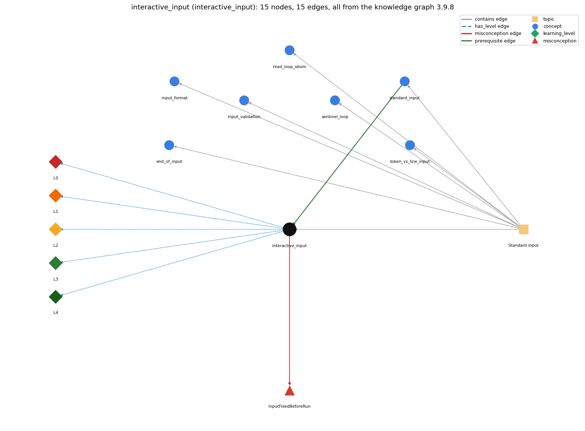

# interactive_input (`interactive_input`)

the user's input can change the program's control flow while it runs

Section 1.5 Input and Output, topic 1.5.c Standard input. From the knowledge graph 3.9.8 (`data/raw/chapter1_kg_updated.json`).

## Concepts associated with interactive\_input (7)

| Concept | Description | How it is associated |
| --- | --- | --- |
| **end\_of\_input** | StdIn.isEmpty() and the end-of-file keystroke | same topic (topic1.5.c) |
| **input\_format** | StdIn reads whitespace-separated tokens of the expected type | same topic (topic1.5.c) |
| **input\_validation** | checking the next input before reading it | same topic (topic1.5.c) |
| **read\_loop\_idiom** | reading until end-of-input | same topic (topic1.5.c) |
| **sentinel\_loop** | reading until a special stop value (Rainfall problem) | same topic (topic1.5.c) |
| **standard\_input** | StdIn -- reading a stream of values | prerequisite of it (it needs this) composition rule (R) with it same topic (topic1.5.c) |
| **token\_vs\_line\_input** | reading tokens (readInt) versus whole lines (readLine) | same topic (topic1.5.c) |

## Every edge in this view and its full label (15)

| From | Edge | To | Full edge label |
| --- | --- | --- | --- |
| **standard\_input** | prerequisite | **interactive\_input** | Standard input can be read at any time while the program runs, so the user can type values that change its control flow during execution. grounding: book\_passage composition rule (R) of standard\_input with interactive\_input: Because a read can run at any point in execution, a read inside a loop lets each typed value decide the next branch. composition rule (R) of interactive\_input with standard\_input: Because a StdIn read can run at any point, a read placed inside the game loop lets each reply choose the branch taken in that round. |
| **interactive\_input** | misconception | **InputFixedBeforeRun** | **wrong rule:** All input to a program is fixed before it starts running. **right rule:** With interactive input the user can change the control flow while the program is executing. role: primary |
| **interactive\_input** | has\_level | **interactive\_input@L0** | interactive input -&gt; L0 (Prestructural): the answer holds a rule that contradicts Java (3 ways). **[0] everyday\_reading** (E): Novices read a program as if it already knew all its inputs, e.g. treating AREA = HEIGHT\*WIDTH written before the input as using the typed values. In fact each read happens only when execution reaches it, and the typed value can change what runs next. **[1] misconception** (M) &rarr; InputFixedBeforeRun: wrong rule: All input to a program is fixed before it starts running. Right rule: With StdIn, the user types values while the program runs, and each value can change the control flow. Only command-line arguments are fixed at launch. **[2] inconsistent\_trace** (T) &rarr; InputFixedBeforeRun: Points to LT (prompt, block for input, test, respond, loop). An uneven trace answers before the guess is read, or reads all the guesses at once. (here mixing in: "All input to a program is fixed before it starts running") |
| **interactive\_input** | has\_level | **interactive\_input@L1** | interactive input -&gt; L1 (Unistructural): the answer states one correct rule without applying it (2 ways). **[0] names\_the\_element** (N): Interactive input is user dialogue through standard I/O: the program prints a prompt, reads the user's reply, and its control flow depends on that reply. **[1] states\_the\_rule** (S): A value can be read from standard input at any time during execution, and each read blocks until the user enters input. |
| **interactive\_input** | has\_level | **interactive\_input@L2** | interactive input -&gt; L2 (Multistructural): the answer applies the rules of interactive input to every part of the code, in order (3 ways). **[0] line\_by\_line\_trace** (LT): Each round prints the prompt, then readInt() blocks until the user types a number and &lt;return&gt;. The value is compared, a response is printed, and the loop test (m != N) runs again. **[1] output\_prediction** (OP): The terminal shows prompts, typed replies and responses interleaved: What's your guess? 500000 / Too high / What's your guess? 250000 / Too low ... and finally You win!. **[2] one\_step\_execution** (OS): One round sets m to the typed value and prints exactly one of You win!, Too low or Too high. N does not change. |
| **interactive\_input** | has\_level | **interactive\_input@L3** | interactive input -&gt; L3 (Relational): the answer relates the parts (2 ways). **[0] relation\_to\_neighbour** (R): Because a StdIn read can run at any point, a read placed inside the game loop lets each reply choose the branch taken in that round. **[1] purpose\_of\_the\_whole** (P): Plan: the prompt-read-respond loop (a guessing game or menu). m is a most-recent holder and N a fixed value. The programmer must plan for every possible user reply. |
| **interactive\_input** | has\_level | **interactive\_input@L4** | interactive input -&gt; L4 (Extended abstract): the answer reasons beyond the given code (4 ways). **[0] predict\_a\_change** (C) &rarr; InputFixedBeforeRun: Redirecting a file of replies instead of typing keeps the same control flow, because the program cannot tell the difference. Only the echo of the typed input disappears from the screen. **[1] transfer\_to\_a\_new\_program** (X): Use interactive input when later questions depend on earlier answers (games, menus, tutoring dialogues). For bulk data use files and redirection; modern applications take user input through a GUI. **[2] diagnose\_an\_error** (D): rule broken: Each reply must be a token of the expected type. Kind: run-time exception. Trigger class: The user types a non-integer (abc, 12.5) at a readInt() prompt: NumberFormatException. **[3] diagnose\_an\_error** (D): rule broken: No reads after the input ends. Kind: run-time exception. Trigger class: The user sends end-of-file (&lt;ctrl-d&gt;) before the loop ends, so the next readInt() fails. |
| **topic1.5.c** | contains | **end\_of\_input** | topic topic1.5.c contains end\_of\_input |
| **topic1.5.c** | contains | **input\_format** | topic topic1.5.c contains input\_format |
| **topic1.5.c** | contains | **input\_validation** | topic topic1.5.c contains input\_validation |
| **topic1.5.c** | contains | **interactive\_input** | topic topic1.5.c contains interactive\_input |
| **topic1.5.c** | contains | **read\_loop\_idiom** | topic topic1.5.c contains read\_loop\_idiom |
| **topic1.5.c** | contains | **sentinel\_loop** | topic topic1.5.c contains sentinel\_loop |
| **topic1.5.c** | contains | **standard\_input** | topic topic1.5.c contains standard\_input |
| **topic1.5.c** | contains | **token\_vs\_line\_input** | topic topic1.5.c contains token\_vs\_line\_input |
