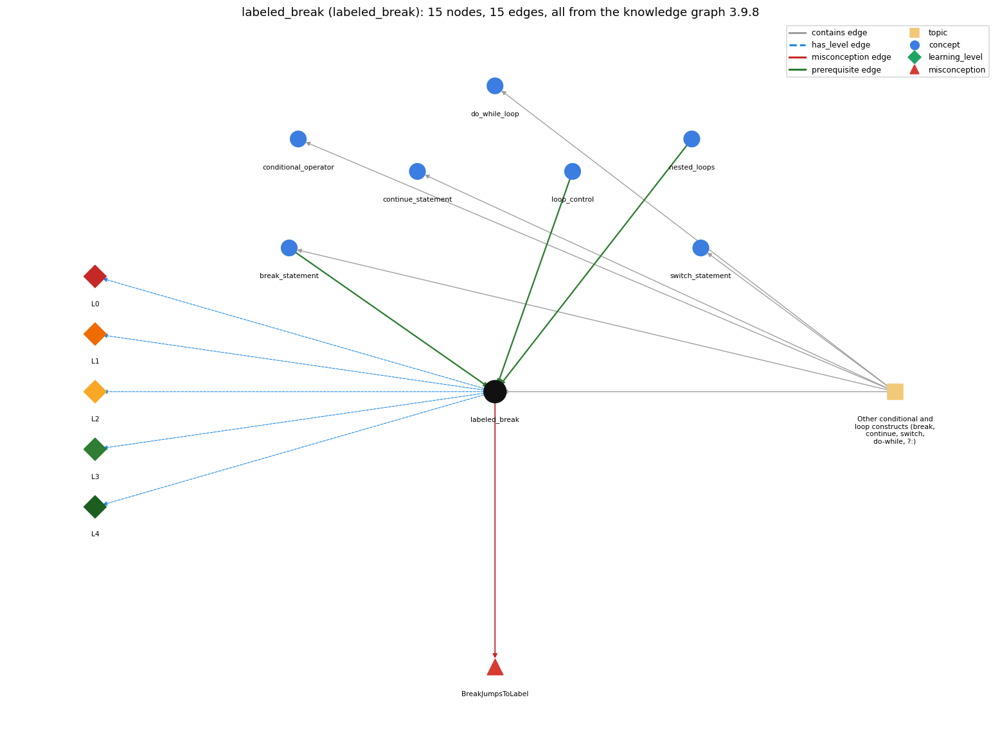

# labeled_break (`labeled_break`)

labeled break/continue exit or continue an outer loop

Section 1.3 Conditionals and Loops, topic 1.3.g Other conditional and loop constructs (break, continue, switch, do-while, ?:).

## At a glance

- **Needs first:** `break_statement`, `loop_control`, `nested_loops`
- **Leads to:** nothing
- **Learned alongside:** nothing
- **Misconceptions:** `BreakJumpsToLabel`
- **Errors:** none
- **Levels:** L0, L1, L2, L3, L4

Everything below comes from the knowledge graph 3.9.8 (`data/raw/chapter1_kg_updated.json`): 15 edges around this concept, each explained in the graph's own words.

## What it needs first (3)

A prerequisite edge means the other concept has to be understood before `labeled_break`.

### `break_statement` comes before `labeled_break`

*break -- immediately exits the innermost loop or switch*

Labeled break extends break to an outer loop.

- **Grounding:** questionable
- **How `labeled_break` combines with `break_statement`:** An unlabeled break exits only the innermost loop or switch. Adding a label lets break exit any enclosing labeled statement, and so end several nested loops at once.
- **How `break_statement` combines with `labeled_break`:** Plain break reaches only the innermost loop. In nested loops, ending the outer loop needs \`break label;\` on a labeled outer statement (or a flag tested by the outer loop).

### `loop_control` comes before `labeled_break`

*the three slots: init ; condition ; update*

break with a label leaves the labelled outer loop, not only the innermost one.

- **Grounding:** spec passage

### `nested_loops` comes before `labeled_break`

*a loop inside a loop*

A labeled break is needed only when a loop is nested inside another and the inner loop must end the outer one.

- **Grounding:** questionable
- **How `labeled_break` combines with `nested_loops`:** A label is needed only when an inner loop must end or advance an outer loop. The label goes on the outer loop header, and both loops share the outer variables, which keep the values they had at the exit.
- **How `nested_loops` combines with `labeled_break`:** A plain break ends only the innermost loop; a labeled break is needed when the inner loop must end the outer one too.

## What it leads to (0)

These concepts need `labeled_break` first.

No concept has this one as a prerequisite.

## Learned alongside (0)

A parallel edge joins two concepts that sit side by side: neither is needed before the other.

No parallel edge touches this concept.

## Misconceptions (1)

A misconception edge states the wrong rule a student may hold about this concept, and the right rule.

### BreakJumpsToLabel

- **Wrong rule:** break outer; jumps back to the label and restarts the outer loop.
- **Right rule:** The break statement terminates the labeled statement; it does not transfer the flow of control to the label.
- **Role of this concept:** primary
- **Shows at level L0 as:** misconception: wrong rule: \`break outer;\` jumps back to the label and restarts the outer loop. Right rule: \`break outer;\` completes the statement labeled outer (the whole outer loop); control continues with the statement after that loop and never returns to the label.
- **Shows at level L0 as:** inconsistent trace: Applies the LT rule unevenly: on a trace, \`break outer;\` sometimes ends only the inner loop (as an unlabeled break would), or restarts the outer loop, so outer-loop passes that should not happen appear in the trace. (here mixing in: "break outer; jumps back to the label and restarts the outer loop")

## Errors (0)

An error edge states the rule that gets broken in a program, and the right rule.

The graph has no error edge from this concept.

## Levels L0 to L4 (5 of 5)

Each level edge lists the ways a student shows that level, each with its exact rule.

### L0: Prestructural / sensorimotor

L0 for labeled break: the answer holds a rule that contradicts Java.

*Deciding question: Does every rule the answer applies to labeled break agree with the language rule? If it reads the code with everyday meanings, applies a wrong rule, or switches rules within one trace, it is L0. A slip in an otherwise rule-correct trace is L2 with an error, not L0.*

labeled break -&gt; L0 (Prestructural): the answer holds a rule that contradicts Java (3 ways).

- **everyday reading** (folk-meaning rule): Folk meaning: a label like \`outer:\` reads like a 'go to' target or bookmark, so \`break outer;\` is read as jump back to the label and start again. In Java, \`break outer;\` terminates the statement labeled outer and continues after it, and \`continue outer;\` starts the next iteration of the outer loop.
- **misconception** (wrong rule / right rule; shows `BreakJumpsToLabel`): wrong rule: \`break outer;\` jumps back to the label and restarts the outer loop. Right rule: \`break outer;\` completes the statement labeled outer (the whole outer loop); control continues with the statement after that loop and never returns to the label.
- **inconsistent trace** (uneven-application rule; shows `BreakJumpsToLabel`): Applies the LT rule unevenly: on a trace, \`break outer;\` sometimes ends only the inner loop (as an unlabeled break would), or restarts the outer loop, so outer-loop passes that should not happen appear in the trace. (here mixing in: "break outer; jumps back to the label and restarts the outer loop")

### L1: Unistructural / atom x text surface

L1 for labeled break: the answer states one correct rule without applying it.

*Deciding question: Does the answer cover every part of the code, in order, with the values (L2)? If it covers one part or only states the rule, it is L1.*

labeled break -&gt; L1 (Unistructural): the answer states one correct rule without applying it (2 ways).

- **names the element** (identity rule): Jump statement with target: \`break label;\` or \`continue label;\` names an enclosing labeled statement (usually an outer loop) to exit or to continue.
- **states the rule** (declarative rule): \`label: for (...) { ... break label; ... }\`. The label must be on a statement that encloses the break. \`break label;\` completes that statement; \`continue label;\` must name an enclosing loop and starts its next iteration. (Spec: JLS §14.7, §14.15, §14.16.) continue label; ends the current pass of the labelled outer loop and goes on to its next iteration (an unlabelled continue does this for the innermost loop).

### L2: Multistructural / block x execution / preoperational

L2 for labeled break: the answer applies these rules to every part of the code, in order.

*Deciding question: Is the answer many segments mapped onto lines (L2), or one segment stating the purpose of the whole (L3)? A correct output with no value-by-value justification is not levelled.*

labeled break -&gt; L2 (Multistructural): the answer applies the rules of labeled break to every part of the code, in order (3 ways).

- **line by line trace** (operational sequencing rule): When \`break outer;\` executes: the rest of the inner body, the inner increment/test, the rest of the outer body and the outer increment/test are all skipped. Execution resumes at the first statement after the outer loop. With \`continue outer;\`, the outer increment and test run next.
- **output prediction** (evaluation / result rule): No value is produced. The visible result is fewer passes: for a search over a 2D grid, the loop indices keep the position of the first match when the labeled break fires.
- **one step execution** (state-transition rule): One execution changes no variables; it only transfers control to after the labeled statement (break) or to its next iteration (continue).

### L3: Relational / relations x function (concrete operational begins)

L3 for labeled break: the answer relates the parts by these rules.

*Deciding question: Was the purpose deduced from the code, or only guessed from traced input/output pairs (then L2)? Does the answer stay within the given code (L3), or reason about changed code, an error class or a new program (L4)?*

labeled break -&gt; L3 (Relational): the answer relates the parts (3 ways).

- **relation to neighbour** (composition rule (with a neighbour)): An unlabeled break exits only the innermost loop or switch. Adding a label lets break exit any enclosing labeled statement, and so end several nested loops at once.
- **relation to neighbour** (composition rule (with a neighbour)): A label is needed only when an inner loop must end or advance an outer loop. The label goes on the outer loop header, and both loops share the outer variables, which keep the values they had at the exit.
- **purpose of the whole** (plan / role rule): Plan: early exit from a nested search (find the first (i, j) that matches and stop both loops). It replaces a flag that the outer loop would otherwise test.

### L4: Extended abstract (concrete-operational reversibility and conservation)

L4 for labeled break: the answer reasons beyond the given code by these rules.

*Deciding question: Does the answer link the code to a broader context: a changed program, a class of inputs, an unseen problem? Re-tracing changed code value by value is L2; fixing one given failing case is L3.*

labeled break -&gt; L4 (Extended abstract): the answer reasons beyond the given code (5 ways).

- **predict a change** (conservation rule; shows `BreakJumpsToLabel`): Removing the label (plain \`break;\`) keeps the inner exit but lets the outer loop continue, and the search may find later matches. Replacing the labeled break with a one-way flag tested by both loops keeps the result.
- **transfer to a new program** (applicability rule): Use a labeled break or continue only in nested loops where the inner loop decides that the outer loop should end or skip ahead. In a method, \`return\` is usually clearer; in single loops plain break suffices.
- **diagnose an error** (error rule): rule broken: The label must belong to a statement that encloses the break or continue. Kind: compile-time. Trigger class: \`break outer;\` where outer labels a different, non-enclosing statement or is misspelled (undefined label).
- **diagnose an error** (error rule): rule broken: \`continue label;\` must name a loop. Kind: compile-time. Trigger class: Putting a label on a block or if and using \`continue label;\` (not a loop label).
- **diagnose an error** (error rule): rule broken: Unlabeled break exits only the innermost loop. Kind: silent logic error. Trigger class: Writing plain \`break;\` in the inner loop when the intention is to stop the whole nested search: the outer loop keeps going.

## Same topic

`labeled_break` belongs to the topic **Other conditional and loop constructs (break, continue, switch, do-while, ?:)** (`topic1.3.g`). The topic also contains: `break_statement`, `conditional_operator`, `continue_statement`, `do_while_loop`, `switch_statement`.

## Rules of the concept (16)

- **folk-meaning rule:** Folk meaning: a label like \`outer:\` reads like a 'go to' target or bookmark, so \`break outer;\` is read as jump back to the label and start again. In Java, \`break outer;\` terminates the statement labeled outer and continues after it, and \`continue outer;\` starts the next iteration of the outer loop.
- **wrong rule / right rule:** BreakJumpsToLabel: wrong: \`break outer;\` jumps back to the label and restarts the outer loop. \| right: \`break outer;\` completes the statement labeled outer (the whole outer loop); control continues with the statement after that loop and never returns to the label.
- **uneven-application rule:** Applies the LT rule unevenly: on a trace, \`break outer;\` sometimes ends only the inner loop (as an unlabeled break would), or restarts the outer loop, so outer-loop passes that should not happen appear in the trace.
- **identity rule:** Jump statement with target: \`break label;\` or \`continue label;\` names an enclosing labeled statement (usually an outer loop) to exit or to continue.
- **declarative rule:** \`label: for (...) { ... break label; ... }\`. The label must be on a statement that encloses the break. \`break label;\` completes that statement; \`continue label;\` must name an enclosing loop and starts its next iteration. (Spec: JLS §14.7, §14.15, §14.16.) continue label; ends the current pass of the labelled outer loop and goes on to its next iteration (an unlabelled continue does this for the innermost loop).
- **operational sequencing rule:** When \`break outer;\` executes: the rest of the inner body, the inner increment/test, the rest of the outer body and the outer increment/test are all skipped. Execution resumes at the first statement after the outer loop. With \`continue outer;\`, the outer increment and test run next.
- **evaluation / result rule:** No value is produced. The visible result is fewer passes: for a search over a 2D grid, the loop indices keep the position of the first match when the labeled break fires.
- **state-transition rule:** One execution changes no variables; it only transfers control to after the labeled statement (break) or to its next iteration (continue).
- **composition rule (with a neighbour):** with break\_statement: An unlabeled break exits only the innermost loop or switch. Adding a label lets break exit any enclosing labeled statement, and so end several nested loops at once.
- **composition rule (with a neighbour):** with nested\_loops: A label is needed only when an inner loop must end or advance an outer loop. The label goes on the outer loop header, and both loops share the outer variables, which keep the values they had at the exit.
- **plan / role rule:** Plan: early exit from a nested search (find the first (i, j) that matches and stop both loops). It replaces a flag that the outer loop would otherwise test.
- **conservation rule:** Removing the label (plain \`break;\`) keeps the inner exit but lets the outer loop continue, and the search may find later matches. Replacing the labeled break with a one-way flag tested by both loops keeps the result.
- **error rule:** rule broken: The label must belong to a statement that encloses the break or continue. (compile-time)
- **error rule:** rule broken: \`continue label;\` must name a loop. (compile-time)
- **error rule:** rule broken: Unlabeled break exits only the innermost loop. (silent logic error)
- **applicability rule:** Use a labeled break or continue only in nested loops where the inner loop decides that the outer loop should end or skip ahead. In a method, \`return\` is usually clearer; in single loops plain break suffices.

## The whole prerequisite chain

- **Everything it builds on (18):** `arithmetic_operators`, `boolean`, `boolean_expression`, `break_statement`, `comparison_operators`, `data_type`, `do_while_loop`, `expression`, `for_loop`, `identifier`, `literal`, `logical_operators`, `loop_control`, `loop_variable`, `nested_loops`, `primitive_type`, `variable`, `while_loop`
- **Everything that builds on it (0):** nothing
