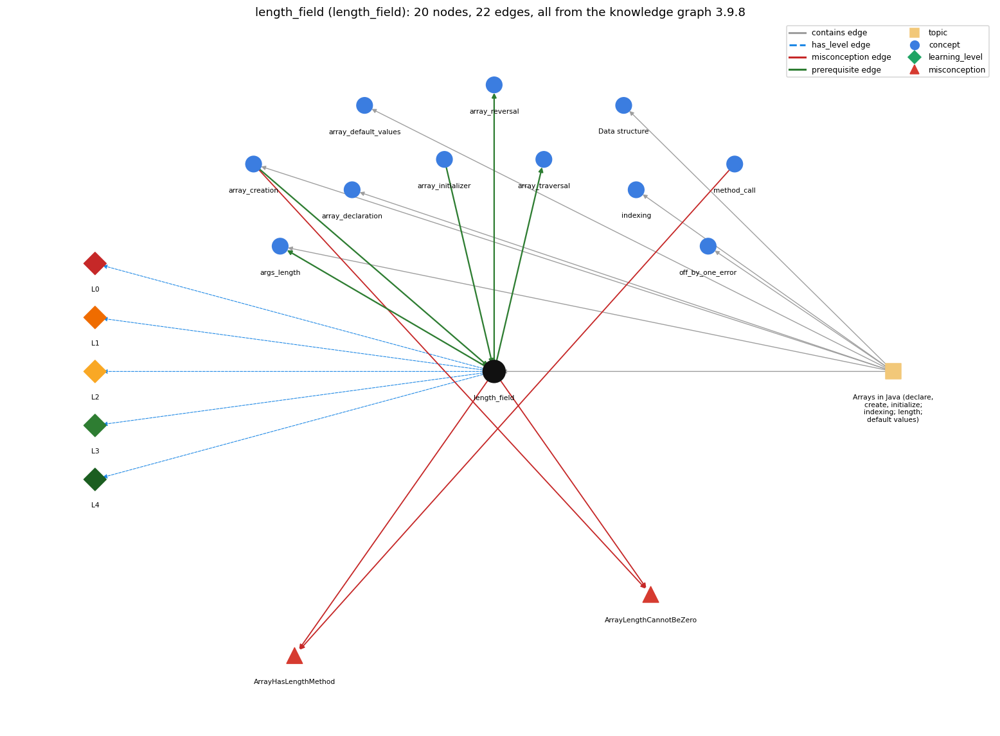

# length_field (`length_field`)

a.length is a field, not a method

Section 1.4 Arrays, topic 1.4.a Arrays in Java (declare, create, initialize; indexing; length; default values). From the knowledge graph 3.9.8 (`data/raw/chapter1_kg_updated.json`).

## Concepts associated with length\_field (11)

| Concept | Description | How it is associated |
| --- | --- | --- |
| **args\_length** | args.length gives the number of command-line arguments | builds on it (needs it) composition rule (R) with it same topic (topic1.4.a) |
| **array\_creation** | new int[n] -- allocates n slots | prerequisite of it (it needs this) composition rule (R) with it shares misconception ArrayLengthCannotBeZero same topic (topic1.4.a) |
| **array\_declaration** | int[] a; -- declares an array variable | same topic (topic1.4.a) |
| **array\_default\_values** | new slots start at 0 / false / null | same topic (topic1.4.a) |
| **array\_initializer** | {1, 2, 3} literal initialization | prerequisite of it (it needs this) |
| **array\_reversal** | reversing an array in place | builds on it (needs it) |
| **array\_traversal** | walking the array with an index loop | builds on it (needs it) |
| **data\_structure** | a method for organizing data; the one-dimensional array is the first example | same topic (topic1.4.a) |
| **indexing** | a[i] -- 0-based access | same topic (topic1.4.a) |
| **method\_call** | name(arguments) -- invokes a library method and uses its return value | shares misconception ArrayHasLengthMethod |
| **off\_by\_one\_error** | a loop or index that runs one time too many or too few (&lt; vs &lt;=, 0..n vs 1..n, length vs length-1) | same topic (topic1.4.a) |

## Every edge in this view and its full label (22)

| From | Edge | To | Full edge label |
| --- | --- | --- | --- |
| **array\_creation** | prerequisite | **length\_field** | The size n given to new becomes a.length and stays fixed for the array's lifetime. grounding: book\_passage composition rule (R) of array\_creation with length\_field: The size n given to new becomes a.length and never changes for that array object. composition rule (R) of length\_field with array\_creation: The n given to new becomes a.length and stays fixed for that array object. |
| **array\_initializer** | prerequisite | **length\_field** | An array made from a literal has as many elements as values listed, and a.length gives that number. grounding: spec\_passage |
| **length\_field** | prerequisite | **args\_length** | args is an ordinary String array, so args.length is its length field and counts the command-line arguments. grounding: order\_only composition rule (R) of length\_field with args\_length: args is an ordinary String[], so args.length is its length field and counts the command-line arguments (0 when none are typed). composition rule (R) of args\_length with length\_field: args.length is the ordinary array length field applied to the String[] args. |
| **length\_field** | prerequisite | **array\_reversal** | Reversal pairs a[i] with a[a.length-1-i], counting back from the last index a.length-1. grounding: book\_passage |
| **length\_field** | prerequisite | **array\_traversal** | A traversal loop runs its index from 0 while it is below a.length, so it visits every element once. grounding: book\_passage |
| **array\_creation** | misconception | **ArrayLengthCannotBeZero** | **wrong rule:** An array cannot have length 0. **right rule:** new int[0] is a legal array of length 0. role: primary |
| **length\_field** | misconception | **ArrayHasLengthMethod** | **wrong rule:** The size of an array is found by calling a.length(). **right rule:** An array's size is the field a.length, written without parentheses. role: primary |
| **length\_field** | misconception | **ArrayLengthCannotBeZero** | **wrong rule:** An array cannot have length 0. **right rule:** new int[0] is a legal array of length 0. role: context |
| **method\_call** | misconception | **ArrayHasLengthMethod** | **wrong rule:** you call length() instead of using the length field **right rule:** An array's size is the field a.length, written without parentheses. role: context |
| **length\_field** | has\_level | **length\_field@L0** | length field -&gt; L0 (Prestructural): the answer holds a rule that contradicts Java (4 ways). **[0] everyday\_reading** (E): Folk meaning: 'length' is something you ask for, like s.length() for a String, and in everyday counting 'length 10' suggests the last item is number 10. Java rule: a.length is a final field written without parentheses, equal to the number of elements, so the last index is a.length-1. **[1] misconception** (M) &rarr; ArrayHasLengthMethod: wrong rule: You call length() instead of using the length field. Right rule: An array's size is the field a.length, written without parentheses; length() is a String method. **[2] inconsistent\_trace** (T) &rarr; ArrayHasLengthMethod: Points to LT: a.length is read every time the loop test i &lt; a.length runs. Inconsistent application: the trace uses a.length as the last valid index on some passes (as if the test were &lt;=). (here mixing in: "you call length() instead of using the length field") **[3] misconception** (M) &rarr; ArrayLengthCannotBeZero: wrong rule: An array cannot have length 0. Right rule: new int[0] is a legal array with length 0; args is such an array when no arguments are typed. |
| **length\_field** | has\_level | **length\_field@L1** | length field -&gt; L1 (Unistructural): the answer states one correct rule without applying it (2 ways). **[0] names\_the\_element** (N): Identity: a.length is the public final instance field that every array has, holding its number of elements. **[1] states\_the\_rule** (S): Declarative: the length of array a is written a.length (no parentheses); it equals the size given at creation, may be zero, cannot be assigned, and the last element is a[a.length-1]. |
| **length\_field** | has\_level | **length\_field@L2** | length field -&gt; L2 (Multistructural): the answer applies the rules of length field to every part of the code, in order (3 ways). **[0] line\_by\_line\_trace** (LT): Sequencing: a is evaluated first (a null a throws NullPointerException), then the length field of the array a refers to now is read. In 'for (int i = 0; i &lt; a.length; i++)' it is re-read at each test. **[1] output\_prediction** (OP): Result: an int &gt;= 0 equal to the number of elements: new double[8].length is 8, {1, 2, 3}.length is 3, and the last element is a[a.length-1]. **[2] one\_step\_execution** (OS): State transition: reading a.length changes nothing. Assigning 'a.length = 5' is impossible (a final field), so only making a refer to a different array changes the value later read as a.length. |
| **length\_field** | has\_level | **length\_field@L3** | length field -&gt; L3 (Relational): the answer relates the parts (3 ways). **[0] relation\_to\_neighbour** (R): The n given to new becomes a.length and stays fixed for that array object. **[1] relation\_to\_neighbour** (R): args is an ordinary String[], so args.length is its length field and counts the command-line arguments (0 when none are typed). **[2] purpose\_of\_the\_whole** (P): Plan/role: a fixed value (Sajaniemi) that lets code adapt to any array size instead of a hard-coded magic number, e.g. loop bounds and the last element. |
| **length\_field** | has\_level | **length\_field@L4** | length field -&gt; L4 (Extended abstract): the answer reasons beyond the given code (5 ways). **[0] predict\_a\_change** (C) &rarr; ArrayHasLengthMethod: Conservation: for a given array object a.length never changes, so loops bounded by a.length stay correct when the array is created with a different size. Reassigning a to another array changes a.length. **[1] transfer\_to\_a\_new\_program** (X): Applicability: use a.length wherever code must follow the array's real size (loop bounds, last element, copying); use a[i].length for each row of a possibly ragged 2-D array; use s.length() for Strings. **[2] diagnose\_an\_error** (D): rule broken: length is a field, not a method. Kind: compile-time. Trigger class: a.length() is written for an array (cannot find symbol: method length()) **[3] diagnose\_an\_error** (D): rule broken: length is final and cannot be assigned. Kind: compile-time. Trigger class: 'a.length = n;' (cannot assign a value to final variable length) **[4] diagnose\_an\_error** (D): rule broken: The last valid index is a.length-1. Kind: run-time exception. Trigger class: a[a.length] or a loop with i &lt;= a.length (ArrayIndexOutOfBoundsException) |
| **topic1.4.a** | contains | **args\_length** | topic topic1.4.a contains args\_length |
| **topic1.4.a** | contains | **array\_creation** | topic topic1.4.a contains array\_creation |
| **topic1.4.a** | contains | **array\_declaration** | topic topic1.4.a contains array\_declaration |
| **topic1.4.a** | contains | **array\_default\_values** | topic topic1.4.a contains array\_default\_values |
| **topic1.4.a** | contains | **data\_structure** | topic topic1.4.a contains data\_structure |
| **topic1.4.a** | contains | **indexing** | topic topic1.4.a contains indexing |
| **topic1.4.a** | contains | **length\_field** | topic topic1.4.a contains length\_field |
| **topic1.4.a** | contains | **off\_by\_one\_error** | topic topic1.4.a contains off\_by\_one\_error |
