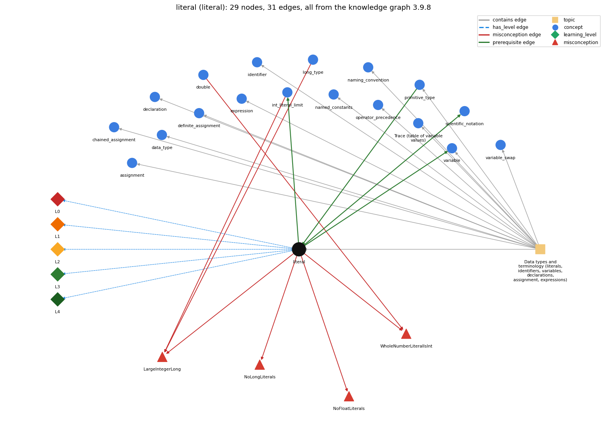

# literal (`literal`)

a constant value written in code (42, 3.14, true, 'a', "hi")

Section 1.2 Built-in Types of Data, topic 1.2.a Data types and terminology (literals, identifiers, variables, declarations, assignment, expressions).

## At a glance

- **Needs first:** `primitive_type`
- **Leads to:** `int_literal_limit`, `scientific_notation`, `variable`
- **Learned alongside:** nothing
- **Misconceptions:** `LargeIntegerLong`, `NoFloatLiterals`, `NoLongLiterals`, `WholeNumberLiteralIsInt`
- **Errors:** none
- **Levels:** L0, L1, L2, L3, L4

Everything below comes from the knowledge graph 3.9.8 (`data/raw/chapter1_kg_updated.json`): 31 edges around this concept, each explained in the graph's own words.

## What it needs first (1)

A prerequisite edge means the other concept has to be understood before `literal`.

### `primitive_type` comes before `literal`

*int, double, boolean, char*

A literal is the source-code form of a value of some type, and the way it is written fixes that type: 1234 is an int, 3.14 a double, true a boolean, 'c' a char.

- **Grounding:** book passage
- **How `literal` combines with `primitive_type`:** The form of a literal selects its primitive type, and that type must be assignable to the target: int x = 3.0; does not compile even though 3.0 is a whole number.
- **How `primitive_type` combines with `literal`:** How a literal is written fixes its primitive type (1234 int, 3.14 double, true boolean, 'c' char), and it must fit the primitive type of the variable it initializes.

## What it leads to (3)

These concepts need `literal` first.

### `literal` comes before `int_literal_limit`

*2147483648 is legal only as -2147483648*

An int literal is legal only if its value lies within the int range, so a digit sequence outside -2147483648..2147483647 is not a valid int literal.

- **Grounding:** book passage
- **How `literal` combines with `int_literal_limit`:** A literal without L must lie in -2147483648..2147483647, so 2147483648 alone is a compile error. Larger values need a long literal (2147483648L).
- **How `int_literal_limit` combines with `literal`:** The general literal rule (a source-code representation of a value) is constrained here by int's range: a digit sequence outside -2147483648..2147483647 is not a valid int literal and must be written as a long literal with L.

### `literal` comes before `scientific_notation`

*double literals like 6.022E23*

Scientific notation is a form of double literal.

- **Grounding:** book passage
- **How `literal` combines with `scientific_notation`:** E-notation is a form of double literal. 6.022e23 and even 1e6 are doubles, so int n = 1e6; needs a cast.
- **How `scientific_notation` combines with `literal`:** Scientific notation is a double literal, so the literal rules for double apply: it cannot initialize an int without a cast (int n = 1e6; does not compile).

### `literal` comes before `variable`

*a named, typed box that holds a value*

A variable of type t is given a value of type t, often written as a literal.

- **Grounding:** order only
- **How `literal` combines with `variable`:** Literals commonly initialize variables. The literal's type must equal or widen to the variable's type: double y = 1; widens, but int x = 1.1; is an error.
- **How `variable` combines with `literal`:** Literals commonly give variables their values, and the literal's type must fit the variable's type (int x = 1.1; is rejected).

## Learned alongside (0)

A parallel edge joins two concepts that sit side by side: neither is needed before the other.

No parallel edge touches this concept.

## Misconceptions (4)

A misconception edge states the wrong rule a student may hold about this concept, and the right rule.

### LargeIntegerLong

- **Wrong rule:** A whole-number literal that is too big for an int automatically becomes a long.
- **Right rule:** A sequence of digits is an int literal only if its value falls within the int range; for larger values the book advises the long type.
- **Role of this concept:** primary
- **Shows at level L0 as:** misconception: wrong rule: a large integer literal is automatically long. Right rule: A sequence of digits is an int literal only if its value falls within the int range; for larger values the book advises the long type.
- **Shows at level L0 as:** inconsistent trace: Points to LT (each literal denotes one fixed value whose type is read from how it is written). Applied unevenly, a student reads 2.0 as an int in one place, or '7' as the number 7 in one expression and as a character in the next. (here mixing in: "a large integer literal is automatically long")
- **Also an edge from `int_literal_limit`:** a large integer literal is automatically long
- **Also an edge from `long_type`:** a large integer literal is automatically long

### NoFloatLiterals

- **Wrong rule:** Java has no way to write a float literal.
- **Right rule:** A decimal literal ending in f is a float; without the f it is a double.
- **Role of this concept:** primary
- **Shows at level L0 as:** misconception: wrong rule: Java has no float literals. Right rule: A decimal literal ending in f is a float; without the f it is a double.

### NoLongLiterals

- **Wrong rule:** Java has no way to write a long literal.
- **Right rule:** An integer literal ending in L is a long.
- **Role of this concept:** primary
- **Shows at level L0 as:** misconception: wrong rule: Java has no long literals. Right rule: An integer literal ending in L is a long.

### WholeNumberLiteralIsInt

- **Wrong rule:** 207. and 2.3e4 are int values because they are whole numbers.
- **Right rule:** A decimal point or scientific notation makes the literal a double.
- **Role of this concept:** primary
- **Shows at level L0 as:** misconception: wrong rule: 207. and 2.3e4 are int values because they are whole numbers. Right rule: A decimal point or scientific notation makes the literal a double.
- **Also an edge from `double`:** 207. and 2.3e4 are int values because they are whole numbers.

## Errors (0)

An error edge states the rule that gets broken in a program, and the right rule.

The graph has no error edge from this concept.

## Levels L0 to L4 (5 of 5)

Each level edge lists the ways a student shows that level, each with its exact rule.

### L0: Prestructural / sensorimotor

L0 for literal: the answer holds a rule that contradicts Java.

*Deciding question: Does every rule the answer applies to literal agree with the language rule? If it reads the code with everyday meanings, applies a wrong rule, or switches rules within one trace, it is L0. A slip in an otherwise rule-correct trace is L2 with an error, not L0.*

literal -&gt; L0 (Prestructural): the answer holds a rule that contradicts Java (6 ways).

- **everyday reading** (folk-meaning rule): In everyday writing, 1,000,000, 007, 1/2 and $5 all stand for numbers. Java literals have strict forms: commas are not allowed, 1/2 is an int division expression worth 0, and a leading 0 makes the number octal (013 is 11).
- **misconception** (wrong rule / right rule; shows `LargeIntegerLong`): wrong rule: a large integer literal is automatically long. Right rule: A sequence of digits is an int literal only if its value falls within the int range; for larger values the book advises the long type.
- **misconception** (wrong rule / right rule; shows `NoFloatLiterals`): wrong rule: Java has no float literals. Right rule: A decimal literal ending in f is a float; without the f it is a double.
- **misconception** (wrong rule / right rule; shows `NoLongLiterals`): wrong rule: Java has no long literals. Right rule: An integer literal ending in L is a long.
- **misconception** (wrong rule / right rule; shows `WholeNumberLiteralIsInt`): wrong rule: 207. and 2.3e4 are int values because they are whole numbers. Right rule: A decimal point or scientific notation makes the literal a double.
- **inconsistent trace** (uneven-application rule; shows `LargeIntegerLong`): Points to LT (each literal denotes one fixed value whose type is read from how it is written). Applied unevenly, a student reads 2.0 as an int in one place, or '7' as the number 7 in one expression and as a character in the next. (here mixing in: "a large integer literal is automatically long")

### L1: Unistructural / atom x text surface

L1 for literal: the answer states one correct rule without applying it.

*Deciding question: Does the answer cover every part of the code, in order, with the values (L2)? If it covers one part or only states the rule, it is L1.*

literal -&gt; L1 (Unistructural): the answer states one correct rule without applying it (2 ways).

- **names the element** (identity rule): Literal: a source-code representation of one fixed data-type value, such as 42, 3.14, true, 'a' or "hi".
- **states the rule** (declarative rule): A digit sequence within the int range is an int literal. A decimal point or e-notation makes a double (3.14, 6.022e23). Suffix L gives a long and f a float. true and false are boolean, one character in single quotes is a char, and characters in double quotes are a String. Integer literals can also be written in hexadecimal (0x1F), octal (a leading 0: 013 is 11) or binary (0b101) and may contain underscores (1\_000\_000); a trailing L makes a long literal (2147483648L) and a trailing F a float literal (2.5F).

### L2: Multistructural / block x execution / preoperational

L2 for literal: the answer applies these rules to every part of the code, in order.

*Deciding question: Is the answer many segments mapped onto lines (L2), or one segment stating the purpose of the whole (L3)? A correct output with no value-by-value justification is not levelled.*

literal -&gt; L2 (Multistructural): the answer applies the rules of literal to every part of the code, in order (3 ways).

- **line by line trace** (operational sequencing rule): A literal is evaluated at once, with no computation, and its evaluation always completes normally. An expression built from literals, such as 1/2, is still computed by its operators when it is reached.
- **output prediction** (evaluation / result rule): A literal's value is itself, with a type fixed by its form: 1234 is int 1234, 3.0 is double, '1' is char (code 49), and "2.5" is a String, not a number.
- **one step execution** (state-transition rule): A literal changes no state by itself. On the right of an assignment it supplies the value stored, e.g. a = 1234; sets a to 1234.

### L3: Relational / relations x function (concrete operational begins)

L3 for literal: the answer relates the parts by these rules.

*Deciding question: Was the purpose deduced from the code, or only guessed from traced input/output pairs (then L2)? Does the answer stay within the given code (L3), or reason about changed code, an error class or a new program (L4)?*

literal -&gt; L3 (Relational): the answer relates the parts (5 ways).

- **relation to neighbour** (composition rule (with a neighbour)): The form of a literal selects its primitive type, and that type must be assignable to the target: int x = 3.0; does not compile even though 3.0 is a whole number.
- **relation to neighbour** (composition rule (with a neighbour)): Literals commonly initialize variables. The literal's type must equal or widen to the variable's type: double y = 1; widens, but int x = 1.1; is an error.
- **relation to neighbour** (composition rule (with a neighbour)): E-notation is a form of double literal. 6.022e23 and even 1e6 are doubles, so int n = 1e6; needs a cast.
- **relation to neighbour** (composition rule (with a neighbour)): A literal without L must lie in -2147483648..2147483647, so 2147483648 alone is a compile error. Larger values need a long literal (2147483648L).
- **purpose of the whole** (plan / role rule): Literals supply the fixed values a computation starts from: initial values of counters and totals (0), messages and labels, and known constants. A meaningful number that is repeated (a 'magic number') should become a named constant.

### L4: Extended abstract (concrete-operational reversibility and conservation)

L4 for literal: the answer reasons beyond the given code by these rules.

*Deciding question: Does the answer link the code to a broader context: a changed program, a class of inputs, an unseen problem? Re-tracing changed code value by value is L2; fixing one given failing case is L3.*

literal -&gt; L4 (Extended abstract): the answer reasons beyond the given code (5 ways).

- **predict a change** (conservation rule; shows `LargeIntegerLong`): Rewriting a literal in another form keeps the value but changes the type, and so the operation: 10 / 3 is 3 but 10.0 / 3 is 3.333..., and "5" + 1 is "51" but 5 + 1 is 6.
- **transfer to a new program** (applicability rule): Use a literal for a self-explanatory value fixed when the program is written (0, 1, "Hello"). Use a final named constant for a meaningful or repeated value, and command-line or standard input for values that change between runs.
- **diagnose an error** (error rule): rule broken: An int literal must lie within the int range. Kind: compile-time. Trigger class: A digit sequence greater than 2147483647 without an L suffix (e.g. long big = 3000000000;): 'integer number too large'.
- **diagnose an error** (error rule): rule broken: A char literal holds exactly one character in single quotes, and a String literal must be closed on the same line. Kind: compile-time. Trigger class: Writing 'ab', using single quotes for a word, or leaving out a closing quote: 'unclosed character literal' or 'unclosed string literal'.
- **diagnose an error** (error rule): rule broken: A leading 0 makes an integer literal octal. Kind: silent logic error. Trigger class: Zero-padded numbers such as 010 or 013 (evaluate to 8 and 11).

## Same topic

`literal` belongs to the topic **Data types and terminology (literals, identifiers, variables, declarations, assignment, expressions)** (`topic1.2.a`). The topic also contains: `assignment`, `chained_assignment`, `data_type`, `declaration`, `definite_assignment`, `expression`, `identifier`, `named_constants`, `naming_convention`, `operator_precedence`, `primitive_type`, `program_trace`, `variable`, `variable_swap`.

## Rules of the concept (21)

- **folk-meaning rule:** In everyday writing, 1,000,000, 007, 1/2 and $5 all stand for numbers. Java literals have strict forms: commas are not allowed, 1/2 is an int division expression worth 0, and a leading 0 makes the number octal (013 is 11).
- **wrong rule / right rule:** LargeIntegerLong: wrong: a large integer literal is automatically long \| right: A sequence of digits is an int literal only if its value falls within the int range; for larger values the book advises the long type.
- **wrong rule / right rule:** NoFloatLiterals: wrong: Java has no float literals \| right: A decimal literal ending in f is a float; without the f it is a double.
- **wrong rule / right rule:** NoLongLiterals: wrong: Java has no long literals \| right: An integer literal ending in L is a long.
- **wrong rule / right rule:** WholeNumberLiteralIsInt: wrong: 207. and 2.3e4 are int values because they are whole numbers. \| right: A decimal point or scientific notation makes the literal a double.
- **uneven-application rule:** Points to LT (each literal denotes one fixed value whose type is read from how it is written). Applied unevenly, a student reads 2.0 as an int in one place, or '7' as the number 7 in one expression and as a character in the next.
- **identity rule:** Literal: a source-code representation of one fixed data-type value, such as 42, 3.14, true, 'a' or "hi".
- **declarative rule:** A digit sequence within the int range is an int literal. A decimal point or e-notation makes a double (3.14, 6.022e23). Suffix L gives a long and f a float. true and false are boolean, one character in single quotes is a char, and characters in double quotes are a String. Integer literals can also be written in hexadecimal (0x1F), octal (a leading 0: 013 is 11) or binary (0b101) and may contain underscores (1\_000\_000); a trailing L makes a long literal (2147483648L) and a trailing F a float literal (2.5F).
- **operational sequencing rule:** A literal is evaluated at once, with no computation, and its evaluation always completes normally. An expression built from literals, such as 1/2, is still computed by its operators when it is reached.
- **evaluation / result rule:** A literal's value is itself, with a type fixed by its form: 1234 is int 1234, 3.0 is double, '1' is char (code 49), and "2.5" is a String, not a number.
- **state-transition rule:** A literal changes no state by itself. On the right of an assignment it supplies the value stored, e.g. a = 1234; sets a to 1234.
- **composition rule (with a neighbour):** with primitive\_type: The form of a literal selects its primitive type, and that type must be assignable to the target: int x = 3.0; does not compile even though 3.0 is a whole number.
- **composition rule (with a neighbour):** with variable: Literals commonly initialize variables. The literal's type must equal or widen to the variable's type: double y = 1; widens, but int x = 1.1; is an error.
- **composition rule (with a neighbour):** with scientific\_notation: E-notation is a form of double literal. 6.022e23 and even 1e6 are doubles, so int n = 1e6; needs a cast.
- **composition rule (with a neighbour):** with int\_literal\_limit: A literal without L must lie in -2147483648..2147483647, so 2147483648 alone is a compile error. Larger values need a long literal (2147483648L).
- **plan / role rule:** Literals supply the fixed values a computation starts from: initial values of counters and totals (0), messages and labels, and known constants. A meaningful number that is repeated (a 'magic number') should become a named constant.
- **conservation rule:** Rewriting a literal in another form keeps the value but changes the type, and so the operation: 10 / 3 is 3 but 10.0 / 3 is 3.333..., and "5" + 1 is "51" but 5 + 1 is 6.
- **error rule:** rule broken: An int literal must lie within the int range. (compile-time)
- **error rule:** rule broken: A char literal holds exactly one character in single quotes, and a String literal must be closed on the same line. (compile-time)
- **error rule:** rule broken: A leading 0 makes an integer literal octal. (silent logic error)
- **applicability rule:** Use a literal for a self-explanatory value fixed when the program is written (0, 1, "Hello"). Use a final named constant for a meaningful or repeated value, and command-line or standard input for values that change between runs.

## The whole prerequisite chain

- **Everything it builds on (2):** `data_type`, `primitive_type`
- **Everything that builds on it (80):** `accumulator_pattern`, `animation`, `api`, `array_copy`, `array_exchange`, `array_reversal`, `array_traversal`, `assignment`, `boolean_expression`, `boolean_flag_array`, `break_statement`, `chained_assignment`, `comparison_operators`, `compound_assignment`, `conditional_operator`, `continue_statement`, `convergence_rate`, `convergence_test`, `coordinate_scaling`, `counter_pattern`, `dangling_else`, `debugging`, `do_while_loop`, `drawing_shapes`, `else_if_chain`, `enhanced_for`, `expression`, `fencepost_loop`, `flag_search_loop`, `for_loop`, `frequency_counting`, `function_plotting`, `if_else_statement`, `if_statement`, `increment_operators`, `infinite_loop`, `int_literal_limit`, `labeled_break`, `loop_body`, `loop_control`, `loop_invariant_reasoning`, `loop_performance`, `loop_scope`, `loop_variable`, `math_library`, `math_random`, `math_round`, `matrix_operations`, `method_call`, `monte_carlo_simulation`, `mouse_interaction`, `named_constants`, `naming_convention`, `nested_conditionals`, `nested_loops`, `number_conversion`, `off_by_one_error`, `operator_precedence`, `power_method`, `program_state`, `program_trace`, `random_move`, `row_major_order`, `running_extreme`, `sampling_without_replacement`, `scientific_notation`, `sentinel_loop`, `shuffle`, `side_effect_order`, `simulation_loop`, `standard_audio`, `standard_drawing`, `switch_statement`, `syntax_template`, `testing`, `trig_functions`, `two_models`, `variable`, `variable_swap`, `while_loop`
